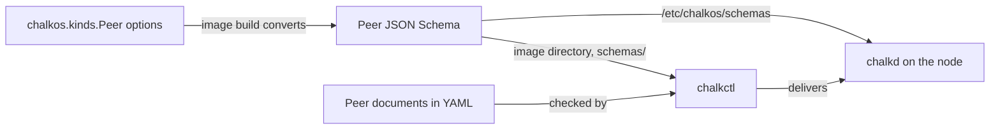

# Declare a config kind

This page is for an image author whose service needs a value that differs from node to node. At
the end the image declares a kind of its own, each node's YAML holds documents of that kind, and
chalkctl refuses a misspelled field before anything reaches a node. The page builds the `Peer`
kind of the homelab's BGP extension, `extensions/bgp.nix`, which holds the neighbours bird
connects to.

## Before you begin

You need a flake that builds the cluster's images, as
[Your first image flake](first-image.md) writes one, and its inventory with the nodes' config
files. The kind goes into a NixOS module of the images. An extension is such a module: it declares
a kind and the services that read its documents.

## Declare the kind in a module

`chalkos.kinds.<Kind>` declares a kind by its name. Here is `Peer`, as `extensions/bgp.nix`
declares it:

```nix
--8<-- "examples/homelab/extensions/bgp.nix:kind"
```

The declaration sets four things:

- `group` is a DNS name you control. chalkos keeps `chalkos.dev` and its subdomains for its own
  kinds, and the build refuses a kind of yours in them.
- `version` is the kind's API version, such as `v1alpha1` or `v1`. A document names group and
  version together as its `apiVersion`, here `bgp.example.org/v1alpha1`.
- `multiple = true` lets a node hold several `Peer` documents, each with a name of its own.
  Without it, a node holds at most one document of the kind.
- `spec` declares the document's fields as NixOS options, under the names the YAML uses.

A field without a default is required. `password` has the default `null`, so a `Peer` may leave
it out. A kind's name starts with a capital letter and holds letters and digits alone.

`address` is a `strMatching` string that accepts an IPv4 or IPv6 address alone. A field whose
value lands in a config file needs a type that accepts valid values alone. Without the pattern,
a value such as `10.0.0.2; import all` would add a statement of its own to `bird.conf`. With it,
`chalkctl validate` refuses the document before it reaches a node.

Put the module where the nodes that carry `Peer` documents get it. The homelab has one variant,
so `bgp.nix` sits in `variants.node.modules`. A module in `modules` reaches every variant. A node
whose image lacks the kind refuses a config that holds a document of it.

## The build writes the kind's JSON Schema

The image build converts the options into a JSON Schema, draft 2020-12. It writes the schema
into the image directory's `schemas/` and into the image itself, at `/etc/chalkos/schemas`. Here
is `images/node-metal/schemas/bgp.example.org_v1alpha1_Peer.json`, trimmed to the `spec` and the
kind. The document's `required`, `additionalProperties` and `metadata`, the fields' `examples`
and the `description` of `password` are left out:

```json
{
  "$schema": "https://json-schema.org/draft/2020-12/schema",
  "title": "Peer",
  "type": "object",
  "properties": {
    "apiVersion": {"const": "bgp.example.org/v1alpha1"},
    "kind": {"const": "Peer"},
    "spec": {
      "type": "object",
      "additionalProperties": false,
      "required": ["address", "asn"],
      "properties": {
        "address": {
          "type": "string",
          "pattern": "^(?:([0-9]{1,3}\\.){3}[0-9]{1,3}|[0-9A-Fa-f]{0,4}(:[0-9A-Fa-f]{0,4}){2,7})$",
          "description": "IPv4 or IPv6 address of the neighbour."
        },
        "asn": {
          "type": "integer",
          "minimum": 1,
          "maximum": 4294967295,
          "description": "AS number of the neighbour.",
          "x-chalkos-rules": [
            {
              "rule": "self == oldSelf",
              "messageExpression": "\"the AS number stays \" + string(oldSelf) + \"; add a Peer of another name for \" + string(self)",
              "takes": "refuse"
            }
          ]
        },
        "password": {
          "anyOf": [
            {
              "type": "object",
              "additionalProperties": false,
              "required": ["secretRef"],
              "properties": {
                "secretRef": {
                  "type": "object",
                  "additionalProperties": false,
                  "required": ["key", "name"],
                  "properties": {
                    "key": {"type": "string", "minLength": 1},
                    "name": {"type": "string", "minLength": 1}
                  }
                }
              },
              "x-chalkos-secret-ref": true
            },
            {"type": "null"}
          ],
          "default": null
        }
      }
    }
  },
  "x-chalkos-kind": {"group": "bgp.example.org", "kind": "Peer", "multiple": true, "version": "v1alpha1"}
}
```

Each part of the schema comes from the options:

- `additionalProperties: false` refuses a field the kind does not declare.
- `required` lists the fields without a default.
- `strMatching` becomes a `pattern` anchored at both ends.
- `ints.between 1 4294967295` becomes `minimum` and `maximum`.
- `description`, `default` and `example` carry over, the example as `examples`.
- `x-chalkos-rules` holds the field's change rules, and `x-chalkos-kind` holds the kind's group,
  version and `multiple`.

chalkctl and chalkd check every document against these schemas:



The diagram shows the options becoming one schema, which the image carries to both checks.
chalkctl checks the YAML against the image directory's copy before it sends anything. chalkd
checks the set again on arrival, against the schemas of the image the set is for, and fills in
the defaults.

## Each node's YAML holds documents of the kind

A `Peer` document has the fields of every config document: `apiVersion`, `kind`, `metadata.name`
and `spec`. Every homelab node peers with the same two routers, so the documents sit in a file
every node gets:

```yaml title="cluster/bgp.yaml"
# The home lab's two routers, which every node peers with over BGP; router-a asks for a password.
apiVersion: bgp.example.org/v1alpha1
kind: Peer
metadata: {name: router-a}
spec:
  address: 10.0.0.1
  asn: 64513
  password: {secretRef: {name: bgp, key: password}}
---
apiVersion: bgp.example.org/v1alpha1
kind: Peer
metadata: {name: router-b}
spec: {address: 10.0.0.2, asn: 64514}
---
# An example value: put router-a's password here, and keep the file out of a public repository.
apiVersion: chalkos.dev/v1alpha1
kind: Secret
metadata: {name: bgp}
spec:
  data: {password: example-password}
```

A node that needs other neighbours gets its `Peer` documents in its own file instead, and the
shared file leaves them out. Documents never merge. The `password` field and the `Secret` are the
subject of [Pass secrets to a service](pass-secrets.md).

## chalkctl validate refuses a misspelled field

`chalkctl validate` checks each node's set against the schemas of the image the inventory gives
it. It reaches no node and needs no secrets file. With `asn` misspelled as `asm` in `router-a`,
it refuses both nodes:

```console
$ chalkctl validate
chalkctl: the config of 2 nodes is invalid:
node cp1: Peer "router-a": - at '/spec': additional properties 'asm' not allowed
- at '/spec': missing property 'asn'
node w1: Peer "router-a": - at '/spec': additional properties 'asm' not allowed
- at '/spec': missing property 'asn'
```

Each error names the node, the document and the path in it. `asm` is a field the kind does not
declare, and `asn` is required, so the one typo gives two errors. `chalkctl install`,
`apply-config` and `upgrade` run the same check before they deliver.

## Field types map to JSON Schema

A field's option type decides its schema. The converter knows these types:

| Option type | JSON Schema |
| --- | --- |
| `str` | `string` |
| `nonEmptyStr` | `string` with `minLength: 1` |
| `strMatching "<regex>"` | `string` with `pattern` anchored at both ends |
| `bool` | `boolean` |
| `int` | `integer` |
| `ints.u8`, `ints.u16`, `ints.u32`, `ints.s8`, `ints.s16`, `ints.s32`, `port` | `integer` with the type's `minimum` and `maximum` |
| `ints.unsigned`, `ints.positive` | `integer` with `minimum` 0 or 1 |
| `ints.between <low> <high>` | `integer` with `minimum` and `maximum` |
| `float` | `number` |
| `enum [ ... ]` | `enum` with the values |
| `nullOr <type>` | `anyOf` the type and `null` |
| `listOf <type>`, `nonEmptyListOf <type>` | `array` of the type; the second with `minItems: 1` |
| `attrsOf <type>`, `lazyAttrsOf <type>` | `object` whose values have the type |
| `submodule { options = ...; }` | `object` with the submodule's options, refusing others |
| `lib.chalkos.types.secretRef` | `object` holding `secretRef` with `name` and `key` |

A pattern of `strMatching` is a POSIX regular expression to Nix and an ECMA-262 one to JSON
Schema. Keep to their common subset: character classes such as `[[:alpha:]]` differ between the
two.

Any other type fails the image's evaluation and names the field. A field of type `path` fails
like this:

```text
error: chalkos.kinds.Peer.spec.keyFile: the option type absolute path has no JSON Schema mapping. Kinds accept str,
nonEmptyStr, strMatching, bool, int, ints.*, port, float, enum, nullOr, listOf, attrsOf,
submodule and lib.chalkos.types.secretRef.
```

## Field rules need lib.chalkos.mkOption

`lib.chalkos.mkOption` is `lib.mkOption` with one more argument, `rules`, a list of change
rules. `lib.mkOption` takes no `rules`. Use `lib.mkOption` for a field without rules, as
`address` and `password` do, and `lib.chalkos.mkOption` for a field with them, as `asn` does.
Both produce the same schema apart from `x-chalkos-rules`.

A change rule is a CEL expression that every config the node accepts makes true. In the rule,
`self` is the field's new value and `oldSelf` its value in the config the node runs. `asn`'s rule
`self == oldSelf` keeps a `Peer`'s AS number once the node runs it, because a new AS number is a
new neighbour. A rule over all of a kind's documents goes into `chalkos.kinds.<Kind>.rules`
instead. [Guard changes with rules and facts](guard-changes.md) covers both, and the facts a
rule reads about the node.

The `rules` argument exists only on `lib.chalkos`, which every image module gets as part of
`lib`. `lib.chalkos.types.secretRef` comes from the same place.

## A new version of a kind is a new set of documents

An image declares one version of each kind, and chalkos converts no document from one version to
another. Changes that keep existing documents valid need no new version:

- a new field with a default;
- a looser type, such as a wider integer range.

Other changes refuse documents the nodes already hold. A new required field, a removed field or
a narrower type are among them. Make such a change a new `version`, and change the documents'
`apiVersion` in the same commit as the module. `chalkctl upgrade` checks the documents against
the new image's schemas and delivers them with the image. The image before keeps its own config
slot with the old documents, so a fallback boots with the config it ran.

## The homelab declares two more kinds

The homelab's other two extensions declare kinds the same way:

- `extensions/rack.nix` declares `Rack`, a node's rack position, in the group
  `rack.example.org`. Its one field has a rule that reads a fact, so a surveyed node accepts no
  location other than the one the survey found.
- `extensions/hardware.nix` declares `Hardware`, the server's vendor, model and asset tag. An
  output renders it into an environment file that a unit reads.

## Check that it worked

Build the image and validate the inventory:

```sh
nix build .#node-metal -o images/node-metal
chalkctl validate
```

`images/node-metal/schemas/` holds `bgp.example.org_v1alpha1_Peer.json`, and `chalkctl validate`
prints a line per node:

```text
cp1: valid for the image node-metal (node on metal, root hash d871203debfe), config 675850c48eaffe4a755dca41652dbf65a5b7959f1e70a3cdd2a94799136fd200
w1: valid for the image node-metal (node on metal, root hash d871203debfe), config 82ec5bbabd10ec79bf76ad892a0bcd7627c9db2ed4c9e252ad0657313359254c
```

`chalkctl validate` refuses a document of a kind the image does not declare. If it names `Peer`
as unknown, the node's image lacks the module: check the variant's `modules`, and that git
tracks the new file.

## What next

- [Read config in a service](read-config.md) gives a unit the `Peer` documents.
- [Render config files](render-config.md) renders bird's config from the `Peer` documents.
- [Config and the inventory](../how-it-works/node/config.md) explains how the documents reach the
  nodes.
