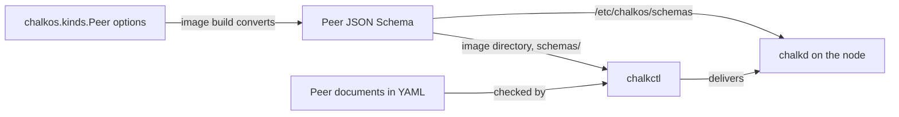

# Declare a config kind

This page is for an image author whose service needs a value that differs from node to node. At
the end the image declares a kind of its own, each node's YAML holds documents of that kind, and
chalkctl refuses a misspelled field before anything reaches a node. The page builds the `Peer`
kind of the homelab's BGP extension, `extensions/bgp.nix`, which holds the neighbours bird runs
sessions with, and its `Speaker` kind, of which a node holds one.

## Before you begin

You need a flake that builds the cluster's images, as
[Your first image flake](first-image.md) writes one, and its inventory with the nodes' config
files. The kind goes into a NixOS module of the images. An extension is such a module: it declares
a kind and the services that read its documents.

## Declare the kind in a module

`chalkos.kinds.<Kind>` declares a kind by its name. Here is `Peer`, as `extensions/bgp.nix`
declares it:

```nix
--8<-- "examples/homelab/extensions/bgp.nix:kind"
```

The declaration sets five things:

- `group` is a DNS name you control. chalkos keeps `chalkos.dev` and its subdomains for its own
  kinds, and the build refuses a kind of yours in them.
- `version` is the kind's API version, such as `v1alpha1` or `v1`. A document names group and
  version together as its `apiVersion`, here `bgp.example.org/v1alpha1`.
- `description` is a sentence that says what a document of the kind is for. The kind's schema
  carries it as its own `description`. A kind may leave it out.
- `multiple = true` lets a node hold several `Peer` documents, each with a name of its own.
  Without it, a node holds at most one document of the kind, as
  [A kind can hold one document per node](#a-kind-can-hold-one-document-per-node) shows.
- `spec` declares the document's fields as NixOS options, under the names the YAML uses.

A field without a default is required. `password` has the default `null` and `bfd` the default
`true`, so a `Peer` may leave both out. A kind's name starts with a capital letter and holds
letters and digits alone.

`address` has the type `lib.chalkos.types.address`, which accepts an IPv4 or IPv6 address alone,
and a rule keeps it to IPv6. A field whose value lands in a config file needs a type that accepts
valid values alone. Without it, a value such as `fdc8:a1b2:c3d4:1::1; import all` would add a
statement of its own to `bird.conf`. With it, `chalkctl validate` refuses the document before it
reaches a node. For the same reason, a `strMatching` pattern keeps each name of `interfaces` to
the characters of an interface name.

Put the module where the nodes that carry `Peer` documents get it. The homelab's nodes run the
variant `node`, so `extensions/default.nix`, which imports `bgp.nix`, sits in
`variants.node.modules`, and the router's image takes no `Peer`. A module in `modules` reaches
every variant. A node whose image lacks the kind refuses a config that holds
a document of it.

## A kind can hold one document per node

bird needs the node's own AS number and router ID beside its neighbours. `extensions/bgp.nix`
declares them in a second kind, `Speaker`, without `multiple`:

```nix
--8<-- "examples/homelab/extensions/bgp.nix:speaker"
```

A node holds one `Speaker` at most, and chalkctl refuses a second one. Its `export.interfaces`
shows a nested field: an attribute set of options in `spec` becomes an object of the schema. The
rule of `routerID` refuses `0.0.0.0`, which the pattern of an IPv4 address accepts. A `Speaker`
differs from node to node, because each node needs a router ID of its own, so it sits in each
node's file:

```yaml title="nodes/node1.yaml"
apiVersion: bgp.example.org/v1alpha1
kind: Speaker
metadata: {name: bgp}
spec:
  asn: 65001
  routerID: 0.0.0.11
  export: {interfaces: [node0]}
```

## The build writes the kind's JSON Schema

The image build converts the options into a JSON Schema, draft 2020-12. It writes the schema
into the image directory's `schemas/` and into the image itself, at `/etc/chalkos/schemas`. Here
is `images/node-metal/schemas/bgp.example.org_v1alpha1_Peer.json`, trimmed to the `spec` and the
kind. The document's `required`, `additionalProperties` and `metadata`, the fields' `examples`
and the `description` of `password` are left out:

```json
{
  "$schema": "https://json-schema.org/draft/2020-12/schema",
  "title": "Peer",
  "description": "A BGP neighbour that the node's bird runs a session with on each of the given interfaces.",
  "type": "object",
  "properties": {
    "apiVersion": {"const": "bgp.example.org/v1alpha1"},
    "kind": {"const": "Peer"},
    "spec": {
      "type": "object",
      "additionalProperties": false,
      "required": ["address", "asn", "interfaces"],
      "properties": {
        "address": {
          "type": "string",
          "format": "ip",
          "description": "IPv6 address of the neighbour, on the subnet of the interfaces the sessions run on.",
          "x-chalkos-rules": [
            {
              "rule": "ip(self).family() == \"ipv6\"",
              "description": "A neighbour has an IPv6 address.",
              "messageExpression": "self + \" is no IPv6 address; bird runs IPv6 sessions alone\"",
              "takes": "refuse"
            }
          ]
        },
        "asn": {
          "type": "integer",
          "minimum": 1,
          "maximum": 4294967295,
          "description": "AS number of the neighbour.",
          "x-chalkos-rules": [
            {
              "rule": "self == oldSelf",
              "description": "A Peer keeps its AS number.",
              "messageExpression": "\"the AS number stays \" + string(oldSelf) + \"; add a Peer of another name for \" + string(self)",
              "takes": "refuse"
            }
          ]
        },
        "interfaces": {
          "type": "array",
          "minItems": 1,
          "items": {"type": "string", "pattern": "^(?:[A-Za-z0-9_.-]{1,15})$"},
          "description": "Interfaces on which bird runs a session with the neighbour, one each, bound to the interface.",
          "x-chalkos-unique": [{"across": "list", "hint": "list each interface once"}]
        },
        "password": {
          "anyOf": [
            {
              "type": "object",
              "additionalProperties": false,
              "required": ["secretRef"],
              "properties": {
                "secretRef": {
                  "type": "object",
                  "additionalProperties": false,
                  "required": ["key", "name"],
                  "properties": {
                    "key": {"type": "string", "minLength": 1},
                    "name": {"type": "string", "minLength": 1}
                  }
                }
              },
              "x-chalkos-ref": {"apiVersion": "chalkos.dev/v1alpha1", "kind": "Secret", "key": true}
            },
            {"type": "null"}
          ],
          "default": null
        },
        "bfd": {
          "type": "boolean",
          "default": true,
          "description": "Whether BFD watches each session, so that bird ends it within about a second of its link failing."
        }
      }
    }
  },
  "x-chalkos-kind": {"group": "bgp.example.org", "kind": "Peer", "multiple": true, "version": "v1alpha1"}
}
```

Each part of the schema comes from the options:

- `additionalProperties: false` refuses a field the kind does not declare.
- `required` lists the fields without a default.
- `lib.chalkos.types.address` becomes `format: ip`, which chalkctl and chalkd check.
- `ints.between 1 4294967295` becomes `minimum` and `maximum`.
- `nonEmptyListOf` becomes an `array` with `minItems: 1`, and `strMatching` a `pattern` anchored
  at both ends.
- `unique` becomes `x-chalkos-unique`, which chalkctl and chalkd check.
- The kind's `description`, and its fields' `description`, `default` and `example`, carry
  over, the example as `examples`.
- `x-chalkos-rules` holds the field's change rules, and `x-chalkos-kind` holds the kind's group,
  version and `multiple`. A kind of chalkos's own layers can also carry `withheld: true` there:
  the node keeps its documents from its services, as
  [Withheld kinds stay out of /run](../how-it-works/node/config.md#withheld-kinds-stay-out-of-run)
  describes.

chalkctl and chalkd check every document against these schemas:



The diagram shows the options becoming one schema, which the image carries to both checks.
chalkctl checks the YAML against the image directory's copy before it sends anything. chalkd
checks the set again on arrival, against the schemas of the image the set is for, and fills in
the defaults.

## Each node's YAML holds documents of the kind

A `Peer` document has the fields of every config document: `apiVersion`, `kind`, `metadata.name`
and `spec`. Every homelab node peers with the same router on the same two ports, so the `Peer`
sits in a file that the inventory's group `nodes` gives every node:

```yaml title="bgp/fabric.yaml"
--8<-- "examples/homelab/bgp/fabric.yaml"
```

A node that needs other neighbours gets its `Peer` documents in its own file instead, and leaves
the shared file out. Documents never merge. The `password` field and the `Secret` are the
subject of [Pass secrets to a service](pass-secrets.md).

## chalkctl validate refuses a misspelled field

`chalkctl validate` checks each node's set against the schemas of the image the inventory gives
it. It reaches no node and needs no secrets file. With `asn` misspelled as `asm` in `router`,
it refuses the three nodes:

```console
$ chalkctl validate
chalkctl: the config of 3 nodes is invalid:
node node1: Peer "router": - at '/spec': additional properties 'asm' not allowed
- at '/spec': missing property 'asn'
node node2: Peer "router": - at '/spec': additional properties 'asm' not allowed
- at '/spec': missing property 'asn'
node node3: Peer "router": - at '/spec': additional properties 'asm' not allowed
- at '/spec': missing property 'asn'
```

Each error names the node, the document and the path in it. `asm` is a field the kind does not
declare, and `asn` is required, so the one typo gives two errors. `chalkctl install`,
`config apply` and `upgrade` run the same check before they deliver.

## Field types map to JSON Schema

A field's option type decides its schema. The converter knows these types:

| Option type | JSON Schema |
| --- | --- |
| `str` | `string` |
| `nonEmptyStr` | `string` with `minLength: 1` |
| `strMatching "<regex>"` | `string` with `pattern` anchored at both ends |
| `bool` | `boolean` |
| `int` | `integer` |
| `ints.u8`, `ints.u16`, `ints.u32`, `ints.s8`, `ints.s16`, `ints.s32`, `port` | `integer` with the type's `minimum` and `maximum` |
| `ints.unsigned`, `ints.positive` | `integer` with `minimum` 0 or 1 |
| `ints.between <low> <high>` | `integer` with `minimum` and `maximum` |
| `float` | `number` |
| `enum [ ... ]` | `enum` with the values |
| `nullOr <type>` | `anyOf` the type and `null` |
| `listOf <type>`, `nonEmptyListOf <type>` | `array` of the type; the second with `minItems: 1` |
| `attrsOf <type>`, `lazyAttrsOf <type>` | `object` whose values have the type |
| `submodule { options = ...; }` | `object` with the submodule's options, refusing others |
| `lib.chalkos.types.ref "<Kind>"`, `lib.chalkos.types.ref { kind = "<Kind>"; reserved = [ ... ]; }` | `string` with the pattern of a document name, and `x-chalkos-ref` with the kind's `apiVersion`, the `kind` and `reserved` |
| `lib.chalkos.types.secretRef` | `object` holding `secretRef` with `name` and `key` |
| `lib.chalkos.types.address` | `string` with `format: ip` |
| `lib.chalkos.types.prefix` | `string` with `format: cidr` |
| `lib.chalkos.types.portRange` | `anyOf` an `integer` from 1 to 65535 and a `string` with `format: port-range` |
| `lib.chalkos.types.imageReference` | `string` with `format: image-reference` |

A pattern of `strMatching` is a POSIX regular expression to Nix and an ECMA-262 one to JSON
Schema. Keep to their common subset: character classes such as `[[:alpha:]]` differ between the
two.

Any other type fails the image's evaluation and names the field. A field of type `path` fails
like this:

```text
error: chalkos.kinds.Peer.spec.keyFile: the option type absolute path has no JSON Schema mapping. Kinds accept str,
nonEmptyStr, strMatching, bool, int, ints.*, port, float, enum, nullOr, listOf, attrsOf,
submodule and the types of lib.chalkos.types.
```

## Field rules need lib.chalkos.mkOption

`lib.chalkos.mkOption` is `lib.mkOption` with three more arguments: `rules`, a list of change
rules; `unique`, which [A field's values can be unique](#a-fields-values-can-be-unique)
describes; and `maxItems`, the most items a list field holds, which the schema checks.
`lib.mkOption` takes none of them. Use `lib.mkOption` for a field without them, as `password`
and `bfd` do, and `lib.chalkos.mkOption` for a field with them, as `address`, `asn` and
`interfaces` do. Both produce the same schema apart from `x-chalkos-rules`, `x-chalkos-unique`
and `maxItems`. The build fails on a `maxItems` on a field that is no list, or one that is no
positive integer.

A change rule is a CEL expression that every config the node accepts makes true. In the rule,
`self` is the field's new value and `oldSelf` its value in the config the node runs. `asn`'s rule
`self == oldSelf` keeps a `Peer`'s AS number once the node runs it, because a new AS number is a
new neighbour. A rule over all of a kind's documents goes into `chalkos.kinds.<Kind>.rules`
instead, and a rule that compares fields of one document into `chalkos.kinds.<Kind>.specRules`.
[Guard changes with rules and facts](guard-changes.md) covers all three, and the facts a rule
reads about the node.

The `rules`, `unique` and `maxItems` arguments exist only on `lib.chalkos`, which every image
module gets as part of `lib`. The types of `lib.chalkos.types` come from the same place.

## A field can name a document of another kind

`lib.chalkos.types.ref` declares a field that holds the name of a document of another kind, as
`metadata.name` writes it. The field names the kind without its group: kind names are unique
within an image, and the build fills in the `apiVersion`.

```nix
{ lib, ... }:
{
  chalkos.kinds.Session = {
    group = "bgp.example.org";
    version = "v1alpha1";
    multiple = true;
    spec = {
      peer = lib.mkOption {
        type = lib.chalkos.types.ref "Peer";
        description = "Peer the session runs to.";
      };
      table = lib.mkOption {
        type = lib.chalkos.types.ref {
          kind = "Table";
          reserved = [ "main" ];
        };
        default = "main";
        description = "Table the session's routes go into; main is the kernel's own table.";
      };
    };
  };
}
```

The type works inside `nullOr`, `listOf`, `attrsOf` and submodules.

- The image build fails when the image declares no kind of the name a reference gives.
- chalkctl and chalkd refuse a config in which a reference names a document the config lacks.
  They report every such reference at once, one line each, before any rule runs:

  ```text
  Session/upstream: spec.peer: Peer "router-c" does not exist
  ```

  A config that drops a document other documents name is refused the same way, with a line for
  each document that still names it.
- `reserved` lists names that stand for something that is no document, such as `main` here. The
  field takes them as they are, and no document of the target kind may have such a name: a
  `Table` named `main` is refused.

A rule reads the document a reference names with `document(kind, name)`, which
[Guard changes with rules and facts](guard-changes.md#rules-call-cels-functions-and-chalkoss)
describes.

## A field's values can be unique

`unique` on `lib.chalkos.mkOption` declares values that must not repeat, and
`chalkos.kinds.<Kind>.unique` declares tuples of spec fields that no two documents share.
chalkctl and chalkd check every declaration with the rest of the set, before any rule runs, so
a kind needs no rule for them. Here a `Session` takes each local port once, lists each neighbour
once, and runs one session per peer and table:

```nix
{ lib, ... }:
{
  chalkos.kinds.Session = {
    group = "bgp.example.org";
    version = "v1alpha1";
    multiple = true;
    unique = [
      {
        by = [ "peer" "table" ];
        hint = "give each peer one session per table";
      }
    ];
    spec = {
      peer = lib.mkOption { type = lib.chalkos.types.ref "Peer"; };
      table = lib.mkOption {
        type = lib.types.str;
        default = "main";
      };
      port = lib.chalkos.mkOption {
        type = lib.types.port;
        unique = true;
        description = "Local TCP port of the session.";
      };
      neighbours = lib.chalkos.mkOption {
        type = lib.types.listOf (
          lib.types.submodule {
            options.address = lib.mkOption { type = lib.types.str; };
            options.asn = lib.mkOption { type = lib.types.ints.u32; };
          }
        );
        default = [ ];
        unique = {
          by = [
            {
              field = "address";
              as = "ip";
            }
          ];
          hint = "list each neighbour once";
        };
      };
    };
  };
}
```

`unique` takes `true`, one declaration, or a list of declarations, each checked on its own. A
declaration has these attributes:

| Attribute | Meaning |
| --- | --- |
| `across` | `"kind"` compares the values of all the node's documents of the kind, `"list"` the items of one list. The default is `"list"` for a list with `by` and `"kind"` otherwise. |
| `by` | The fields of a list's items, or of an object, that make up the key, each a field name or `{ field; as; }`. Without `by`, the key is the value itself, or each item of a list of values. |
| `as` | The normaliser of a key without `by`. |
| `hint` | What to do instead, which ends the refusal. |

`unique = true` on a single value compares it across the kind's documents. On a list of values,
it compares each item across the kind, so a value listed twice in one document is refused too.
`chalkos.kinds.<Kind>.unique` takes a list of `{ by; hint; }`, whose `by` names fields of the
spec and compares across the kind.

A normaliser changes how a value compares. The message still shows the value as written:

| `as` | Compares |
| --- | --- |
| `ip` | as an address, as the rules' `ip()` reads it: `2001:db8::1` equals `2001:db8:0::1`. |
| `cidr` | as an address range with its host bits cleared, as `cidr()` reads it: `10.1.0.0/8` equals `10.0.0.0/8`. |
| `host` | as a registry host, in lower case and with `docker.io` as `index.docker.io`. A port stays, so `ghcr.io:443` and `ghcr.io` differ. |
| `lower` | in lower case. |

A null value or a field left out takes no part. A key of several fields takes part when one of
them holds a value, and a null field then equals another null field. A value its normaliser
cannot read takes no part either; give the field a type or a rule that refuses such values.

chalkctl and chalkd report every repeated value at once, one line each, sorted:

```text
Session/a, Session/b: (spec.peer, spec.table) ("router-a", "main") is not unique; give each peer one session per table
Session/a, Session/b: spec.port 1179 is not unique
Session/up: spec.neighbours[0].address, spec.neighbours[2].address: "2001:db8::1" is not unique; list each neighbour once
```

The image build fails on a declaration that does not fit its field: an unknown normaliser, `by`
on a list of values, `across = "list"` on a field that is no list, a `by` field the items lack or
one that holds a list or an object, `as` on a field that may hold a value other than a string (an
`enum` of strings holds strings only), and a declaration on a `secretRef`.

## A new version of a kind is a new set of documents

An image declares one version of each kind, and chalkos converts no document from one version to
another. Changes that keep existing documents valid need no new version:

- a new field with a default;
- a looser type, such as a wider integer range.

Other changes refuse documents the nodes already hold. A new required field, a removed field or
a narrower type are among them. Make such a change a new `version`, and change the documents'
`apiVersion` in the same commit as the module. `chalkctl upgrade` checks the documents against
the new image's schemas and delivers them with the image. The image before keeps its own config
slot with the old documents, so a fallback boots with the config it ran.

## The extensions example declares two more kinds

The [extensions example](https://github.com/trevex/chalkos/tree/main/examples/extensions) declares
two more kinds the same way:

- `rack.nix` declares `Rack`, a node's rack position, in the group
  `rack.example.org`. Its one field has a rule that reads a fact, so a surveyed node accepts no
  location other than the one the survey found.
- `hardware.nix` declares `Hardware`, the server's vendor, model and asset tag. An
  output renders it into an environment file that a unit reads.

## Check that it worked

Build the image and validate the inventory:

```sh
nix build .#router-metal -o images/router-metal
nix build .#node-metal -o images/node-metal
chalkctl validate
```

`images/node-metal/schemas/` holds `bgp.example.org_v1alpha1_Peer.json` and
`bgp.example.org_v1alpha1_Speaker.json`, and `chalkctl validate` prints a line per node, the
router among them:

```text
node1: valid for the image node-metal (node on metal, root hash d871203debfe), config c2bef3c1242a847b16346d3e1f6de732a86832fa8294ce90e923bad30c85e6bf
node2: valid for the image node-metal (node on metal, root hash d871203debfe), config afa765d5e8029dbe3aea1a589d2dafdf260de42fff21692656891ddde062d567
node3: valid for the image node-metal (node on metal, root hash d871203debfe), config 719604db3fd2c0634df350fc6b7760bba57de0ec82ac3fb9a9b2dcf532cfdc43
router: valid for the image router-metal (router on metal, root hash e9be19557973), config a8d132f3d5517185654d573c02c543497ab42d0068131d25bbfe8405d5761093
```

`chalkctl validate` refuses a document of a kind the image does not declare. If it names `Peer`
as unknown, the node's image lacks the module: check the variant's `modules`, and that git
tracks the new file.

## What next

- [Read config in a service](read-config.md) gives a unit the `Peer` documents.
- [Render config files](render-config.md) renders bird's config from the `Speaker` and `Peer`
  documents.
- [Validate config with a program](validate-config.md) refuses an interface the node does not
  configure.
- [Config and the inventory](../how-it-works/node/config.md) explains how the documents reach the
  nodes.
