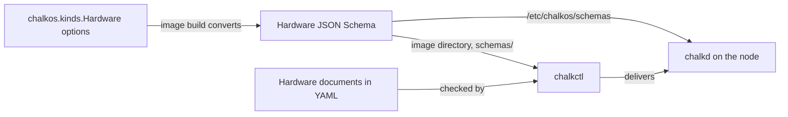

# Declare a config kind

This page is for an image author whose service needs a value that differs from node to node. At
the end the image declares a kind of its own, each node's YAML holds documents of that kind, and
chalkctl refuses a misspelled field before anything reaches a node. The examples use the
`Hardware` kind of the [extensions example](https://github.com/trevex/chalkos/tree/main/examples/extensions),
which records a node's server vendor and model.

See it in a full extension: [Declare the kinds](../guides/bgp-extension.md#declare-the-kinds) of
the BGP guide declares two kinds with rules and nested fields.

## Before you begin

You need a flake that builds the cluster's images, as
[Your first image flake](first-image.md) writes one, and its inventory with the nodes' config
files. The kind goes into a NixOS module of the images. An extension is such a module: it declares
a kind and the services that read its documents.

## Declare the kind in a module

`chalkos.kinds.<Kind>` declares a kind by its name. Here is `Hardware`, as `hardware.nix`
declares it, with the output that renders its documents:

```nix title="hardware.nix"
--8<-- "examples/extensions/hardware.nix:head"
```

The declaration sets these attributes:

- `group` is a DNS name you control. chalkos keeps `chalkos.dev` and its subdomains for its own
  kinds, and the build refuses a kind of yours in them.
- `version` is the kind's API version, such as `v1alpha1` or `v1`. A document names group and
  version together as its `apiVersion`, here `hardware.example.org/v1alpha1`.
- `description` is a sentence that says what a document of the kind is for. The kind's schema
  carries it as its own `description`. A kind may leave it out.
- `multiple = true` lets a node hold several documents of the kind, each with a name of its own.
  `Hardware` leaves it out, as
  [Hold one document per node](#hold-one-document-per-node) describes.
- `spec` declares the document's fields as NixOS options, under the names the YAML uses.

A field without a default is required. `assetTag` has the default `null`, so a `Hardware` may
leave it out. A kind's name starts with a capital letter and holds letters and digits alone.
[Render config files](render-config.md) covers `chalkos.outputs.hardware`.

A field whose value lands in a config file needs a type that accepts valid values alone.
Otherwise a value could add a statement of its own to that file. With a narrow type,
`chalkctl validate` refuses such a document before it reaches a node.

Put the module where the nodes that carry the kind's documents get it. The extensions example
lists its directory in the `modules` of the image `node-metal`, and its `default.nix` imports
`hardware.nix`. A module in the `modules` of `mkImages` reaches every image. A node whose image
lacks the kind refuses a config that holds a document of it.

## Hold one document per node

Without `multiple`, a node holds one document of the kind at most, and chalkctl refuses a
second one. A server has one vendor and model, so `Hardware` has no `multiple`. A kind whose
documents a node may hold several of sets it:

```nix
{ chalkosLib, lib, ... }:
{
  chalkos.kinds.Backend = {
    group = "myapp.example.org";
    version = "v1alpha1";
    multiple = true;
    spec = {
      address = lib.mkOption {
        type = chalkosLib.types.address;
        description = "Address of the backend.";
      };
      health.path = lib.mkOption {
        type = lib.types.str;
        default = "/healthz";
        description = "Path the web server asks to learn whether the backend is up.";
      };
    };
  };
}
```

`health.path` shows a nested field: an attribute set of options in `spec` becomes an object of
the schema, so a document writes `health: {path: /ready}`.

## Look at the kind's JSON Schema

The image build converts the options into a JSON Schema, draft 2020-12. It writes the schema
into the image directory's `schemas/` and into the image itself, at `/etc/chalkos/schemas`.

You can look at a schema without building the image. The schemas are a build output of their own,
`system.build.chalkosSchemas`, which builds in seconds. The extensions example's flake exports the
images' evaluated NixOS systems as `nixosConfigurations`:

```nix
nixosConfigurations = chalkos.lib.nixosOf images;
```

Build the schemas and print the parts of `Hardware`'s schema that the fields do not give:

```console
$ nix build .#nixosConfigurations.node-metal.config.system.build.chalkosSchemas
$ jq '{title, required, "x-chalkos-kind"}' result/hardware.example.org_v1alpha1_Hardware.json
{
  "title": "Hardware",
  "required": [
    "apiVersion",
    "kind",
    "metadata",
    "spec"
  ],
  "x-chalkos-kind": {
    "group": "hardware.example.org",
    "kind": "Hardware",
    "multiple": false,
    "version": "v1alpha1"
  }
}
```

`.properties.spec` holds the fields, as
[Look at the kind's schema](first-extension.md#look-at-the-kinds-schema) of the first extension
shows. A field with a rule carries it in `x-chalkos-rules`. Here is the `location` field of the
example's `Rack` kind:

```console
$ jq .properties.spec.properties.location result/rack.example.org_v1alpha1_Rack.json
{
  "description": "Rack and height unit the node is mounted in.",
  "examples": [
    "rack-a/u12"
  ],
  "minLength": 1,
  "type": "string",
  "x-chalkos-rules": [
    {
      "description": "A Rack's location is the one the rack survey found.",
      "messageExpression": "\"the survey found the node at \" + facts.rackSurvey.location + \", not at \" + self + \"; fix the location, or survey the node again\"",
      "rule": "facts.rackSurvey == null || self == facts.rackSurvey.location",
      "takes": "refuse"
    }
  ]
}
```

Each part of the schema comes from the options:

- `additionalProperties: false` refuses a field the kind does not declare.
- `required` lists the fields without a default.
- Each option type becomes a schema, as [Field types](../reference/extension-runtime.md#field-types)
  lists: `nonEmptyStr` becomes a `string` with `minLength: 1`.
- `unique` becomes `x-chalkos-unique`, which chalkctl and chalkd check.
- The kind's `description`, and its fields' `description`, `default` and `example`, carry
  over, the example as `examples`.
- `x-chalkos-rules` holds the field's change rules, and `x-chalkos-kind` holds the kind's group,
  version and `multiple`. A kind of chalkos's own layers can also carry `withheld: true` there:
  the node keeps its documents from its services, as
  [Withheld kinds stay out of /run](../how-it-works/node/config.md#withheld-kinds-stay-out-of-run)
  describes.

`result/` holds a file for each kind the image accepts, chalkos's own among them. The same
outputs show what other guides describe: [Add software and drivers](add-software.md) builds the
image's kernel modules the same way.

chalkctl and chalkd check every document against these schemas:



The diagram shows the options becoming one schema, which the image carries to both checks.
chalkctl checks the YAML against the image directory's copy before it sends anything. chalkd
checks the set again on arrival, against the schemas of the image the set is for, and fills in
the defaults.

## Write documents of the kind

A `Hardware` document has the fields of every config document: `apiVersion`, `kind`,
`metadata.name` and `spec`. Each server differs, so the document sits in the node's own file,
`nodes/server1.yaml`:

```yaml title="nodes/server1.yaml"
apiVersion: hardware.example.org/v1alpha1
kind: Hardware
metadata: {name: hardware}
spec: {vendor: Supermicro, model: SYS-E300-9D, assetTag: HL-0001}
```

A document that several nodes share goes into a file that an inventory group gives each of them.
A node that needs another document gets it in its own file instead, and leaves the shared file
out. Documents never merge.

## Validate the documents

`chalkctl validate` checks each node's set against the schemas of the image the inventory gives
it. It reaches no node and needs no secrets file. In the lab of
[Write your first extension](first-extension.md), with `model` misspelled as `modle` in
`nodes/w1.yaml`, it refuses w1:

```console
$ chalkctl validate
cp1: valid for the image node-kvm (node-kvm on kvm, root hash 5425995f5799), config cff86e2957830b9ec4a10a6f6966660695c5a332fca12103d59f79ab4c1ccc15
chalkctl: the config of 1 node is invalid:
node w1: Hardware "hardware": - at '/spec': additional properties 'modle' not allowed
- at '/spec': missing property 'model'
```

Each error names the node, the document and the path in it. `modle` is a field the kind does not
declare, and `model` is required, so the one typo gives two errors. `chalkctl install`,
`config apply` and `upgrade` run the same check before they deliver.

## Choose each field's type

A field's option type decides its schema. [Field types](../reference/extension-runtime.md#field-types)
lists the types the converter knows and their schemas. Any other type, such as `path`, fails the
image's evaluation and names the field. Keep `strMatching` patterns to the subset that POSIX and
ECMA-262 regular expressions share, because Nix reads a pattern as the first and JSON Schema as
the second.

## Add rules with chalkosLib.mkOption

`chalkosLib.mkOption` is `lib.mkOption` with three more arguments: `rules`, a list of change
rules; `unique`, which [Make a field's values unique](#make-a-fields-values-unique)
describes; and `maxItems`, the most items a list field holds, which the schema checks.
`lib.mkOption` takes none of them. Use `lib.mkOption` for a field without them, as every field
of `Hardware` does, and `chalkosLib.mkOption` for a field with them, as `location` of `Rack`
does. Both produce the same schema apart from `x-chalkos-rules`, `x-chalkos-unique` and
`maxItems`. The build fails on a `maxItems` on a field that is no list, or one that is no
positive integer.

A change rule is a CEL expression that every config the node accepts makes true. In the rule,
`self` is the field's new value and `oldSelf` its value in the config the node runs. A rule
`self == oldSelf` keeps a field's value once the node runs it. A rule over all of a kind's
documents goes into `chalkos.kinds.<Kind>.rules` instead, and a rule that compares fields of one
document into `chalkos.kinds.<Kind>.specRules`.
[Guard changes with rules and facts](guard-changes.md) covers all three, and the facts a rule
reads about the node, such as the rack survey that `location`'s rule reads.

The `rules`, `unique` and `maxItems` arguments exist only on `chalkosLib`, which every image
module gets as a module argument. The types of `chalkosLib.types` come from the same place.

## Name a document of another kind

`chalkosLib.types.ref` declares a field that holds the name of a document of another kind, as
`metadata.name` writes it. The field names the kind without its group: kind names are unique
within an image, and the build fills in the `apiVersion`. Here a `Site` of a web server names the
`Backend` it forwards to, and the `Cache` it keeps responses in:

```nix
{ chalkosLib, lib, ... }:
{
  chalkos.kinds.Site = {
    group = "myapp.example.org";
    version = "v1alpha1";
    multiple = true;
    spec = {
      backend = lib.mkOption {
        type = chalkosLib.types.ref "Backend";
        description = "Backend the site forwards to.";
      };
      cache = lib.mkOption {
        type = chalkosLib.types.ref {
          kind = "Cache";
          reserved = [ "none" ];
        };
        default = "none";
        description = "Cache the site keeps responses in; none keeps none.";
      };
    };
  };
}
```

The type works inside `nullOr`, `listOf`, `attrsOf` and submodules.

- The image build fails when the image declares no kind of the name a reference gives.
- chalkctl and chalkd refuse a config in which a reference names a document the config lacks.
  They report every such reference at once, one line each, before any rule runs:

  ```text
  Site/shop: spec.backend: Backend "app-c" does not exist
  ```

  A config that drops a document other documents name is refused the same way, with a line for
  each document that still names it.
- `reserved` lists names that stand for something that is no document, such as `none` here. The
  field takes them as they are, and no document of the target kind may have such a name. A
  `Cache` named `none` is refused:

  ```text
  Cache "none": - at '/metadata/name': the name "none" is reserved: fields that reference a Cache use it for something other than a document
  ```

A rule reads the document a reference names with `document(kind, name)`, which
[CEL functions](../reference/extension-runtime.md#cel-functions)
describes.

## Make a field's values unique

`unique` on `chalkosLib.mkOption` declares values that must not repeat, and
`chalkos.kinds.<Kind>.unique` declares tuples of spec fields that no two documents share.
chalkctl and chalkd check every declaration with the rest of the set, before any rule runs, so
a kind needs no rule for them. Here each `Site` takes a local port of its own, lists each client
once, and serves a hostname and path that no other `Site` serves:

```nix
{ chalkosLib, lib, ... }:
{
  chalkos.kinds.Site = {
    group = "myapp.example.org";
    version = "v1alpha1";
    multiple = true;
    unique = [
      {
        by = [ "hostname" "path" ];
        hint = "serve each hostname and path from one site";
      }
    ];
    spec = {
      hostname = lib.mkOption { type = lib.types.nonEmptyStr; };
      path = lib.mkOption {
        type = lib.types.str;
        default = "/";
      };
      port = chalkosLib.mkOption {
        type = lib.types.port;
        unique = true;
        description = "Local TCP port of the site.";
      };
      allow = chalkosLib.mkOption {
        type = lib.types.listOf (
          lib.types.submodule {
            options.address = lib.mkOption { type = lib.types.str; };
          }
        );
        default = [ ];
        unique = {
          by = [
            {
              field = "address";
              as = "ip";
            }
          ];
          hint = "list each client once";
        };
      };
    };
  };
}
```

`allow` compares its items by their `address`, read as an address, so two spellings of one
address repeat. [Unique declarations](../reference/extension-runtime.md#unique) lists the
attributes of a declaration, the normalisers of `as` and which values take part. Give a field
with `as` a type or a rule that refuses the values its normaliser cannot read.

chalkctl and chalkd report every repeated value at once, one line each, sorted:

```text
Site/a, Site/b: (spec.hostname, spec.path) ("shop.example.org", "/") is not unique; serve each hostname and path from one site
Site/a, Site/b: spec.port 8080 is not unique
Site/b: spec.allow[0].address, spec.allow[1].address: "2001:db8::1" is not unique; list each client once
```

## Change a kind in a new version

An image declares one version of each kind, and chalkos converts no document from one version to
another. Changes that keep existing documents valid need no new version:

- a new field with a default;
- a looser type, such as a wider integer range.

Other changes refuse documents the nodes already hold. A new required field, a removed field or
a narrower type are among them. Make such a change a new `version`, and change the documents'
`apiVersion` in the same commit as the module. `chalkctl upgrade` checks the documents against
the new image's schemas and delivers them with the image. The image before keeps its own config
slot with the old documents, so a fallback boots with the config it ran.

## Compare with the extensions example's kinds

The [extensions example](https://github.com/trevex/chalkos/tree/main/examples/extensions) declares
two kinds:

- `hardware.nix` declares `Hardware`, the server's vendor, model and asset tag. An
  output renders it into an environment file that a unit reads.
- `rack.nix` declares `Rack`, a node's rack position, in the group
  `rack.example.org`. Its one field has a rule that reads a fact, so a surveyed node accepts no
  location other than the one the survey found.

## Check that it worked

Build the image and validate the inventory:

```sh
nix build .#node-metal -o images/node-metal
chalkctl validate
```

`images/node-metal/schemas/` holds `hardware.example.org_v1alpha1_Hardware.json`, and
`chalkctl validate` prints a line per node, such as the lines of
[Check the config against the image](first-extension.md#check-the-config-against-the-image).

## If it fails

- `chalkctl validate` refuses a document of a kind the image does not declare. If it names
  `Hardware` as unknown, the node's image lacks the module: check the image's `modules`, and that
  git tracks the new file.
- A misspelled or missing field gives one error per path, as
  [Validate the documents](#validate-the-documents) shows.
- An option type the converter does not know fails the image's evaluation and names the field.
  [Field types](../reference/extension-runtime.md#field-types) shows the error.
- A `unique` declaration that does not fit its field fails the image build, as
  [Unique declarations](../reference/extension-runtime.md#unique) lists.

## What next

- [Read config in a service](read-config.md) gives a unit the kind's documents.
- [Render config files](render-config.md) renders a service's config file from the documents.
- [Guard changes with rules and facts](guard-changes.md) refuses a change a node cannot make.
- [Config and the inventory](../how-it-works/node/config.md) explains how the documents reach the
  nodes.
