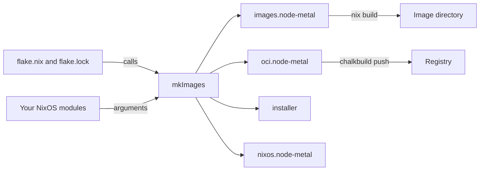

# Your first image flake

This page is for an image author who builds a cluster's images with Nix. At the end you have a
flake that builds one unsigned image into `images/node-metal`, the directory the cluster's
inventory names, and you know what the build writes there and what else `mkImages` returns. The
page follows the
[homelab example](https://github.com/trevex/chalkos/tree/main/examples/homelab): one image for
bare metal, which every node of the cluster runs.

## Before you begin

You need Nix with flakes enabled on an x86-64 Linux machine, and a git repository for the flake.
A flake sees only the files git tracks, so `git add` a new module before you build.

Nix is needed only on the machine that builds images. chalkctl and chalklab never evaluate the
flake: the inventory names the directory a build was linked to, so the machine that runs chalkctl
needs that directory and no Nix.

## The flake calls mkImages

The homelab's flake builds one image, with three extensions that add config kinds:

```nix title="flake.nix"
--8<-- "examples/homelab/flake.nix"
```

The flake takes chalkos as an input and calls `chalkos.lib.mkImages`. `flake.lock` pins the
chalkos version, so the images change only when the lock file or the flake's own modules change.
The call sets three arguments:

- `revision` is the commit the image is built from. chalkctl shows it beside the image's root
  hash.
- `platforms` names the kinds of machine to build for, here `metal` alone.
- `variants.node.modules` adds the extensions' NixOS modules to the one variant, `node`.

`mkImages` returns the image as `images.node-metal`, and the flake exposes it as the package
`node-metal`. One image serves every node of its variant and platform. What differs between
nodes, from their addresses to the cluster's endpoint, is their config: YAML documents that
chalkctl delivers, which [Config and the inventory](../how-it-works/node/config.md) describes.

## mkImages checks its arguments as module options

`mkImages` takes these arguments:

| Argument | Default | What it sets |
| --- | --- | --- |
| `variants` | `{ node = { }; }` | The variants to build, each with its NixOS modules and whether its images run Kubernetes |
| `platforms` | `[ "metal" "kvm" ]` | The platforms every variant is built for, as a list of names or with each platform's modules |
| `modules` | `[ ]` | NixOS modules every variant's images carry |
| `osCA` | `null` | The public part of the cluster's secrets, whose OS CA the images and the installer trust in maintenance mode |
| `installer.modules` | `[ ]` | The installer's own NixOS modules |
| `nixpkgs` | the nixpkgs chalkos is tested against | The nixpkgs the images are evaluated and built from |
| `system` | `x86_64-linux` | The platform the images are built for, as Nix names it |
| `specialArgs` | `{ }` | Extra arguments for every image's modules, such as a flake's inputs |
| `revision` | `null` | The git revision the images are built from |
| `tag` | `null` | The git tag the images are built from, such as a release's |

The arguments are module options, so a misspelled argument fails the evaluation and names the
argument. The [options reference](../reference/options.md) documents each one.
[Variants and platforms](variants-and-platforms.md) covers `variants`, `platforms`, `modules` and
`osCA`.

`revision` and `tag` say where an image came from. Nix cannot read git tags, so whatever builds a
release passes the tag:

```nix
images = chalkos.lib.mkImages {
  revision = self.rev or self.dirtyRev or null;
  tag = "v1.5.0";
  platforms = [ "metal" ];
};
```

`self` must be among the arguments of the flake's `outputs`, as in the homelab's flake. Each image
directory's `metadata.json` records both values, and chalkctl shows them beside the root hash's
first 12 hex characters, as in `3fa9c1e2b7d0 (v1.5.0, a1b2c3d4e5f6)`. They never reach the
image's store, so they change no root hash, and nothing orders or refuses an image by them.

An image has no version to raise. Its identity is the root hash of its store: a changed module
changes the store, so the build is a new image. The build refuses `system.image.version`, because
systemd-boot would order boot entries by it.

## Build the image

Build the package and link the result where the inventory looks for it:

```console
$ nix build .#node-metal -o images/node-metal
$ ls images/node-metal
chalkos.raw
image.json
metadata.json
repart.d
repart-output.json
schemas
```

`images/node-metal` is a link into `/nix/store`. The homelab's inventory names it as the image
`node-metal` and gives it to every node:

```yaml title="chalkos.yaml"
apiVersion: chalkctl.chalkos.dev/v1alpha1
kind: Inventory
metadata: {name: homelab}
spec:
  images:
    node-metal: {source: {directory: images/node-metal}}
  all: {imageName: node-metal, files: [cluster/*.yaml]}
  nodes:
    cp1: {address: 10.0.0.11, files: [nodes/cp1.yaml]}
    w1: {address: 10.0.0.21, files: [nodes/w1.yaml]}
```

A relative directory is relative to the inventory's directory. The next build replaces the link,
so the inventory names the newest image without an edit.

## The image directory holds the disk image and its contract

The build writes six entries:

- `chalkos.raw` is the raw disk image. Its slot A carries labels named after its root hash, which
  the build sets once systemd-repart has computed the hash.
- `repart-output.json` is systemd-repart's report of the partitions, with their offsets, sizes and
  the root hash. chalkctl reads the store, the hash tree and the UKI at those offsets.
- `repart.d` holds the partition definitions of the system region, which the installer lays out
  on a target disk.
- `metadata.json` names the image's root hash, variant and platform, the revision and tag it was
  built from, and the kinds it accepts.
- `schemas` holds the JSON Schema of each kind the image accepts.
- `image.json` records what the image fixes about Kubernetes. It exists only on an image with
  Kubernetes.

chalkctl reads `metadata.json`, `schemas` and `image.json` when it validates, installs or upgrades
a node whose image in the inventory is this directory.
[Image and partition layout](../reference/image-layout.md#outputs-of-an-image-build) lists the
files in detail.

The image is unsigned. A node that does not enforce Secure Boot installs it as it is. Nodes that
enforce Secure Boot need a signed copy, which
[Sign images for Secure Boot](sign-images.md) makes on a machine that holds the key, so
the key never enters `/nix/store`.

chalkos does not wrap image conversion. `qemu-img convert -f raw -O qcow2` makes a qcow2 disk for
KVM, `zstd` compresses the raw image for transport, and `dd` or a USB writer puts it on a disk.

## mkImages returns four sets of outputs

The homelab exposes one image, but `mkImages` returns four attribute sets. Each is built only when
something asks for it:



The diagram shows the flake and its modules passing through `mkImages` into its four outputs.
The image directory is what the inventory names; the OCI layout goes to a registry.

- `images.<variant>-<platform>` is the image directory of a variant on a platform, such as
  `images.node-metal`.
- `oci.<variant>-<platform>` is the same image as an OCI image layout, as `chalkbuild oci` writes
  it. [Publish images to a registry](publish-images.md) pushes it.
- `installer` is one directory with a raw image and a hybrid ISO, which installs images of every
  platform. [Customise the installer](customise-installer.md) adds to it.
- `nixos.<variant>-<platform>` and `nixos.installer` are the evaluated NixOS systems. They read an
  image's options, such as `nixos.node-metal.config.chalkos.kubernetes.package.version`.

A flake exposes whichever it needs. The homelab's exposes `node-metal` alone. A flake that also
builds the installer can expose every image directory and the installer:

```nix
packages.x86_64-linux = images.images // { inherit (images) installer; };
```

## Check that it worked

`chalkctl validate` checks every node's config files against the schemas of the image the
inventory names for it. It reaches no node and needs no secrets:

```sh
chalkctl validate
```

For the homelab it prints a line per node, with the image's root hash and the hash of the node's
config:

```text
cp1: valid for the image node-metal (node on metal, root hash d871203debfe), config 675850c48eaffe4a755dca41652dbf65a5b7959f1e70a3cdd2a94799136fd200
w1: valid for the image node-metal (node on metal, root hash d871203debfe), config 82ec5bbabd10ec79bf76ad892a0bcd7627c9db2ed4c9e252ad0657313359254c
```

A document of a kind the image does not declare, or a misspelled field, fails here. The image is
then ready to install on a machine with
[Install on bare metal](../operate/install-bare-metal.md), or to roll out to running
nodes with [Upgrade a cluster](../operate/upgrade-cluster.md).

## What next

- [Variants and platforms](variants-and-platforms.md) builds images for nodes that run other
  software or other machines.
- [Add software, drivers and kernel modules](add-software.md) adds to the image.
- [The image](../how-it-works/node/image.md) explains what the raw image holds and how it boots.
