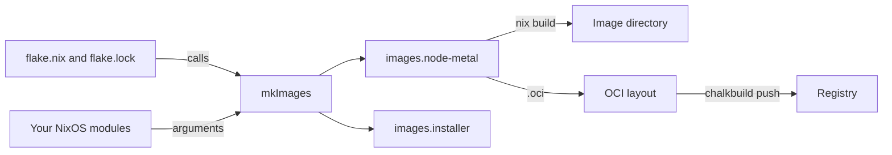

# Your first image flake

This page is for an image author who builds a cluster's images with Nix. At the end you have a
flake that builds unsigned images into the directories the cluster's inventory names, such as
`images/node-metal`, and you know what the build writes there and what else `mkImages` returns.
The page follows the `cluster-metal` template, which
[Build a cluster on real machines](../guides/cluster-on-machines.md) installs: one image for bare
metal that its three Kubernetes control planes, `cp1` to `cp3`, run.

## Before you begin

You need Nix with flakes enabled on an x86-64 Linux machine, and a git repository for the flake.
A flake sees only the files git tracks, so `git add` a new module before you build.

Nix is needed only on the machine that builds images. chalkctl and chalklab never evaluate the
flake: the inventory names the directory a build was linked to, so the machine that runs chalkctl
needs that directory and no Nix.

## The flake calls mkImages

The template's flake builds the Kubernetes node image and the installer.

```nix title="flake.nix"
--8<-- "templates/cluster-metal/flake.nix"
```

The flake takes chalkos as an input and calls `chalkos.lib.mkImages`. `flake.lock` pins the
chalkos version, so the images change only when the lock file or the flake's own modules change.
The call sets three arguments:

- `osCA` is the public part of the cluster's secrets, `secrets.pub.json`, which
  `chalkctl gen secrets` writes. The image and the installer trust its OS CA in maintenance mode,
  so a machine that waits for its install accepts only the cluster's clients. Generate the secrets
  before the first build.
- `revision` is the commit the images are built from. chalkctl shows it beside an image's root
  hash.
- `images` lists the images to build, each with its name, its platform and its NixOS modules.
  `node-metal` is for bare metal and lists the Kubernetes layer, `chalkos.nixosModules.kubernetes`.

A layer is a predefined set of NixOS modules that chalkos ships, listed like any other module.
An image lists one layer at most, and an image without one runs chalkos's base alone.

`mkImages` returns each image by its name, such as `images.node-metal`, and the installer as
`images.installer`. The flake exposes them as packages of the same names. `chalkos.lib.testsOf`
collects each image's tests, which the flake exports as its checks, so `nix flake check` runs
them, as [Test an extension](test-an-extension.md) describes. The flake's shell, which
`nix develop` enters, holds chalkctl and chalkbuild of the chalkos that `flake.lock` pins. One
image serves every node the inventory gives it. What differs between nodes, from their
addresses to the cluster's endpoint, is their config: YAML documents that chalkctl delivers,
which [Config and the inventory](../how-it-works/node/config.md) describes.

## mkImages checks its arguments as module options

`mkImages` takes these arguments:

| Argument | Default | What it sets |
| --- | --- | --- |
| `images` | `[ ]` | The images to build, each with its `name`, `platform` and NixOS `modules` |
| `modules` | `[ ]` | NixOS modules every image carries, before its own |
| `osCA` | `null` | The public part of the cluster's secrets, whose OS CA the images and the installer trust in maintenance mode |
| `installer.modules` | `[ ]` | The installer's own NixOS modules |
| `nixpkgs` | the nixpkgs chalkos is tested against | The nixpkgs the images are evaluated and built from |
| `system` | `x86_64-linux` | The platform the images are built for, as Nix names it |
| `specialArgs` | `{ }` | Extra arguments for every image's modules, such as a flake's inputs |
| `revision` | `null` | The git revision the images are built from |
| `tag` | `null` | The git tag the images are built from, such as a release's |

The arguments are module options, so a misspelled argument fails the evaluation and names the
argument. The [mkImages reference](../reference/mkimages.md) documents each one.
[Images and platforms](images-and-platforms.md) covers `images`, `modules` and `osCA`.

`revision` and `tag` say where an image came from. Nix cannot read git tags, so whatever builds a
release passes the tag:

```nix
images = chalkos.lib.mkImages {
  revision = self.rev or self.dirtyRev or null;
  tag = "v1.5.0";
  images = [
    {
      name = "node-metal";
      platform = "metal";
      modules = [ chalkos.nixosModules.kubernetes ];
    }
  ];
};
```

`self` must be among the arguments of the flake's `outputs`, as in the template's flake. Each image
directory's `metadata.json` records both values, and chalkctl shows them beside the root hash's
first 12 hex characters, as in `3fa9c1e2b7d0 (v1.5.0, a1b2c3d4e5f6)`. They never reach the
image's store, so they change no root hash, and nothing orders or refuses an image by them.

An image has no version to raise. Its identity is the root hash of its store: a changed module
changes the store, so the build is a new image. The build refuses `system.image.version`, because
systemd-boot would order boot entries by it.

## Build the image

Build the package and link the result where the inventory looks for it:

```console
$ nix build .#node-metal -o images/node-metal
$ ls images/node-metal
chalkos.raw
facts
metadata.json
repart.d
repart-output.json
schemas
```

`images/node-metal` is a link into `/nix/store`. The template's inventory names it as the image
`node-metal` and gives it to every node through `spec.all`:

```yaml title="chalkos.yaml"
--8<-- "templates/cluster-metal/chalkos.yaml"
```

A relative directory is relative to the inventory's directory. The next build replaces the link,
so the inventory names the newest image without an edit.

## The image directory holds the disk image and its contract

The build writes six entries:

- `chalkos.raw` is the raw disk image. Its slot A carries labels named after its root hash, which
  the build sets once systemd-repart has computed the hash.
- `repart-output.json` is systemd-repart's report of the partitions, with their offsets, sizes and
  the root hash. chalkctl reads the store, the hash tree and the UKI at those offsets.
- `repart.d` holds the partition definitions of the system region, which the installer lays out
  on a target disk.
- `metadata.json` names the image's root hash, name and platform, the revision and tag it was
  built from, the OS CA it carries and the kinds it accepts.
- `schemas` holds the JSON Schema of each kind the image accepts.
- `facts` holds a `<layer>.json` for each of the image's layers that has facts. On an image with
  Kubernetes, `facts/kubernetes.json` records what the image fixes about Kubernetes: the release of
  its kubelet and its pod network. On an image without such layers, `facts` is empty.

chalkctl reads `metadata.json`, `schemas` and `facts` when it validates, installs or upgrades
a node whose image in the inventory is this directory.
[Image and partition layout](../reference/image-layout.md#outputs-of-an-image-build) lists the
files in detail.

The image is unsigned. A node that does not enforce Secure Boot installs it as it is. Nodes that
enforce Secure Boot need a signed copy, which
[Sign images for Secure Boot](sign-images.md) makes on a machine that holds the key, so
the key never enters `/nix/store`.

chalkos does not wrap image conversion. `qemu-img convert -f raw -O qcow2` makes a qcow2 disk for
KVM, `zstd` compresses the raw image for transport, and `dd` or a USB writer puts it on a disk.

## An image carries its OCI layout, NixOS system and tests

The template exposes its image and the installer by name. Each image `mkImages` returns is its
image directory, and carries the other forms of the image as attributes. Each is built only when
something asks for it:



The diagram shows the flake and its modules passing through `mkImages` into each image and the
installer. The image directory is what the inventory names; the OCI layout goes to a registry.

- `images.node-metal` is the image directory. Its `name` and `platform` are the entry's, and its
  `layer` is `"kubernetes"`, `"router"` or null.
- `images.node-metal.oci` is the same image as an OCI image layout, as `chalkbuild oci` writes
  it. [Publish images to a registry](publish-images.md) pushes it.
- `images.node-metal.nixos` is the evaluated NixOS system. It reads the image's options, such as
  `images.node-metal.nixos.config.chalkos.kubernetes.package.version`, and its
  `config.system.build` holds parts of the image that build on their own, such as its schemas,
  `chalkosSchemas`.
- `images.node-metal.sbom` is the image's SBOM, which lists its packages with their versions and
  licences. [Inspect what an image contains](add-software.md#inspect-what-an-image-contains)
  reads it.
- `images.node-metal.tests` builds the image's tests, its `chalkos.tests`.
- `images.installer` is one directory with a raw image and a hybrid ISO, which installs images of
  every platform. [Customise the installer](customise-installer.md) adds to it.

`chalkos.lib` has helpers that map over the images and leave the installer out. `ociOf`,
`nixosOf` and `testsOf` return each image's `oci`, `nixos` and `tests` by its name.
`selectImages` picks the images whose `platform` or `layer` match, so a flake can expose every
Kubernetes image as a package:

```nix
packages.x86_64-linux = chalkos.lib.selectImages { layer = "kubernetes"; } images;
```

`chalkos.lib` is the library a flake calls, with `mkImages` and these helpers. Image modules get
another one as a module argument, [`chalkosLib`](../reference/extension-api.md#chalkoslib), with
helpers such as `types`, `mkOption`, `render`, `validate` and `reloadOn`.

The template's flake exports the NixOS systems as `nixosConfigurations` and the tests as its
checks:

```nix
nixosConfigurations = chalkos.lib.nixosOf images;
checks.${system} = chalkos.lib.testsOf images;
```

The guides use the NixOS systems to build one part of an image without the rest, such as its
schemas with `nix build .#nixosConfigurations.node-metal.config.system.build.chalkosSchemas`.

## Check that it worked

`chalkctl validate` checks every node's config files against the schemas of the image the
inventory names for it. It reaches no node and needs no secrets:

```sh
chalkctl validate
```

For the template it prints a line per node, with the image's root hash and the hash of the node's
config:

```text
cp1: valid for the image node-metal (node-metal on metal, root hash 3b80d0bf1243), config 451b547e8373fe70683c9dbf95f7cc08916ae0e920702da6c1a2c3e85c6f4080
cp2: valid for the image node-metal (node-metal on metal, root hash 3b80d0bf1243), config 10c35f7fe988679c3a54691ddf95e78267269d22297fb360ceae5527f5965d50
cp3: valid for the image node-metal (node-metal on metal, root hash 3b80d0bf1243), config 55ed0b193224383f68d0bb4014e45885697279cd67dfa6fc9232627757cfbd44
```

A document of a kind the image does not declare, or a misspelled field, fails here. The image is
then ready to install on a machine with
[Install a node](../operate/install.md), or to roll out to running
nodes with [Upgrade nodes](../operate/upgrade.md).

## What next

- [Images and platforms](images-and-platforms.md) builds images for nodes that run other
  software or other machines.
- [Add software, drivers and kernel modules](add-software.md) adds to the image.
- [The image](../how-it-works/node/image.md) explains what the raw image holds and how it boots.
