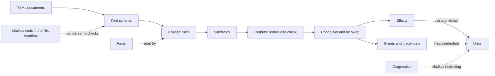

# Build images

These pages are for image authors who build a cluster's images in Nix with
`chalkos.lib.mkImages`. They assume some Nix and NixOS modules, and the
[Kubernetes quick start](../get-started/quick-start-kubernetes.md).

A cluster that needs nothing of its own runs the images each chalkos release publishes, and needs
none of these pages, as
[Published images or your own](../get-started/decisions.md#published-images-or-your-own)
explains.

## Read in this order

1. [Upgrade the lab to your own image](upgrade-the-lab.md) builds, signs and rolls out a first
   image on the quick start's lab.
2. [Your first image flake](first-image.md) explains the flake every later page builds on.
3. [Images and platforms](images-and-platforms.md) adds images, layers and features.
4. [Add software, drivers and kernel modules](add-software.md) puts your own packages in an image.
5. [Write your first extension](first-extension.md) adds a config kind and a unit that reads it.
6. [Release your own images](../guides/release-your-images.md) publishes the images on every tag.

## How an extension fits together

An extension is a NixOS module that adds config kinds and the parts that act on their documents.
The diagram follows a node's YAML from a delivery to the units that read it.



The schema, the change rules, the validators and the outputs can each refuse a delivery. The node
then keeps the config it runs. Once all four pass, chalkd writes the config slot, swaps the
documents and rendered files in, and takes the effects. Diagnostics stand apart: an operator runs
them on demand. The tests run the same checks as a delivery, without a node.

Each part is an option of the image's modules. A part that chalkctl runs refuses a mistake before
anything reaches the node.

| Option | Where it runs | Can refuse a delivery | Page |
| --- | --- | --- | --- |
| `chalkos.kinds` | chalkctl and the node, against the kind's schema | yes | Declare a config kind |
| `chalkos.kinds.<name>.rules`, `specRules` | chalkctl, for the rules that read no facts; the node, for every rule | yes | Guard changes with rules and facts |
| `chalkos.facts` | the node, when a rule or an effect's `when` reads the fact | no | Guard changes with rules and facts |
| `chalkos.validators` | the node; chalkctl runs only the router layer's `router` | yes | Validate config with a program |
| `chalkos.outputs` | the node, before a delivery changes anything, and at boot | yes | Render config files |
| `chalkos.effects` | the node, once a delivery is applied | no | React to changes |
| `systemd.services.<unit>.chalkos.kinds` | the node, for the unit the grant names | no | Read config in a service, Pass secrets to a service |
| `chalkos.diagnostics` | the node, on `chalkctl node diag` | no | Add a diagnostic |
| `chalkos.tests` | the build, in the Nix sandbox, by `nix flake check` | no; a failing test fails the check | Test an extension |

!!! note "The fast loop"

    Three builds check an extension without a node. Run them in the image flake, with `<image>`
    the name of an image of its `mkImages`:

    ```sh
    # The kinds' JSON Schemas, as chalkctl checks documents against them.
    nix build .#nixosConfigurations.<image>.config.system.build.chalkosSchemas
    # What each test rendered and refused; -L prints the errors of renderers and checks.
    nix build -L .#nixosConfigurations.<image>.config.system.build.chalkosTestResults
    # Every image's tests, compared with what they expect.
    nix flake check
    ```

    [Develop and debug an extension](develop-an-extension.md) runs the whole loop, from these
    builds to a node, and lists the common errors.

## Build

These pages build an image a node can install: the flake, its images and platforms, and the
software it carries.

<!-- docgen cards: upgrade-the-lab.md first-image.md images-and-platforms.md add-software.md shell-free.md -->
<div class="grid cards" markdown>

-   __[Upgrade the lab to your own image](upgrade-the-lab.md)__

    ---

    Build an image of your own from the lab template's flake, sign it and roll it through the quick start's lab

-   __[Your first image flake](first-image.md)__

    ---

    Write a flake that builds a cluster's image with mkImages, into the directory the inventory names

-   __[Images and platforms](images-and-platforms.md)__

    ---

    Build images for nodes that run other software or other machines

-   __[Add software, drivers and kernel modules](add-software.md)__

    ---

    Add packages, services, kernel modules, firmware and debug tools to a cluster's images within an appliance's limits

-   __[Keep an image shell-free](shell-free.md)__

    ---

    Find what brings a shell into an image, and run units, checks, effects and small programs without one

</div>
<!-- end docgen cards -->

## Write extensions

These pages write extensions, in the order an extension grows: a config kind for each node's
YAML, the files a unit reads, the tests that check them, the effects of a change, its secrets, the
checks that refuse a config a node cannot run, a change of a kind between images and the
diagnostics operators run.

<!-- docgen cards: first-extension.md develop-an-extension.md declare-a-kind.md read-config.md render-config.md test-an-extension.md react-to-changes.md pass-secrets.md validate-config.md guard-changes.md change-a-kind.md add-a-diagnostic.md -->
<div class="grid cards" markdown>

-   __[Write your first extension](first-extension.md)__

    ---

    Add a config kind, a rendered file, a test and a unit to the lab's image, then change the config on a node

-   __[Develop and debug an extension](develop-an-extension.md)__

    ---

    Check an extension from the fastest build to a node, find the cause of an evaluation error and fix common errors

-   __[Declare a config kind](declare-a-kind.md)__

    ---

    Declare a config kind in a NixOS module, so each node's YAML carries values the image checks

-   __[Read config in a service](read-config.md)__

    ---

    Grant a unit the config kinds it reads, and read their documents as files or with chalkcfg

-   __[Render config files](render-config.md)__

    ---

    Render a service's config file from the node's documents, checked before a delivery changes anything

-   __[Test an extension](test-an-extension.md)__

    ---

    Check what an image renders, refuses and reloads for a config, with tests that nix flake check runs

-   __[React to changes](react-to-changes.md)__

    ---

    Restart, reload or run a command when a delivery changes an output, a kind's documents or a condition

-   __[Pass secrets to a service](pass-secrets.md)__

    ---

    Reference a Secret from a field of your kind, so a granted unit gets its value as a systemd credential

-   __[Validate config with a program](validate-config.md)__

    ---

    Refuse a node's config with a program of your image, for what the kind's schema and rules cannot check

-   __[Guard changes with rules and facts](guard-changes.md)__

    ---

    Refuse a config change a node cannot make, with CEL rules on your kind and facts about the node

-   __[Change a kind incompatibly](change-a-kind.md)__

    ---

    Give a kind a new version, move the nodes' documents to it with an upgrade, and rename or remove a kind

-   __[Add a diagnostic](add-a-diagnostic.md)__

    ---

    Declare a read-only command that operators run on a node with chalkctl node diag

</div>
<!-- end docgen cards -->

## Ship

These pages take an image to the nodes: the installer, signing for Secure Boot, publishing to a
registry, and testing and rolling out an upgrade.

<!-- docgen cards: customise-installer.md sign-images.md publish-images.md test-and-roll-out.md -->
<div class="grid cards" markdown>

-   __[Customise the installer](customise-installer.md)__

    ---

    Give the installer static addresses, VLANs, bonds, drivers or firmware

-   __[Sign images for Secure Boot](sign-images.md)__

    ---

    Create Secure Boot keys, sign a copy of each image and the installer, and name the signed copy in the inventory

-   __[Publish images to a registry](publish-images.md)__

    ---

    Build an image as an OCI layout, sign it if the nodes need it, push it and name its digest in the inventory

-   __[Test and roll out an image](test-and-roll-out.md)__

    ---

    Check an image and the nodes' config, upgrade the nodes, and confirm their outputs and services

</div>
<!-- end docgen cards -->
