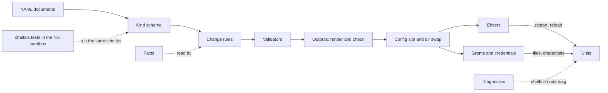

# Build images

These pages are for image authors who build a cluster's images in Nix with
`chalkos.lib.mkImages`. They assume some Nix and NixOS modules, and no earlier knowledge of chalkos.

Start here: [Your first image flake](first-image.md), then
[Images and platforms](images-and-platforms.md), then
[Add software, drivers and kernel modules](add-software.md). Every later page builds on the
flake from these three. [Write your first extension](first-extension.md) then adds a config kind
and a unit that reads it, on the lab of the quick start.

## How an extension fits together

An extension is a NixOS module that adds config kinds and the parts that act on their documents.
The diagram follows a node's YAML from a delivery to the units that read it.



The schema, the change rules, the validators and the outputs can each refuse a delivery. The node
then keeps the config it runs. Once all four pass, chalkd writes the config slot, swaps the
documents and rendered files in, and takes the effects. Diagnostics stand apart: an operator runs
them on demand. The tests run the same checks as a delivery, without a node.

Each part is an option of the image's modules. A part that chalkctl runs refuses a mistake before
anything reaches the node.

| Option | Where it runs | Can refuse a delivery | Page |
| --- | --- | --- | --- |
| `chalkos.kinds` | chalkctl and the node, against the kind's schema | yes | Declare a config kind |
| `chalkos.kinds.<name>.rules`, `specRules` | chalkctl, for the rules that read no facts; the node, for every rule | yes | Guard changes with rules and facts |
| `chalkos.facts` | the node, when a rule or an effect's `when` reads the fact | no | Guard changes with rules and facts |
| `chalkos.validators` | the node; chalkctl runs only the router layer's `router` | yes | Validate config with a program |
| `chalkos.outputs` | the node, before a delivery changes anything, and at boot | yes | Render config files |
| `chalkos.effects` | the node, once a delivery is applied | no | React to changes |
| `systemd.services.<unit>.chalkos.kinds` | the node, for the unit the grant names | no | Read config in a service, Pass secrets to a service |
| `chalkos.diagnostics` | the node, on `chalkctl node diag` | no | Add a diagnostic |
| `chalkos.tests` | the build, in the Nix sandbox, by `nix flake check` | no; a failing test fails the check | Test an extension |

!!! note "The fast loop"

    Three builds check an extension without a node. Run them in the image flake, with `<image>`
    the name of an image of its `mkImages`:

    ```sh
    # The kinds' JSON Schemas, as chalkctl checks documents against them.
    nix build .#nixosConfigurations.<image>.config.system.build.chalkosSchemas
    # What each test rendered and refused; -L prints the errors of renderers and checks.
    nix build -L .#nixosConfigurations.<image>.config.system.build.chalkosTestResults
    # Every image's tests, compared with what they expect.
    nix flake check
    ```

    [Develop and debug an extension](develop-an-extension.md) runs the whole loop, from these
    builds to a node, and lists the common errors.

## Build

These pages build an image a node can install: the flake, its images and platforms, and the
software it carries.

<div class="grid cards" markdown>

-   :material-rocket-launch: __Your first image flake__

    ---

    Write a flake that builds a cluster's image with mkImages, into the directory the inventory
    names.

    [:octicons-arrow-right-24: Read](first-image.md)

-   :material-layers: __Images and platforms__

    ---

    Build images for nodes that run other software or other machines, and set the order of their
    modules.

    [:octicons-arrow-right-24: Read](images-and-platforms.md)

-   :material-expansion-card: __Add software, drivers and kernel modules__

    ---

    Add packages, services, kernel modules, firmware and debug tools within an appliance's limits.

    [:octicons-arrow-right-24: Read](add-software.md)

</div>

## Configure services

These pages give the services in an image their configuration, in the order an extension grows: a
config kind for each node's YAML, the files a unit reads, the tests that check them, the effects
of a change, its secrets and the checks that refuse a config a node cannot run.

<div class="grid cards" markdown>

-   :material-school: __Write your first extension__

    ---

    A tutorial of about 15 minutes: add a config kind, a rendered file, a test and a unit to the
    quick start's lab, then change the config on a node.

    [:octicons-arrow-right-24: Follow](first-extension.md)

-   :material-bug: __Develop and debug an extension__

    ---

    Check an extension from the fastest build to a node, find the cause of an evaluation error
    and fix common errors.

    [:octicons-arrow-right-24: Read](develop-an-extension.md)

-   :material-shape-plus: __Declare a config kind__

    ---

    Declare a config kind in a NixOS module, so each node's YAML carries values the image checks.

    [:octicons-arrow-right-24: Read](declare-a-kind.md)

-   :material-file-search: __Read config in a service__

    ---

    Grant a unit the config kinds it reads, and read their documents as files or with chalkcfg.

    [:octicons-arrow-right-24: Read](read-config.md)

-   :material-file-code: __Render config files__

    ---

    Render a service's config file from the node's documents, checked before a delivery changes
    anything.

    [:octicons-arrow-right-24: Read](render-config.md)

-   :material-test-tube: __Test an extension__

    ---

    Check what an image renders, refuses and reloads for a config, with tests that nix flake
    check runs.

    [:octicons-arrow-right-24: Read](test-an-extension.md)

-   :material-refresh: __React to changes__

    ---

    Restart, reload or run a command when a delivery changes an output, a kind's documents or a
    condition.

    [:octicons-arrow-right-24: Read](react-to-changes.md)

-   :material-key-chain: __Pass secrets to a service__

    ---

    Reference a Secret from a field of your kind, so a granted unit gets its value as a systemd
    credential.

    [:octicons-arrow-right-24: Read](pass-secrets.md)

-   :material-check-decagram: __Validate config with a program__

    ---

    Refuse a node's config with a program of your image, for what the kind's schema and rules
    cannot check.

    [:octicons-arrow-right-24: Read](validate-config.md)

-   :material-shield-check: __Guard changes with rules and facts__

    ---

    Refuse a config change a node cannot make, with CEL rules on your kind and facts about the
    node.

    [:octicons-arrow-right-24: Read](guard-changes.md)

</div>

## Diagnose

This page gives operators a way to look into a service on a node.

<div class="grid cards" markdown>

-   :material-stethoscope: __Add a diagnostic__

    ---

    Declare a read-only command that operators run on a node with `chalkctl node diag`.

    [:octicons-arrow-right-24: Read](add-a-diagnostic.md)

</div>

## Ship

These pages take an image to the nodes: the installer, signing for Secure Boot, publishing to a
registry, testing and rolling out an upgrade, and changing a kind between images.

<div class="grid cards" markdown>

-   :material-disc: __Customise the installer__

    ---

    Give the installer static addresses, VLANs, bonds, drivers or firmware.

    [:octicons-arrow-right-24: Read](customise-installer.md)

-   :material-file-certificate: __Sign images for Secure Boot__

    ---

    An optional step: create Secure Boot keys and enrol them, sign a copy of each image and the
    installer, and name the signed copy in the inventory.

    [:octicons-arrow-right-24: Read](sign-images.md)

-   :material-cloud-upload: __Publish images to a registry__

    ---

    Build an image as an OCI layout, sign it if the nodes need it, push it and name its digest in
    the inventory.

    [:octicons-arrow-right-24: Read](publish-images.md)

-   :material-check-decagram: __Test and roll out an image__

    ---

    Check an image and the nodes' config, upgrade the nodes, and confirm their outputs and
    services.

    [:octicons-arrow-right-24: Read](test-and-roll-out.md)

-   :material-swap-horizontal: __Change a kind incompatibly__

    ---

    Give a kind a new version, move the nodes' documents to it with an upgrade, and rename or
    remove a kind.

    [:octicons-arrow-right-24: Read](change-a-kind.md)

</div>
