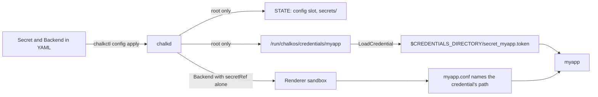

# Pass secrets to a service

This page is for an image author whose service needs a password, a token or a key that differs
between clusters. At the end a field of your kind references a `Secret`, a granted unit receives
the value as a systemd credential, and a rendered config file holds the credential's name alone.
The examples follow a web server, `myapp.service`, that sends a token to each of its backends.

See it in a full extension: [Run bird](../guides/bgp-extension.md#run-bird) of the BGP guide
passes a session's password to bird, which takes no password from a file.

## Before you begin

You need a kind of your own, as [Declare a config kind](declare-a-kind.md) declares one, and a unit
that reads it, as [Read config in a service](read-config.md) grants one. The page renders the
service's config with an output from [Render config files](render-config.md) and restarts it with
an effect from [React to changes](react-to-changes.md).

## A Secret document holds the value

The operator writes the value into a `Secret` document:

```yaml title="myapp/secrets.yaml"
apiVersion: chalkos.dev/v1alpha1
kind: Secret
metadata: {name: myapp}
spec:
  data: {token: example-token}
```

`spec.data` maps keys to string values. A node's set may hold any number of `Secret` documents,
each with a name of its own. Keep the `Secret` in a file of its own, so that the file with the
documents that reference it can go into a public repository.

A `Secret` document is not the cluster's secrets file. The secrets file, `secrets.age`, holds the
cluster's CAs and keys. `chalkctl gen secrets` writes it once, and chalkctl decrypts it to
authenticate to nodes. `Secret` documents hold your services' values and sit in the node's
config files like any other document. chalkctl reads them as plain YAML, so keep the file out of
version control, or decrypt it into place with a tool such as sops before the command and remove
it after.

## A secretRef field names the value

A field of type `chalkosLib.types.secretRef` holds a reference to a key of a `Secret`, never the
value. The `Backend` kind declares `token` that way, with `nullOr` so a backend without a token
leaves it out:

```nix
{ chalkosLib, lib, ... }:
{
  chalkos.kinds.Backend = {
    group = "myapp.example.org";
    version = "v1alpha1";
    multiple = true;
    spec = {
      address = lib.mkOption {
        type = chalkosLib.types.address;
        description = "Address of the backend.";
      };
      token = lib.mkOption {
        type = lib.types.nullOr chalkosLib.types.secretRef;
        default = null;
        description = "Token myapp sends to the backend.";
      };
    };
  };
}
```

A `Backend` document references the key by the `Secret`'s name and the key. Its `spec` reads:

```yaml
spec:
  address: 192.0.2.20
  token: {secretRef: {name: myapp, key: token}}
```

chalkctl and chalkd refuse a set whose reference names a `Secret` or a key the set lacks. Without
the `Secret` document, `chalkctl validate` refuses each node with this message:

```text
Backend/app: spec.token: Secret "myapp" does not exist
```

A misspelled key gives `Backend/app: spec.token: Secret "myapp" has no key "tokn"`. The
`Secret`'s name and the key become a file name on the node. They hold printable ASCII without `/`
or `:`, and at most 247 bytes together, or chalkd refuses the set.

## The granted unit gets the value as a credential

A unit granted a kind receives the values that the kind's `secretRef` fields name.
`myapp.service` is granted `Backend`:

```nix
systemd.services.myapp.chalkos.kinds = [ "Backend" ];
```

For each granted unit, chalkd writes the values to
`/run/chalkos/credentials/<unit>/<secret>.<key>`, readable by root alone. The grant sets the
unit's `LoadCredential=secret:/run/chalkos/credentials/<unit>`. systemd then loads each file as
the credential `secret_<secret>.<key>`, here `secret_myapp.token`. The unit reads it at
`$CREDENTIALS_DIRECTORY/secret_myapp.token` in a script, or as `%d/secret_myapp.token` in a unit
setting. Every granted unit gets its directory, empty when its kinds reference no secret, once
chalkd loads the node's config. A node without config, as in maintenance mode, has no
directory, and neither has one whose `chalkos-config.service` failed. systemd refuses to start a
unit whose credential path is missing unless `SetCredential=` gives a credential of the same name,
so the grant sets `SetCredential=secret:none`, which stands in for the directory. A unit that
needs its credentials checks for the directory, as `frr.service` does with
`ConditionPathIsDirectory=`.

The image's build fails when a granted unit runs nothing: neither its unit file nor a drop-in has
`ExecStart=`, as for a typo in the unit's name.

A unit receives only the values that its own kinds' documents reference. A `Secret` that no
granted kind references reaches no unit. A grant of the `Secret` kind itself fails the image's
evaluation.

## The rendered config names the credential

The renderer of an output sees a `secretRef` field as the reference alone. Its sandbox hides
`/run/chalkos/credentials` and STATE, so it cannot read a value even by path. The rendered file
names the credential, and the service reads the value when it starts.

A service that reads a secret from a file needs nothing more. The template of `myapp-conf` writes
the credential's path into the config:

```text title="myapp.conf.tmpl"
{{- range .documents.Backend }}
[backend.{{ .metadata.name }}]
address = {{ .spec.address }}
{{- with .spec.token }}
token_file = /run/credentials/myapp.service/secret_{{ .secretRef.name }}.{{ .secretRef.key }}
{{- end }}
{{ end -}}
```

```nix
chalkos.outputs.myapp-conf = {
  inputs = [ "Backend" ];
  render = chalkosLib.render.template ./myapp.conf.tmpl;
};
```

For the `Backend` above, named `app`, it renders:

```text title="myapp.conf"
[backend.app]
address = 192.0.2.20
token_file = /run/credentials/myapp.service/secret_myapp.token
```

`/run/credentials/<unit>` is the directory systemd passes as `$CREDENTIALS_DIRECTORY` to a system
service. The renderer knows no unit name, so the template spells it out. A service that expands
environment variables in its config, or a wrapper script, can use `$CREDENTIALS_DIRECTORY`
instead. chalkos's test image does that: its template writes the credential's name alone, and the
unit reads `$CREDENTIALS_DIRECTORY/<name>`.

A service that takes no secret from a file needs a program that turns the credentials into what
it reads, before it starts and on each reload. The BGP guide's `bird-credentials` writes them as
constants of bird's config.

The whole path of the value, from the operator's file to the service:



The diagram shows the value moving from the YAML through chalkd into root-only files, and from
there through systemd's credential to the service. The renderer receives the `Backend` without
the value, so the rendered `myapp.conf` holds only the credential's path.

## Where the value lives and what shows it

chalkd keeps each `Secret` in the image's config slot on STATE, `/state/config/<root-hash>`, as
`secrets/<name>.json`, readable by root alone. It never writes a `Secret` below
`/run/chalkos/config`, so chalkcfg never prints one. Every other view shows a hash of the value:

- GetConfig, which chalkctl calls before it delivers, returns each value of a `Secret` as its
  SHA-256.
- `chalkctl config apply --diff` compares the inventory's values by the same hashes and shows a
  changed value as `changed`.
- `chalkctl status` and `chalkctl validate` hash the config with each `Secret` value replaced by
  its own SHA-256.
- Change rules see a `Secret`'s values as hashes too.

## A rotated value fires the effects

A new value in a `Secret` reaches the services on the next `chalkctl config apply`. The rendered
`myapp.conf` does not change, because it names the credential. An effect whose `outputs` trigger
names `myapp-conf` fires all the same, because it counts a changed value of a `Secret` that the
output's input documents reference. A `kinds` trigger counts it the same way.

chalkd writes the new credential files before it takes the effects. A restart loads them again.
A reload does not, unless the unit sets `RefreshOnReload=credentials`. A unit that reloads on a
new value sets it, as bird's unit in the guide does.

## Check that it worked

`chalkctl validate` refuses a reference without its `Secret`, so run it before every delivery.
After `config apply`, the unit's journal shows its restart or reload, and any error it hit while
it read the credential:

```sh
chalkctl logs server1 --unit=myapp.service
```

## What next

- [Validate config with a program](validate-config.md) refuses a config with a program of
  the image.
- [Guard changes with rules and facts](guard-changes.md) refuses a change a node cannot make, and
  sees a `Secret`'s values as hashes.
- [Read config in a service](read-config.md) for the other documents a grant gives a unit.
- [Config and the inventory](../how-it-works/node/config.md) for where the operator keeps the
  files.
