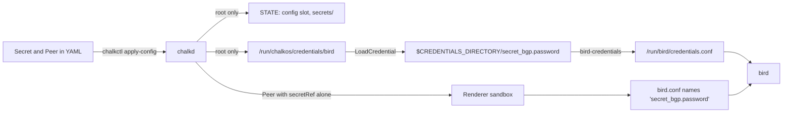

# Pass secrets to a service

This page is for an image author whose service needs a password, a token or a key that differs
between clusters. At the end a field of your kind references a `Secret`, a granted unit receives
the value as a systemd credential, and a rendered config file holds the credential's name alone.
The page continues the homelab's BGP extension: the `password` of a `Peer` reaches bird, which
uses it for a BGP session's TCP MD5 signature.

## Before you begin

You need a kind of your own, as [Declare a config kind](declare-a-kind.md) declares one, and a unit
that reads it, as [Read config in a service](read-config.md) grants one. The page builds on bird's
output from [Render config files](render-config.md) and its effect from
[React to changes](react-to-changes.md).

## A Secret document holds the value

The operator writes the value into a `Secret` document, beside the documents that use it:

```yaml title="cluster/bgp.yaml"
apiVersion: chalkos.dev/v1alpha1
kind: Secret
metadata: {name: bgp}
spec:
  data: {password: example-password}
```

`spec.data` maps keys to string values. A node's set may hold any number of `Secret` documents,
each with a name of its own.

A `Secret` document is not the cluster's secrets file. The secrets file, `secrets.age`, holds the
cluster's CAs and keys. `chalkctl gen secrets` writes it once, and chalkctl decrypts it to
authenticate to nodes. `Secret` documents hold your services' values and sit in the node's
config files like any other document. chalkctl reads them as plain YAML, so keep the file out of
version control, or decrypt it into place with a tool such as sops before the command and remove
it after.

## A secretRef field names the value

A field of type `lib.chalkos.types.secretRef` holds a reference to a key of a `Secret`, never the
value. `Peer` declares `password` that way, with `nullOr` so a peer without a password leaves it
out:

```nix
--8<-- "examples/homelab/extensions/bgp.nix:kind"
```

A `Peer` document references the key by the `Secret`'s name and the key:

```yaml title="cluster/bgp.yaml"
apiVersion: bgp.example.org/v1alpha1
kind: Peer
metadata: {name: router-a}
spec:
  address: 10.0.0.1
  asn: 64513
  password: {secretRef: {name: bgp, key: password}}
```

chalkctl and chalkd refuse a set whose reference names a `Secret` or a key the set lacks. Without
the `Secret` document, `chalkctl validate` refuses both homelab nodes:

```text
chalkctl: the config of 2 nodes is invalid:
node cp1: Peer "router-a" names Secret "bgp", which the config does not hold
node w1: Peer "router-a" names Secret "bgp", which the config does not hold
```

A misspelled key gives `names key "passwort" of Secret "bgp", which it does not hold`. The
`Secret`'s name and the key become a file name on the node. They hold printable ASCII without `/`
or `:`, and at most 247 bytes together, or chalkd refuses the set.

## The granted unit gets the value as a credential

A unit granted a kind receives the values that the kind's `secretRef` fields name. bird is granted
`Peer`:

```nix
--8<-- "examples/homelab/extensions/bgp.nix:grant"
```

For each granted unit, chalkd writes the values to
`/run/chalkos/credentials/<unit>/<secret>.<key>`, readable by root alone. The grant sets the
unit's `LoadCredential=secret:/run/chalkos/credentials/<unit>`. systemd then loads each file as
the credential `secret_<secret>.<key>`, here `secret_bgp.password`. The unit reads it at
`$CREDENTIALS_DIRECTORY/secret_bgp.password` in a script, or as `%d/secret_bgp.password` in a unit
setting. Every granted unit gets its directory, empty when its kinds reference no secret, because
systemd refuses to start a unit whose credential path is missing.

A unit receives only the values that its own kinds' documents reference. A `Secret` that no
granted kind references reaches no unit. A grant of the `Secret` kind itself fails the image's
evaluation.

## The rendered config names the credential

The renderer of an output, such as bird's `bird-conf`, sees a `secretRef` field as the reference
alone. Its sandbox hides `/run/chalkos/credentials` and STATE, so it cannot read a value even by
path. The rendered file names the credential, and the service reads the value when it starts.

A service that reads a secret from a file needs nothing more. Suppose a kind `Upstream` with a
`token` field of type `secretRef`, granted to `exporter.service`. Its template writes the
credential's path into the config:

```text title="exporter.conf.tmpl"
{{- range .documents.Upstream }}
[upstream.{{ .metadata.name }}]
url = {{ .spec.url }}
token_file = /run/credentials/exporter.service/secret_{{ .spec.token.secretRef.name }}.{{ .spec.token.secretRef.key }}
{{ end -}}
```

`/run/credentials/<unit>` is the directory systemd passes as `$CREDENTIALS_DIRECTORY` to a system
service. The renderer knows no unit name, so the template spells it out. A service that expands
environment variables in its config, or a wrapper script, can use `$CREDENTIALS_DIRECTORY`
instead. chalkos's test image does that: its template writes the credential's name alone, and the
unit reads `$CREDENTIALS_DIRECTORY/<name>`.

## bird takes the value as a constant

bird reads no password from a file, so `bgp.nix` turns the credential into a bird constant before
bird starts. The template names the constant `'secret_<secret>.<key>'`, as the credential is
named:

```text title="extensions/bird.conf.tmpl"
--8<-- "examples/homelab/extensions/bird.conf.tmpl"
```

The unit's settings run a small program, `bird-credentials`, before bird starts and on each
reload:

```nix
--8<-- "examples/homelab/extensions/bgp.nix:service"
```

`bird-credentials` reads each `secret_*` file in `$CREDENTIALS_DIRECTORY` and writes a line
`define 'secret_bgp.password' = "...";` to `/run/bird/credentials.conf`, readable by bird's user
alone. It writes a new file and renames it over the old one, so bird never reads a file that a
failed run left half written. bird's config includes that file before the rendered one, so
`password 'secret_bgp.password';` resolves to the value.

The program refuses two things that would end bird's statement early, and fails the unit:

- A credential name with a character other than letters, digits, `.`, `_` and `-` after
  `secret_`. chalkd accepts more in a `Secret`'s name and key, so keep both to these characters
  for a value bird reads.
- A value with a quote or a line break, because bird's strings take no escapes.

The whole path of the value, from the operator's file to bird:



The diagram shows the value moving from the YAML through chalkd into root-only files, and from
there through systemd's credential into bird's constants. The renderer receives the `Peer`
without the value, so the rendered `bird.conf` holds only the constant's name.

## Where the value lives and what shows it

chalkd keeps each `Secret` in the image's config slot on STATE, `/state/config/<root-hash>`, as
`secrets/<name>.json`, readable by root alone. It never writes a `Secret` below
`/run/chalkos/config`, so chalkcfg never prints one. Every other view shows a hash of the value:

- GetConfig, which chalkctl calls before it delivers, returns each value of a `Secret` as its
  SHA-256.
- `chalkctl apply-config --diff` compares the inventory's values by the same hashes and shows a
  changed value as `changed`.
- `chalkctl status` and `chalkctl validate` hash the config with each `Secret` value replaced by
  its own SHA-256.
- Change rules see a `Secret`'s values as hashes too.

## A rotated value fires the effects

A new value in a `Secret` reaches the services on the next `chalkctl apply-config`. The rendered
`bird.conf` does not change, because it names the constant. bird's effect from
[React to changes](react-to-changes.md) fires all the same, because its `outputs` trigger counts
a changed value of a `Secret` that the output's input documents reference. A `kinds` trigger
counts it the same way.

chalkd writes the new credential files before it takes the effects. A restart loads them again.
A reload does not, unless the unit sets `RefreshOnReload=credentials`, as bird's does. Its
`ExecReload` then runs `bird-credentials` again and `birdc configure`, so bird takes the new
password and keeps its sessions to the other peers.

## Check that it worked

`chalkctl validate` refuses a reference without its `Secret`, so run it before every delivery.
After `apply-config`, bird's journal shows the reload and no error from `bird-credentials`:

```sh
chalkctl logs cp1 --unit=bird.service
```

A failed start that names `secret_bgp.password` with "bird takes no password with a quote or a
line break" needs a value without those characters. One that says "bird takes a credential name
of letters, digits, '.', '_' and '-' alone" needs a `Secret` name and key of those characters.

## What next

- [Guard changes with rules and facts](guard-changes.md) refuses a change a node cannot make, and
  sees a `Secret`'s values as hashes.
- [Read config in a service](read-config.md) for the other documents a grant gives a unit.
- [Config and the inventory](../how-it-works/node/config.md) for where the operator keeps the
  files.
