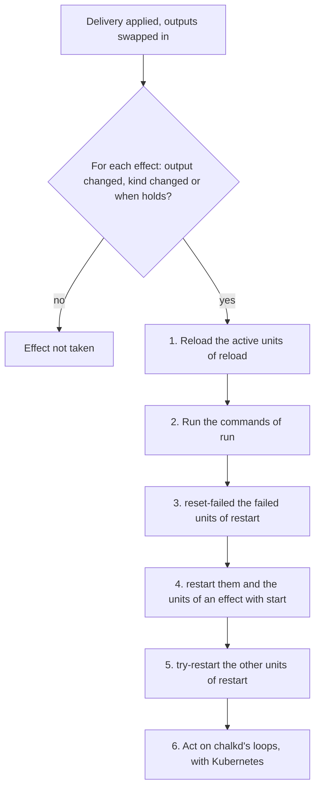

# React to changes

This page is for an image author whose service must pick up new config without a reboot. At the
end a delivery reloads or restarts the service when its config changes, and leaves it alone when
nothing it reads changed. The page continues the homelab's BGP extension: bird reloads when
`bird.conf` changes.

An effect is what a delivery does to the node's services once it is applied: restart a unit,
reload it or run a command. A grant or an output never restarts a unit by itself. Which changes
matter to a service is the service's to say, in an effect.

## Before you begin

You need a service that reads config from the node: its documents through a grant, as
[Read config in a service](read-config.md) sets up, or a rendered file, as
[Render config files](render-config.md) sets up.

## Reload bird when its config changes

`chalkos.effects.<name>` declares an effect. Here is bird's, as `extensions/bgp.nix` declares it:

```nix
--8<-- "examples/homelab/extensions/bgp.nix:effect"
```

`lib.chalkos.reloadOn` takes the triggers and the units. The line above is the same effect as:

```nix
chalkos.effects.bird = {
  outputs = [ "bird-conf" ];
  kinds = [ ];
  reload = [ "bird.service" ];
};
```

Once a delivery is applied, chalkd reloads `bird.service` when the files of `bird-conf` changed.
bird's `ExecReload` runs `birdc configure`, which reads the config again and keeps the sessions
that a restart would drop. A delivery that leaves `bird.conf` and its password unchanged reloads
nothing.

`lib.chalkos.restartOn` builds an effect that restarts its units instead. The homelab's rack unit
reads its `Rack` when it starts, so a changed `Rack` restarts it:

```nix
chalkos.effects.rack-location = lib.chalkos.restartOn { kinds = [ "Rack" ]; } [
  "rack-location.service"
];
```

## Three triggers fire an effect

An effect fires when any of its triggers fires. It has at least one, or the image's evaluation
fails:

| Trigger | Fires when |
| --- | --- |
| `outputs` | The hash of one output's files differs from the one before the delivery, or the values of the Secrets its input documents reference differ. |
| `kinds` | A document of one kind was added, removed or changed, or a value of a Secret one of them references changed. |
| `when` | The CEL expression holds once the delivery is applied. |

Use `outputs` for a service that reads a rendered file, and `kinds` for a service that reads its
documents itself when it starts. Both count a rotated `Secret` value as a change, because the
service reads the value as a credential beside its files. bird's password reaches it that way, so
a new password reloads bird although `bird.conf` names the same constant.

`kinds` cannot name `Secret` or `Addon`. A `Secret` counts through the kinds whose documents
reference it, and chalkd applies `Addon` documents itself.

## Four actions an effect takes

An effect takes at least one action, or the image's evaluation fails:

| Option | Action |
| --- | --- |
| `reload` | Reloads the units with `systemctl reload`, by their full names. |
| `restart` | Restarts the units, by their full names. A unit that does not run stays stopped. |
| `start` | With `restart`, starts the units that do not run too. |
| `run` | Runs one command after the reloads and before the restarts. |

`start` is for a unit that only the delivery lets start, such as a unit whose condition the
delivered config meets for the first time. Without it, a stopped unit stays stopped.

`run` names a program and its arguments. chalkd splits the command on spaces, with no shell
quoting, and runs its first word: a program of the image's store by its absolute path, or a bare
name on chalkd's `PATH`. A module adds a program to that `PATH` with
`systemd.services.chalkd.path`, as chalkos's chrony effect does. chalkd runs the command whether
or not any unit runs. A command that fails fails the delivery, so a command that talks to a
service that may be stopped first checks that the service runs.

The image build fails on an effect that restarts or reloads a unit the image does not define, and
the evaluation on one whose `outputs` names no output.

!!! note "Kubernetes only: chalkd's own loops"

    An effect's `chalkd` option acts on chalkd's Kubernetes loops, which run inside chalkd and have
    no unit. `reload` starts the control plane's loop again, and `restart` restarts every
    Kubernetes loop. chalkos's own Kubernetes effects use it. Without Kubernetes, it does nothing.

## A when condition fires on what no output renders

`when` holds a CEL expression, the language of [change rules](guard-changes.md). It fires an
effect on a condition that neither an output nor a whole kind expresses. Say a BGP exporter reads
the peers' addresses when it starts, and never their passwords. An effect on `kinds = [ "Peer" ]`
would restart it whenever a password rotates. This effect restarts it only when the addresses
change:

```nix
# The exporter reads the peers' addresses alone, so a new password restarts nothing.
chalkos.effects.bgp-exporter = {
  when = ''
    cel.bind(api, "bgp.example.org/v1alpha1",
      (api in config && "Peer" in config[api] ? config[api].Peer.map(n, config[api].Peer[n].spec.address) : [])
        != (api in oldConfig && "Peer" in oldConfig[api] ? oldConfig[api].Peer.map(n, oldConfig[api].Peer[n].spec.address) : []))
  '';
  restart = [ "bgp-exporter.service" ];
};
```

`config` maps apiVersion, kind and name to each document. A node without `Peer` documents has no
such key, so the expression checks with `in` before it reads one. A map iterates in the order of
its keys, so both lists of addresses follow the peers' names.

The expression reads these variables:

| Variable | Value |
| --- | --- |
| `config` | The config the node runs once the delivery is applied, by apiVersion, kind and name: `config["bgp.example.org/v1alpha1"].Peer["router-a"]`. |
| `oldConfig` | The config before the delivery, in the same shape. |
| `node.name` | The node's name, which its node certificate carries. |
| `facts.<name>` | A fact once the delivery is applied. |
| `oldFacts.<name>` | The same fact before the delivery changed anything. |

Every value of a `Secret` is its SHA-256 in `config` and `oldConfig`. An expression can tell that
a secret changed, but not read it. `documents`, `self` and `oldSelf` exist in change rules alone.

A fact is node state that a rule reads, such as the JSON of a file.
[Guard changes with rules and facts](guard-changes.md#facts-give-a-rule-node-state) declares one.
chalkd loads the facts an expression reads before a delivery changes anything, and again once it
is applied, so `facts.<name> != oldFacts.<name>` fires on a file that the delivery writes. A fact
is read by its name alone: `facts["share"]`, `has(facts.share)` or `facts` by itself fails the
build. A fact the node cannot find reads as null.

The image build compiles every `when`, and fails on one that does not compile or reads a fact no
module declares. On the node, a `when` that cannot be evaluated counts as true. Its units then
restart or reload once more than they needed to, so none runs on config it has not read.
chalkctl prints the reason as a warning.

## chalkd takes the due effects in one order

Once a delivery is applied, chalkd collects every effect that fires and takes their actions
together:



The diagram shows the decision for each effect and the order of the actions of all due effects:

1. chalkd reloads, in one `systemctl reload`, the units of `reload` that are active. A unit that
   is inactive or failed reads its config when it starts, and a unit chalkd also restarts gets no
   reload.
2. It runs the `run` commands, each once, in the order of their effects' names.
3. It runs `systemctl reset-failed` on the units of `restart` that failed. The new config may be
   what they lacked, and their earlier failures would count against their start limit.
4. It restarts, in one `systemctl restart`, those failed units and the units of an effect with
   `start`. `systemctl restart` starts a unit that does not run.
5. It restarts the other units in one `systemctl try-restart`. A unit that runs, or ran and stays
   active, restarts. A unit that never started or was stopped stays so.
6. On a node with Kubernetes, it restarts or reloads its own loops.

A oneshot unit that should run again on a change sets `RemainAfterExit = true`, so it stays
active and `try-restart` runs it again. The homelab's rack unit does.

A reload, command or restart that fails fails the delivery. The delivery is applied by then, so
the error ends with what is still to do: for example `reload bird.service by hand once that is
fixed, or deliver it again`.

## A delivery that changes nothing takes no effect

Delivery is idempotent: a delivery that changes nothing an effect compares takes no effect. The
same config delivered twice reloads bird once. A delivery that fails part way leaves a baseline,
and the next delivery compares with it, so it takes every effect of the failed one again.
[The config pipeline](../how-it-works/node/config-pipeline.md) describes the baseline.

## Check that it worked

`chalkctl apply-config` prints each unit it restarted, as `restarted <unit>`, then the config the
node runs. Reloaded units are not listed. Check bird's journal for the reload:

```sh
chalkctl apply-config cp1
chalkctl logs cp1 --unit=bird.service
```

A warning that starts with `the rule of effect` names a `when` that could not be evaluated, whose
effect chalkd took all the same. A unit that did not restart was not running: an effect without
`start` leaves a stopped unit stopped.

## chalkos declares outputs and effects of its own

Every image renders the node's network and time servers as outputs of its own. A delivery checks
them as it checks an extension's, and every boot renders them before networkd and chrony start.
Their names are taken, so an extension's outputs and effects use others.

| Output | Inputs | Files | Check |
| --- | --- | --- | --- |
| `networkd` | `Network`, `NetDev`, `Link` | One unit per document in `/run/systemd/network`, named as the document with its kind's suffix, such as `10-uplink.network`. | None. |
| `chrony` | `TimeSync` | `servers.sources`, one `server` line per server of the `TimeSync`, or chalkos's own servers without one. | `chronyd -p` parses the file, and each line must be a `server` line of a host name or address. |

`networkd` has no offline validator, so the schemas guard it: they accept exactly the sections and
keys of the image's networkd, and refuse a value that spans lines. Its units take precedence over
the image's own in `/etc/systemd/network`. The output owns `/run/systemd/network`, so a unit
written there by other means is gone once the link replaces the directory. The time servers that
DHCP announces are no output, because they come from the network at runtime.

| Effect | Fires when | Does |
| --- | --- | --- |
| `networkd` | The output `networkd` changed. | Reloads `systemd-networkd.service`. |
| `chrony` | The output `chrony` changed. | Runs `chronyc reload sources` while `chronyd.service` is active. |
| `chrony-dhcp` | The `TimeSync`'s spec changed. | Restarts `chalkos-chrony-dhcp.service`. |

Images with Kubernetes declare six more:

| Effect | Fires when | Does |
| --- | --- | --- |
| `registry-mirrors` | A `Mirror` or `Registry` spec changed. | Restarts `chalkos-registry-mirrors.service`. |
| `registry-credentials` | A `Registry` document, or a value of a Secret one references, changed. | Restarts `chalkos-registry-credentials.service` and `kubelet.service`. |
| `controlplane-ports` | The `Node`'s spec changed. | Restarts `chalkos-controlplane.service`. |
| `kubernetes` | The `Node`, the `Host`, the `Network` documents' addresses, the `Cluster` or `Flannel` document, the cluster file or the share changed, apart from a share that differs in its node CA alone. | Restarts and starts `chalkos-kubernetes.service` and `kubelet.service`. |
| `chalkd-cluster` | The cluster changed. | Restarts chalkd's Kubernetes loops. |
| `chalkd-share` | The share changed beyond its node CA or, on a control plane, the objects of the `Addon` documents changed. | Reloads the control plane's loop. |

chalkd acts on its own loops also when a delivery fails part way, as when it cannot write the
cluster file, the node certificate, the share or the slot.

## What next

- [Guard changes with rules and facts](guard-changes.md) refuses a change before any effect.
- [Render config files](render-config.md) for the outputs an effect names.
- [The config pipeline](../how-it-works/node/config-pipeline.md) for where effects sit in a
  delivery.
