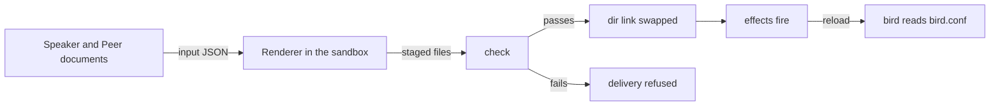

# Render config files

This page is for an image author whose service reads a config file of its own format. At the end
an output renders that file from the node's documents, the service's own validator checks it, and
a document that would break the service is refused before it reaches the node. The page continues
the homelab's BGP extension, `extensions/bgp.nix`: bird reads `bird.conf`, rendered from the
`Speaker` and `Peer` documents.

An output is a directory of files that a program of the image renders from documents. chalkd
renders and checks every output before a delivery changes anything. When a render or a check
fails, chalkd refuses the whole delivery, and the node keeps the config it runs.

## Before you begin

You need a kind whose documents the service needs, as [Declare a config kind](declare-a-kind.md)
declares `Peer`. A service that reads JSON documents itself needs no output: a grant gives it the
documents, as [Read config in a service](read-config.md) shows.

## Declare the output

`chalkos.outputs.<name>` declares an output. Here is `bird-conf`, as `extensions/bgp.nix`
declares it:

```nix
--8<-- "examples/homelab/extensions/bgp.nix:output"
```

The declaration sets three things:

- `inputs` names the kinds whose documents the renderer reads.
- `render` is the renderer: here a Go template, rendered into `bird.conf`.
- `check` is a shell script that checks the rendered files. `bird -p` parses the config without
  running it and exits with an error on a config bird rejects.

bird's config includes the rendered file from the output's `dir`. The module names the path as
`config.chalkos.outputs.bird-conf.dir`, so a misspelled output name fails the image's evaluation:

```nix
--8<-- "examples/homelab/extensions/bgp.nix:service"
```

On a delivery, the files pass through these steps before bird reads them:



The diagram shows the documents becoming staged files, which the check either passes or refuses.
Files that pass replace the old ones in one link swap, and the effects that name the output fire
after it. A refused render changes nothing the service reads.

## The renderer reads one JSON object

Every renderer reads the same input on standard input: the node's name and the documents of each
input kind. For the homelab's `Speaker` and `Peer` on `node1`, `bird-conf`'s renderer reads
this object, indented here:

```json
{
  "documents": {
    "Peer": [
      {
        "apiVersion": "bgp.example.org/v1alpha1",
        "kind": "Peer",
        "metadata": {"name": "router"},
        "spec": {
          "address": "fdc8:a1b2:c3d4:1::1",
          "asn": 65000,
          "bfd": true,
          "interfaces": ["enp1s0", "enp2s0"],
          "password": {"secretRef": {"key": "password", "name": "bgp"}}
        }
      }
    ],
    "Speaker": [
      {
        "apiVersion": "bgp.example.org/v1alpha1",
        "kind": "Speaker",
        "metadata": {"name": "bgp"},
        "spec": {"asn": 65001, "export": {"interfaces": ["node0"]}, "routerID": "0.0.0.11"}
      }
    ]
  },
  "node": {"name": "node1"}
}
```

- `documents` holds one list per kind of `inputs`, empty when the node holds no document of the
  kind. Each list is sorted by the documents' names.
- The documents carry their schema defaults, so `router` has `bfd: true` although its YAML
  leaves the field out.
- A `secretRef` field holds the reference alone. A renderer never sees a `Secret`'s value, as
  [Pass secrets to a service](pass-secrets.md) explains.
- `node.name` is the node's name in the inventory, which its node certificate carries.

The renderer writes its files into the directory that the environment variable `OUT` names.

## A template renders one file

`chalkosLib.render.template` renders a Go `text/template` into one file, named as the template
less `.tmpl`. `bird.conf.tmpl` becomes `bird.conf`:

```text title="extensions/bird.conf.tmpl"
--8<-- "examples/homelab/extensions/bird.conf.tmpl"
```

From the input above, the template renders this file:

```text title="bird.conf"
# bird's config for node1, rendered by chalkos from its Speaker and Peer documents.
router id 0.0.0.11;

protocol device {
}

# The addresses of the Speaker's interfaces, which every session announces.
protocol direct node_addresses {
  ipv6;
  interface "node0";
}

# The default route the peers send, installed into the kernel with a next hop per session.
protocol kernel {
  ipv6 {
    import none;
    export where source = RTS_BGP;
  };
  merge paths on;
}

protocol bfd {
}

protocol bgp 'router_enp1s0' {
  local as 65001;
  neighbor fdc8:a1b2:c3d4:1::1 as 65000;
  interface "enp1s0";
  direct;
  connect retry time 5;
  bfd on;
  authentication md5;
  password 'secret_bgp.password';
  ipv6 {
    # The router sends a link-local next hop beside its global one. bird would resolve the global
    # one through the first port on the fabric's prefix for every session; the link-local one
    # keeps each session's routes on its own port.
    next hop prefer local;
    import where net = ::/0;
    export where proto = "node_addresses";
  };
}

protocol bgp 'router_enp2s0' {
  local as 65001;
  neighbor fdc8:a1b2:c3d4:1::1 as 65000;
  interface "enp2s0";
  direct;
  connect retry time 5;
  bfd on;
  authentication md5;
  password 'secret_bgp.password';
  ipv6 {
    # The router sends a link-local next hop beside its global one. bird would resolve the global
    # one through the first port on the fabric's prefix for every session; the link-local one
    # keeps each session's routes on its own port.
    next hop prefer local;
    import where net = ::/0;
    export where proto = "node_addresses";
  };
}
```

The `Speaker` gives the router ID, the AS number of every session and the interfaces of
`node_addresses`, whose addresses each session announces. Each `Peer` gets a session per
interface, named after the `Peer` and the interface and bound to that interface. A session takes
the default route alone from the neighbour, and `merge paths` installs it with a next hop per
session, so the node keeps it while one port works.

The template reads the input as `.node.name` and `.documents.<Kind>`. Besides Go's own functions
it has five more:

| Function | Result |
| --- | --- |
| `join <sep> <list>` | The list's values, each as it prints, joined with `<sep>`. |
| `quote <value>` | The value as a double-quoted string with Go's escapes. |
| `json <value>` | The value as JSON. |
| `default <fallback> <value>` | `<fallback>` when the value is missing, null, empty or false; the value otherwise. |
| `refuse <kind> <name> <path> <message>` | Stops the render and refuses the config, as [A renderer refuses a config](#a-renderer-refuses-a-config) shows. |

A key that a document lacks, or that holds null, prints as nothing, so `{{ .spec.password }}`
prints nothing for a `Peer` without a password. A key below a missing one, such as
`.spec.missing.name`, fails the render.

## A jq program renders one file

`chalkosLib.render.jq` runs a jq program on the input and writes its result into one file, named
as the program less `.jq`, so `peers.json.jq` writes `peers.json`. Here is that program, which
turns the peers into a JSON list for a tool that reads its neighbours from JSON:

```text title="peers.json.jq"
# One entry per Peer, for a tool that reads its neighbours from JSON.
.documents.Peer | map({name: .metadata.name, address: .spec.address, asn: .spec.asn})
```

```nix
chalkos.outputs.peers-json = {
  inputs = [ "Peer" ];
  render = chalkosLib.render.jq ./peers.json.jq;
};
```

For the homelab's `Peer`, the output's `dir` then holds `peers.json`:

```json title="peers.json"
[
  {
    "name": "router",
    "address": "fdc8:a1b2:c3d4:1::1",
    "asn": 65000
  }
]
```

jq runs with `-r`, so a program whose result is a string writes the string raw, without quotes.

## The documents renderer copies documents

`chalkosLib.render.documents` writes each document of the kinds it names as
`<Kind>/<name>.json`, for a service that reads documents from a directory of its own choosing:

```nix
chalkos.outputs.racks = {
  inputs = [ "Rack" ];
  render = chalkosLib.render.documents [ "Rack" ];
};
```

Each kind it names must be one of `inputs`, or the render fails. A unit granted the kind reads
the same documents below `/run/chalkos/config` without an output.

## Any program of the store renders too

`render` also takes a command: a program of the image's store, with its arguments, or a package
that is such a program. chalkd splits the command on spaces and runs it without a shell, so the
command cannot redirect output or expand `$OUT`. A script from `pkgs.writeShellScript` does both.
This one writes the peers as YAML with yq:

```nix
chalkos.outputs.peers-yaml = {
  inputs = [ "Peer" ];
  render = pkgs.writeShellScript "render-peers-yaml" ''
    ${lib.getExe pkgs.yq-go} -P -o yaml '.documents.Peer | map({"name": .metadata.name, "address": .spec.address})' >"$OUT/peers.yaml"
  '';
};
```

```yaml title="peers.yaml"
- name: router
  address: fdc8:a1b2:c3d4:1::1
```

The program may write any number of files and directories into `$OUT`, but no links. Its
standard output is reserved for refusals: anything it prints there that is not a report of
refusals fails the render.

## A renderer refuses a config

A schema and the change rules check what a document's fields hold. A renderer can check more,
such as what several documents mean together. It refuses a config by printing a report of
refusals on standard output, one JSON object:

```json
{"refusals": [{"kind": "Peer", "name": "router", "path": "metadata.name", "message": "a node with Peer documents needs a Speaker document, which gives bird its AS number and router ID"}]}
```

- `kind` and `name` name the document. `name` takes the form of a document name.
- `path` names the field, as written in the document, such as `spec.asn` or
  `spec.neighbors[0].address`, without spaces or colons.
- `message` says what is wrong and how to fix it, on one line of at most 1 KiB.

Any refusal refuses the delivery, whether the renderer then exits with 0 or not. An empty
report, `{"refusals": []}`, or no output refuses nothing. chalkd reports each refusal after
`the config is refused:`, as it reports a rule's refusal, and reports a refusal that several
outputs print once:

```text
the config is refused: Peer/router: metadata.name: a node with Peer documents needs a Speaker document, which gives bird its AS number and router ID
```

A report that does not take this form fails the render as the renderer's own error, as does more
than 64 KiB of output. When the renderer also exits with a status other than 0, chalkd reports
that status, as it does for any renderer that fails. A refusal can quote any value of the
documents. It cannot carry a secret's value, because the renderer never reads one.

A template refuses with `refuse`. These lines of `bird.conf.tmpl` refuse `Peer` documents on a
node without a `Speaker`, whose AS number every session needs:

```text
{{- if and .documents.Peer (not .documents.Speaker) }}
{{- refuse "Peer" (index .documents.Peer 0).metadata.name "metadata.name" "a node with Peer documents needs a Speaker document, which gives bird its AS number and router ID" }}
{{- end }}
```

The validator `bgp-peers` of [Validate config with a program](validate-config.md) refuses the
same config, before any renderer runs.

A program that `render` names prints the report itself, and a script made by
`pkgs.writeShellScript` can print it with `echo` or `jq`. A jq renderer cannot refuse: what the
program prints is the output's file. Its `error` fails the render, with the message in the
node's journal alone.

A check refuses the rendered files by failing, as [The check refuses a bad
file](#the-check-refuses-a-bad-file) shows. Its standard output goes nowhere.

A check of the documents that needs no rendered file fits a validator better, which
[Validate config with a program](validate-config.md) declares: it runs before every renderer,
reads the same input and reports its refusals in the same form.

## The renderer must be pure

The same documents must always give the same files. `/run` is a tmpfs, so a node keeps no
rendered file across a reboot: it renders every output again at boot, from the config slot it
boots with. A renderer that reads nothing but its input renders at boot the files that the
delivery checked. A renderer that read node state, such as an interface's address, could render a
file at boot that no delivery checked. A service that needs node state therefore reads that part
itself.

## The check refuses a bad file

`check` holds shell commands. chalkd runs them with bash and `set -e`, so the first command that
fails refuses the files. The check runs after the renderer, in the same sandbox:

- `$OUT` holds the files as the renderer wrote them, before they get the output's owner and mode.
  The check may not change them.
- Standard input holds the renderer's input, so a check can compare the files with the documents.
- `PATH` holds coreutils, grep and sed alone. Name any other program by its store path, as
  `${bird}/bin/bird` does.
- Unlike the renderer, the check may open netlink sockets. They reach the sandbox's own network
  namespace, or one the check creates: the router's check runs
  `unshare --map-root-user --net nft --check --file "$OUT/ruleset.nft"`, so the kernel checks the
  ruleset.

The best check is the service's own validator, such as `bird -p`, `nginx -t` or `chronyd -p`.
`bird-conf`'s check defines each password constant before it runs `bird -p`, because the
constants exist on the node alone.

An output without `check` has its files served as the renderer wrote them.

## Tests render the output before any node does

A test of `chalkos.tests` renders and checks every output from a config file, as chalkd does for
a delivery, and compares an output's files with golden files that hold what it should render.
`nix flake check` runs the tests, so a template that does not render, or renders a file the check
refuses, fails there before any node gets the image. The homelab's test `bgp-fabric` renders
`bird-conf` from `bgp-examples/fabric.yaml`, with a node's `Speaker`, the `Peer` of the router,
the `Secret` that the `Peer` names and the `Network` documents of the node's ports and of `node0`,
which the validator of [Validate config with a program](validate-config.md) reads. It compares the
result with `tests/fabric/bird-conf/bird.conf`.

Cover the documents that change what the renderer writes: no documents, one, several, and each
optional field set and unset. In a test the renderer and the check run outside the sandbox, and
the files keep the owner the build gives them. [Test an extension](test-an-extension.md) declares
the tests and takes the golden files.

## The output's dir is a link

Services read the files at the output's `dir`, `/run/chalkos/outputs/<name>` by default. `dir` is
a symbolic link to the directory of the last render. chalkd replaces the link in one rename, so a
service reads the files of one render and never a mix of two.

A `dir` of your own lets a service find its files where it expects them. The built-in output
`networkd` uses `/run/systemd/network`. The first swap removes a directory it finds at `dir`, so
the image's evaluation refuses a `dir` that breaks these rules:

- It is a clean path below `/run`, and no component starts with a dot.
- It stays out of `/run/chalkos`, except for `/run/chalkos/outputs/<name>` and the paths below it.
- It is neither another output's `dir` nor inside one.

chalkd checks the same rules again when it reads the image's `/etc/chalkos/outputs.json`, and
refuses an `outputs.json` with a `dir` that breaks one.

## Owner and mode default to root and 0644

The files belong to the output's `user` and `group`, `root` and `root` by default, with its
`mode`, `0644` by default. Directories get `0755`. A file that holds anything a local user must not
read, such as a password, belongs in a credential instead. A file only the service may read gets
the service's user and a narrower mode:

```nix
chalkos.outputs.bird-conf = {
  user = "bird";
  group = "bird";
  mode = "0640";
};
```

`mode` is three octal digits with an optional leading `0`.

## Check that it worked

Run the tests. `nix flake check` renders `bird-conf` for each test and runs its check, so a
broken template fails here, and a `bird.conf` that differs from `bgp-fabric`'s golden file fails
with a diff:

```sh
nix flake check
```

A test that fails names the output in a `FAIL` line, such as
`FAIL bgp-fabric: output bird-conf differs from its golden files`.
[A failing test shows what it got](test-an-extension.md#a-failing-test-shows-what-it-got) shows the
diff and how to take the new file.

After `chalkctl config apply`, a render or check that fails refuses the delivery, and nothing on
the node changes. A renderer's refusal shows as `the config is refused:` and the refusals. Any
other failure names the output and the exit status:

```text
output bird-conf: its check refused the rendered files (exit 1); see the node's journal
```

That message leaves out what the program printed, because a program can echo the documents it
read. Each program runs as a transient unit, `chalkos-render-<n>.service`. Its journal holds the
program's standard error, and the journal of `chalkd.service` names the unit beside the failure:

```sh
chalkctl logs node1 --unit=chalkd.service
chalkctl logs node1 --unit=chalkos-render-<n>.service
```

`chalkctl status node1` lists each output with three columns. `OUTPUT` is its name. `HASH` is the
start of the hash of the files the node serves, `none` while it serves none. `STATE` is
`rendered`, `failed:` with the last failure, or `not rendered yet`. A refused delivery leaves the
hash of the files the node still serves.

`chalkctl config apply --dry-run` renders and checks every output on the node without a delivery.
It prints the refusal a delivery would print, or the outputs whose files would change, and records
nothing in the status.

`chalkctl config apply` while an image is staged, with or without `--staged` and `--dry-run`, and
`chalkctl upgrade` run the renderers of the image the config is for, from that image's store, in
`chalkos-check.service`; its journal holds what they write to standard error.

## The renderer runs in a sandbox

chalkd runs every renderer and check as a transient unit with these limits:

- It runs as the unprivileged system user `chalkos-render`, without capabilities, devices or
  network. A check may open netlink sockets, which reach no network but a namespace's own.
- The system is read-only. STATE, `/var`, and the config, credentials and Kubernetes keys chalkd
  writes below `/run/chalkos` are hidden, so a renderer cannot read a secret even by its path.
- The renderer may write `$OUT` and a private `/tmp` of 16 MiB alone.
- It must finish within 30 seconds.
- No file it writes, standard output among them, may grow past 16 MiB, and its files together
  may take 16 MiB and hold no links, because chalkd sets their owner afterwards and must
  not follow a link to a file the output does not own.

The outputs' files, those the node serves and those a render stages, sit on a tmpfs of their own
at `/run/chalkos/outputs`. It has room for every output's files twice and 16 MiB more, so a
renderer that writes without end fills that tmpfs and not `/run`.

## What next

- [React to changes](react-to-changes.md) reloads bird when `bird.conf` changes.
- [Guard changes with rules and facts](guard-changes.md) refuses a `Peer` change before any
  render.
- [Validate config with a program](validate-config.md) refuses an interface the node does not
  configure.
- [Test an extension](test-an-extension.md) takes `bird.conf` as a golden file, which every
  `nix flake check` compares.
- [The config pipeline](../how-it-works/node/config-pipeline.md) shows where rendering sits in a
  delivery, at boot and after an upgrade.
