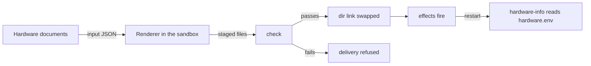

# Render config files

This page is for an image author whose service reads a config file of its own format. At the end
an output renders that file from the node's documents, a check refuses a file the service could
not read, and a document that would break the service is refused before it reaches the node. The
examples use the output `hardware` of the
[extensions example](https://github.com/trevex/chalkos/tree/main/examples/extensions): it renders
the node's `Hardware` document into an environment file that a unit reads.

An output is a directory of files that a program of the image renders from documents. chalkd
renders and checks every output before a delivery changes anything. When a render or a check
fails, chalkd refuses the whole delivery, and the node keeps the config it runs.

See it in a full extension: [Render bird.conf](../guides/bgp-extension.md#render-birdconf) of the
BGP guide renders bird's config and checks it with bird's parser.

## Before you begin

You need a kind whose documents the service needs, as [Declare a config kind](declare-a-kind.md)
declares `Hardware`. A service that reads JSON documents itself needs no output: a grant gives it
the documents, as [Read config in a service](read-config.md) shows.

## Declare the output

`chalkos.outputs.<name>` declares an output. Here is `hardware`, as `hardware.nix` declares it:

```nix title="hardware.nix"
--8<-- "examples/extensions/hardware.nix:output"
```

The declaration sets two things, and may set a third:

- `inputs` names the kinds whose documents the renderer reads.
- `render` is the renderer: here a Go template, rendered into `hardware.env`.
- `check` is a shell script that checks the rendered files. `hardware` has none.
  [Check the rendered files](#check-the-rendered-files) describes it.

The unit reads the rendered file from the output's `dir`. The module names the path as
`config.chalkos.outputs.hardware.dir`, so a misspelled output name fails the image's evaluation:

```nix
EnvironmentFile = "-${config.chalkos.outputs.hardware.dir}/hardware.env";
```

On a delivery, the files pass through these steps before the unit reads them:



The diagram shows the documents becoming staged files, which the check either passes or refuses.
Files that pass replace the old ones in one link swap, and the effects that name the output fire
after it. A refused render changes nothing the service reads.

## Read the renderer's input

Every renderer reads the same input on standard input: the node's name and the documents of each
input kind. For a renderer with the inputs `Hardware` and `Rack`, on a node named `example`, the
input reads, indented here:

```json
{
  "documents": {
    "Hardware": [
      {
        "apiVersion": "hardware.example.org/v1alpha1",
        "kind": "Hardware",
        "metadata": {"name": "hardware"},
        "spec": {"assetTag": null, "model": "SYS-E300-9D", "vendor": "Supermicro"}
      }
    ],
    "Rack": [
      {
        "apiVersion": "rack.example.org/v1alpha1",
        "kind": "Rack",
        "metadata": {"name": "rack"},
        "spec": {"location": "rack-a/u12"}
      }
    ]
  },
  "node": {"name": "example"}
}
```

The documents carry their schema defaults, so the `Hardware` has `assetTag: null` although its
YAML leaves the field out. A renderer never sees a `Secret`'s value, as
[Pass secrets to a service](pass-secrets.md) explains. It writes its files into the directory
that the environment variable `OUT` names.
[Program input](../reference/extension-runtime.md#program-input) lists the rules of the input.

A renderer must read nothing but this input, because every boot renders the outputs again.
[Every boot renders the outputs again](../how-it-works/node/config-pipeline.md#every-boot-renders-the-outputs-again)
explains why.

## Render one file from a template

`chalkosLib.render.template` renders a Go `text/template` into one file, named as the template
less `.tmpl`. `hardware.env.tmpl` becomes `hardware.env`:

```text title="hardware.env.tmpl"
--8<-- "examples/extensions/hardware.env.tmpl"
```

From a `Hardware` with the asset tag `HL-0042`, the template renders this file:

```text title="hardware.env"
--8<-- "examples/extensions/tests/server/hardware/hardware.env"
```

On a node without a `Hardware` document the range is empty, and so is the file.

The template reads the input as `.node.name` and `.documents.<Kind>`.
[Template functions](../reference/extension-runtime.md#template-functions) lists the functions it
has besides Go's own, such as `quote` and `refuse`, and how it prints a missing key.

## Render one file with jq

`chalkosLib.render.jq` runs a jq program on the input and writes its result into one file, named
as the program less `.jq`, so `hardware.json.jq` writes `hardware.json`. Here is that program,
for a tool that reads the server's details from JSON:

```text title="hardware.json.jq"
# One object per Hardware document, for a tool that reads the server's details from JSON.
.documents.Hardware | map({vendor: .spec.vendor, model: .spec.model})
```

```nix
chalkos.outputs.hardware-json = {
  inputs = [ "Hardware" ];
  render = chalkosLib.render.jq ./hardware.json.jq;
};
```

For the `Hardware` above, the output's `dir` then holds `hardware.json`:

```json title="hardware.json"
[
  {
    "vendor": "Supermicro",
    "model": "SYS-E300-9D"
  }
]
```

## Copy documents as they are

`chalkosLib.render.documents` writes each document of the kinds it names as
`<Kind>/<name>.json`, for a service that reads documents from a directory of its own choosing:

```nix
chalkos.outputs.racks = {
  inputs = [ "Rack" ];
  render = chalkosLib.render.documents [ "Rack" ];
};
```

Each kind it names must be one of `inputs`, or the render fails. A unit granted the kind reads
the same documents below `/run/chalkos/config` without an output.

## Render with any program of the store

`render` also takes a command: a program of the image's store, with its arguments, or a package
that is such a program. chalkd splits the command on spaces and runs it without a shell, so the
command cannot redirect output or expand `$OUT`. A script from `pkgs.writeShellScript` does both.
This one writes the servers as YAML with yq:

```nix
chalkos.outputs.hardware-yaml = {
  inputs = [ "Hardware" ];
  render = pkgs.writeShellScript "render-hardware-yaml" ''
    ${lib.getExe pkgs.yq-go} -P -o yaml '.documents.Hardware | map({"vendor": .spec.vendor, "model": .spec.model})' >"$OUT/hardware.yaml"
  '';
};
```

```yaml title="hardware.yaml"
- vendor: Supermicro
  model: SYS-E300-9D
```

[Program output](../reference/extension-runtime.md#program-output) lists what the program may
write, and where.

## Refuse a config from the renderer

A schema and the change rules check what a document's fields hold. A renderer can check more,
such as what several documents mean together. It refuses a config by printing a report of
refusals on standard output, one JSON object:

```json
{"refusals": [{"kind": "Hardware", "name": "hardware", "path": "metadata.name", "message": "a node with a Hardware document needs a Rack document, which says where the server is mounted"}]}
```

Any refusal refuses the delivery, and chalkd reports it after `the config is refused:`, with the
document and the field:

```text
the config is refused: Hardware/hardware: metadata.name: a node with a Hardware document needs a Rack document, which says where the server is mounted
```

[Refusal report](../reference/extension-runtime.md#refusal-report) gives the rules of each field
and of the report.

A template refuses with `refuse`. These lines refuse a `Hardware` document on a node without a
`Rack`, in a template whose output has both kinds as `inputs`:

```text
{{- if and .documents.Hardware (not .documents.Rack) }}
{{- refuse "Hardware" (index .documents.Hardware 0).metadata.name "metadata.name" "a node with a Hardware document needs a Rack document, which says where the server is mounted" }}
{{- end }}
```

A program that `render` names prints the report itself, and a script made by
`pkgs.writeShellScript` can print it with `echo` or `jq`. A jq renderer cannot refuse, and a check
refuses by failing, as [Check the rendered files](#check-the-rendered-files) shows.

A check of the documents that needs no rendered file fits a validator better, which
[Validate config with a program](validate-config.md) declares: it runs before every renderer,
reads the same input and reports its refusals in the same form. When a validator and a renderer
refuse the same config, the operator sees the validator's refusal.

## Check the rendered files

`check` names a program, which chalkd runs after the renderer, without a shell. An exit status
other than 0 refuses the files.
[Check environment](../reference/extension-runtime.md#check-environment) lists what a check reads
and may run.

The best check is the service's own test of its config, such as `nginx -t` or `chronyd -p`.
`chalkosLib.check.run` runs it on the rendered files, with `$OUT` in its arguments replaced by
their directory. Name the program by its store path, because the check's `PATH` names none:

```nix
chalkos.outputs.myapp-conf.check = chalkosLib.check.run [
  "${pkgs.nginx}/bin/nginx"
  "-t"
  "-c"
  "$OUT/nginx.conf"
];
```

`chalkosLib.check.each` runs the program once for each file a glob matches, with `$FILE` replaced
by the file's path, for a renderer that writes a file per document. A config that names files the
node alone holds, such as credentials, needs the check to stand in for them first. That takes a
program of your own: the check of `bird-conf` in
[Render bird.conf](../guides/bgp-extension.md#render-birdconf) is a script that defines each
password constant before it runs `bird -p`.

## Test the output

A test of `chalkos.tests` renders and checks every output from a config file, as chalkd does for
a delivery, and compares an output's files with golden files that hold what it should render.
`nix flake check` runs the tests, so a template that does not render, or renders a file the check
refuses, fails there before any node gets the image. The example's test `hardware-server`
renders `hardware` from `hardware-examples/server.yaml` and compares the result with
`tests/server/hardware/hardware.env`:

```nix
--8<-- "examples/extensions/hardware.nix:test"
```

Cover the documents that change what the renderer writes: no documents, one, several, and each
optional field set and unset. In a test the renderer and the check run in the Nix build sandbox, not
in the output's [sandbox](../reference/extension-runtime.md#sandbox), and
the files keep the owner the build gives them. [Test an extension](test-an-extension.md) declares
the tests and takes the golden files.

## Choose the files' directory and owner

Services read the files at the output's `dir`. A `dir` of your own lets a service find its files
where it expects them. The files belong to `root` by default, and every local user may read them.
A file that holds anything a local user must not read, such as a password, belongs in a
credential instead. A file only the service may read gets the service's user and a narrower mode:

```nix
chalkos.outputs.myapp-conf = {
  user = "myapp";
  group = "myapp";
  mode = "0640";
};
```

[Output directories](../reference/extension-runtime.md#output-directories) gives the defaults of
`dir`, `user`, `group` and `mode`, and the rules a `dir` of your own follows.

## Check that it worked

Run the tests. `nix flake check` renders `hardware` for each test and runs its check, so a
broken template fails here, and a `hardware.env` that differs from `hardware-server`'s golden file
fails with a diff:

```sh
nix flake check
```

A test that fails names the output in a `FAIL` line, such as
`FAIL hardware-server: output hardware differs from its golden files`.
[A failing test shows what it got](test-an-extension.md#a-failing-test-shows-what-it-got) shows the
diff and how to take the new file.

`chalkctl status server1` lists each output with three columns. `OUTPUT` is its name. `HASH` is
the start of the hash of the files the node serves, `none` while it serves none. `STATE` is
`rendered`, `failed:` with the last failure, or `not rendered yet`. A refused delivery leaves the
hash of the files the node still serves.

`chalkctl config apply --dry-run` renders and checks every output on the node without a delivery.
It prints the refusal a delivery would print, or the outputs whose files would change, and records
nothing in the status.

## If it fails

After `chalkctl config apply`, a render or check that fails refuses the delivery, and nothing on
the node changes. A renderer's refusal shows as `the config is refused:` and the refusals. Any
other failure names the output and the exit status, such as
`output <name>: its check refused the rendered files (exit 1); see the node's journal`.

That message leaves out what the program printed, because a program can echo the documents it
read. Each program runs as a transient unit, `chalkos-render-<n>.service`. Its journal holds the
program's standard error, and the journal of `chalkd.service` names the unit beside the failure:

```sh
chalkctl logs server1 --unit=chalkd.service
chalkctl logs server1 --unit=chalkos-render-<n>.service
```

`chalkctl config apply` while an image is staged, with or without `--staged` and `--dry-run`, and
`chalkctl upgrade` run the renderers of the image the config is for, from that image's store, in
`chalkos-check.service`; its journal holds what they write to standard error.

A renderer that times out, writes too much or reads a path it may not read hits a limit of its
[sandbox](../reference/extension-runtime.md#sandbox).

## What next

- [Test an extension](test-an-extension.md) takes the rendered file as a golden file, which every
  `nix flake check` compares.
- [React to changes](react-to-changes.md) restarts the unit when its file changes.
- [Guard changes with rules and facts](guard-changes.md) refuses a change before any render.
- [Validate config with a program](validate-config.md) refuses a config before any render.
- [The config pipeline](../how-it-works/node/config-pipeline.md) shows where rendering sits in a
  delivery, at boot and after an upgrade.
