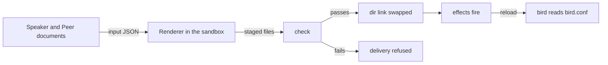

# Render config files

This page is for an image author whose service reads a config file of its own format. At the end
an output renders that file from the node's documents, the service's own validator checks it, and
a document that would break the service is refused before it reaches the node. The page continues
the homelab's BGP extension, `extensions/bgp.nix`: bird reads `bird.conf`, rendered from the
`Speaker` and `Peer` documents.

An output is a directory of files that a program of the image renders from documents. chalkd
renders and checks every output before a delivery changes anything. When a render or a check
fails, chalkd refuses the whole delivery, and the node keeps the config it runs.

## Before you begin

You need a kind whose documents the service needs, as [Declare a config kind](declare-a-kind.md)
declares `Peer`. A service that reads JSON documents itself needs no output: a grant gives it the
documents, as [Read config in a service](read-config.md) shows.

## Declare the output

`chalkos.outputs.<name>` declares an output. Here is `bird-conf`, as `extensions/bgp.nix`
declares it:

```nix
--8<-- "examples/homelab/extensions/bgp.nix:output"
```

The declaration sets three things:

- `inputs` names the kinds whose documents the renderer reads.
- `render` is the renderer: here a Go template, rendered into `bird.conf`.
- `check` is a shell script that checks the rendered files. `bird -p` parses the config without
  running it and exits with an error on a config bird rejects.

bird's config includes the rendered file from the output's `dir`. The module names the path as
`config.chalkos.outputs.bird-conf.dir`, so a misspelled output name fails the image's evaluation:

```nix
--8<-- "examples/homelab/extensions/bgp.nix:service"
```

On a delivery, the files pass through these steps before bird reads them:



The diagram shows the documents becoming staged files, which the check either passes or refuses.
Files that pass replace the old ones in one link swap, and the effects that name the output fire
after it. A refused render changes nothing the service reads.

## Read the renderer's input

Every renderer reads the same input on standard input: the node's name and the documents of each
input kind. For the homelab's `Speaker` and `Peer` on `node1`, `bird-conf`'s renderer reads
this object, indented here:

```json
{
  "documents": {
    "Peer": [
      {
        "apiVersion": "bgp.example.org/v1alpha1",
        "kind": "Peer",
        "metadata": {"name": "router"},
        "spec": {
          "address": "fdc8:a1b2:c3d4:1::1",
          "asn": 65000,
          "bfd": true,
          "interfaces": ["enp1s0", "enp2s0"],
          "password": {"secretRef": {"key": "password", "name": "bgp"}}
        }
      }
    ],
    "Speaker": [
      {
        "apiVersion": "bgp.example.org/v1alpha1",
        "kind": "Speaker",
        "metadata": {"name": "bgp"},
        "spec": {"asn": 65001, "export": {"interfaces": ["node0"]}, "routerID": "0.0.0.11"}
      }
    ]
  },
  "node": {"name": "node1"}
}
```

The documents carry their schema defaults, so `router` has `bfd: true` although its YAML leaves
the field out. A renderer never sees a `Secret`'s value, as
[Pass secrets to a service](pass-secrets.md) explains. It writes its files into the directory
that the environment variable `OUT` names.
[Program input](../reference/extension-runtime.md#program-input) lists the rules of the input.

A renderer must read nothing but this input, because every boot renders the outputs again.
[Every boot renders the outputs again](../how-it-works/node/config-pipeline.md#every-boot-renders-the-outputs-again)
explains why.

## Render one file from a template

`chalkosLib.render.template` renders a Go `text/template` into one file, named as the template
less `.tmpl`. `bird.conf.tmpl` becomes `bird.conf`:

```text title="extensions/bird.conf.tmpl"
--8<-- "examples/homelab/extensions/bird.conf.tmpl"
```

From the input above, the template renders this file:

```text title="bird.conf"
# bird's config for node1, rendered by chalkos from its Speaker and Peer documents.
router id 0.0.0.11;
...

protocol bgp 'router_enp1s0' {
  local as 65001;
  neighbor fdc8:a1b2:c3d4:1::1 as 65000;
  interface "enp1s0";
  direct;
  connect retry time 5;
  bfd on;
  authentication md5;
  password 'secret_bgp.password';
  ipv6 {
    # The router sends a link-local next hop beside its global one. bird would resolve the global
    # one through the first port on the fabric's prefix for every session; the link-local one
    # keeps each session's routes on its own port.
    next hop prefer local;
    import where net = ::/0;
    export where proto = "node_addresses";
  };
}
...
```

This excerpt shows the session of the `Peer` named `router` on `enp1s0`. The file has a second
session on `enp2s0`, and the blocks for the node's addresses and the kernel. The
[BGP extension guide](../guides/bgp-extension.md#see-what-the-output-renders) shows the whole file.

The `Speaker` gives the router ID, the AS number of every session and the interfaces of
`node_addresses`, whose addresses each session announces. Each `Peer` gets a session per
interface, named after the `Peer` and the interface and bound to that interface. A session takes
the default route alone from the neighbour, and `merge paths` installs it with a next hop per
session, so the node keeps it while one port works.

The template reads the input as `.node.name` and `.documents.<Kind>`.
[Template functions](../reference/extension-runtime.md#template-functions) lists the functions it
has besides Go's own, such as `quote` and `refuse`, and how it prints a missing key.

## Render one file with jq

`chalkosLib.render.jq` runs a jq program on the input and writes its result into one file, named
as the program less `.jq`, so `peers.json.jq` writes `peers.json`. Here is that program, which
turns the peers into a JSON list for a tool that reads its neighbours from JSON:

```text title="peers.json.jq"
# One entry per Peer, for a tool that reads its neighbours from JSON.
.documents.Peer | map({name: .metadata.name, address: .spec.address, asn: .spec.asn})
```

```nix
chalkos.outputs.peers-json = {
  inputs = [ "Peer" ];
  render = chalkosLib.render.jq ./peers.json.jq;
};
```

For the homelab's `Peer`, the output's `dir` then holds `peers.json`:

```json title="peers.json"
[
  {
    "name": "router",
    "address": "fdc8:a1b2:c3d4:1::1",
    "asn": 65000
  }
]
```

## Copy documents as they are

`chalkosLib.render.documents` writes each document of the kinds it names as
`<Kind>/<name>.json`, for a service that reads documents from a directory of its own choosing:

```nix
chalkos.outputs.racks = {
  inputs = [ "Rack" ];
  render = chalkosLib.render.documents [ "Rack" ];
};
```

Each kind it names must be one of `inputs`, or the render fails. A unit granted the kind reads
the same documents below `/run/chalkos/config` without an output.

## Render with any program of the store

`render` also takes a command: a program of the image's store, with its arguments, or a package
that is such a program. chalkd runs the command without a shell, so a script from
`pkgs.writeShellScript` redirects the output and expands `$OUT`. This one writes the peers as YAML
with yq:

```nix
chalkos.outputs.peers-yaml = {
  inputs = [ "Peer" ];
  render = pkgs.writeShellScript "render-peers-yaml" ''
    ${lib.getExe pkgs.yq-go} -P -o yaml '.documents.Peer | map({"name": .metadata.name, "address": .spec.address})' >"$OUT/peers.yaml"
  '';
};
```

```yaml title="peers.yaml"
- name: router
  address: fdc8:a1b2:c3d4:1::1
```

[Program output](../reference/extension-runtime.md#program-output) lists what the program may
write, and where.

## Refuse a config from the renderer

A schema and the change rules check what a document's fields hold. A renderer can check more,
such as what several documents mean together. It refuses a config by printing a report of
refusals on standard output, one JSON object:

```json
{"refusals": [{"kind": "Peer", "name": "router", "path": "metadata.name", "message": "a node with Peer documents needs a Speaker document, which gives bird its AS number and router ID"}]}
```

Any refusal refuses the delivery, and chalkd reports it after `the config is refused:`:

```text
the config is refused: Peer/router: metadata.name: a node with Peer documents needs a Speaker document, which gives bird its AS number and router ID
```

[Refusal report](../reference/extension-runtime.md#refusal-report) gives the rules of each field
and of the report.

A template refuses with `refuse`. These lines of `bird.conf.tmpl` refuse `Peer` documents on a
node without a `Speaker`, whose AS number every session needs:

```text
{{- if and .documents.Peer (not .documents.Speaker) }}
{{- refuse "Peer" (index .documents.Peer 0).metadata.name "metadata.name" "a node with Peer documents needs a Speaker document, which gives bird its AS number and router ID" }}
{{- end }}
```

The validator `bgp-peers` of [Validate config with a program](validate-config.md) refuses the
same config, before any renderer runs.

A program that `render` names prints the report itself, and a script made by
`pkgs.writeShellScript` can print it with `echo` or `jq`. A jq renderer cannot refuse, and a check
refuses by failing, as [Check the rendered files](#check-the-rendered-files) shows.

A check of the documents that needs no rendered file fits a validator better, which
[Validate config with a program](validate-config.md) declares: it runs before every renderer,
reads the same input and reports its refusals in the same form.

## Check the rendered files

`check` holds shell commands, which chalkd runs with bash and `set -e` after the renderer. The
first command that fails refuses the files.
[Check environment](../reference/extension-runtime.md#check-environment) lists what a check reads
and may run.

The best check is the service's own validator, such as `bird -p`, `nginx -t` or `chronyd -p`.
`bird-conf`'s check defines each password constant before it runs `bird -p`, because the
constants exist on the node alone.

## Test the output

A test of `chalkos.tests` renders and checks every output from a config file, as chalkd does for
a delivery, and compares an output's files with golden files that hold what it should render.
`nix flake check` runs the tests, so a template that does not render, or renders a file the check
refuses, fails there before any node gets the image. The homelab's test `bgp-fabric` renders
`bird-conf` from `bgp-examples/fabric.yaml`, with a node's `Speaker`, the `Peer` of the router,
the `Secret` that the `Peer` names and the `Network` documents of the node's ports and of `node0`,
which the validator of [Validate config with a program](validate-config.md) reads. It compares the
result with `tests/fabric/bird-conf/bird.conf`.

Cover the documents that change what the renderer writes: no documents, one, several, and each
optional field set and unset. In a test the renderer and the check run in the Nix build sandbox, not
in the output's [sandbox](../reference/extension-runtime.md#sandbox), and
the files keep the owner the build gives them. [Test an extension](test-an-extension.md) declares
the tests and takes the golden files.

## Choose the files' directory and owner

Services read the files at the output's `dir`. A `dir` of your own lets a service find its files
where it expects them. The files belong to `root` by default, and every local user may read them.
A file that holds anything a local user must not read, such as a password, belongs in a
credential instead. A file only the service may read gets the service's user and a narrower mode:

```nix
chalkos.outputs.bird-conf = {
  user = "bird";
  group = "bird";
  mode = "0640";
};
```

[Output directories](../reference/extension-runtime.md#output-directories) gives the defaults of
`dir`, `user`, `group` and `mode`, and the rules a `dir` of your own follows.

## Check that it worked

Run the tests. `nix flake check` renders `bird-conf` for each test and runs its check, so a
broken template fails here, and a `bird.conf` that differs from `bgp-fabric`'s golden file fails
with a diff:

```sh
nix flake check
```

A test that fails names the output in a `FAIL` line, such as
`FAIL bgp-fabric: output bird-conf differs from its golden files`.
[A failing test shows what it got](test-an-extension.md#a-failing-test-shows-what-it-got) shows the
diff and how to take the new file.

`chalkctl status node1` lists each output with three columns. `OUTPUT` is its name. `HASH` is the
start of the hash of the files the node serves, `none` while it serves none. `STATE` is
`rendered`, `failed:` with the last failure, or `not rendered yet`. A refused delivery leaves the
hash of the files the node still serves.

`chalkctl config apply --dry-run` renders and checks every output on the node without a delivery.
It prints the refusal a delivery would print, or the outputs whose files would change, and records
nothing in the status.

## If it fails

After `chalkctl config apply`, a render or check that fails refuses the delivery, and nothing on
the node changes. A renderer's refusal shows as `the config is refused:` and the refusals. Any
other failure names the output and the exit status:

```text
output bird-conf: its check refused the rendered files (exit 1); see the node's journal
```

That message leaves out what the program printed, because a program can echo the documents it
read. Each program runs as a transient unit, `chalkos-render-<n>.service`. Its journal holds the
program's standard error, and the journal of `chalkd.service` names the unit beside the failure:

```sh
chalkctl logs node1 --unit=chalkd.service
chalkctl logs node1 --unit=chalkos-render-<n>.service
```

`chalkctl config apply` while an image is staged, with or without `--staged` and `--dry-run`, and
`chalkctl upgrade` run the renderers of the image the config is for, from that image's store, in
`chalkos-check.service`; its journal holds what they write to standard error.

A renderer that times out, writes too much or reads a path it may not read hits a limit of its
[sandbox](../reference/extension-runtime.md#sandbox).

## What next

- [Test an extension](test-an-extension.md) takes `bird.conf` as a golden file, which every
  `nix flake check` compares.
- [React to changes](react-to-changes.md) reloads bird when `bird.conf` changes.
- [Guard changes with rules and facts](guard-changes.md) refuses a `Peer` change before any
  render.
- [Validate config with a program](validate-config.md) refuses an interface the node does not
  configure.
- [The config pipeline](../how-it-works/node/config-pipeline.md) shows where rendering sits in a
  delivery, at boot and after an upgrade.
