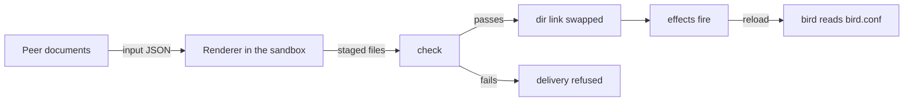

# Render config files

This page is for an image author whose service reads a config file of its own format. At the end
an output renders that file from the node's documents, the service's own validator checks it, and
a document that would break the service is refused before it reaches the node. The page continues
the homelab's BGP extension, `extensions/bgp.nix`: bird reads `bird.conf`, rendered from the
`Peer` documents.

An output is a directory of files that a program of the image renders from documents. chalkd
renders and checks every output before a delivery changes anything. When a render or a check
fails, chalkd refuses the whole delivery, and the node keeps the config it runs.

## Before you begin

You need a kind whose documents the service needs, as [Declare a config kind](declare-a-kind.md)
declares `Peer`. A service that reads JSON documents itself needs no output: a grant gives it the
documents, as [Read config in a service](read-config.md) shows.

## Declare the output

`chalkos.outputs.<name>` declares an output. Here is `bird-conf`, as `extensions/bgp.nix`
declares it:

```nix
--8<-- "examples/homelab/extensions/bgp.nix:output"
```

The declaration sets four things:

- `inputs` names the kinds whose documents the renderer reads.
- `render` is the renderer: here a Go template, rendered into `bird.conf`.
- `check` is a shell script that checks the rendered files. `bird -p` parses the config without
  running it and exits with an error on a config bird rejects.
- `examples` is a directory of config files that the image build renders and checks.

bird's config includes the rendered file from the output's `dir`. The module names the path as
`config.chalkos.outputs.bird-conf.dir`, so a misspelled output name fails the image's evaluation:

```nix
--8<-- "examples/homelab/extensions/bgp.nix:service"
```

On a delivery, the files pass through these steps before bird reads them:



The diagram shows the documents becoming staged files, which the check either passes or refuses.
Files that pass replace the old ones in one link swap, and the effects that name the output fire
after it. A refused render changes nothing the service reads.

## The renderer reads one JSON object

Every renderer reads the same input on standard input: the node's name and the documents of each
input kind. For the homelab's two `Peer` documents on `cp1`, `bird-conf`'s renderer reads this
object, indented here:

```json
{
  "documents": {
    "Peer": [
      {
        "apiVersion": "bgp.example.org/v1alpha1",
        "kind": "Peer",
        "metadata": {"name": "router-a"},
        "spec": {"address": "10.0.0.1", "asn": 64513, "password": {"secretRef": {"key": "password", "name": "bgp"}}}
      },
      {
        "apiVersion": "bgp.example.org/v1alpha1",
        "kind": "Peer",
        "metadata": {"name": "router-b"},
        "spec": {"address": "10.0.0.2", "asn": 64514, "password": null}
      }
    ]
  },
  "node": {"name": "cp1"}
}
```

- `documents` holds one list per kind of `inputs`, empty when the node holds no document of the
  kind. Each list is sorted by the documents' names.
- The documents carry their schema defaults, so `router-b` has `password: null` although its
  YAML leaves the field out.
- A `secretRef` field holds the reference alone. A renderer never sees a `Secret`'s value, as
  [Pass secrets to a service](pass-secrets.md) explains.
- `node.name` is the node's name in the inventory, which its node certificate carries.

The renderer writes its files into the directory that the environment variable `OUT` names.

## A template renders one file

`lib.chalkos.render.template` renders a Go `text/template` into one file, named as the template
less `.tmpl`. `bird.conf.tmpl` becomes `bird.conf`:

```text title="extensions/bird.conf.tmpl"
--8<-- "examples/homelab/extensions/bird.conf.tmpl"
```

From the input above, the template renders this file:

```text title="bird.conf"
# bird's config for cp1, rendered by chalkos from its Peer documents.
router id from "*";

protocol device {
}

protocol bgp 'router-a' {
  local as 64512;
  neighbor 10.0.0.1 as 64513;
  authentication md5;
  password 'secret_bgp.password';
  ipv4 {
    import all;
    export none;
  };
}

protocol bgp 'router-b' {
  local as 64512;
  neighbor 10.0.0.2 as 64514;
  ipv4 {
    import all;
    export none;
  };
}
```

The template reads the input as `.node.name` and `.documents.<Kind>`. Besides Go's own functions
it has four more:

| Function | Result |
| --- | --- |
| `join <sep> <list>` | The list's values, each as it prints, joined with `<sep>`. |
| `quote <value>` | The value as a double-quoted string with Go's escapes. |
| `json <value>` | The value as JSON. |
| `default <fallback> <value>` | `<fallback>` when the value is missing, null, empty or false; the value otherwise. |

A key that a document lacks, or that holds null, prints as nothing, so `{{ .spec.password }}`
prints nothing for `router-b`. A key below a missing one, such as `.spec.missing.name`, fails the
render.

## A jq program renders one file

`lib.chalkos.render.jq` runs a jq program on the input and writes its result into one file, named
as the program less `.jq`. Here is a program that turns the peers into a JSON list, for a tool
that reads its neighbours from JSON:

```text title="peers.jq"
# One entry per Peer, for a tool that reads its neighbours from JSON.
.documents.Peer | map({name: .metadata.name, address: .spec.address, asn: .spec.asn})
```

```nix
chalkos.outputs.peers-json = {
  inputs = [ "Peer" ];
  render = lib.chalkos.render.jq ./peers.jq;
};
```

The output's `dir` then holds `peers.json`:

```json title="peers.json"
[
  {
    "name": "router-a",
    "address": "10.0.0.1",
    "asn": 64513
  },
  {
    "name": "router-b",
    "address": "10.0.0.2",
    "asn": 64514
  }
]
```

jq runs with `-r`, so a program whose result is a string writes the string raw, without quotes.

## The documents renderer copies documents

`lib.chalkos.render.documents` writes each document of the kinds it names as
`<Kind>/<name>.json`, for a service that reads documents from a directory of its own choosing:

```nix
chalkos.outputs.racks = {
  inputs = [ "Rack" ];
  render = lib.chalkos.render.documents [ "Rack" ];
};
```

Each kind it names must be one of `inputs`, or the render fails. A unit granted the kind reads
the same documents below `/run/chalkos/config` without an output.

## Any program of the store renders too

`render` also takes a command: a program of the image's store, with its arguments, or a package
that is such a program. chalkd splits the command on spaces and runs it without a shell, so the
command cannot redirect output or expand `$OUT`. A script from `pkgs.writeShellScript` does both.
This one writes the peers as YAML with yq:

```nix
chalkos.outputs.peers-yaml = {
  inputs = [ "Peer" ];
  render = pkgs.writeShellScript "render-peers-yaml" ''
    ${lib.getExe pkgs.yq-go} -P -o yaml '.documents.Peer | map({"name": .metadata.name, "address": .spec.address})' >"$OUT/peers.yaml"
  '';
};
```

```yaml title="peers.yaml"
- name: router-a
  address: 10.0.0.1
- name: router-b
  address: 10.0.0.2
```

The program may write any number of files and directories into `$OUT`, but no links.

## The renderer must be pure

The same documents must always give the same files. `/run` is a tmpfs, so a node keeps no
rendered file across a reboot: it renders every output again at boot, from the config slot it
boots with. A renderer that reads nothing but its input renders at boot the files that the
delivery checked. A renderer that read node state, such as an interface's address, could render a
file at boot that no delivery checked. A service that needs node state therefore reads that part
itself.

## The check refuses a bad file

`check` holds shell commands. chalkd runs them with bash and `set -e`, so the first command that
fails refuses the files. The check runs after the renderer, in the same sandbox:

- `$OUT` holds the files as the renderer wrote them, before they get the output's owner and mode.
  The check may not change them.
- Standard input holds the renderer's input, so a check can compare the files with the documents.
- `PATH` holds coreutils, grep and sed alone. Name any other program by its store path, as
  `${bird}/bin/bird` does.

The best check is the service's own validator, such as `bird -p`, `nginx -t` or `chronyd -p`.
`bird-conf`'s check defines each password constant before it runs `bird -p`, because the
constants exist on the node alone.

An output without `check` has its files served as the renderer wrote them.

## Examples are rendered when the image is built

`examples` names a directory of YAML or JSON files. Each file is one node's documents, checked
against the image's schemas. The image build renders and checks the output from each file, as the
node `example`, and fails when one fails. A template that does not render, or renders a file the
check refuses, then fails the build before any node gets it. `bgp.nix` has one example,
`bgp-examples/two-peers.yaml`, with both peers and the `Secret` that `router-a` names.

Cover the documents that change what the renderer writes: no documents, one, several, and each
optional field set and unset. At build time the renderer and the check run outside the sandbox,
and the files keep the owner the build gives them.

## The output's dir is a link

Services read the files at the output's `dir`, `/run/chalkos/outputs/<name>` by default. `dir` is
a symbolic link to the directory of the last render. chalkd replaces the link in one rename, so a
service reads the files of one render and never a mix of two.

A `dir` of your own lets a service find its files where it expects them. The built-in output
`networkd` uses `/run/systemd/network`. The first swap removes a directory it finds at `dir`, so
the image's evaluation refuses a `dir` that breaks these rules:

- It is a clean path below `/run`, and no component starts with a dot.
- It stays out of `/run/chalkos`, except for `/run/chalkos/outputs/<name>` and the paths below it.
- It is neither another output's `dir` nor inside one.

## Owner and mode default to root and 0644

The files belong to the output's `user` and `group`, `root` and `root` by default, with its
`mode`, `0644` by default. Directories get `0755`. A file that holds anything a local user must not
read, such as a password, belongs in a credential instead. A file only the service may read gets
the service's user and a narrower mode:

```nix
chalkos.outputs.bird-conf = {
  user = "bird";
  group = "bird";
  mode = "0640";
};
```

`mode` is three octal digits with an optional leading `0`.

## Check that it worked

Build the image. The build renders each example and runs the check, so a broken template fails
here and names the output and the example file.

After `chalkctl apply-config`, a render or check that fails refuses the delivery, and nothing on
the node changes. The error names the output and the exit status:

```text
output bird-conf: its check refused the rendered files (exit 1); see the node's journal
```

The message leaves out what the program printed, because a program can echo the documents it
read. Each program runs as a transient unit, `chalkos-render-<n>.service`. Its journal holds the
program's standard error, and the journal of `chalkd.service` names the unit beside the failure:

```sh
chalkctl logs cp1 --unit=chalkd.service
chalkctl logs cp1 --unit=chalkos-render-<n>.service
```

`chalkctl status cp1` lists each output with three columns. `OUTPUT` is its name. `HASH` is the
start of the hash of the files the node serves, `none` while it serves none. `STATE` is
`rendered`, `failed:` with the last failure, or `not rendered yet`. A refused delivery leaves the
hash of the files the node still serves.

## The renderer runs in a sandbox

chalkd runs every renderer and check as a transient unit with these limits:

- It runs as the unprivileged system user `chalkos-render`, without capabilities, devices or
  network.
- The system is read-only. STATE, `/var`, and the config, credentials and Kubernetes keys chalkd
  writes below `/run/chalkos` are hidden, so a renderer cannot read a secret even by its path.
- The renderer may write `$OUT` and a private `/tmp` of 16 MiB alone.
- It must finish within 30 seconds.
- Its files may take 16 MiB and hold no links, because chalkd sets their owner afterwards and must
  not follow a link to a file the output does not own.

The outputs' files, those the node serves and those a render stages, sit on a tmpfs of their own
at `/run/chalkos/outputs`. It has room for every output's files twice and 16 MiB more, so a
renderer that writes without end fills that tmpfs and not `/run`.

## What next

- [React to changes](react-to-changes.md) reloads bird when `bird.conf` changes.
- [Guard changes with rules and facts](guard-changes.md) refuses a `Peer` change before any
  render.
- [The config pipeline](../how-it-works/node/config-pipeline.md) shows where rendering sits in a
  delivery, at boot and after an upgrade.
