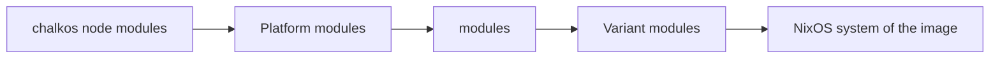

# Variants and platforms

This page is for an image author whose nodes do not all run the same software, or do not all run
on the same kind of machine. At the end your flake builds one image per variant and platform, and
the inventory gives each node the image it needs. It starts from the flake of
[Your first image flake](first-image.md).

A variant is a named set of NixOS modules: the software a group of nodes runs. A platform is the
kind of machine an image runs on, such as `metal` or `kvm`. `mkImages` builds every variant for
every platform, so two variants on two platforms are four images.

## A second variant builds a second image

This call builds a `node` variant and a `storage` variant without Kubernetes, each for `metal` and
`kvm`:

```nix
images = chalkos.lib.mkImages {
  osCA = ./secrets.pub.json;
  platforms = [ "metal" "kvm" ];
  # Every variant's images carry these.
  modules = [ ./site.nix ];
  variants = {
    node = { };
    storage = {
      kubernetes = false;
      modules = [ ./storage.nix ];
    };
  };
};
```

It returns `images.node-metal`, `images.node-kvm`, `images.storage-metal` and
`images.storage-kvm`. `variants` replaces the default, a single `node` variant, so the call names
`node` to keep it. Expose each image the cluster runs as a package, as the first flake exposes
`node-metal`, and build it the same way:

```sh
nix build .#storage-metal -o images/storage-metal
```

A variant declares three things:

- `modules`, the NixOS modules of the variant's images: a monitoring agent, a storage daemon, more
  kernel module groups or an extension's kinds and services.
- `kubernetes`, whether the variant's images carry the Kubernetes layer, `true` by default. An
  image without it runs no kubelet, etcd or containerd, and its nodes accept none of the kinds of
  `kubernetes.chalkos.dev`: `Node`, `Cluster`, `Flannel` and `Addon`.
- `router`, whether the variant's images carry the router layer, `false` by default. Its images
  forward IPv4 and IPv6 packets between their interfaces, accept the kinds of
  `router.chalkos.dev`, filter with the router's own firewall in place of NixOS's and run FRR
  for BGP.
  [How a router works](../how-it-works/router/overview.md) describes the layer.

An image carries one layer at most. A router variant therefore also sets `kubernetes = false`, and
`mkImages` refuses a variant with both layers and names it.

A variant's name is lower-case letters, digits and dashes, and starts with a letter or digit. It
becomes `CHALKOS_VARIANT` in its images' os-release and `variant` in their `metadata.json`. A name
with a dash can collide with another on a platform with a dash, such as variant `a-b` on `metal`
and variant `a` on `b-metal`; `mkImages` refuses that pair and names it.

## Add a variant only for other software

An image fixes the software a node runs. The node's config sets every value that names the
cluster, the node or its surroundings:

| Fixed when the image is built | Set at runtime by the node's config |
| --- | --- |
| Kernel, kernel modules and initrd | Hostname |
| NixOS services and the variant's modules | systemd-networkd units: `Network`, `NetDev` and `Link` documents |
| The OS CA for maintenance mode, from `osCA` | Storage: system disk, VAR, volumes and encryption |
| Partition sizes of the system region, from `chalkos.disk` | Time servers and whether DHCP may add more |
| Boot tries and health timeout, from `chalkos.upgrade` | `Secret` documents and documents of the kinds extensions declare |
| The image's revision and tag, which only `metadata.json` records | |

A change in the left column is a new image and an upgrade. A change in the right column reaches
the node with `chalkctl apply-config` and needs no reboot; a storage change that would destroy
data is refused there and needs `chalkctl storage reset`.

So a cluster needs a second variant only for nodes that run other software, such as storage nodes
with a daemon the others should not carry, or GPU nodes with drivers. A cluster whose nodes run
the same software has one variant, and its nodes differ only in config. Because no cluster value
is in the image, a cluster of fifty nodes on one platform builds one image.

!!! note "Kubernetes: what the image fixes and what config sets"

    An image with Kubernetes also fixes the Kubernetes release, the images of etcd, the pod
    sandbox and CoreDNS, and the pod network from `chalkos.cni.provider`: flannel or none, and
    the CNI plugins. The node's config sets whether the node is a control plane or a worker,
    its labels, taints and addresses, and the cluster's endpoint and Kubernetes settings:
    ranges, VIP, extra flags, flannel's MTU, registry mirrors and addons.

    So one image of a variant with Kubernetes serves control planes and workers. Each node's
    [`Node`](../reference/kinds.md#node) document makes it one or the other.

## The inventory gives each node its image

A node runs the image the [inventory](../reference/kinds.md#inventory) names for it. Add the new
variant's image to `spec.images`, beside `node-metal`, and name it on the node that runs it, here
`nas1`:

```yaml title="chalkos.yaml"
apiVersion: chalkctl.chalkos.dev/v1alpha1
kind: Inventory
metadata: {name: homelab}
spec:
  images:
    node-metal: {source: {directory: images/node-metal}}
    storage-metal: {source: {directory: images/storage-metal}}
  all: {imageName: node-metal, files: [cluster/*.yaml]}
  nodes:
    cp1: {address: 10.0.0.11, files: [nodes/cp1.yaml]}
    w1: {address: 10.0.0.21, files: [nodes/w1.yaml]}
    nas1: {address: 10.0.0.31, imageName: storage-metal, files: [nodes/nas1.yaml]}
```

A node's own `imageName` wins, then the `imageName` of its groups, then `spec.all.imageName`.
chalkctl refuses the inventory when a node is in two groups that name different images, or when
a node ends up with no image. Several storage nodes can share a group with
`imageName: storage-metal` instead.

No check compares variants. A node may move to another variant's image with an upgrade. The node
checks the config the upgrade carries against the new image's schemas before the image becomes
its next boot, so an image that does not accept the node's config never boots.

## A platform builds an image per kind of machine

A platform's NixOS modules add what one kind of machine needs and other machines do not: drivers,
firmware, agents and the console. chalkos has modules for two platforms:

- `metal` puts the console on the screen and the first serial port, where a BMC's
  serial-over-LAN shows it.
- `kvm` puts the console on the first serial port, adds the virtio disk drivers to the initrd and
  runs a QEMU guest agent, which starts only under KVM. The host may ask the agent about the node
  and shut it down. It never runs commands or reads and writes files on the node.

`platforms` names the platforms every variant is built for. A list names them: `[ "metal" ]`
builds metal images alone. An attribute set also gives each platform modules of its own. This
call adds modules for one server model as a platform `r650`:

```nix title="platforms/r650.nix"
{
  boot.kernelParams = [
    "console=tty0"
    "console=ttyS1,115200"
  ];
  chalkos.kernel.extraModules = [ "mlx5_ib" ];
}
```

```nix
images = chalkos.lib.mkImages {
  platforms = {
    metal = [ ];
    r650 = [ ./platforms/r650.nix ];
  };
  variants.node = { };
};
```

It builds `images.node-metal` and `images.node-r650`. Only the `r650` images carry the module and
the console settings. Either form of `platforms` replaces the default, so a platform is built only
when it is named: `metal` is built here because it is named.

`metal` and `kvm` carry chalkos's own modules for them before the ones given. A platform of your
own starts from chalkos's node modules alone, without `metal`'s, so give it a console. Its name
follows the rules of a variant's name and becomes `CHALKOS_PLATFORM` in its images' os-release.

A node refuses an image of a platform other than the one it runs, so a node changes platform only
by being installed again. Its config files stay as they are on any platform. One image per
platform keeps each image small, because a universal image would carry every platform's agents
and drivers.

## Modules apply in a fixed order

An image of a variant on a platform is one NixOS system, evaluated from four lists of modules in
this order:



1. chalkos's node modules.
2. The platform's modules: chalkos's own for `metal` and `kvm`, then those `platforms` gives.
3. `modules`, which every variant carries.
4. The variant's own `modules`.

The order decides the order of list entries such as `boot.kernelParams`, and nothing else. NixOS
merges a value by priority, not by module order. So a variant that sets a value its platform also
sets plainly gets a conflict. It overrides that value with `lib.mkForce`. A value the platform
forces itself, such as the `kvm` platform's `ExecStart` of the guest agent, needs
`lib.mkOverride` with a priority below 50, for example `lib.mkOverride 40`. `lib.mkBefore` and
`lib.mkAfter` place a list's entries.

The installer is a system of its own, built from chalkos's node modules, its installer modules and
`installer.modules`. It carries no variant's modules and no `modules`, because it holds no config
for an extension to read. It belongs to no platform: one installer writes images of every
platform. [Customise the installer](customise-installer.md) adds to it.

## The OS CA ties images to one cluster

`osCA` names `secrets.pub.json`, the public part of the cluster's secrets that
[`chalkctl gen secrets`](../reference/cli/chalkctl_gen_secrets.md) writes. It holds certificates
and no keys, so it belongs in the repository beside `flake.nix`. Every image and the installer
carry its OS CA, so chalkd in maintenance mode accepts only clients with a certificate from it.
chalkos reads version 3 of the file only. The evaluation fails on another version and says to
generate new secrets.

Left `null`, images accept any client until they are installed. That suits a lab on a private
network and nothing else. The OS CA is the only cluster value an image carries, so images built
with one serve that cluster alone, and images built without one serve any.

No module reads the secrets file itself. chalkctl reads it where `--secrets` names it. The lab
template's `.gitignore` keeps the plaintext `secrets.json` out of git, and so out of `/nix/store`,
which copies a flake's tracked files.

## Limits

- One image serves every node of its variant and platform. A per-node kernel parameter, package or
  driver needs a variant or a platform of its own.
- `mkImages` builds images for one Nix `system` per call. A cluster of x86-64 and arm64 machines
  calls it once for each.
- A flake rebuilds an image whenever its modules or `flake.lock` change. A build whose store
  changed has a new root hash and is a new image to `chalkctl upgrade`. A build whose store did not
  change is the image the nodes run already.

## What next

- [Add software, drivers and kernel modules](add-software.md) writes the modules a variant or
  platform carries.
- [mkImages](../reference/mkimages.md) documents every argument, and [Image options](../reference/image-options.md) every option of the node modules.
- [Upgrade nodes](../operate/upgrade.md) rolls new images out.
