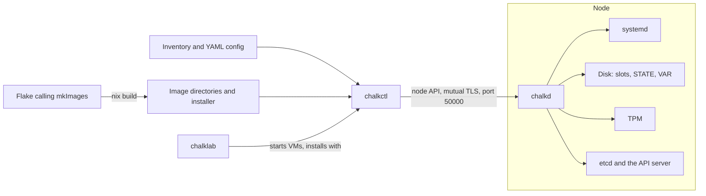
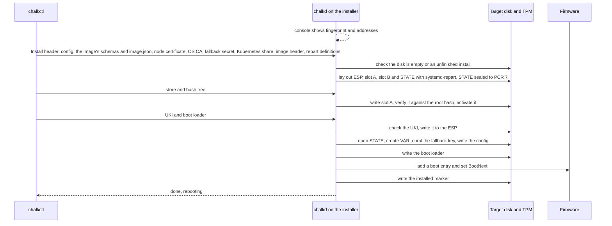

# Architecture

chalkos builds signed, read-only images with Nix and configures the machines that boot them with
YAML documents, through one agent on each node. This page names the parts, says where each one
runs and follows a node from its first boot to its first upgrade.

The parts fall into three places:

- On the operator's machine, a flake calls `chalkos.lib.mkImages`, which Nix evaluates into the
  images of the cluster's [variants](../reference/glossary.md#variant), one per
  [platform](../reference/glossary.md#platform), and an
  [installer](../reference/glossary.md#installer).
- Also on the operator's machine, [chalkctl](../reference/glossary.md#chalkctl) reads an
  [inventory](../reference/glossary.md#inventory) of the cluster's nodes and their YAML
  [config](../reference/glossary.md#config) files, signs images and drives the nodes; it never
  runs Nix. [chalklab](../reference/glossary.md#chalklab) runs a whole cluster as local virtual
  machines.
- On every node, [chalkd](../reference/glossary.md#chalkd) serves the node API, installs and
  upgrades the node, applies its config and runs the Kubernetes control plane.

The diagram shows how they connect.



## What does Nix build?

Nix builds the software a node runs: the operating system, Kubernetes and chalkd.
[`chalkos.lib.mkImages`](../reference/options.md#mkimages-arguments) evaluates one NixOS system
per variant and platform, each from chalkos's node modules, the platform's modules, the modules
every variant shares and the variant's own, and builds each into an unsigned raw disk
[image](../reference/glossary.md#image) in an
[image directory](../reference/glossary.md#image-directory). It also builds one installer, which
installs images of every platform. mkImages takes no node, address or cluster setting; its only
input of a cluster is the optional public part of its secrets, for the OS CA. So one image serves
every node whose [`Image`](../reference/kinds.md#image) document names it, control planes and
[workers](../reference/glossary.md#worker) alike.
[Variants and platforms](variants.md) explains variants, platforms and the order of their modules.

What an image fixes when it is built and what reaches a node at runtime:

| Fixed when the image is built | Delivered at runtime, in the config |
| --- | --- |
| Kernel, kernel modules and initrd | Hostname and whether the node is a control plane or a worker, in [`Node`](../reference/kinds.md#node) |
| NixOS services and the variant's modules, the services of [extensions](../reference/glossary.md#extension) among them | systemd-networkd units, in [`Network`](../reference/kinds.md#network), [`NetDev`](../reference/kinds.md#netdev) and [`Link`](../reference/kinds.md#link) |
| Kubernetes release, the images of its components and the CNI provider | The cluster's name and endpoint, in [`Cluster`](../reference/kinds.md#cluster), and its Kubernetes settings: ranges, [VIP](../reference/glossary.md#vip), extra flags, registry mirrors and addons, in [`Kubernetes`](../reference/kinds.md#kubernetes), [`Flannel`](../reference/kinds.md#flannel), [`RegistryMirror`](../reference/kinds.md#registrymirror) and [`Addon`](../reference/kinds.md#addon) |
| The [OS CA](../reference/glossary.md#os-ca) for maintenance mode, from mkImages' [`osCA`](../reference/options.md#osca) | The kubelet's addresses, labels and taints, in [`Kubelet`](../reference/kinds.md#kubelet) |
| Partition sizes of the system region | Storage: system disk, VAR, volumes and encryption, in [`SystemDisk`](../reference/kinds.md#systemdisk) and [`Volume`](../reference/kinds.md#volume) |
| Boot tries and health timeout | Time servers, in [`TimeSync`](../reference/kinds.md#timesync) |
| The config [kinds](../reference/glossary.md#kind) the image accepts and their schemas | Documents of the kinds extensions declare, and the `Secret`s they reference |

[Variants and platforms](variants.md#what-does-an-image-fix-and-what-does-config-set) draws the
line in detail; [Config and the inventory](config.md) explains the right column.

The split keeps one image per variant and platform, so a cluster of three control planes and
fifty workers of one variant builds and signs one image per platform. A change in the left column
is a new image and an [upgrade](upgrades.md); a change in the right column is a change to YAML
files, delivered with [`chalkctl apply-config`](../reference/cli/chalkctl_apply-config.md) without
a reboot. A storage change that would destroy data, such as a volume formatted otherwise, is
refused there and needs [`chalkctl storage reset`](../reference/cli/chalkctl_storage_reset.md);
removing a volume or moving it to another disk takes a reinstall.

## What runs on the operator's machine?

chalkctl reads the cluster from an inventory, `chalkos.yaml` in the current directory or the file
`--inventory` names. The inventory names each node, the address chalkctl reaches it at and the
YAML files of its config; each node's `Image` document names the image directory of its image,
which chalkctl reads when a command needs the image. chalkctl never builds images or runs Nix.
Without an inventory, a command that only reaches a node works with a client file and
`--address`. [Config and the inventory](config.md) describes the files.

chalkctl authenticates in one of two ways:

- With the [secrets file](../reference/glossary.md#secrets-file), which holds every CA key of the
  cluster. chalkctl signs itself a short-lived admin certificate from it for each run. Installs,
  config changes and [rotations](../reference/glossary.md#rotation) need it.
- With a [client file](../reference/glossary.md#client-file), which holds one certificate of the
  [reader](../reference/glossary.md#reader), [operator](../reference/glossary.md#operator) or
  [admin](../reference/glossary.md#admin) role. Upgrades, reboots, status and logs work with one,
  so the people who operate a cluster need not hold its CA keys.

chalklab runs the nodes a lab file names as QEMU virtual machines on one machine, each with
[Secure Boot](../reference/glossary.md#secure-boot) and a [TPM](../reference/glossary.md#tpm).
It never builds images: it copies the `kvm` image each node's `Image` document names, signs the
copy with lab keys it enrols in the VMs' firmware, boots each node and installs it with chalkctl.
A [lab](../reference/glossary.md#lab) is how the [quick start](../getting-started/index.md) runs.

## What runs on a node?

A node runs its image from a read-only store checked by
[dm-verity](../reference/glossary.md#dm-verity), with its root file system in memory. What it
writes goes to two encrypted partitions:
[STATE](../reference/glossary.md#state), 128 MiB by default, which holds the node's config,
certificates and Kubernetes secrets, and [VAR](../reference/glossary.md#var), mounted at `/var`,
which holds etcd, containerd, the kubelet and logs. [The image](image.md) describes the disk;
[Storage and encryption](storage.md) describes STATE and VAR.

These units do chalkos's work at every boot:

| Unit | When | What it does |
| --- | --- | --- |
| `chalkos-state.service` | initrd | Unlocks and mounts STATE, with the TPM or with the second key the console asks for |
| `chalkos-storage.service` | initrd | Creates the volumes recorded on STATE and mounts VAR |
| `chalkos-config.service` | before networkd | Applies the config on STATE: hostname, network units, time servers, the documents in `/run/chalkos/config` and the secrets their consumers read |
| `chalkd.service` | after the network | Serves the node API and carries out its requests |
| `chalkos-kubernetes.service` | on images with Kubernetes, once the network is online | Waits for the node's addresses and prepares its Kubernetes certificates, kubeconfigs and kubelet flags |
| `chalkos-health.service` | only on a boot that systemd-boot counts | Decides whether a new image is healthy |

chalkd runs as root with its capabilities, because it partitions disks, enrols TPM keyslots,
writes EFI variables, mounts volumes the host must see and sets the hostname. Its unit therefore
has no file system or hostname namespace. The sandboxing it does have restricts it to the socket
families it uses (Unix, IPv4, IPv6, netlink, the kernel crypto API and packet sockets), forbids
new privileges, fixes the system call architecture and protects the clock. chalkd restarts
whenever it stops, with no limit, because it is the only way to reach the node: nodes have no SSH
and no login.

On a [control plane](../reference/glossary.md#control-plane), chalkd also renders the static pods
of etcd, the API server, the controller-manager and the scheduler, holds the
[VIP](../reference/glossary.md#vip) when elected, renews the node certificates of the cluster and
drains nodes for upgrades. [Kubernetes on chalkos](kubernetes.md) covers that side.

## Which mode is chalkd in?

chalkd runs in one of two modes, and the file `installed` on STATE decides which.

In [maintenance mode](../reference/glossary.md#maintenance-mode), on a node that is not
installed, chalkd serves a self-signed certificate and prints its SHA-256 fingerprint and the
node's addresses on the console:

```text
chalkd: maintenance mode, accepting clients of the OS CA; certificate fingerprint <fingerprint>
chalkd: addresses <addresses>; certificate fingerprint <fingerprint>
```

It accepts only reads (node information, disks and logs), a reboot and an install. An image built
with [`osCA`](../reference/options.md#osca) carries that OS CA and accepts only
clients with a certificate from it. An image built without one prints `accepting any client`
and accepts anyone until it is installed.

In [normal mode](../reference/glossary.md#normal-mode), on an installed node, chalkd serves its
[node certificate](../reference/glossary.md#node-certificate) and accepts only clients whose
certificate chains to the OS CAs on STATE. Each method is open to the
[client roles](../reference/glossary.md#client-role) allowed to call it, and the install method
is closed.

When chalkd cannot read STATE well enough to tell whether the node is installed, it fails and
restarts. It never falls back to maintenance mode, which would offer an installed node for a
new install.

## How do chalkctl and chalkd talk?

They use the [node API](../reference/api.md): Connect RPC over HTTPS with TLS 1.3 on TCP port 50000,
with a client certificate on every call. chalkd reads the client's role from its certificate's
Organization and checks it for every request against the OS CAs it trusts at that moment,
so a client whose CA was rotated out loses access on its next request, not when its connection
closes. The one exception is maintenance mode on an image built without an OS CA: chalkd checks no
certificate there and treats every client as admin. [Security model](security.md) explains the roles
and what each may call.

## How does a machine become a node?

A node's life has five stages: a first boot into maintenance mode, the install, the first boot in
normal mode, joining Kubernetes and upgrades.

### First boot into maintenance mode

A machine reaches maintenance mode in one of two ways:

- It boots the installer, from a USB disk, an ISO or a network boot. The installer never touches
  the medium it boots from; it writes the node's image to another disk.
- It boots its image directly, written to its disk with `dd`, used as a VM's disk or created
  by chalklab. On the first boot, systemd-repart adds [slot](../reference/glossary.md#slot) B
  and an empty STATE behind the partitions the image ships with. STATE has no `installed` file,
  so chalkd starts in maintenance mode.

### The install

[`chalkctl install`](../reference/cli/chalkctl_install.md) connects to the node, compares its
certificate with the fingerprint from the console, and sends what makes the machine this node:

```sh
chalkctl install <node> --secrets=secrets.age --fingerprint=<fingerprint>
```

`<node>` is the node's name in the inventory and `<fingerprint>` the one on its console.
`--insecure` accepts any certificate instead and prints the fingerprint chalkctl saw, to
compare with the console afterwards; the secrets then travel over a second connection pinned to
that fingerprint. With `--fingerprint` the first connection is pinned already and carries them.

On a node that runs its image already, the install happens in place: chalkctl sends no image.
chalkd recreates STATE if its encryption differs from the node's `SystemDisk`, opens it, creates
VAR and the volumes, enrols the second keyslot of every encrypted volume unless the fallback is
`none`, writes the config and certificates, gives the [ESP](../reference/glossary.md#esp) a random
partition UUID and writes the `installed` marker.

On a node that runs the installer, chalkctl also sends the image the node's `Image` document names,
or the one `--image` gives, in the same parts an upgrade sends, plus the boot loader. The sequence
shows what the installer does with them.



Before anything is written, the installer checks the config against the image's schemas,
translates it for the image's platform, and checks that the image is built for the machine's
architecture. With Secure Boot enforced, it checks the [UKI](../reference/glossary.md#uki)'s and
the boot loader's signatures against the firmware's
[db and dbx](../reference/glossary.md#db-and-dbx), as the firmware will at the next boot, when it
receives them: after slot A is written and before the boot loader is. The
installer takes the disk the node's `SystemDisk` names when blkid finds nothing on it but at
most an empty GPT, or when it holds an unfinished install of the node, which it continues; any
other disk only with `--wipe-disk`. Until the boot loader is written the firmware finds nothing
to boot on the target, so an interrupted install never boots a half-installed node, and running
the same command again continues it.

The image travels as its parts: the compressed store, its hash tree, the UKI and systemd-boot,
about 300 MiB for an image with Kubernetes, instead of the multi-gigabyte raw image.

### First boot in normal mode

The node reboots into its image. The initrd unseals STATE and VAR with the TPM,
`chalkos-config.service` applies the config, and chalkd finds the `installed` marker and
starts in normal mode with the node certificate from STATE.

### Joining Kubernetes

The first control plane waits for [`chalkctl bootstrap`](../reference/cli/chalkctl_bootstrap.md),
which starts etcd as its first member and the control plane with it; the
[bootstrap](../reference/glossary.md#bootstrap) runs once per cluster. Further control planes
join the existing etcd on their own, and workers join the API server with the kubelet certificate
chalkctl issued them at install. [Kubernetes on chalkos](kubernetes.md) describes the joins.

### Upgrades

An upgrade replaces the whole image at once. [`chalkctl
upgrade`](../reference/cli/chalkctl_upgrade.md) sends each node the image its `Image` document
names, or the one `--image` gives, chalkd writes it into the inactive slot, and the node boots it
with [boot counting](../reference/glossary.md#boot-counting). If the new image does not become
healthy within its tries, the node falls back to the image it ran before. [Upgrades](upgrades.md)
and [Boot, health and rollback](boot-and-rollback.md) explain both halves.

## Limits

- chalkos does not enrol Secure Boot keys on nodes. The firmware must trust the signer of the
  images before the install; only chalklab enrols keys, its own, in its VMs. Installing does not
  check that Secure Boot is on.
- Images reach nodes only through chalkctl's stream over the node API. There is no pull from a
  registry and no update server.
- Nodes have no shell access. Debugging goes through the node API's logs and status, or a
  privileged pod with [`chalkos.debug.tools`](../reference/options.md#chalkosdebugtools).
- An image without an OS CA accepts any client in maintenance mode. Build images with mkImages'
  `osCA` set for machines on a network others can reach.

## Related pages

- [Variants and platforms](variants.md), [Config and the inventory](config.md) and
  [The image](image.md) for what Nix builds and what a node receives.
- [Security model](security.md) for the client roles and what Secure Boot and the TPM protect.
- [Install on bare metal](../guides/install-bare-metal.md) for the install as a task.
- [`chalkctl install`](../reference/cli/chalkctl_install.md) and the [node API](../reference/api.md)
  for the details.
- [Architecture for developers](../contributing/architecture.md) for the code's layout.
