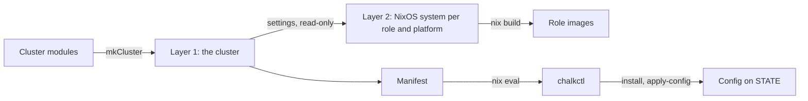

# The cluster definition

A [cluster definition](../reference/glossary.md#cluster-definition) is a set of Nix modules that
declares a whole cluster: its settings, the kinds of node it has, the machines they run on and
every node by name. chalkos evaluates it into two things: one disk
[image](../reference/glossary.md#image) per [role](../reference/glossary.md#role) and
[platform](../reference/glossary.md#platform), and a [manifest](../reference/glossary.md#manifest)
that tells [chalkctl](../reference/glossary.md#chalkctl) about every node. It is the
only inventory chalkos has, so a node that is not in the definition cannot be installed.

## How is a cluster declared?

A cluster lives in a [flake](../reference/glossary.md#flake) as `chalkos.<cluster>`, the result
of `chalkos.lib.mkCluster`. A minimal `flake.nix` declares one:

```nix title="flake.nix"
{
  inputs.chalkos.url = "github:trevex/chalkos";

  outputs =
    { chalkos, ... }:
    {
      chalkos.lab = chalkos.lib.mkCluster { modules = [ ./cluster.nix ]; };
    };
}
```

`mkCluster` takes:

- `modules`, the cluster's own modules, evaluated together with chalkos's cluster modules;
- `nixpkgs`, the nixpkgs flake the role images are built from, by default the one chalkos is
  tested against;
- `specialArgs`, extra arguments for the modules, as in any `lib.evalModules` call.

The flake pins the chalkos version in `flake.lock`, so the images a cluster builds change only
when the lock file does.

A flake may hold several clusters, each under its own name. chalkctl and
[chalklab](../reference/glossary.md#chalklab) pick the only one, or the one `--cluster` names.
Each command's `--flake` names the flake's directory, `.` by default.

With flake-parts, the module `chalkos.flakeModules.default` declares the same thing:
`chalkos.clusters.<cluster>` takes a cluster's module, sets `chalkos.cluster.name` to the
attribute's name, and exposes the result as `flake.chalkos.<cluster>`. Its `chalkos.nixpkgs`
option passes the nixpkgs flake to every cluster.

```nix title="flake.nix"
{
  inputs = {
    chalkos.url = "github:trevex/chalkos";
    flake-parts.url = "github:hercules-ci/flake-parts";
  };

  outputs =
    inputs:
    inputs.flake-parts.lib.mkFlake { inherit inputs; } {
      imports = [ inputs.chalkos.flakeModules.default ];
      systems = [ "x86_64-linux" ];
      chalkos.clusters.homelab = ./cluster.nix;
    };
}
```

## What does the option tree hold?

Every option of a cluster lives under `chalkos`. The
[options reference](../reference/options.md) lists them all; the top level groups them:

| Option | What it declares |
| --- | --- |
| `chalkos.cluster` | Name, API endpoint, the system images are built for and the Kubernetes settings: version, subnets, [VIP](../reference/glossary.md#vip), registries, extra flags, manifests |
| `chalkos.osCA` | The public part of the cluster's secrets, whose [OS CA](../reference/glossary.md#os-ca) the images and the installer carry for maintenance mode |
| `chalkos.roles` | The images to build, each with its NixOS modules, whether it runs Kubernetes and storage defaults |
| `chalkos.nodes` | Every node by name, with its role, platform, Kubernetes kind and own settings |
| `chalkos.platforms` | The kinds of machine, each with the NixOS modules its images carry |
| `chalkos.installer` | The [installer](../reference/glossary.md#installer)'s own NixOS modules and the installer image |
| `chalkos.secureBoot` | The certificate of the [Secure Boot](../reference/glossary.md#secure-boot) signer: `chalkctl install` and `chalkctl upgrade` refuse an image whose UKI or boot loader it did not sign |
| `chalkos.time` | The time servers every node uses |
| `chalkos.cni` | The pod network: flannel or none, and the CNI plugins the images ship |
| `chalkos.manifest` | The generated manifest, read-only |

The lab template's `cluster.nix` shows a small cluster: settings, one role and two nodes.

```nix title="cluster.nix"
let
  labNetwork = n: {
    networks."10-lab" = {
      matchConfig.MACAddress = "52:54:00:7b:00:${n}";
      address = [ "192.168.123.${n}/24" ];
    };
  };
in
{
  chalkos.cluster = {
    name = "lab";
    endpoint = "https://192.168.123.11:6443";
  };

  chalkos.osCA = ./secrets.pub.json;

  chalkos.roles.node = { };

  chalkos.nodes = {
    cp1 = {
      role = "node";
      platform = "kvm";
      kubernetes.kind = "controlplane";
      storage.system.disk = "/dev/vda";
      network = labNetwork "11";
    };
    w1 = {
      role = "node";
      platform = "kvm";
      storage.system.disk = "/dev/vda";
      network = labNetwork "12";
    };
  };
}
```

## What is a role?

A role is a kind of node, and the unit an image is built for: every node of a role on one
platform boots the same image. A role declares:

- [`nixosModules`](../reference/options.md#chalkosrolesnixosmodules), plain NixOS modules added
  to the role's images, for a GPU driver, a monitoring agent or extra kernel
  [module groups](../reference/glossary.md#module-group);
- [`kubernetes.enable`](../reference/options.md#chalkosroleskubernetesenable), whether its
  images run Kubernetes (the default); each node's
  [`kubernetes.kind`](../reference/options.md#chalkosnodeskuberneteskind) makes it a control
  plane or a worker;
- `storage`, defaults for its nodes' storage, applied leaf by leaf, so a node overrides one
  value or adds a volume without restating the rest.

[`images`](../reference/options.md#chalkosrolesimages) is the output:
`chalkos.<cluster>.roles.<role>.images.<platform>` builds the role's image for a platform, and
only the images asked for are evaluated. [Customise a role](../guides/customise-role.md) shows
how to extend one.

## What is a node?

A [node](../reference/glossary.md#node) is a machine of the cluster under
[`chalkos.nodes`](../reference/options.md#chalkosnodes), named by its attribute. Its options:

| Option | Default | What it sets |
| --- | --- | --- |
| [`role`](../reference/options.md#chalkosnodesrole) | none | The role whose image the node runs |
| [`platform`](../reference/options.md#chalkosnodesplatform) | `metal` | The platform whose image of the role it runs |
| [`hostname`](../reference/options.md#chalkosnodeshostname) | the node's name | The hostname set at boot |
| [`network`](../reference/options.md#chalkosnodesnetwork) | none | systemd-networkd networks, netdevs and links, in the shape of NixOS's `systemd.network` |
| [`labels`](../reference/options.md#chalkosnodeslabels), [`taints`](../reference/options.md#chalkosnodestaints) | none | The Kubernetes Node's labels and taints |
| [`storage`](../reference/options.md#chalkosnodesstoragesystemdisk) | the role's | The system disk, [VAR](../reference/glossary.md#var), further volumes and encryption |
| [`kubernetes.nodeIPs`](../reference/options.md#chalkosnodeskubernetesnodeips) | `kubernetes.nodeIP`, else the first static address of each family; none when the node's [`kubernetes.validSubnets`](../reference/options.md#chalkosnodeskubernetesvalidsubnets) or the cluster's [`kubernetes.nodeIP.validSubnets`](../reference/options.md#chalkosclusterkubernetesnodeipvalidsubnets) are set, and the node picks its addresses at boot | The addresses the kubelet registers and a [control plane](../reference/glossary.md#control-plane) advertises |
| [`time.servers`](../reference/options.md#chalkosnodestimeservers) | the cluster's | Time servers that replace the cluster's |

A node's name is its name in Kubernetes too, which its kubelet certificate carries. Changing a
node's role or platform means installing it again: the node refuses an image of another role or
platform than the image it runs, and chalkctl refuses to deliver config to a node whose image
has another role or platform than the definition gives it.

## What is a platform?

A platform is the kind of machine an image runs on, declared under
[`chalkos.platforms`](../reference/options.md#chalkosplatforms) as a list of NixOS modules that
every role image for it carries before the role's own. chalkos defines two:

- `metal`: the base kernel module groups, with the console on the screen and the first serial
  port.
- `kvm`: the console on the first serial port and a QEMU guest agent that starts only under KVM.
  The host may ask the agent about the node and shut it down, never run commands or touch files.

A definition adds modules to either, or declares its own platform, for example one for a hardware
model that needs firmware the others do not. Building one image per role and platform keeps each
image small: a universal image would carry every platform's agents and drivers. The platform's
name, lower-case letters, digits and dashes, becomes `CHALKOS_PLATFORM` in the image's
os-release. [Support additional hardware](../guides/additional-hardware.md) adds a platform.

## How does the evaluation work?

`mkCluster` evaluates in two layers, because one image serves many nodes.

Layer 1 is the cluster: chalkos's cluster modules and the definition's modules, evaluated with
`lib.evalModules`. It knows every node, and it produces the manifest.

Layer 2 is one NixOS system per role and platform, built from chalkos's node modules, the
platform's modules and the role's modules. The cluster's settings reach it as read-only options
under the same names: everything under `chalkos` except `nodes`, `roles`, `platforms`,
`installer`, `manifest` and the internal warnings. So a role's module reads
`config.chalkos.cluster.endpoint` or a feature's settings, and cannot change them.

Node values do not exist in layer 2. `config.chalkos.nodes` throws inside a role image with an
error that says so, because the same image runs on every node of the role. A module that needs a
node's value reads it at runtime, from the node's
[config documents](#what-does-a-node-receive-at-runtime).

The flowchart shows both layers and where their results go.



The installer is a layer 2 system too, built from the node modules, the cluster's settings and
[`chalkos.installer.nixosModules`](../reference/options.md#chalkosinstallernixosmodules), with no
role or platform.

## What is the manifest?

The manifest is the JSON document layer 1 generates at `chalkos.<cluster>.manifest`. It is how Go
code reads what Nix declared: chalkctl evaluates it with `nix eval` and learns nothing about the
cluster from anywhere else, except when it runs with a client file and finds no `flake.nix`: it
then takes the node names and addresses from the client file. In the directory of the
[homelab example](https://github.com/trevex/chalkos/tree/main/examples/homelab):

```console
$ nix eval --json .#chalkos.homelab.manifest | jq '{schemaVersion, cluster, roles}'
{
  "schemaVersion": 0,
  "cluster": {
    "endpoint": "https://10.0.0.11:6443",
    "name": "homelab"
  },
  "roles": {
    "node": {
      "images": {
        "kvm": "roles.node.images.kvm",
        "metal": "roles.node.images.metal"
      }
    }
  }
}
```

Besides these, it holds `secureBoot.signerCertificate`, the Kubernetes and flannel settings every
Kubernetes node's config carries and, under `nodes`, each node's role, Kubernetes kind (null on a
role without Kubernetes), platform, identity and documents. The identity is what layer 1 renders
from the node's options: hostname, network units, storage, Kubernetes and time settings. The
documents are the config documents its extensions add. chalkctl generates the node's config from
both. A role's images are attribute paths relative to the cluster, which chalkctl builds when a
command needs an image. While `schemaVersion` is 0 the format may change between chalkos
versions, which matters only to tools other than chalkctl and chalklab.

`chalkctl --manifest=<file>` reads a manifest from a file instead of evaluating the flake. It
cannot build images then, so commands that need one take `--image`.

## What does a node receive at runtime?

A node receives its [config](../reference/glossary.md#config): a set of documents in the style
of Kubernetes objects, each with an `apiVersion`, a `kind`, a `metadata.name` and a `spec`.
chalkctl generates them from the node's entry in the manifest: a `Cluster`; an `Image` named
`<role>-<platform>`; a `Node`; a `TimeSync`; a `SystemDisk` and a `Volume` per volume; a
`Network`, `NetDev` or `Link` per networkd unit; a `Kubelet` on a Kubernetes role; and the
documents the node's extensions add. The homelab's `cp1`, in part:

```yaml
apiVersion: chalkos.dev/v1alpha1
kind: Node
metadata: {name: cp1}
spec: {imageRef: node-metal, type: controlplane}
---
apiVersion: networkd.chalkos.dev/v1alpha1
kind: Network
metadata: {name: 10-uplink}
spec:
  match: {name: enp1s0}
  network: {address: 10.0.0.11/24, gateway: 10.0.0.1}
---
apiVersion: rack.example.org/v1alpha1
kind: Rack
metadata: {name: rack}
spec: {location: rack-a/u12}
```

Layer 1 renders the node's network with the role image's own networkd renderer, so a unit means
on the node exactly what it would mean in NixOS; chalkctl reads each unit back into a document,
with sections and keys in camelCase.

Before it sends anything, chalkctl checks the documents against the image they are for: the
image directory's schemas and `image.json` when it installs from the installer, and otherwise
those of the image the node runs, which the node returns with the image's role and platform through
its [Contract](../reference/api.md#method-contract) method. chalkctl refuses an image of another
role or platform than the cluster definition gives the node. It then translates the
documents as chalkd does and refuses to deliver them unless they give back what the cluster
definition declares for the node, so the config a node applies matches its definition.

chalkctl delivers the config at install, and later with
[`chalkctl apply-config`](../reference/cli/chalkctl_apply-config.md); the node's certificates and
secrets travel beside it in the same request. [chalkd](../reference/glossary.md#chalkd) checks
the documents again, fills in the schemas' defaults and keeps them on
[STATE](../reference/glossary.md#state). At every boot, `chalkos-identity.service` applies them
before the network starts:

- it writes the networkd units to `/run/systemd/network`, where they take precedence over the
  image's;
- it writes the time servers for chrony and sets the hostname;
- it writes each document, `Secret`s excepted, to `/run/chalkos/config/<group>/<Kind>/<name>.json`;
- it writes, for each service that reads config kinds, the values the `secretRef` fields of those
  kinds name to `/run/chalkos/credentials/<unit>/`.

A service that needs a node's value declares the kinds it reads under
[`chalkos.consumers`](../reference/options.md#chalkosconsumers). It reads their documents with
[chalkcfg](../reference/glossary.md#chalkcfg), whose commands
[`chalkos.kinds.<Kind>.get`](../reference/options.md#chalkoskindsget) builds with a path the
evaluation checks against the kind's options, or as files below `/run/chalkos/config`. It reads
the secrets they reference as its systemd credentials `secret_<secret>.<key>`. When
`chalkctl apply-config` changes a document of one of its kinds, or a `Secret` one of them
references, chalkd restarts the service, unless it sets
[`restartOnChange = false`](../reference/options.md#chalkosconsumersrestartonchange). It
restarts a service that runs or stays active after it ran, and starts a failed one again, since
the new config may be what it lacked; a service that never started or was stopped stays so.

[`chalkctl status`](../reference/cli/chalkctl_status.md) shows whether a node runs the config the
cluster definition gives, by comparing the SHA-256 of the documents it would deliver with the
version the node reports.

## How does an extension add options?

An [extension](../reference/glossary.md#extension) is a cluster module that declares options
under a namespace of its own, optionally adds per-node options and contributes NixOS modules to
roles. chalkos's own features, such as `chalkos.cni`, use the same mechanism. An extension that
hands a node's value to a service declares a config kind in its role modules, and its per-node
option adds a document of that kind. The homelab's rack extension records where each node is
mounted and hands the value to a service on that node:

```nix title="extensions/rack.nix"
{ config, lib, ... }:
let
  inherit (config.chalkos.rack) enable;
in
{
  options.chalkos.rack.enable = lib.mkEnableOption "rack position reporting";

  options.chalkos.nodes = lib.mkOption {
    type = lib.types.attrsOf (
      lib.types.submodule (
        { config, ... }:
        {
          options.rack.location = lib.mkOption {
            type = lib.types.str;
            example = "rack-a/u12";
            description = "Rack and height unit the node is mounted in.";
          };
          # The node's position travels in its config as a document of the Rack kind.
          config.documents = lib.mkIf enable [
            {
              apiVersion = "rack.example.org/v1alpha1";
              kind = "Rack";
              metadata.name = "rack";
              spec.location = config.rack.location;
            }
          ];
        }
      )
    );
  };

  config = lib.mkIf enable {
    chalkos.roles.node = {
      nixosModules = [
        (
          { config, pkgs, ... }:
          {
            chalkos.kinds.Rack = {
              group = "rack.example.org";
              version = "v1alpha1";
              spec.location = lib.mkOption {
                type = lib.types.nonEmptyStr;
                example = "rack-a/u12";
                description = "Rack and height unit the node is mounted in.";
              };
            };
            # chalkd writes the node's Rack below /run/chalkos/config and restarts the unit when
            # it changes.
            chalkos.consumers.rack-location.kinds = [ "Rack" ];
            systemd.services.rack-location = {
              wantedBy = [ "multi-user.target" ];
              serviceConfig = {
                Type = "oneshot";
                RemainAfterExit = true;
                # A path the kind lacks fails the image's evaluation.
                ExecStart = pkgs.writeShellScript "rack-location" (
                  config.chalkos.kinds.Rack.get {
                    name = "rack";
                    path = "spec.location";
                  }
                );
              };
            };
          }
        )
      ];
    };
  };
}
```

The three parts reach the node by different paths:

- `chalkos.rack.enable` is a cluster setting, so every image of the cluster can read it as
  `config.chalkos.rack.enable`.
- `chalkos.nodes.<node>.rack.location` is a per-node option. It adds a `Rack` document to the
  node's [`documents`](../reference/options.md#chalkosnodesdocuments), which chalkctl delivers
  with the documents it generates.
- The role module declares the kind `Rack` under
  [`chalkos.kinds`](../reference/options.md#chalkoskinds), so the image accepts its documents, and
  runs a unit that prints the node's `Rack` with `chalkos.kinds.Rack.get`, whose path
  `spec.location` the evaluation checks. chalkd restarts the unit when the document changes.

A namespace must not collide with a name chalkos declares under `chalkos`. In the cluster
definition those are `cluster`, `cni`, `installer`, `manifest`, `nodes`, `platforms`, `roles`,
`osCA`, `secureBoot`, `time` and `warnings`; inside images `consumers`, `debug`, `disk`, `kernel`,
`kinds`, `maintenance`, `platform`, `role` and `upgrade` are taken too. A kind's group must be a
DNS name outside `chalkos.dev`, which chalkos keeps for its own kinds.

## Where does the OS CA come from?

[`chalkctl gen secrets`](../reference/cli/chalkctl_gen_secrets.md) writes the cluster's
[secrets file](../reference/glossary.md#secrets-file) and its public part, `secrets.pub.json`.
[`chalkos.osCA`](../reference/options.md#chalkososca) points to the public part, which holds
certificates and no keys, so it belongs in the repository. It is an input of the images: the role
images and the installer carry its [OS CA](../reference/glossary.md#os-ca), so chalkd in
[maintenance mode](../reference/glossary.md#maintenance-mode) accepts only clients with a
certificate from it. chalkos reads version 3 of the file only; evaluation fails on another version
and says to generate new secrets. Left `null`, images accept any client until they are installed,
which suits a lab on a private network and nothing else.

No module reads the secrets file itself. chalkctl reads it from the flake's directory, or the
path `--secrets` names, when it installs a node or issues a certificate. The lab template's
`.gitignore` keeps the plaintext `secrets.json` out of git, and so out of the Nix store, which
copies a flake's tracked files.

## Limits

- One image serves every node of a role and platform, so anything that differs between two
  nodes must travel in the node's config. A per-node kernel parameter or package is a role or
  platform of its own.
- Config carries data, not code. A new service, or a change to how a service reads its value, is
  an image change and an [upgrade](upgrades.md).
- A `Secret` document reaches the node through `documents` like any other, so its values are in
  the manifest and in the Nix store. The node keeps them out of `/run/chalkos/config`, but the
  cluster definition offers no way to keep them out of the store.
- `chalkos.secureBoot.enrollment` and `chalkos.secureBoot.require` are declared and appear in the
  options reference, but nothing reads them yet: chalkos does not enrol Secure Boot keys.
- The manifest's format is unstable while `schemaVersion` is 0.

## Related pages

- [Architecture](architecture.md) for where the definition's outputs go.
- [The image](image.md) for what a role image holds.
- [Storage and encryption](storage.md) for the storage options of roles and nodes.
- [Customise a role](../guides/customise-role.md) for extending a role with NixOS modules.
- [Cluster and node options](../reference/options.md) for every option.
