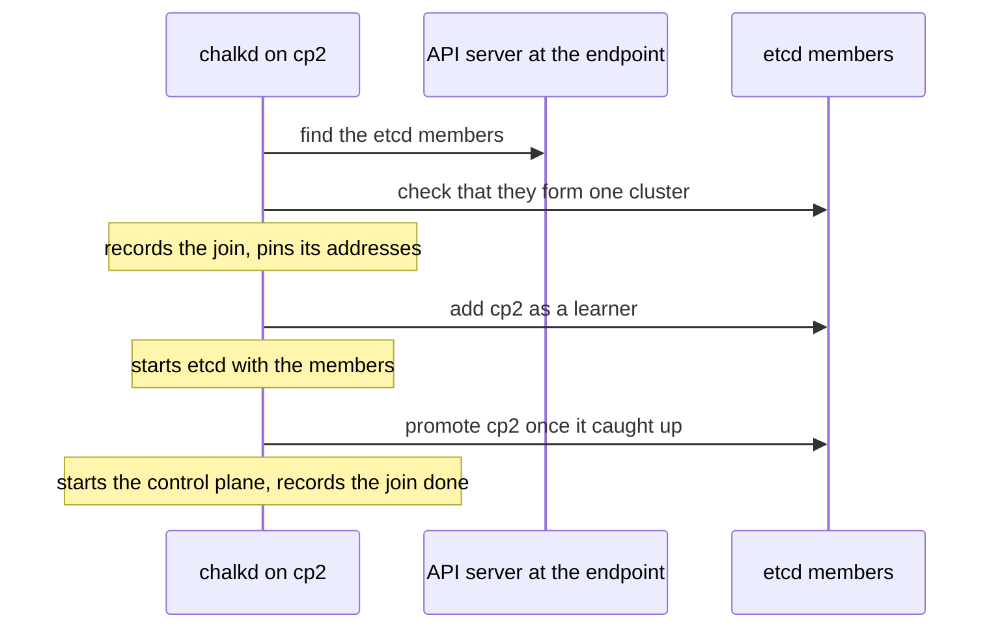

# Kubernetes on chalkos

chalkos runs upstream Kubernetes in the layout kubeadm uses, without kubeadm. containerd and the
kubelet are systemd units of the image; etcd, the API server, the controller-manager and the
scheduler run as static pods from the upstream images, which
[chalkd](../reference/glossary.md#chalkd) renders on every
[control plane](../reference/glossary.md#control-plane). Certificates come from the cluster's
[secrets file](../reference/glossary.md#secrets-file) instead of `kubeadm init`, control planes
join etcd on their own, and chalkd applies the cluster's add-ons at every boot. The image fixes
the Kubernetes release; every setting of the cluster and of each node is a
[config document](../reference/glossary.md#config-document).

## Which Kubernetes does a node run?

One Kubernetes version per image:
[`chalkos.kubernetes.package`](../reference/options.md#chalkoskubernetespackage),
nixpkgs's `kubernetes` by default. Nodes run its kubelet; the control plane runs the upstream
images of the same version from `registry.k8s.io`, so a node's kubelet and control plane always run
the same version. etcd, the pause image and CoreDNS have their own images under
[`chalkos.kubernetes.images`](../reference/options.md#chalkoskubernetesimagesetcd).
A Kubernetes upgrade is therefore an image [upgrade](../reference/glossary.md#upgrade), rolled
through the cluster like any other, as [Upgrades](upgrades.md) describes.

`spec.type` of the node's [`Node`](../reference/kinds.md#node) document decides what the node is
in Kubernetes, so control planes and workers boot the same image. A node keeps its type once it
holds its [Kubernetes share](../reference/glossary.md#kubernetes-share): chalkd refuses config that
changes it, because the share holds certificates for that type. The images of a
[variant](../reference/glossary.md#variant) built with
[`kubernetes = false`](../reference/options.md#variantskubernetes) run no Kubernetes and have no
`Node` kind, so their nodes have no type:

| Type | Runs |
| --- | --- |
| `controlplane` | containerd, the kubelet, and etcd and the control plane as static pods |
| `worker` | containerd and the kubelet |
| none, on an image without Kubernetes | No Kubernetes at all; the image leaves it out |

## Where do a node's Kubernetes settings come from?

The image fixes what it ships: the Kubernetes release, the images of its components and the pod
network, recorded in `/etc/chalkos/kubernetes/image.json`. Everything else is
[config](../reference/glossary.md#config), in documents of the kinds of the group
`kubernetes.chalkos.dev`:

| Kind | Count | Holds |
| --- | --- | --- |
| [`Cluster`](../reference/kinds.md#cluster) | one, required | The URL of the cluster's API server, its address families and ranges, DNS domain and address, how nodes pick their addresses, the [VIP](../reference/glossary.md#vip), scheduling on control planes and extra flags of the control plane's components |
| [`Node`](../reference/kinds.md#node) | one, required | The node's type and its own labels, taints, addresses, extra flags of its kubelet and the interface it holds the VIP on |
| [`Flannel`](../reference/kinds.md#flannel) | at most one, on images with flannel | The MTU flannel assumes and the ranges its VXLAN must come from |
| [`Addon`](../reference/kinds.md#addon) | any | Kubernetes objects the control planes apply |

The cluster's documents go into the files the [inventory](../reference/glossary.md#inventory) gives
every node, so all nodes hold the same ones, and a node's `Node` goes into its own file, as
[Config and the inventory](config.md#how-does-the-inventory-assign-files-to-nodes) describes;
chalkctl refuses an inventory whose nodes hold different `Cluster` or `Flannel` specs. The node's
config must hold one `Cluster` and one `Node` document on an image with Kubernetes:
[`chalkctl validate`](../reference/cli/chalkctl_validate.md) and chalkd refuse a set without one,
with `no Cluster: the config of a node whose image runs Kubernetes holds one Cluster document`
or `no Node: the config of a node whose image runs Kubernetes holds one Node document`. The
`Cluster` document names the [cluster endpoint](../reference/glossary.md#cluster-endpoint), the
URL of the API server, which every node names alike. Every other field has a default, so a
cluster on IPv4 with the default ranges needs no more than the lab template's document:

```yaml
# Kubernetes with its defaults: IPv4, the pod range 10.244.0.0/16 and the service range
# 10.96.0.0/12.
apiVersion: kubernetes.chalkos.dev/v1alpha1
kind: Cluster
metadata: {name: default}
spec:
  # cp1 on the lab network: the API server of the only control plane.
  endpoint: https://192.168.123.11:6443
```

chalkctl delivers the documents at install and with
[`chalkctl apply-config`](../reference/cli/chalkctl_apply-config.md). chalkd builds the node's
cluster from its `Node`, `Cluster` and `Flannel` documents and `image.json` into
`/run/chalkos/kubernetes/cluster.json`, at boot and on every apply.

A changed cluster restarts `chalkos-kubernetes` and the kubelet, as their
[effect](outputs-and-effects.md#which-effects-does-chalkos-declare) says,
and chalkd on a control plane starts its Kubernetes work again, so the static pods and add-ons
follow the new settings. Some settings are fixed once the cluster exists: `ipFamilies`, the pod
ranges of `podCIDRs`, the service ranges of `serviceCIDRs` and the addresses of `dnsIPs`, because
the certificates, etcd and the ranges the control plane allocated were made for them. On a node
that holds a Kubernetes share, `chalkctl apply-config` is refused when it changes them, with a
message such as `the config changes the cluster's podCIDRs from ipv4 10.244.0.0/16 to ipv4
10.245.0.0/16; they are fixed once the cluster exists, so keep them, or reinstall the node into a
new cluster`. The [change rules](rules.md) of the `Cluster` kind decide this.

## What runs on every node?

containerd and the kubelet run as systemd units from the image. Before the kubelet starts,
`chalkos-kubernetes.service` prepares the node: it picks the node's addresses, as
[Networking](networking.md) describes, issues a control plane's certificates, and writes the
kubelet's kubeconfig and per-node flags below `/run/chalkos/kubernetes`. A node without a
Kubernetes share, which is not installed yet, runs no kubelet.

chalkd renders the kubelet's configuration from the node's cluster into
`/run/chalkos/kubernetes/kubelet/config.json`, the same on every node of the cluster: webhook
authentication and authorisation, no anonymous access and no read-only port, the systemd cgroup
driver, the cluster's DNS address and domain, and `rotateCertificates` with `serverTLSBootstrap`.
What differs per node the kubelet gets as flags in `$KUBELET_ARGS`: the node name, which is the
node's [name in the inventory](config.md#what-names-a-node), and the addresses, labels, taints and
extra flags of its `Node` document in `kubeletExtraArgs`. The homelab example's worker carries fast
storage and keeps other workloads off:

```yaml
apiVersion: kubernetes.chalkos.dev/v1alpha1
kind: Node
metadata: {name: default}
spec:
  type: worker
  labels: {node.kubernetes.io/storage: ssd}
  taints: [{key: dedicated, value: storage, effect: NoSchedule}]
```

A control plane is tainted `node-role.kubernetes.io/control-plane:NoSchedule` unless the `Cluster`
document sets `allowSchedulingOnControlPlanes: true`. `kubeletExtraArgs` of a node's `Node` document
adds flags to its kubelet.

containerd pulls through the endpoints of the `Mirror` documents, tried in order before the
registry itself. Each document names one registry as image references name it, in
`spec.registry`:

```yaml
apiVersion: oci.chalkos.dev/v1alpha1
kind: Mirror
metadata: {name: docker.io}
spec:
  registry: docker.io
  endpoints: [https://mirror.example.com]
```

`chalkos-registry-mirrors.service` writes containerd's
`/run/containerd/certs.d/<registry>/hosts.toml` from the `Mirror` and
[`Registry`](../reference/kinds.md#registry) documents, before containerd starts and whenever
they change; containerd reads those files on every pull. Each file lists the endpoints as the
`Mirror` names them, then the registry itself. A registry whose `Registry` sets `insecure` is
reached over HTTP, and gets a file even without a `Mirror`. An `http://` endpoint needs a
`Registry` of its host with `insecure: true`, since nothing authenticates what a plain HTTP
endpoint serves.

### How do pods pull images from a private registry?

A [`Registry`](../reference/kinds.md#registry) with `username` and `password` gives every pod on
the node the images of its host, without `imagePullSecrets`. The kubelet asks chalkd, which it
runs as its image credential provider, for the credentials of an image's host, and hands them to
containerd as it hands over those of a pull secret:

```yaml
apiVersion: oci.chalkos.dev/v1alpha1
kind: Registry
metadata: {name: ghcr}
spec:
  host: ghcr.io
  username: robot
  password: {secretRef: {name: registry, key: token}}
```

The kubelet matches the `host` against the image reference as written, port included, and names
Docker Hub `docker.io`. `chalkos-registry-credentials.service` writes the provider's configuration
and the credentials to `/run/chalkos/kubernetes/credential-provider/`, whose `credentials.json`
only root reads. A node without a `Registry` that has credentials runs the kubelet without a
credential provider.

The kubelet reads the provider's configuration when it starts and keeps each answer for 5
minutes. A change of a `Registry`, or of a password it references, therefore restarts both
`chalkos-registry-credentials.service` and `kubelet.service`, which empties that cache; running
pods keep running.

Node credentials hold for every pod on the node, in every namespace. Any pod scheduled there can
pull every image those credentials read, so give a node only credentials that every workload on
it may use, and keep images that only some workloads may read behind an `imagePullSecret` in
their namespace.

containerd sends every endpoint of a `Mirror` that asks for credentials, and the token service
such an endpoint names, the credentials the kubelet gives it for the image's registry, from the
node's `Registry` or from an `imagePullSecret` alike. The kubelet passes them without the host
they belong to, so containerd 2.4 cannot tell a mirror from the registry. In other words, a mirror
of an authenticated registry receives that registry's credentials, so give its endpoints the
trust the registry has. The credentials of an endpoint's own `Registry` do not reach containerd.
chalkd, which pulls OS images through the same `Mirror` documents, authenticates each endpoint
with the `Registry` of the endpoint's host instead, and sends each host only its own credentials,
as [Pull through a mirror](../guides/publish-images.md#pull-through-a-mirror) describes. The
[`e2e-kubernetes`](../contributing/testing.md#end-to-end-tests) check pins this behaviour: its
worker pulls a private image through a mirror endpoint that accepts only the credentials of the
image's registry.

## How does the control plane run?

chalkd renders the static pods of etcd, the API server, the controller-manager and the scheduler
into `/run/chalkos/kubernetes/manifests`, where the kubelet picks them up. Their certificates are
issued at every boot into `/run/chalkos/kubernetes/pki`, a tmpfs mounted into the pods as
`/etc/kubernetes/pki`. Each pod carries a hash of the certificates it mounts in the annotation
`chalkos.dev/certificates`, so when chalkd renews the certificates the kubelet starts the pod
again on the new files. etcd keeps its data on [VAR](../reference/glossary.md#var) in
`/var/lib/etcd`, which `chalkos-controlplane.service` makes at boot on a node whose `Node`
document has the type `controlplane`. The same unit opens the API server's and etcd's ports in
the firewall on such a node and closes them on a worker, at boot and whenever the `Node`
document changes, as [Ports and firewall](../reference/ports-and-firewall.md) describes.

The flags are close to kubeadm's, with a few chalkos choices: the API server talks to its node's own
[etcd member](../reference/glossary.md#etcd-member) only, authorises with `Node,RBAC` and admits
with `NodeRestriction`, allows anonymous requests only to `/livez`, `/readyz` and `/healthz`, has
bootstrap-token authentication off, and encrypts Secrets in etcd with the cluster's encryption key.
The controller-manager runs without the bootstrap-signer and token-cleaner controllers, since
nothing uses bootstrap tokens.

`extraArgs` of the `Cluster` document adds or overrides flags per component of the control plane,
`etcd`, `kube-apiserver`, `kube-controller-manager` and `kube-scheduler`, and `kubeletExtraArgs` of
a node's `Node` document those of its kubelet. Each is a map of flags named without their leading
dashes with letters, digits, `_`, `.` and `-`, starting with a letter or digit. A kubelet flag's
name and value may hold no whitespace or backslash:

```yaml
apiVersion: kubernetes.chalkos.dev/v1alpha1
kind: Cluster
metadata: {name: default}
spec:
  endpoint: https://10.0.0.10:6443
  extraArgs:
    kube-apiserver: {audit-log-maxage: "30"}
---
apiVersion: kubernetes.chalkos.dev/v1alpha1
kind: Node
metadata: {name: default}
spec:
  type: worker
  kubeletExtraArgs: {max-pods: "200"}
```

Some flags are refused, also spelt with `_` for `-`, which the components accept: the API
server's `anonymous-auth`, `authentication-config`, `authorization-mode` and
`enable-bootstrap-token-auth`, which decide who may do what, and the kubelet's `anonymous-auth`,
`authentication-token-webhook`, `authorization-mode`, `bootstrap-kubeconfig`, `cert-dir`,
`client-ca-file`, `config`, `config-dir`, `hostname-override`,
`image-credential-provider-bin-dir`, `image-credential-provider-config`, `kubeconfig`, `node-ip`,
`node-labels`, `pod-manifest-path`, `read-only-port`, `register-with-taints`,
`rotate-certificates`, `tls-cert-file` and `tls-private-key-file`, which set where it finds its
configuration, credentials, credential provider and static pods, the node's name, addresses, labels and taints, and
who may use its API. A node's labels and taints come from its `Node` document instead.

## How does a cluster start?

One control plane initialises etcd, once, with
[`chalkctl bootstrap`](../reference/cli/chalkctl_bootstrap.md):

```sh
chalkctl bootstrap <node>
```

chalkd records the [bootstrap](../reference/glossary.md#bootstrap) on
[STATE](../reference/glossary.md#state) before it starts anything, so a failure after that point
is retried by the next boot and never initialises a second cluster. It then renders the static
pods with an etcd of one member, waits for the API server, and applies chalkos's add-ons and the
objects of the node's `Addon` documents; chalkctl waits until they are applied, up to `--timeout`
(20 minutes by default). The node refuses
to bootstrap when it is bootstrapped already, has joined or is joining a cluster, holds etcd data,
has left etcd, or finds the cluster's API server answering at the endpoint, because then a cluster
exists and the node joins it instead.

## How do further control planes join?

Every other control plane joins on its own; there is no join command. A control plane that is not
bootstrapped looks for the cluster at the endpoint: it finds the etcd members through the API
server there, which must present a certificate of the cluster's Kubernetes CA, and joins through
them. The sequence shows a second control plane, cp2, joining.



A learner receives etcd's data without voting, so a member that is still catching up never counts
toward the quorum. etcd accepts one learner at a time, so control planes that boot together join
one after another. A node that was interrupted resumes from its markers on STATE, and the join
gives up on a promotion that does not complete within 10 minutes and tries again later.

The join stops, and the node's status says why, when etcd has a member of the node's name that the
node did not add itself: a control plane that was reinstalled without leaving etcd. That stale
member is never removed automatically, because only the operator knows whether the machine that
owned it is gone. [`chalkctl etcd`](../reference/cli/chalkctl_etcd.md) manages the membership:

```sh
chalkctl etcd members
chalkctl etcd remove-member <node>
chalkctl etcd leave <node>
```

`remove-member` removes another node's member and `leave` takes a node out itself, releasing its
[VIPs](../reference/glossary.md#vip), stopping its control plane, deleting its etcd data and
unpinning its addresses. Both refuse when the voters left would have fewer healthy members than
their quorum; `remove-member --force` removes a member anyway. A node that left joins again only
after a reinstall.

## How do workers join?

A [worker](../reference/glossary.md#worker) receives a kubelet client certificate for its own node
name in its share at install, and its kubelet registers at the [cluster
endpoint](../reference/glossary.md#cluster-endpoint) with it. There is no bootstrap token and no
join step. The kubelet renews the certificate itself through a certificate request, which the
controller-manager approves for nodes renewing their own.

Every kubelet also requests a serving certificate, which the API server checks when it fetches logs
or execs into a pod. chalkd on the control planes approves such a request when a node asks for its
own name, for server use only, and for addresses its Node object lists; it leaves every other
request pending. [Certificates](certificates.md) lists every certificate and its lifetime.

## What does the control plane apply?

After the API server is ready, chalkd applies a list of objects with server-side apply, as field
manager `chalkd`, taking over fields other managers changed, so chalkos's objects always win.
chalkd renders the first four from the node's cluster, and the last are the objects of the node's
`Addon` documents:

1. RBAC: `chalkos:cluster-admins` bound to `cluster-admin` for admin kubeconfigs, the binding that
   lets kubelets renew their own client certificates, and the API server's access to kubelets.
2. kube-proxy, as a DaemonSet in nftables mode.
3. The pod network, flannel unless
   [`chalkos.cni.provider`](../reference/options.md#chalkoscniprovider) is `none`.
4. CoreDNS, at the primary family's address of `dnsIPs`.
5. The objects of the `Addon` documents, each document's `spec.objects` in their order and the
   documents in the order of their names.

An `Addon` document holds any Kubernetes objects, for example a namespace for the cluster's
applications:

```yaml
apiVersion: kubernetes.chalkos.dev/v1alpha1
kind: Addon
metadata: {name: apps}
spec:
  objects:
    - apiVersion: v1
      kind: Namespace
      metadata: {name: apps}
```

chalkd applies the list at bootstrap and again on every bootstrapped control plane each time it
starts its Kubernetes work: at boot, after the node's cluster changed, and when
[`chalkctl apply-config`](../reference/cli/chalkctl_apply-config.md) delivers changed `Addon`
documents, which restarts no unit. An image upgrade or a changed config therefore rolls out changed
add-ons without a separate step. An object an `Addon` document no longer holds is not deleted.
Beside the apply, from the moment the API server is ready, chalkd runs the approver of kubelet
serving certificates, so an object that fails to apply does not leave kubelets without them.

Only control planes apply the `Addon` objects to the cluster's API. An `Addon` may sit in the files
every node gets, but chalkctl delivers `Addon` documents only to the nodes whose `Node` document
has the type `controlplane`, and workers never hold them; a worker given one anyway applies nothing
and restarts nothing. The objects may include
Secrets, so a control plane keeps its `Addon` documents in its stored config on
[STATE](../reference/glossary.md#state), readable by root alone: chalkd never writes them below
`/run/chalkos/config` for the node's services, and `chalkcfg` does not print them.

## How is the cluster reached?

[`chalkctl kubeconfig`](../reference/cli/chalkctl_kubeconfig.md) writes an admin kubeconfig from
the secrets file, for the cluster endpoint, with a client certificate in `chalkos:cluster-admins`:

```sh
chalkctl kubeconfig --out=<file>
```

`--server` points it at another URL, such as a forwarded port, while it still verifies the API
server's certificate for the endpoint. The kubeconfig's cluster, user and context are named after
the inventory's `metadata.name`, or after `--context`.

## What does the status show?

[`chalkctl status`](../reference/cli/chalkctl_status.md) shows a node's Kubernetes side in one
line: its kind and state, whether its Node is Ready, the VIP role of a control plane, and whether
the control plane runs on its current certificates. A healthy control plane that holds the VIP
reads:

```text
kubernetes controlplane: bootstrapped, node ready: True, vip holder, control plane current
```

Other states name what the node waits for or why it stopped:

| State | Meaning |
| --- | --- |
| `no share` | The node holds no Kubernetes share yet; it gets one at install or with `chalkctl apply-config --kubernetes-share` |
| `preparing` | The preparation of the node's addresses, certificates and kubelet flags runs |
| `waiting for bootstrap or for the cluster at <endpoint>` | A control plane that found no cluster to join yet |
| `joining the cluster at <endpoint>: <step>` | A join that runs, with its step or its last error |
| `bootstrapped` | A control plane that is an etcd voter, by bootstrap or join |
| `bootstrapped: <problem>` | A control plane whose address differs from its etcd peer URL, or whose etcd member belongs to another cluster than the other control planes' members |
| `joined` | A worker |
| `joined: <problem>` | A worker whose Node lacks a pod range of one of the cluster's families |
| `preparation failed: <reason>` | The preparation stopped, for example because no address matched |
| `left etcd; reinstall the node to join the cluster again` | A control plane after `chalkctl etcd leave` |
| `etcd data missing: restore etcd or reinstall the node` | A bootstrapped control plane whose etcd data is gone, as after VAR was lost |

## Limits

- An object removed from an `Addon` document is not deleted from the cluster; delete it with
  kubectl.
- chalkos has no etcd backup or restore command. etcd's data lives only on the control planes'
  VAR partitions.
- The API server on a control plane uses only its own etcd member. When that member is unhealthy,
  that node's API server fails its readiness and the VIP moves to another control plane.
- A cluster of one or two control planes loses etcd's quorum, and with it the API server, while a
  control plane reboots. Use three control planes; one is fine for a lab.
- The approver of kubelet serving certificates trusts the addresses a kubelet reports for its own
  Node, as the [Security model](security.md) explains.

## Related pages

- [Config and the inventory](config.md): how the Kubernetes documents reach the nodes.
- [Networking](networking.md): node addresses, the VIP and the pod network.
- [Certificates](certificates.md): the CAs and certificates the cluster runs on.
- [Upgrades](upgrades.md): how a new Kubernetes version reaches the nodes.
- [Install on bare metal](../guides/install-bare-metal.md#bootstrap-the-first-control-plane) for
  the bootstrap, and [Run a highly available control plane](../guides/ha-control-plane.md) for
  joins and membership changes.
- [Config kinds](../reference/kinds.md#cluster) for every field of `Cluster`, `Node`, `Flannel`
  and `Addon`.
- [`chalkctl bootstrap`](../reference/cli/chalkctl_bootstrap.md),
  [`chalkctl kubeconfig`](../reference/cli/chalkctl_kubeconfig.md) and
  [`chalkctl etcd`](../reference/cli/chalkctl_etcd.md).
