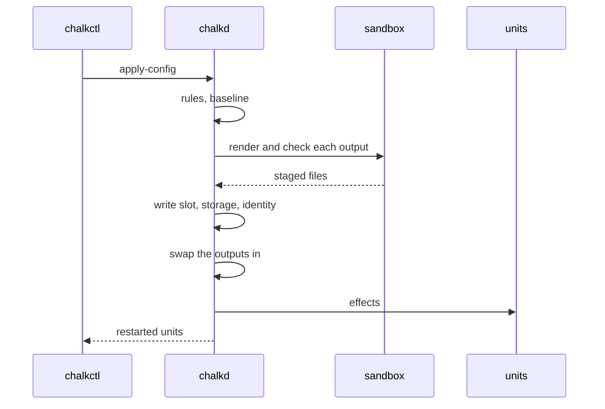

# Outputs and effects

An output is a set of config files for a service, rendered from a node's
[config documents](../reference/glossary.md#config-document) by a program of the image, and an
effect is what a delivery does to the node's services when an output changes: restart a unit,
reload it or run a command. chalkd renders and checks every output before a delivery changes the
node, so a document that would give a service a file it rejects is refused with the delivery,
and the node keeps running its old config. The model follows reactive programming: documents are
the sources, outputs are values derived from them, and effects are the actions that follow a
change of a value.

An image declares the three parts in its NixOS modules:

- A grant, [`systemd.services.<unit>.chalkos.kinds`](../reference/options.md#systemdserviceschalkoskinds),
  gives a unit the documents of the kinds it reads at runtime, and their secrets.
- An output, [`chalkos.outputs.<name>`](../reference/options.md#chalkosoutputs), derives files from
  documents and checks them.
- An effect, [`chalkos.effects.<name>`](../reference/options.md#chalkoseffects), restarts, reloads
  or runs something when outputs change, or when a CEL condition holds.

## What does a grant give a unit?

A grant gives a unit runtime access to config kinds: chalkd writes the node's documents of those
kinds below `/run/chalkos/config`, the values their `secretRef` fields name as the unit's systemd
credentials `secret_<secret>.<key>`, and puts [chalkcfg](../reference/glossary.md#chalkcfg) on the
unit's `PATH`. A grant never restarts the unit, because which changes matter to a service is the
service's to say, in an effect. A service that reads only its rendered outputs needs no grant,
unless it reads a secret: renderers never see secret values, so the secret reaches the service as
a credential, and the rendered file names the credential.

## What is an output?

An output is a directory of files that a renderer writes from the documents of its input kinds.
The renderer is a program of the image's store. It reads JSON on standard input and writes its
files into `$OUT`:

```json
{
  "node": {"name": "cp1"},
  "documents": {
    "Peer": [
      {"apiVersion": "bgp.example.org/v1alpha1", "kind": "Peer", "metadata": {"name": "upstream-a"}, "spec": {"address": "10.0.0.1", "asn": 64513}}
    ]
  }
}
```

`documents` holds each kind of the output's `inputs`, the documents sorted by name and filled in
with their schema defaults. A `secretRef` field holds the reference alone, never the value. The
node's name is the subject of its node certificate, as [change rules](rules.md) see it.

The renderer runs in the sandbox of command [facts](../reference/glossary.md#fact): the system is
read-only, there is no network, and `$OUT`, an empty directory, is the only path it may write
besides a private `/tmp`. It must finish within 30 seconds, and its files may take 16 MiB and hold
no links, because chalkd sets their owner afterwards and must not follow a link to a file the
output does not own.

An output's `check` runs in the same sandbox against the rendered files, as a script of bash with
`set -e`. A check that fails refuses the files, so a service's own validator, such as
`bird -p`, runs before the service ever reads them. `examples`, a directory of config files, is
rendered and checked when the image is built, so a template that does not render, or renders a
file the check refuses, fails the build.

Services read the files at the output's `dir`, `/run/chalkos/outputs/<name>` by default, which a
module refers to as `config.chalkos.outputs.<name>.dir`, so a misspelled output fails the image's
evaluation. `dir` is a link to the rendered directory, and chalkd replaces the link in one rename,
so a service reads the files of one render and never a mix of two. The files belong to the
output's `user` and `group` with its `mode`, `root:root 0644` by default.

The first swap removes a directory it finds at `dir`, so `dir` is a clean path below `/run`, a
tmpfs, whose components start with no dot. It stays out of `/run/chalkos`, which holds the node's
config and credentials, except for `/run/chalkos/outputs/<name>` and the paths below it, and it
is neither another output's `dir` nor inside one. A path such as `/run/systemd/network` is a valid
`dir`; the image's evaluation refuses any other, and chalkd refuses an `outputs.json` that holds
one.

### Why are renderers pure?

A renderer is pure: the same documents always give the same files. `/run` is a tmpfs, so a node
keeps no rendered file across a reboot and renders every output again at boot, from the config
slot it boots with. Because the renderer reads nothing but its input, the files the boot renders
are the files the delivery checked. A renderer that read node state, such as an interface's
address, could render a file at boot that no delivery checked, so outputs read documents alone; a
service that needs node state renders that part itself.

### Which renderers does chalkosLib offer?

Extensions call the helpers of the module argument `chalkosLib`:

| Helper | Renders |
| --- | --- |
| `chalkosLib.render.template ./bird.conf.tmpl` | A Go `text/template`, executed on the input, into one file named as the template less `.tmpl`. Besides Go's own functions it has `join`, `quote`, `json` and `default`, and a key a document lacks reads as missing, which `default` replaces. |
| `chalkosLib.render.jq ./peers.jq` | A jq program, whose output becomes one file named as the program less `.jq`; a string is written raw. |
| `chalkosLib.render.documents [ "Rack" ]` | The documents of the kinds as they are, each as `<Kind>/<name>.json`, for a service that reads its config at runtime and needs an effect when it changes. |

Any program of the store renders too, such as a script from `pkgs.writeShellScript`.

## What is an effect?

An effect is an action a delivery takes once it is applied. It fires when one of the outputs its
`on` names changed, or when its CEL `when` holds:

| Option | Meaning |
| --- | --- |
| `on` | Outputs, by name. An output changed when the hash of its files differs from the one before the delivery, or when the values of the Secrets its input documents reference differ, so a rotated password fires the effect although the rendered file names the same credential. |
| `when` | A CEL expression over `config` and `oldConfig`, `facts.<name>` and `oldFacts.<name>`, and `node.name`, for a trigger that no output renders, such as the node's Kubernetes share. |
| `restart` | Units to restart, by their full names. |
| `reload` | Units to reload with `systemctl reload`. |
| `run` | A command to run, such as `chronyc reload sources`: a bare program name of chalkd's `PATH` or a program of the image's store, with its arguments split on spaces. |
| `start` | Whether the units of `restart` start when they do not run, as for a unit whose condition only the delivery meets. |
| `chalkd` | `restart` or `reload`, for chalkd's control-plane loops, which run inside chalkd and have no unit of their own. |

An effect has `on`, `when`, or both, and fires when either holds. `chalkosLib.restartOn` and
`chalkosLib.reloadOn` build the common case:

```nix
chalkos.effects.bird = chalkosLib.reloadOn [ "bird-conf" ] [ "bird.service" ];
```

chalkd takes the effects that fire together, in this order:

1. It reloads the units of their `reload` that are active, in one `systemctl reload`. A unit that
   does not run reads its config when it starts, and a unit it restarts is not reloaded.
2. It runs their `run` commands.
3. It restarts the units of their `restart`: in one `systemctl try-restart` the units that run, or
   ran and stay active, so a unit that never started or was stopped stays so; in one
   `systemctl restart` the units of an effect with `start`; and with `systemctl reset-failed` and
   `restart` the units that failed, since the new config may be what they lacked.
4. It acts on its own loops: `reload` starts the control plane's loop again, which reads the share
   and applies the control plane's objects, and `restart` every Kubernetes loop, which read the
   cluster when they start.

A `when` that cannot be evaluated counts as true, so a unit restarts once more than it needed to
rather than run on config it has not read; its error goes to the journal and back to the client
as a warning. [`chalkctl apply-config`](../reference/cli/chalkctl_apply-config.md) prints the
restarted units and the warnings. A reload, command or restart that fails fails the delivery, and
the error names what to do by hand.

## What happens on a delivery?

A delivery to the running image, an
[`apply-config`](../reference/cli/chalkctl_apply-config.md), renders and checks every output
before it changes anything:



1. The [change rules](rules.md) pass, and chalkd records the effects' baseline if none exists:
   the running slot's config, the facts the rules read and the hash of each output.
2. chalkd renders every output from the new documents into a staging directory below
   `/run/chalkos/outputs/.staging`, then runs each output's check. A renderer or a check that
   fails refuses the delivery, and nothing on the node has changed.
3. chalkd writes the slot, the storage and the identity.
4. chalkd swaps each output's link to the staged files.
5. chalkd takes the effects whose outputs changed or whose rule holds.

Until a delivery is applied whole, the effects compare with the baseline, the state from before
the first delivery that failed part way, in `/run/chalkd/effects-baseline.json`, readable by root
alone, with `Secret` values as their hashes. A retry, or another delivery, renders again and takes
every effect of the failed delivery again, the reloads and restarts that succeeded included,
because what it compares with predates them. The delivery that succeeds removes the file; one
refused before it changed anything leaves it as it was. A delivery without config, such as a
share, renders from the running slot's documents and is refused in the same way when an output
fails.

An install in place renders and checks the outputs with the running image's renderers before it
installs anything, and the boot that follows renders them again. An install from the installer
cannot run the installed image's renderers, so that image renders its outputs at its first boot.

## What happens at boot?

`chalkos-config.service` renders every output from the booted slot's documents before services
start, runs the checks, and swaps in each output that passes. A renderer or a check that fails
fails `chalkos-config.service` once the rest of the config is applied, and so fails the boot's
[health check](boot-and-rollback.md). A boot the boot loader counts then falls back to the
previous image and its config. A boot that was blessed already comes up degraded: the output
holds no files, its services read none, and `chalkctl status` names the output.

## What happens after an upgrade?

A staged image's renderers live in its own store, which cannot run before that image boots, so its
outputs are rendered and checked at its first boot, and a failure falls back as at any boot.
[`chalkctl upgrade`](../reference/cli/chalkctl_upgrade.md) says so for each node it installs an
image on:

```text
cp1: installed 3fa9c1e2b7d0 (a1b2c3d4e5f6), which boots next as chalkos_2+3.efi
cp1: 3fa9c1e2b7d0 (a1b2c3d4e5f6) renders and checks its outputs when it first boots; if one fails, the node falls back to the image it runs
```

The build renders each output's examples, so a failure at first boot comes from documents the
examples do not cover.

## How is an image checked when it is built?

The image build's `chalkos-rules check`, which also compiles the [change rules](rules.md), refuses
an image when:

- an effect's `on` names something that is not an output, which the image's evaluation refuses
  first;
- an effect restarts or reloads a unit the image does not define;
- an output's `inputs` name a kind the image does not declare, or a `Secret` or `Addon`;
- an output's renderer or check is no program of the image's store;
- an output fails to render one of its `examples`, or its check refuses the result.

## How does a failure show up?

A renderer or check that fails on a delivery refuses it with the output's name and the exit
status:

```text
output bird-conf: its check refused the rendered files (exit 1); see the node's journal
```

What the program wrote to standard error goes to the node's journal alone, because a program can
echo the documents it read. Each program runs as a transient unit, `chalkos-render-<n>.service`,
whose journal holds its standard error, and the journal of `chalkd.service`, or of
`chalkos-config.service` at boot, names that unit beside the failure.
[`chalkctl logs`](../reference/cli/chalkctl_logs.md) shows both:

```sh
chalkctl logs cp1 --unit=chalkd.service
chalkctl logs cp1 --unit=chalkos-render-<n>.service
```

[`chalkctl status`](../reference/cli/chalkctl_status.md) lists each output with the start of the
hash of the files the node serves and its last render or check failure, at a delivery or at boot,
until a render passes:

```text
OUTPUT     HASH          STATE
bird-conf  5c2e81f09ab3  failed: its check refused the rendered files (exit 1); see the node's journal
```

A refused delivery leaves the hash of the files the node still serves. After a boot whose render
failed, the hash is `none`.

## Which effects does chalkos declare?

chalkos's own units take effects of their own, which `when` rules express:

| Effect | Fires when | Does |
| --- | --- | --- |
| `networkd` | The networkd units chalkd writes differ from those before the delivery: a `Network`, `NetDev` or `Link` document changed, a `Secret` one of them references, or a boot left other units. | Reloads `systemd-networkd.service`. |
| `chrony` | The `TimeSync`'s servers change, or the sources file chalkd writes differs from the one before the delivery. | Runs `chronyc reload sources`. |
| `chrony-dhcp` | The `TimeSync`'s spec changes. | Restarts `chalkos-chrony-dhcp.service`. |
| `registry-mirrors`, `controlplane-ports` | A `RegistryMirror` or a `Node` changes. | Restart `chalkos-registry-mirrors.service` or `chalkos-controlplane.service`. |
| `kubernetes` | The `Node`, the `Host`, the `Address=` values of the `Network` documents' `[Network]` sections, the `Cluster` or `Flannel` document, the cluster file or the share changes, but not for a share that differs in its node CA alone. | Restarts and starts `chalkos-kubernetes.service` and `kubelet.service`. |
| `chalkd-cluster` | The cluster changes. | Restarts chalkd's Kubernetes loops. |
| `chalkd-share` | The share changes beyond its node CA or, on a control plane, the objects of the `Addon` documents. | Reloads the control plane's loop. |

The Kubernetes effects exist on images with Kubernetes alone. chalkd acts on its own loops also
when a delivery fails part way, as when it cannot write the cluster file, the node certificate, the
share or the slot: the rules compare the cluster file and the share its loops read as they are by
then.

## Limits

- A renderer reads documents and the node's name alone; a service that needs node state renders
  that part itself.
- chalkctl cannot run an image's renderers, so `chalkctl apply-config --diff` shows the documents
  a delivery changes and not the rendered files.
- A `when` rule compares documents as written, so a change that makes no difference to the unit
  still counts: an `Address=` value whose prefix length alone changes restarts the kubelet.
- An output of a staged image is checked at its first boot, after the upgrade wrote the image and
  its config.

## Related pages

- [Change rules and facts](rules.md) for the CEL the rules and `when` share, and the facts they
  read.
- [Config and the inventory](config.md) for how documents reach a node.
- [Customise an image](../guides/customise-image.md) for an extension with a kind, an output and an
  effect.
- [`chalkos.outputs`](../reference/options.md#chalkosoutputs),
  [`chalkos.effects`](../reference/options.md#chalkoseffects) and
  [`systemd.services.<name>.chalkos.kinds`](../reference/options.md#systemdserviceschalkoskinds)
  for the options.
