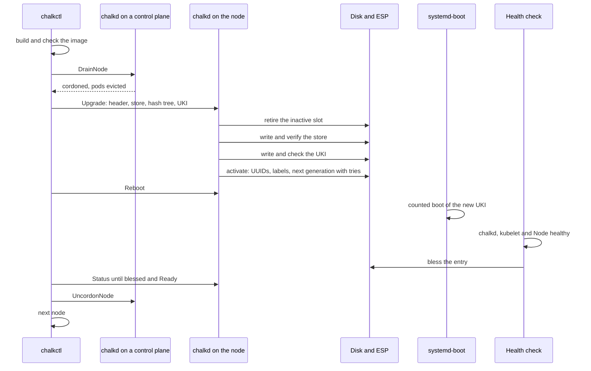

# Upgrades

An [upgrade](../reference/glossary.md#upgrade) installs a new
[image](../reference/glossary.md#image) on a node: the operating system, Kubernetes and
[chalkd](../reference/glossary.md#chalkd) together. chalkd writes the image into the node's inactive
[slot](../reference/glossary.md#slot), and the node boots it with a fixed number of tries; an image
that does not become healthy is replaced by the one before.
[`chalkctl upgrade`](../reference/cli/chalkctl_upgrade.md) rolls the upgrade through a cluster node
by node, so the cluster keeps its etcd quorum and its workloads keep running.

## What is an upgrade?

An upgrade replaces the whole image with another, which its store's
[root hash](../reference/glossary.md#root-hash) identifies. Any change to an image's modules gives
it a new root hash, so a new build needs nothing raised before it is installed. There are no
packages to update on a node and no separate Kubernetes upgrade: a new Kubernetes release is a new
image built with a new
[`chalkos.kubernetes.package`](../reference/options.md#chalkoskubernetespackage), installed like any
other.

The node receives three parts of the image, in this order:

- the [store](../reference/glossary.md#store)'s data, the compressed erofs file system that the
  [root hash](../reference/glossary.md#root-hash) covers, about 250 MiB for an image with
  Kubernetes;
- the store's [dm-verity](../reference/glossary.md#dm-verity) hash tree, about 2 MiB;
- the [UKI](../reference/glossary.md#uki), about 44 MiB, signed for
  [Secure Boot](../reference/glossary.md#secure-boot).

An upgrade never sends a boot loader, and the node refuses one: systemd-boot stays as it was
installed. The parts are the ones an install sends, read from the same image, so a node installed
from an image and one upgraded to it run the same bytes.

The node keeps no upgrade state of its own. The slots' partition UUIDs and labels and the UKIs on
the [ESP](../reference/glossary.md#esp) say what is installed, and the root hashes the nodes run
and their cordons say how far a rolling upgrade got. So any step can stop at any point, and running
the
same command again continues.

## Where does chalkctl get the images?

Without `--image`, each node gets the image the inventory names for it: chalkctl asks every node
what it runs, refuses a node that runs another platform than that image, and opens each image
directory once for the nodes that share it. Control planes and workers of one image in the
inventory get the same image:

```sh
chalkctl upgrade
```

The image in the directory of an inventory's image must be the build whose root hash its
`metadata.json` names, which `chalkctl status` compares the nodes with; rebuild the image or link
its directory again otherwise. The root hash stays on the operator's machine, so a new build changes
no node's config, and an upgrade needs no `chalkctl apply-config` after it.

With `--image`, it takes a prebuilt image, a raw image with `repart-output.json` beside it or an
image directory, and installs it on the nodes that run the image's variant, or on the nodes
`--nodes` names, whatever they run. Nodes on another platform than the image's are skipped and
named. chalkctl prints each node that gets an image of another variant than the one it runs.

```sh
chalkctl upgrade --image=<image-dir> --max-unavailable=2
```

`<image-dir>` is the directory `nix build` produced. In both cases, `--sign-key` and `--sign-cert`
sign the UKI before it is sent, so the signing key never enters the Nix store.

Before it sends anything, chalkctl checks each image against the cluster:

- the UKI boots the store the image holds: its `usrhash=` equals the store's root hash;
- the UKI's os-release sets `IMAGE_VERSION` empty, so systemd-boot orders the node's entries by
  generation, and names a variant and platform;
- the config the inventory gives each node that gets the image suits the `schemas/` and
  `image.json` in the image's directory, as an install checks the config it delivers;
- the UKI carries a signature of the certificate `--sign-cert` names, with or without
  `--sign-key`. Without `--sign-cert`, chalkctl checks no signature.

chalkctl checks every node's config before it drains the first node. It needs the inventory for
that, whatever it authenticates with; without one, the node's own check is all there is.

A node may get an image of another [variant](../reference/glossary.md#variant) than the one it
runs: the check of its config against the image's schemas decides whether the image suits it.

## What config does an upgrade carry?

chalkctl sends each node its config with the image: the set the inventory gives the node, the one
it checked against the image. The node checks the set against the image again and keeps it in
the new image's [config slot](config.md#where-does-a-node-keep-its-config), beside the slot of the
image it runs. The new image boots with its own config, and a
[fallback](boot-and-rollback.md) boots the image before with the config it ran, so config only the
new image accepts, such as a document of a kind its extension declares, goes with the upgrade.
Without an inventory, chalkctl sends no config, and the node carries the documents of the running
image's slot over, checked against the new image the same way. Delivering config with an upgrade
needs the [admin](../reference/glossary.md#admin) role, as `apply-config` does. With an operator
client file chalkctl sends no config either, and with an inventory prints one line for the run
instead of a line per node:

```text
config not delivered: the operator role cannot deliver config; each node carries its own over
```

The config meets the new image's [change rules](rules.md) as `apply-config`'s config meets the
running image's: compared with the running slot's config and the storage STATE records, a storage
change that takes a reset or a reinstall, or a change of a fixed Kubernetes setting, is refused,
and a new volume is created before the image boots, while the running image runs. chalkctl sends
the fallback secret such a volume is enrolled with, the recovery key from the secrets file or a
password from `--password-file`.
[Config and the inventory](config.md#which-changes-does-a-node-accept) lists what each change
takes.

Before it sends a node the image, chalkctl prints a line of what the config changes against the
running image's, the slot the new one replaces, such as
`w1: config 1 added, 0 removed, 1 changed`; without an inventory the line says there is nothing
to compare with. `chalkctl upgrade --diff` prints the whole comparison for every node and changes
nothing. A node that has the image staged already, after an upgrade with `--no-reboot`, gets the
image again only when the config kept for it is not the inventory's; the node then replaces that
config without writing the image again.

## What does the node check?

The [Upgrade](../reference/api.md#method-upgrade) method needs the
[operator](../reference/glossary.md#operator) role, the admin role when it carries config or a
fallback secret, and [normal mode](../reference/glossary.md#normal-mode). Before it changes
anything, chalkd checks the image's header against the running image's os-release and the disk:

- the image ID and platform equal the running image's, and the architecture the machine's;
- the root hash is not the running one; if it is, the node answers that it runs the image already
  and changes nothing;
- the entry the node booted, and any other the upgrade keeps, is named
  `chalkos_<generation>.efi` with a generation from 1 on and no leading zeros, and no name on the
  ESP gives a generation too large for one to follow it in 64 bits; chalkd never writes other
  names, and refuses to upgrade past one placed by hand or corrupted until the node is
  reinstalled or the entry renamed;
- the root hash is not that of the entry that boots next, the highest generation with tries left
  that the node did not boot; if it is and the inactive slot holds its store, chalkd checks the
  config the upgrade carries against the image, as step 4 below does, keeps it for the image in
  place of the config it had, and answers that the image is staged already without writing the
  image again; when the check refuses, it retires the slot, removes the entry and the image's
  config slot, so the running image boots next;
- the running boot was found healthy, when the upgrade would remove the image the node falls back
  to;
- the store and hash tree fit the inactive slot.

Any other root hash is installed as the next generation: a newer image, an older one, or one
whose earlier entry used up its tries, which the retirement then removes.

The UKI is checked when it arrives, before anything can boot it. Its SHA-256 must match the
header, its os-release must name the same image ID and platform as the header and set
`IMAGE_VERSION` empty, its `usrhash=` must equal the header's root hash, and its boot tries must
be a positive number. With Secure Boot enforced, chalkd checks its signature against the firmware's
[db and dbx](../reference/glossary.md#db-and-dbx) as the firmware will, and refuses it when dbx
lists its digest or any certificate in its signer's chain.

## How does a node install the image?

chalkd installs in five steps. At every point between them the disk boots the running image, or
the new one with all its tries.

1. Retire the inactive slot. chalkd removes every UKI of the image on the ESP except those that
   boot the running store, including a UKI a stopped upgrade left under its temporary name and a
   file whose name gives a generation of the image but that is no UKI. A UKI whose os-release
   names no `IMAGE_ID`, such as another system's, stays, and a UKI the ESP fails to read stops the
   upgrade. Then chalkd gives the slot's partitions random UUIDs and the label `_empty`, so
   nothing can boot them.
2. Write and verify. chalkd writes the store and hash tree into the slot, checks their SHA-256
   sums and verifies the store read back from the disk against the root hash. A slot that already
   holds this store is not written again.
3. Receive the UKI. chalkd writes it to the ESP as `/EFI/Linux/.upgrade-<root-hash>.efi`, a name
   systemd-boot ignores, and checks it.
4. Check and keep the config. chalkd opens the written store read-only through dm-verity with the
   image's root hash, reads the schemas and `image.json` of the system the UKI boots, and checks
   the config the upgrade carries against them, or without one the running slot's documents, as
   an install checks the config it delivers: the set rules, each document's schema and, on an
   image with Kubernetes, the cluster it gives. It evaluates the image's change rules against the
   running slot's config, the storage STATE records and the node's facts, refuses a change they
   refuse, makes the storage changes they accept, such as a new volume, and writes the image's
   config slot `/state/config/<root-hash>`. An image that would not accept the config would fail
   its boot in `chalkos-config`, and boot counting would fall back. When the check refuses, chalkd
   answers with the reason, removes the UKI and leaves the slot retired, so the running image
   stays the next boot and the next upgrade reuses or overwrites the slot.
   A node whose running slot holds no documents and that gets none refuses the upgrade.
5. Activate. chalkd gives the slot the partition UUIDs derived from the root hash and the labels
   `store_<hash16>` and `store-verity_<hash16>`, from the root hash's first 16 hex characters, and
   renames the UKI to `chalkos_<generation>+<tries>.efi`, one generation above the highest any
   name on the ESP gave, whatever its UKI holds. The rename is the last change: before it,
   nothing boots the slot. After it, chalkd records the image's revision and tag in
   `/state/chalkd/images.json` and forgets the images no UKI on the ESP boots any more, with their
   config slots. A refused upgrade forgets the images it retired the same way.

The running slot and its UKI are never written. Once the client stops sending, chalkd stops
between steps, never in the middle of a partition table change.

[Boot, health and rollback](boot-and-rollback.md) explains what happens at the next boot: the
counted tries, the [health check](../reference/glossary.md#health-check), the
[blessed boot](../reference/glossary.md#blessed-boot) and the fallback.

## How does an upgrade roll through a cluster?

`chalkctl upgrade` upgrades the [control planes](../reference/glossary.md#control-plane) first,
one at a time, then the [workers](../reference/glossary.md#worker) and nodes without Kubernetes in
batches of `--max-unavailable`, 1 by default. Control planes go first across every image and
platform, which also keeps every kubelet at or behind its API server's version, as Kubernetes
requires.

For each node, chalkctl:

1. reads what the node runs and its boot status;
2. on a control plane, checks that etcd keeps its quorum while the node reboots;
3. on a worker, drains the node;
4. streams the image, unless the node has it installed already;
5. on a control plane, drains the node;
6. reboots the node;
7. waits until the node runs the new image's root hash, its boot was found healthy and its Node is
   Ready;
8. uncordons the node, if the upgrade cordoned it.

The sequence shows a worker's upgrade.



A run over a cluster of three control planes prints this, shortened. On cp1 a pod without a
controller, `default/debug`, stays where it is:

```text
upgrading node on metal to 3fa9c1e2b7d0 (v1.5.0, a1b2c3d4e5f6): cp1, cp2, cp3
cp1: installing 3fa9c1e2b7d0 (v1.5.0, a1b2c3d4e5f6)
cp1: installed 3fa9c1e2b7d0 (v1.5.0, a1b2c3d4e5f6), which boots next as chalkos_2+3.efi
cp1: cordoned, evicted 2 pods, kept 7
cp1: keeps pods without a controller: default/debug; nothing starts them elsewhere, and they are deleted for good if the node stays down longer than their tolerations allow
cp1: rebooting into 3fa9c1e2b7d0 (v1.5.0, a1b2c3d4e5f6)
cp1: runs 3fa9c1e2b7d0 (v1.5.0, a1b2c3d4e5f6), found healthy
cp1: uncordoned
cp2: installing 3fa9c1e2b7d0 (v1.5.0, a1b2c3d4e5f6)
...
upgraded 3 nodes to 3fa9c1e2b7d0 (v1.5.0, a1b2c3d4e5f6)
```

### Why must etcd keep its quorum?

etcd needs a majority of its voting members to answer, and the API server needs etcd. Before a
control plane that is an [etcd member](../reference/glossary.md#etcd-member) reboots, chalkctl asks
for etcd's members through a control plane and requires that enough of the other voters are healthy
to make a majority of all voters. A learner refuses the check until it has joined as a voter. etcd
may need a moment after the previous control plane came back, so the check is retried for up to a
minute.

With one or two control planes, the others can never be a majority: etcd and the API server are
down while one reboots. chalkctl refuses that unless `--allow-downtime` accepts it. A lab's single
control plane always needs the flag.

### How are nodes drained?

Drains run on a control plane's chalkd, through the
[DrainNode](../reference/api.md#method-drainnode) method, because an operator's client file carries
no Kubernetes credentials. chalkd cordons the node, marks it with the annotation
`chalkos.dev/upgrade-cordon` and evicts its pods through the eviction API, so PodDisruptionBudgets
hold. It keeps DaemonSet pods, mirror pods, finished pods and pods without a controller, which
nothing would start elsewhere; chalkctl names those. Pods with emptyDir volumes are evicted only
with `--delete-emptydir-data`, which deletes their data; without it, a node that runs such a pod is
not drained, the run stops and the node stays cordoned. A drain that does not finish within
`--timeout`, 30 minutes by default, stops the run and leaves the node cordoned.

A worker is drained before its image is sent. A control plane gets its image first and is drained
right before it reboots.

## What stops a run?

A run stops at the first node that fails, and leaves the rest as they are. The most important case
is a [rollback](../reference/glossary.md#rollback): a node that fell back from the new image. The
error names the node and the image it runs again, and the journal lines its failed boot
recorded follow it:

```text
chalkctl: w2: upgrade to 3fa9c1e2b7d0 (v1.5.0, a1b2c3d4e5f6) failed: rolled back to 81bd02c4a9e1 (v1.4.0, 0f1e2d3c4b5a); it stays cordoned; its boots logged:
```

The node stays cordoned for an operator to look at.

A run also stops when a drain times out, when a control plane would take etcd's quorum with it or
when a node does not come back healthy and Ready within `--timeout`.

## What happens when the command runs again?

Running the same command again continues where the last run stopped:

- a node that runs the new image with a blessed boot is skipped, or only uncordoned once its
  Node is Ready;
- a node that booted the new image and is still being counted is waited for;
- a node that has the image installed already is rebooted without sending the image again;
- a node is uncordoned only if the annotation `chalkos.dev/upgrade-cordon` shows the upgrade
  cordoned it, so a node an operator cordoned stays cordoned.

A node that fell back from the image stops every later run too, so a known-bad image is never
booted again by itself. `--retry-failed` installs it once more on such nodes, as the next
generation, for a failure that lay outside the image; each node is upgraded once per run, so a
second fallback stops the run again. Usually the fix is a new build, which has a new root hash and
is installed like any other image.

## Which flags change a run?

| Flag | Effect |
| --- | --- |
| `--image` | Install a prebuilt image on the nodes that run its variant and platform, or on the nodes `--nodes` names, instead of each node's image in the inventory |
| `--nodes` | Upgrade only the named nodes |
| `--max-unavailable` | Upgrade this many workers and nodes without Kubernetes at once, 1 by default |
| `--allow-downtime` | Upgrade one or two control planes, whose etcd and API server are down while one reboots |
| `--no-reboot` | Install on every node without draining or rebooting; each boots the new image at its next reboot |
| `--retry-failed` | Install an image again, once, on nodes that fell back from it |
| `--delete-emptydir-data` | Evict pods with emptyDir volumes too, deleting their data |
| `--timeout` | How long a drain and a node's return may take, 30 minutes by default |

The command needs an operator [client file](../reference/glossary.md#client-file) or the
[secrets file](../reference/glossary.md#secrets-file), and to deliver config an admin client file
or the secrets file. Without an inventory, `--address NODE=ADDR` names the nodes, and `--image` is
needed. A [lab](../reference/glossary.md#lab), for example, is
upgraded with the lab's inventory, its client file and its Secure Boot keys, which
[`chalklab status`](../reference/cli/chalklab_status.md) names:

```sh
chalkctl upgrade --inventory=<lab-inventory> --config=<client-file> \
  --sign-key=<db-key> --sign-cert=<db-cert> --allow-downtime
```

## Can a node go back to an older image?

Yes, at the operator's own risk. chalkd has no notion of older or newer: a downgrade is an upgrade
to another root hash, installed as the next generation, so systemd-boot boots it first like any
upgrade, and when its tries are used up it falls back to the image the node ran. When the inactive
slot still holds the older image, as after one upgrade, its store is not written again. Neither
chalkctl nor chalkd warns of a downgrade; whether the older image still suits the node's data,
such as etcd's or a workload's, is for the operator to know.

## What does an upgrade trust?

chalkd checks that an image is of its platform, that the node's config suits it, and that
it boots the store it carries; it cannot tell an image to trust from another. Secure Boot does
that. With Secure Boot enforced, the node refuses a UKI that the firmware's db does not accept, so
only images signed by a trusted signer run. Without Secure Boot, an operator can upgrade a node
to any image, which then runs as root with [STATE](../reference/glossary.md#state) and
[VAR](../reference/glossary.md#var) unsealed, because their keys are sealed to
[PCR 7](../reference/glossary.md#pcr-7) alone.
[Security model](security.md) explains the consequences.

After a [rotation](../reference/glossary.md#rotation) of the [OS
CA](../reference/glossary.md#os-ca), images rebuilt from the new `secrets.pub.json` and rolled out
with `chalkctl upgrade` bring the trust of [maintenance
mode](../reference/glossary.md#maintenance-mode) up to date, for nodes that are installed again
later.

## Limits

- Every node receives the whole compressed store, about 300 MiB with the hash tree and UKI. There
  are no delta updates, and nodes do not share a download.
- Images travel only through chalkctl's stream. Nodes do not pull images from a registry.
- An upgrade never updates systemd-boot.
- chalkctl does not check Kubernetes's
  [version skew policy](https://kubernetes.io/releases/version-skew-policy/) beyond upgrading
  control planes first. An image that skips a Kubernetes minor version is not refused.
- The health check decides on chalkd, etcd, the API server and the kubelet. An image that breaks
  only workloads is blessed, and the run continues.
- A cluster with one or two control planes has no API server while a control plane reboots.

## Related pages

- [Boot, health and rollback](boot-and-rollback.md) for [boot
  counting](../reference/glossary.md#boot-counting) and the health check.
- [The image](image.md) for what an image holds and how its root hash identifies it.
- [Kubernetes on chalkos](kubernetes.md) for etcd membership and the control plane.
- [Upgrade a cluster](../guides/upgrade-cluster.md) for the task, step by step.
- [`chalkctl upgrade`](../reference/cli/chalkctl_upgrade.md) and the
  [Upgrade](../reference/api.md#method-upgrade) method for the details.
