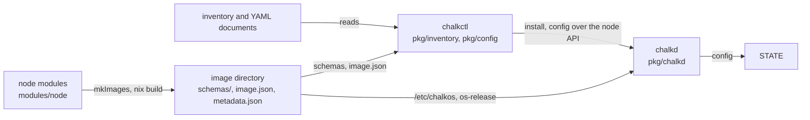
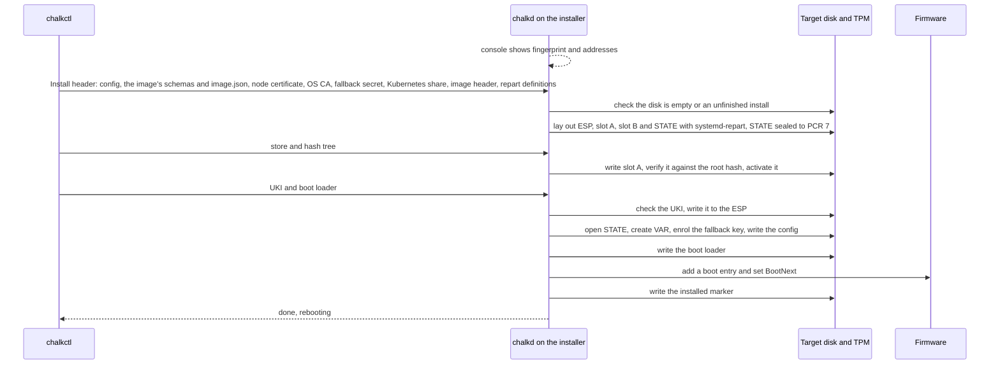

# Architecture for developers

chalkos is two halves: Nix modules that build a cluster's images, and Go programs that read the
cluster's YAML and install and operate the nodes. This page maps both to the repository and shows
where they meet. [Architecture](../how-it-works/node/architecture.md) explains the system as a user sees it;
this page is for changing it.

## Nix and Go meet at the image and the node's config

Go code never evaluates Nix itself. Nix builds images; everything about a cluster or a node is
YAML that Go reads. They meet in these places:

- The image directory. `chalkos.lib.mkImages` builds one per
  variant and platform
  from the node modules (`lib/images.nix`, `modules/node`): the raw image with its partitions,
  `metadata.json` (variant, platform, root hash, revision and tag), `image.json` (what the image
  fixes about Kubernetes) and `schemas/`, the JSON Schemas of the
  config kinds the image accepts. chalkctl and chalklab read
  them from there, or from a running node through the Contract method.
- Files the image carries in `/etc/chalkos`, written by the node modules: the same
  `kubernetes/image.json` and `schemas`, the units granted each kind in `services.json`, the
  outputs a node renders in `outputs.json`, what a delivery restarts or reloads in
  `effects.json`, the system region's repart definitions in `repart.d`
  and the OS CA certificate in `os-ca.crt` when `mkImages` has
  an `osCA`; and the image's own description in `/etc/os-release`. chalkd reads them on the node.
- A node's config: the YAML
  config documents an inventory gives the node,
  which chalkctl reads (`pkg/inventory`), checks against the schemas of the image the inventory
  names for the node and translates into the identity the
  node applies (`pkg/config`). chalkctl delivers the documents to
  chalkd, which checks them again against its own image's
  schemas, keeps them on STATE and translates them the same
  way.
- The node's Kubernetes cluster, which chalkd builds from the `Cluster` and `Flannel`
  documents and the image's `image.json` into `/run/chalkos/kubernetes/cluster.json`. chalkd renders
  chalkos's add-ons (RBAC, kube-proxy, flannel, CoreDNS) and the kubelet's configuration from it
  in Go (`pkg/kubernetes/addons`, `pkg/kubernetes/node`) and applies the objects of the
  `Addon` documents after the add-ons.

The diagram follows an image and a node's YAML to a running node.



## Programs in cmd

Each directory of `cmd/` is a main that wires a package up; the logic lives in `pkg/`.

| Program | What its main does |
| --- | --- |
| `cmd/chalkctl` | Runs `chalkctl.NewCommand()` with a context that Ctrl+C cancels. |
| `cmd/chalklab` | The same for `chalklab.NewCommand()`. |
| `cmd/chalkbuild` | The same for `chalkbuild.NewCommand()`. |
| `cmd/chalkcfg` | Runs `chalkcfg.NewCommand()` on a node. |
| `cmd/chalkd` | Dispatches the four commands the node's units run: `serve` (chalkd.service), `load-config` (chalkos-config.service), `prepare-kubernetes` (chalkos-kubernetes.service) and `health` (chalkos-health.service), and loads the credentials `serve` starts with. |
| `cmd/chalkos-networkd-schema` | Writes the spec schemas of the networkd kinds from systemd's gperf tables, for the image build. |
| `cmd/chalkos-render` | Renders the outputs of the `lib.chalkos.render.template` and `.documents` renderers and the built-in output `networkd` on a node, in an output's sandbox. |
| `cmd/chalkos-rules` | Checks an image when it is built: every rule compiles within the cost limit and reads facts the image declares, the effects act on units and outputs the image has, and every output renders its examples and passes its check. |
| `cmd/chalkos-storage` | Opens STATE and sets up the volumes in the initrd, runs as a systemd generator for the other volumes, and prints the storage facts the storage kinds' rules read. |
| `cmd/docgen` | Writes the command reference and checks the commands the documentation shows. |

## Packages in pkg

| Package | What it does |
| --- | --- |
| `api/node/v1` | The node API's messages and Connect client and server, generated by `buf generate`. |
| `atomicfile` | Replaces a file in one step through a synced temporary file, and syncs directories, so a crash leaves the old content or the new. |
| `chalkbuild` | The chalkbuild command tree. |
| `chalkcfg` | The chalkcfg command tree: reads the documents below `/run/chalkos/config` and the kinds the image's schemas name, and prints them. |
| `chalkctl` | The chalkctl command tree. |
| `chalkd` | The node API server, with the permissions of each method, and chalkd's work at boot: renewals, the VIP election, the health check. |
| `chalklab` | The chalklab command tree. |
| `client` | Connections to chalkd: by fingerprint in maintenance mode, by the OS CA otherwise; the names chalkd's status gives certificates and trusted values. |
| `command` | Runs a program of the image's store with bounded output, for command facts and outputs; a failure keeps standard error out of its error. |
| `config` | Config documents: parsing, the rules of a set, defaults, the hash, and the translation into the identity the node applies. |
| `config/slot` | Keeps a node's config on STATE, a slot per image with its identity, and writes it for the node's units: the documents below `/run/chalkos/config` and the secrets the granted units load as credentials. |
| `config/withheld` | Names the kinds the node withholds from its services, Secret and Addon, without importing anything, so chalkcfg shares the list with chalkos-rules. |
| `effects` | Reads the image's `services.json`, the units granted config kinds, and `effects.json`, what a delivery does to those units and to chalkd, and refuses an effect chalkd could not carry out. |
| `facts` | Loads the facts change rules read: files, and commands of the image's store run in a sandbox. |
| `identity` | The node's identity, the form its config translates to, which the node applies at boot and its Kubernetes side reads. |
| `image` | Reads a disk image: its partitions from `repart-output.json`, its store and hash tree, the UKI and boot loader off its ESP, and the provenance `metadata.json` names. |
| `imagesign` | Signs an image's boot loader and UKIs, in place or in a signed copy of an image directory. |
| `install` | Installs a node in place or from the installer, step by step and repeatable. |
| `kubernetes` | The node's Kubernetes cluster as the image records it, and the node as its config names it. |
| `kubernetes/apply` | Server-side apply of manifests and approval of kubelet serving certificates. |
| `kubernetes/etcd` | etcd membership: learners, promotion, quorum-safe removal. |
| `kubernetes/manifests` | The control plane's static pods. |
| `kubernetes/node` | The node's Kubernetes files at boot: addresses, kubelet credentials and flags, control-plane certificates. |
| `kubernetes/nodeip` | Picks the node's address of each family. |
| `kubernetes/pki` | The Kubernetes certificates: the share, the control plane's leaves, admin kubeconfigs. |
| `kubernetes/vip` | Adds a VIP to an interface and announces it. |
| `lab` | QEMU VMs, swtpm, the lab switch and console and the lab's supervisor, for chalklab and the end-to-end tests. |
| `networkdschema` | Generates the spec schemas of the networkd kinds from systemd's gperf tables. |
| `nodeconfig` | Applies the running image's config slot, chosen by `usrhash=`, at boot (`chalkd load-config`) and after every apply: the hostname and `/run/chalkos/node.json`; writes the config's documents and secrets for the granted units, and renders the outputs at boot, networkd's units and chrony's servers among them. |
| `outputs` | Renders and checks the image's outputs in a sandbox of their own, as an unprivileged user, swaps them in by a symlink rename, and records their hashes and failures. |
| `pki` | The secrets file, the OS CA and node CA, client and node certificates, client roles. |
| `rules` | Compiles the change rules of an image's schemas, with chalkos's CEL functions, and evaluates them against a config, the config it replaces and the node's facts. |
| `schema` | Reads an image's config contract: `metadata.json` and the JSON Schemas of its kinds, and validates documents against them. |
| `storage` | Storage sections, disk references and pins, repart definitions, and the changes a delivered section makes to the recorded one. |
| `storage/node` | Storage on the node: STATE, volumes, VAR and the generator's units. |
| `tool` | Runs the command-line tools chalkd, the installer and the storage code drive, such as cryptsetup, sfdisk and systemctl. |
| `uki` | Reads a UKI's os-release and command line, checks its signature as firmware does, and refuses an image version systemd-boot would order its entry by. |
| `upgrade` | Writes an image into the inactive slot and makes it the next boot; the slot writer install shares. |
| `verity` | Reads and checks dm-verity hash trees. |

`uki/ukitest`, `image/imagetest`, `kubernetes/etcd/etcdtest` and `tool/tooltest` hold test helpers:
small UKIs, small disk images and db signers, in-process etcd members, and a fake tool runner that
records commands and answers them by prefix.

## The node API

The API is defined in `api/chalkos/node/v1/node.proto` and served by chalkd over Connect on
TCP port 50000 with mutual TLS. Which client role may
call a method, and in which mode, is one table: `permissions` in `pkg/chalkd/server.go`.

```go
nodev1connect.NodeServiceInfoProcedure:    {[]nodev1.Mode{maintenance, normal}, pki.RoleReader},
nodev1connect.NodeServiceInstallProcedure: {[]nodev1.Mode{maintenance}, pki.RoleAdmin},
nodev1connect.NodeServiceUpgradeProcedure: {[]nodev1.Mode{normal}, pki.RoleOperator},
```

A new method needs an entry there; the authoriser refuses a method without one. Comments in the
proto file become the [Node API](../reference/api.md) page, so they are written for users.

## chalkd runs with a narrow sandbox

The unit `chalkd.service` is declared in `modules/node/chalkd.nix`. chalkd runs as root with its
capabilities, because it partitions disks, enrols TPM keyslots, writes EFI variables, mounts
volumes the host must see and sets the hostname. Its unit therefore has no file system or
hostname namespace. `ProtectKernelLogs` stays off too, because systemd would give chalkd a mount
namespace for it, and chalkd's mounts would not reach the host.

The sandbox it does have:

- `RestrictAddressFamilies` allows only the socket families chalkd uses: Unix, IPv4, IPv6,
  netlink, the kernel crypto API (`AF_ALG`, for cryptsetup and systemd-cryptenroll) and packet
  sockets (`AF_PACKET`, for the gratuitous ARP of a VIP).
- `NoNewPrivileges` forbids new privileges.
- `SystemCallArchitectures=native` fixes the system call architecture.
- `ProtectClock` protects the clock, and `LockPersonality` and `RestrictRealtime` are on.

`Restart=always` with no start limit restarts chalkd whenever it stops, because it is the only
way to reach the node: nodes have no SSH and no login.

## An install runs in fixed steps

`pkg/install` turns a node in maintenance mode into an installed node, and `pkg/chalkd/install.go`
serves it as the node API's Install method. Every step finds what an earlier, interrupted attempt
did and continues from there, so running the same `chalkctl install` again continues an install.

[`chalkctl install`](../reference/cli/chalkctl_install.md) connects to the node, compares its
certificate with the fingerprint from the console, and sends what makes the machine this node.
[Security model](../how-it-works/node/security.md) explains how the fingerprint and `--insecure`
protect the secrets on the way.

On a node that runs its image already, the install happens in place (`Installer.InPlace`), and
chalkctl sends no image. chalkd recreates STATE if its encryption differs from the node's
`SystemDisk`, opens it, creates VAR and the volumes, and enrols the second keyslot of every
encrypted volume unless the fallback is `none`. It then writes the config and certificates, gives
the ESP a random partition UUID and writes the `installed` marker.

On a node that runs the installer (`Installer.FromParts`), chalkctl also sends the image the
inventory names for the node, or the one `--image` gives, in the same parts an upgrade sends,
plus the boot loader. The sequence shows what the installer does with them. When the inventory
names the image in a registry, the header carries the image's reference by digest in place of the
schemas, `image.json` and repart definitions, and no parts follow it. The installer then reads
those from the artifact's contract layer before it touches the disk. It pulls the store, hash
tree, UKI and boot loader from the registry in the steps where the sequence receives them from
chalkctl.



Before anything is written, the installer checks the config against the image's schemas,
translates it for the image's platform, and checks that the image is built for the machine's
architecture. With Secure Boot enforced, it checks the UKI's and the boot loader's signatures
against the firmware's db and dbx, as the firmware will at the next boot. It checks each when it
receives it: after slot A is written and before the boot loader is.

The installer takes the disk the node's `SystemDisk` names when blkid finds nothing on it but at
most an empty GPT, or when it holds an unfinished install of the node, which it continues. It
takes any other disk only with `--wipe-disk`. Until the boot loader is written the firmware finds
nothing to boot on the target, so an interrupted install never boots a half-installed node.

The image travels as its parts: the compressed store, its hash tree, the UKI and systemd-boot.
For an image with Kubernetes that is about 300 MiB, instead of the multi-gigabyte raw image.

After the reboot, the initrd unseals STATE and VAR with the TPM, `chalkos-config.service` applies
the config, and chalkd finds the `installed` marker and starts in normal mode with the node
certificate from STATE.

## Storage partitions are matched deterministically

`pkg/config/storage.go` renders the systemd-repart definitions of a node's VAR and volumes, and
`pkg/storage/node` runs systemd-repart once per disk to create and grow the partitions. repart
assigns existing partitions to definitions, so three choices keep that matching deterministic:

- Each partition gets its own GPT type UUID, derived from its label. repart assigns existing
  partitions to definitions by type, so a new volume can never take over another volume's
  partition.
- Definition files are ordered: VAR first, then the system disk's volumes in name order. A disk of
  its own holds one volume.
- Partition UUIDs derive from a seed of the node's name and the disk, passed as `--seed`. The same
  definition yields the same partition UUID on every run, and the node opens volumes on other
  disks by that UUID.

A `Volume`'s `repart` field passes further repart.d keys through. The keys the typed fields set
(`Type`, `Label`, `Encrypt`, `Format`, `SizeMinBytes`, `SizeMaxBytes` and `MountPoint`) are refused
there.

## The command-line programs

chalkctl, chalklab, chalkbuild and chalkcfg are cobra command trees in importable packages:
`pkg/chalkctl`, `pkg/chalklab`, `pkg/chalkbuild` and `pkg/chalkcfg` each export `NewCommand()`,
which returns the root command, and `Execute(ctx, root)`, which runs it and returns the exit code.
Another program can add their trees to its own, and tests run commands in-process with their
output captured. The four share `pkg/internal/cli`: its `Execute` prints a command's error and
exits with 2 and the command's usage after a usage error, such as a wrong number of arguments, an
unknown flag or a required flag not set, and with 1 after another error. chalkctl also exits with
130 after an error once Ctrl+C cancelled it. Each package keeps its help texts in `help.go`, and
a test requires a short and a long description and an example on every visible command, because
they become the [command reference](../reference/cli/index.md). chalkcfg runs on nodes, which have no logins, so
it has no `completion` command.

## Nix modules

| Directory | What it holds |
| --- | --- |
| `modules/node/` | The NixOS modules of every image: `packages.nix` (chalkos's programs, as the module argument `chalkosPackages`), `base/` (appliance, closure, disk, image directory, storage), `kinds/` (`chalkos.kinds`, `chalkos.facts`, networkd's kinds and the built-in kinds), `runtime/` (grants, `chalkos.outputs`, `chalkos.effects`, chalkcfg on the system path), kernel, chalkd, time, the CNI, `kubernetes/` (the kubelet, effects, containerd, registries, firewall), upgrade. |
| `modules/platforms/` | `metal` and `kvm`. |
| `modules/installer/` | The installer image and its ISO. |
| `modules/testing/` | The test probe, the test image's partition sizes and the test-only config kind `Greeting` with its output and effect. |
| `lib/` | `mkImages` (`images.nix`), its arguments as module options (`images-arguments.nix`), `chalkos.nix`, the `lib.chalkos` of every image's modules, and the functions the modules share: `kinds/` (the JSON Schema converter, the chalkcfg commands of `get`, the option types both recognise, the API groups of chalkos's own kinds, and the check of the kinds a grant, output or effect names) and `cel.nix` (CEL that effect rules share). |

## Layout rules

The layout follows these rules, so each change has one place to go:

- An extension is a NixOS module in a variant's
  `modules`: its kinds, its units, their outputs and their effects, together.
- The node modules declare the image options; `lib/images-arguments.nix` declares the
  arguments of `mkImages`. Everything about a cluster or a node is a config kind, not an option.
- Go code reads a node's config documents and the image's files alone.
- `nix/` holds packages and tooling: apps, checks, the development shell, the docs build and
  test fixtures. The scripts the node modules run, such as the VXLAN rule, are packages there;
  the modules decide where and with which arguments an image runs them.
- `cmd/` holds the mains, which wire packages up; logic worth testing lives in `pkg/`.

[Development setup](development.md) lists the commands of a development loop and
[Testing](testing.md) the tests each part has.
