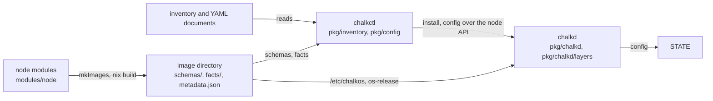

# Architecture for developers

chalkos is two halves: Nix modules that build a cluster's images, and Go programs that read the
cluster's YAML and install and operate the nodes. This page shows where the halves meet, how a
layer spreads across both and where each kind of change goes.
[Architecture](../how-it-works/node/architecture.md) explains the system as a user sees it.

## Nix and Go meet at the image and the node's config

Go code never evaluates Nix. Nix builds images, and everything about a cluster or a node is YAML
that Go reads. They meet in four places:

- The image directory. `chalkos.lib.mkImage` (`lib/images.nix`) builds one per image from the node
  modules (`modules/node`). Beside the raw image it holds `metadata.json`, `facts/` and `schemas/`,
  the JSON Schemas of the config kinds the image accepts. chalkctl and chalklab read them there,
  or from a running node through the Contract method.
- The files the image carries in `/etc/chalkos`, which the node modules write, and its
  `/etc/os-release`. `pkg/contract` loads the schemas and the definition files as one contract.
  chalkd loads the running image's contract once as it starts. For an image it checks config
  for, it loads the contract from that image's own `/etc/chalkos`.
- A node's config. chalkctl reads the documents an inventory gives the node (`pkg/inventory`) and
  checks them against the schemas of the image the inventory names. `pkg/config` translates them
  into the identity the node applies. Each layer adds its part through a translator, such as
  `pkg/kubernetes/translate`, which stores it in the identity's `layers` by the layer's name.
  chalkd checks the documents again against its own image's schemas, keeps them on STATE and
  translates them the same way.
- The node's Kubernetes cluster. chalkd writes `/run/chalkos/kubernetes/cluster.json` from the
  `Cluster` and `Flannel` documents and the image's `kubernetes/image.json`. From it, Go code
  renders chalkos's add-ons and the kubelet's configuration (`pkg/kubernetes/addons`,
  `pkg/kubernetes/node`). chalkd applies the objects of the `Addon` documents after the add-ons.

[Outputs of an image build](../reference/image-layout.md#outputs-of-an-image-build) and
[Paths on a running node](../reference/image-layout.md#paths-on-a-running-node) list the files.
The diagram follows an image and a node's YAML to a running node.

## A layer spans Nix modules and four Go plugins

A layer, such as Kubernetes or the router, is a set of NixOS modules plus a Go plugin in each
program that serves it. `lib/layers.nix` exports the layers as the flake's `nixosModules`. An
image lists one in its modules, which enables the layer's modules in `modules/node` and writes
the layer's marker to `/etc/chalkos/layers`.

| Program | The layer's plugin | Listed in |
| --- | --- | --- |
| chalkd | `pkg/chalkd/layers/<layer>`: the layer's API, loops, hooks, commands and actions | `cmd/chalkd/plugins.go` |
| chalkctl | `pkg/chalkctl/layers/<layer>`: commands, status, delivery, upgrade and rotation hooks | `pkg/chalkctl/layers.go` |
| Console | `pkg/console/layers/<layer>`: the layer's tab | `cmd/chalkos-console/layers.go` |
| Status view | `pkg/statusview/layers/<layer>`: the layer's section of a node's status | used by the chalkctl plugin and the console tab |

Common code names no layer. `pkg/inventory` takes its filters from chalkctl's plugins, and
`pkg/identity` keeps each layer's part without interpreting it.
[Layer plugins](internals/layer-plugins.md) describes the hooks.

## Layout rules

The layout follows these rules, so each change has one place to go:

- An extension is a NixOS module in an image's `modules`: its kinds, its units, their outputs and
  their effects, together.
- A part of the router layer is a directory of `modules/node/router`, laid out as
  [Nix code](nix.md#what-the-modules-and-lib-hold) describes.
- The node modules declare the image options; `lib/images-arguments.nix` declares the arguments
  of `mkImage` and `mkImages`. Everything about a cluster or a node is a config kind, not an
  option.
- Go code reads a node's config documents and the image's files alone.
- `nix/` holds how the repository builds and checks chalkos: the packages, the overlay, the flake
  outputs, the docs build, the checks and the test images.
- `nix/overlay/default.nix` adds `pkgs.chalkos`, the scope of chalkos's programs and Go
  toolchain. The flake exports it as `overlays.default`, and mkImage applies it to the images'
  nixpkgs. The node modules take chalkos's programs and scripts from that scope and decide where
  and with which arguments an image runs them.
- A script a module builds from its config, such as the control plane's ports, sits next to that
  module.
- `cmd/` holds the mains, which wire packages up; logic worth testing lives in `pkg/`.

## Where to change what

Each row names where a change goes and the checks that cover it. `nix build
.#checks.x86_64-linux.<check>` runs one check.

| To change | Edit | Check with |
| --- | --- | --- |
| A NodeService method | `api/chalkos/node/v1/node.proto`, then `buf generate`; the handler and its `permissions` entry in `pkg/chalkd` | `api-generated`, `docs-generated`, `go-unit`, `go-lint` |
| A layer's API method | `api/chalkos/<layer>/v1/<layer>.proto`; the handler and `Permissions` in `pkg/chalkd/layers/<layer>` | `api-generated`, `docs-generated`, `go-unit`, `go-lint` |
| A chalkctl command or flag | `pkg/chalkctl` or `pkg/chalkctl/layers/<layer>` and its `help.go`, then `nix run .#docgen` | `go-unit`, `docs-generated`, `docs` |
| A chalklab or chalkbuild command | `pkg/chalklab` or `pkg/chalkbuild` and its `help.go`, then `nix run .#docgen` | `go-unit`, `docs-generated` |
| Parsing or translating config | `pkg/config`, or a layer's translator such as `pkg/kubernetes/translate` | `go-unit`, `go-lint` |
| A kind every image accepts | `modules/node/kinds/` | `eval-kinds`, `eval`, `image-tests`, `docs-generated` |
| The CEL functions of change rules | `pkg/rules` | `go-unit`, `rules` |
| How a delivery is checked and applied | `pkg/check`, `pkg/outputs`, `pkg/effects`, `pkg/chalkd/apply.go` | `go-unit`, `image-tests` |
| An image's checker | `pkg/imagecheck`, `chalkd check` in `pkg/chalkd` | `image-checker`, `go-unit`, `e2e-upgrade` |
| The install | `pkg/install`, `pkg/chalkd/install.go` | `go-unit`, `e2e-install`, `e2e-installer` |
| Staging, activation or an upgrade | `pkg/upgrade`, `pkg/chalkd/staged.go`, `pkg/chalkctl/upgrade.go` | `go-unit`, `e2e-upgrade` |
| Disks, STATE, VAR or volumes | `pkg/storage` and its subpackages, `pkg/config/storage.go`, `cmd/chalkos-storage` | `go-unit`, `e2e-image` |
| Secure Boot checks or signing | `pkg/secureboot`, `pkg/imagesign` | `go-unit`, `e2e-secureboot` |
| OCI images | `pkg/ociimage`, `pkg/chalkbuild` | `go-unit`, `image-oci` |
| Kubernetes on a node | `pkg/kubernetes` and its subpackages, `pkg/chalkd/layers/kubernetes`, `modules/node/kubernetes/` | `go-unit`, `eval`, `e2e-kubernetes`, `e2e-kubernetes-ha` |
| containerd or registries | `modules/node/kubernetes/containerd.nix`, `registries.nix`, `registry-mirrors.nix` | `containerd-config`, `registry-mirrors` |
| The node's clock | `modules/node/time.nix` | `chrony-dhcp`, `image-tests` |
| A router feature | `modules/node/router/<feature>/`, its renderer in `cmd/chalkos-render`, `pkg/router/derive` | `rules`, `image-tests`, `eval-kinds`, the feature's `router-<feature>` check, `e2e-router` |
| Status or the console | `pkg/statusview`, `pkg/console` and their `layers/<layer>` | `go-unit` |
| The arguments of mkImage and mkImages | `lib/images.nix`, `lib/images-arguments.nix` | `eval`, `image-tests`, `docs-generated` |
| Kernel modules or the closure | `modules/node/kernel.nix`, `modules/node/base/closure.nix` | `kernel-modules`, `image-size`, `bootspec` |
| The lab template | `templates/lab` | `template-lab` |
| A documentation page | `docs/` | `docs` |

[Testing](testing.md#flake-checks) maps more parts to their checks.

## Read further

- [Packages and programs](packages.md) lists every directory of `cmd/` and `pkg/`.
- [Nix code](nix.md) describes the modules and `lib/`.
- [Internals](internals/index.md) maps the node API, layer plugins, config redaction, chalkd's
  sandbox, the install, staging and storage matching to their code.
- [Development setup](development.md) lists the commands of a development loop.
