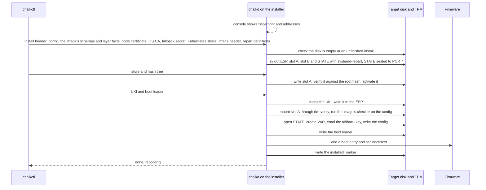

# The install in code

[Maintenance mode serves a node that is not installed](../../how-it-works/node/architecture.md#maintenance-mode-serves-a-node-that-is-not-installed) explains the install's place in a node's life; this page maps its steps to the code.

`pkg/install` turns a node in maintenance mode into an installed node, and
`pkg/chalkd/install.go` serves it as the node API's Install method. Every step finds what an
earlier, interrupted attempt did and continues from there. Running the same `chalkctl install`
again therefore continues an install.

[`chalkctl install`](../../reference/cli/chalkctl_install.md) connects to the node and compares its
certificate with the fingerprint from the console. Then it sends what makes the machine this
node. [Security model](../../how-it-works/node/security.md) explains how the fingerprint and
`--insecure` protect the secrets on the way.

## An install in place

On a node that runs its image already, the install happens in place (`Installer.InPlace`), and
chalkctl sends no image. chalkd recreates STATE if its encryption differs from the node's
`SystemDisk`, opens it, and creates VAR and the volumes. It enrols the second keyslot of every
encrypted volume unless the fallback is `none`. It then writes the config and certificates, gives
the ESP a random partition UUID and writes the `installed` marker.

## An install from the installer

On a node that runs the installer (`Installer.FromParts`, in `pkg/install/parts.go`), chalkctl
also sends an image. It is the image the inventory names for the node, or the one `--image` gives,
sent in the same parts an upgrade sends, plus the boot loader. The sequence shows what the
installer does with them.

When the inventory names the image in a registry, the header carries the image's reference by
digest. It replaces the schemas, layer facts and repart definitions, and no parts follow it. The
installer reads those from the artifact's contract layer before it touches the disk. It pulls the
store, hash tree, UKI and boot loader from the registry in the steps where the sequence receives
them from chalkctl.

The image travels as its parts: the compressed store, its hash tree, the UKI and systemd-boot.
For an image with Kubernetes that is about 300 MiB, instead of the multi-gigabyte raw image.

## Checks before the disk changes

Before anything is written, the installer does three things:

- It translates the config with its own code and the image's schemas, for the storage section it
  lays the disk out by.
- It checks that the image is built for the machine's architecture.
- It plans the layers' payloads against that translation's identity. A payload no layer takes, or
  a Kubernetes share for another node, is refused with the disk untouched.

With Secure Boot enforced, it checks the UKI's and the boot loader's signatures against the
firmware's db and dbx, as the firmware will at the next boot. It checks each when it receives it:
after slot A is written and before the boot loader is.

## The image checks its config

Once slot A holds the store and the ESP the UKI, `Installer.checkConfig` mounts the store
read-only through dm-verity (`upgrade.OpenStore`). It then calls `PartsRequest.Check`, which
chalkd's `installCheck` serves with `checkWithImage`. The image's `chalkd check` runs as
[An image that does not run checks its own config](../../how-it-works/node/config-pipeline.md#an-image-that-does-not-run-checks-its-own-config)
describes, with the facts of the installer's machine, which the node runs on.

The identity the checker returns must have the storage section the disk was laid out by, or the
install is refused (`sectionDifference`). STATE gets the config slot the checker returned. The
layers' payloads are planned again against its identity, and STATE records them with it. A
refusal comes before STATE, the boot loader and the boot entry, so the disk boots nothing. An
install continues on that disk, of the same image or another.

## Disk choice and the reboot

The installer takes the disk the node's `SystemDisk` names when blkid finds nothing on it but at
most an empty GPT. It also takes it when it holds an unfinished install of the node, which it
continues. It takes any other disk only with `--wipe-disk`. Until the boot loader is written the
firmware finds nothing to boot on the target, so an interrupted install never boots a
half-installed node.

After the reboot, the initrd unseals STATE and VAR with the TPM, and `chalkos-config.service`
applies the config. chalkd finds the `installed` marker and starts in normal mode with the node
certificate from STATE.
