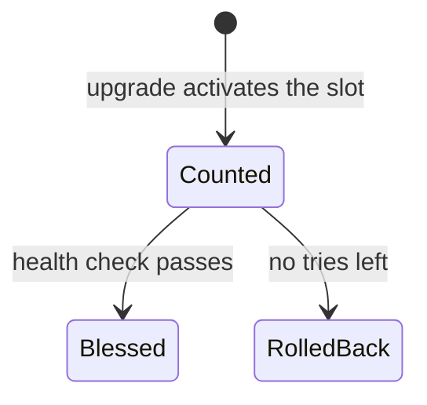

# Style guide

This guide sets the rules for every hand-written page of the chalkos documentation. Generated
reference text follows the voice and word rules too; it is written in command help, option
descriptions, schemas and the proto files. How to build, check and generate the site is on
[Writing documentation](writing-docs.md).

## Audiences

Each page is written for one of three readers. Write for that reader's task.

| Reader | Works with | Reads |
| --- | --- | --- |
| Operator | chalkctl, YAML files and signed images | Get started, Operate nodes, Run Kubernetes, Run a router |
| Image author | Nix, NixOS modules and `chalkos.lib.mkImages` | Build images |
| Contributor | the chalkos repository | Contribute |

All three read How chalkos works and Reference. Assume a working engineer who knows Linux and
some Nix but has not met chalkos. An operator does not need Nix, so operator pages show no Nix.

## Voice

- Keep to one idea per sentence. Most sentences stay under 25 words.
- Lead with the point. The first sentence of a page or section says what it is about.
- Address the reader as "you" on task pages: tutorials and how-tos. Explanation and reference
  pages describe chalkos and never the reader.
- Write steps in the imperative: "Run `chalkctl install`."
- Use the present tense, also for what happens next: "the node reboots".
- Use the active voice: "chalkd writes the inactive slot".
- Say "chalkos" or name the component. Never "we".
- Describe chalkos as it is today. Plans go on the [roadmap](roadmap.md).
- Quote the exact text the reader sees, such as an error or a status line, and say what it means.
- Say when something happens instead of hedging: "fails when the disk holds another node's STATE".
- Keep chumminess out: no "let's", no "don't worry", no exclamation marks.
- Explain a mechanism on a How chalkos works page. A task page links to it.
- Reference pages and help text say what a thing is and its default. They give no advice.
- No italics or bold for emphasis. Italics are for titles of works.

### Words to avoid

| Word | Instead |
| --- | --- |
| simply, just, easily, obviously, basically, actually, really, very | Delete it. |
| leverage, utilise | use |
| robust, powerful, seamless, blazing fast | Name the property: "rolls back after 3 failed boots". |
| secure, safe (alone) | Name the threat and what stops it. |
| in order to, it should be noted that | to; delete |
| etc., and so on | Finish the list, or write "for example". |
| master, slave, whitelist, blacklist | primary, replica, allow list, deny list |

### AI tells

| Tell | Fix |
| --- | --- |
| "Not just X, but Y" | Delete the negated half. |
| Em dashes | Use a colon, a comma or a new sentence. |
| Punchy reveal: "Slow: every node, every time." | State it plainly. |
| Rhetorical question in prose | Answer it instead. |
| Forced triad: "fast, safe and simple" | List what is true. |
| One-line closer: "That's all there is to it." | Delete it. |
| Bold labels in lists: "- **Fast:** ..." | Write a sentence, or use a table. |

## Spelling and names

- British spelling with -ise: customise, behaviour, licence as a noun. Upstream names keep
  theirs (`Authorization`).
- No serial comma, unless an item contains "and".
- chalkos is always lower case, also at the start of a sentence. chalkd, chalkctl, chalklab,
  chalkbuild and chalkcfg are names in prose. Use code font for them only in a command or path.
- Keep upstream spelling: Kubernetes, etcd, containerd, kubelet, systemd-boot, NixOS, erofs,
  dm-verity, Secure Boot, TPM, UEFI.
- chalkos terms: STATE and VAR in capitals, A/B, UKI, OS CA, node CA, db and dbx, PCR 7. Sizes
  use binary units with a space: 128 MiB.

## Headings

- Name the thing or the stage: "Rollback after a failed boot", "Install the first control
  plane". Use sentence case, without a full stop, parentheses, code font or "you".
- Question headings belong only in Troubleshooting, where the reader arrives with a symptom.
- One H1, equal to the front matter's `title`. Go no deeper than H3 on task pages.
- Put text under every heading. Drop "Overview" and "Introduction" headings.

## Examples first

Show the thing before the rules about it: a YAML document before its field table, a command and
its output before its flags, a whole Nix file before the options it sets. Examples are real: output comes from a run, and documents pass the checks. The mechanics of
code blocks and placeholders are in [Writing documentation](writing-docs.md#code-blocks).

## Diagrams

Use a Mermaid diagram for a flow, a state machine or a layout. Give each one a sentence that
says what it shows, and keep it under about 15 nodes. The text must make sense without the
diagram, because a screen reader sees only its code. Use the glossary's terms as labels, and
short verbs on edges. Add no colours or styles: the theme colours diagrams in both schemes.



## Nodes before Kubernetes

A chalkos node does not need Kubernetes. First say how a node behaves on its own. Then say what
Kubernetes adds. Material that only applies to Kubernetes goes in Run Kubernetes or in the
Kubernetes layer of How chalkos works, so another variant can add a section of its own.

## Terms and links

Define a term before an argument depends on it; a short clause is enough. Then keep the term: a
slot stays a slot for the whole page and never becomes a "partition set".

Glossary terms show their definition as a tooltip on every page. Do not link them.

- `docs/reference/glossary.md` is the source. The first sentence of an entry is the tooltip, so
  it is a short definition that stands alone, without "See ...".
- `<!-- abbr: slots, Slots -->` under a heading adds other forms of the term.
- `<!-- abbr: nolower -->` drops the automatic lower-case form, where it is an ordinary word,
  as "effect" is in "take effect".
- `<!-- abbr: none -->` gives a term no tooltip. Use it when the term is mostly an ordinary word,
  such as Node, Image or Lab.
- A new term goes into the glossary. Then `nix run .#docgen` regenerates the tooltips.

Link a page only where the reader needs it to go on. Never link inside a table or a tutorial
step. Link text names the target, never "here". Link upstream documentation for upstream
behaviour, rather than restating it.

## Admonitions

| Kind | Use it for |
| --- | --- |
| `note` | Context the reader can skip without harm. |
| `warning` | A mistake that costs time or recoverable data. |
| `danger` | A mistake that cannot be undone: lost keys or data, a node that no longer boots. |

Give each one a title that states the point. Use at most one per screen, and never two in a row.

## Front matter and file names

Every hand-written page starts with two keys in double quotes:

```yaml
---
title: "Upgrade nodes"
description: "Roll a new image through the nodes with chalkctl upgrade, and act on a node that rolls back"
---
```

- `title` is the name in sentence case, short enough for the navigation, and equal to the H1.
- `description` is one sentence of at most about 120 characters, without a full stop.
- No other keys, except `icon` on the home page. `zensical.toml` sets the navigation.
- File names are lower case with dashes, after the title: `add-remove-nodes.md`.

## Page templates

Each page is one of four kinds. A section index is a short paragraph and a card per page.

### Tutorial

For a new reader, on one fixed path with real values, such as the lab's `cp1` and `w1`.

1. What the reader has at the end, and how long it takes.
2. "Before you begin": machine, tools and access.
3. One H2 per step, in the imperative, with the command, its output and what to notice.
4. "Check that it worked", then two to four links for what to read next.

### How-to

For a reader who knows the task they want done.

1. The task and when it is needed.
2. "Before you begin": what must already be true.
3. One H2 per step. Explain each choice where it is made, default first.
4. "Check that it worked", then common failures and their fixes.

### Explanation

For a reader who wants the mechanism behind a task. Open with an example of the behaviour, such
as a status line or a file. Then explain how it works, with the diagram the page needs. End with
"Limits": what it does not do.

### Reference

For a reader who looks up one fact. Open with who uses the page and when. Give one entry per
row, in the order the reader looks things up. Close with a "Sources" line naming the code the
facts come from.

## Before you hand in a page

- The page follows its template, and its first sentence states its point.
- Every fact was checked against the code: names, defaults, flags, paths, messages, ports, sizes.
- No word from the avoid list, no em dash, no emphasis and no AI tell. Read the page aloud once.
- The `docs` and `docs-generated` checks pass, so every command and config document is valid.
- The page reads well in `nix run .#docs-serve`, in both colour schemes.
