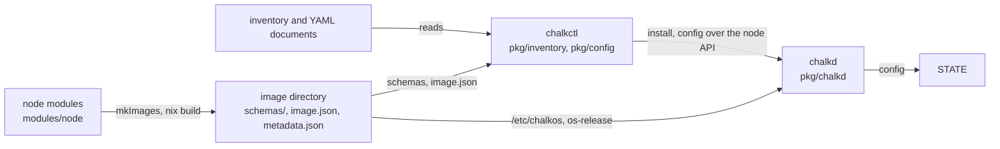

# Architecture for developers

chalkos is two halves: Nix modules that build a cluster's images, and Go programs that read the
cluster's YAML and install and operate the nodes. This page maps both to the repository and shows
where they meet. [Architecture](../concepts/architecture.md) explains the system as a user sees it;
this page is for changing it.

## Where do Nix and Go meet?

Go code never evaluates Nix itself. Nix builds images; everything about a cluster or a node is
YAML that Go reads. They meet in these places:

- The [image](../reference/glossary.md#image) directory. `chalkos.lib.mkImages` builds one per
  [variant](../reference/glossary.md#variant) and [platform](../reference/glossary.md#platform)
  from the node modules (`lib/images.nix`, `modules/node`): the raw image with its partitions,
  `metadata.json` (variant, platform, root hash, revision and tag), `image.json` (what the image
  fixes about Kubernetes) and `schemas/`, the JSON Schemas of the
  [config kinds](../reference/glossary.md#kind) the image accepts. chalkctl and chalklab read
  them from there, or from a running node through the Contract method.
- Files the image carries in `/etc/chalkos`, written by the node modules: the same
  `kubernetes/image.json` and `schemas`, the units that read each kind or that a delivery
  restarts or reloads in `consumers.json`, the system region's repart definitions in `repart.d`
  and the [OS CA](../reference/glossary.md#os-ca) certificate in `os-ca.crt` when `mkImages` has
  an `osCA`; and the image's own description in `/etc/os-release`. chalkd reads them on the node.
- A node's [config](../reference/glossary.md#config): the YAML
  [config documents](../reference/glossary.md#config-document) an inventory gives the node,
  which chalkctl reads (`pkg/inventory`), checks against the schemas of the image the inventory
  names for the node and translates into the [identity](../reference/glossary.md#identity) the
  node applies (`pkg/config`). chalkctl delivers the documents to
  [chalkd](../reference/glossary.md#chalkd), which checks them again against its own image's
  schemas, keeps them on [STATE](../reference/glossary.md#state) and translates them the same
  way.
- The node's Kubernetes cluster, which chalkd builds from the `Cluster` and `Flannel`
  documents and the image's `image.json` into `/run/chalkos/kubernetes/cluster.json`. chalkd renders
  chalkos's add-ons (RBAC, kube-proxy, flannel, CoreDNS) and the kubelet's configuration from it
  in Go (`pkg/kubernetes/addons`, `pkg/kubernetes/node`) and applies the objects of the
  `Addon` documents after the add-ons.

The diagram follows an image and a node's YAML to a running node.



## Programs in cmd

Each directory of `cmd/` is a main that wires a package up; the logic lives in `pkg/`.

| Program | What its main does |
| --- | --- |
| `cmd/chalkctl` | Runs `chalkctl.NewCommand()` with a context that Ctrl+C cancels. |
| `cmd/chalklab` | The same for `chalklab.NewCommand()`. |
| `cmd/chalkcfg` | Runs `chalkcfg.NewCommand()` on a node. |
| `cmd/chalkd` | Dispatches the four commands the node's units run: `serve` (chalkd.service), `load-config` (chalkos-config.service), `prepare-kubernetes` (chalkos-kubernetes.service) and `health` (chalkos-health.service), and loads the credentials `serve` starts with. |
| `cmd/chalkos-networkd-schema` | Writes the spec schemas of the networkd kinds from systemd's gperf tables, for the image build. |
| `cmd/chalkos-rules` | Checks an image's rules and facts when the image is built: every rule compiles within the cost limit and reads facts the image declares. |
| `cmd/chalkos-storage` | Opens STATE and sets up the volumes in the initrd, runs as a systemd generator for the other volumes, and prints the storage facts the storage kinds' rules read. |
| `cmd/docgen` | Writes the command reference and checks the commands the documentation shows. |

## Packages in pkg

| Package | What it does |
| --- | --- |
| `api/node/v1` | The node API's messages and Connect client and server, generated by `buf generate`. |
| `chalkcfg` | The chalkcfg command tree: reads the documents below `/run/chalkos/config` and the kinds the image's schemas name, and prints them. |
| `chalkctl` | The chalkctl command tree. |
| `chalkd` | The node API server, with the permissions of each method, and chalkd's work at boot: renewals, the [VIP](../reference/glossary.md#vip) election, the [health check](../reference/glossary.md#health-check). |
| `chalklab` | The chalklab command tree. |
| `client` | Connections to chalkd: by fingerprint in [maintenance mode](../reference/glossary.md#maintenance-mode), by the OS CA otherwise. |
| `config` | Config documents: parsing, the rules of a set, defaults, the hash, and the translation into the identity the node applies. |
| `config/store` | Keeps a node's config on STATE, a slot per image with its identity, and writes it for the node's units: the documents below `/run/chalkos/config` and the secrets their consumers load as credentials. |
| `facts` | Loads the [facts](../reference/glossary.md#fact) change rules read: files, and commands of the image's store run in a sandbox. |
| `identity` | The node's identity, the form its config translates to, which the node applies at boot and its Kubernetes side reads, and the kinds of Kubernetes nodes. |
| `image` | Reads the partitions of a raw image from `repart-output.json`. |
| `imagesign` | Signs an image's boot loader and UKIs, and copies them off the image. |
| `install` | Installs a node in place or from the [installer](../reference/glossary.md#installer), step by step and repeatable. |
| `kubernetes` | The node's Kubernetes cluster as the image records it, and the node as its config names it. |
| `kubernetes/apply` | Server-side apply of manifests and approval of kubelet serving certificates. |
| `kubernetes/etcd` | etcd membership: learners, promotion, quorum-safe removal. |
| `kubernetes/manifests` | The [control plane](../reference/glossary.md#control-plane)'s static pods. |
| `kubernetes/node` | The node's Kubernetes files at boot: addresses, kubelet credentials and flags, control-plane certificates. |
| `kubernetes/nodeip` | Picks the node's address of each family. |
| `kubernetes/pki` | The Kubernetes certificates: the share, the control plane's leaves, admin kubeconfigs. |
| `kubernetes/vip` | Adds a VIP to an interface and announces it. |
| `lab` | QEMU VMs, swtpm, the lab switch and console and the [lab](../reference/glossary.md#lab)'s supervisor, for chalklab and the end-to-end tests. |
| `networkdschema` | Generates the spec schemas of the networkd kinds from systemd's gperf tables. |
| `nodeconfig` | Applies the running image's config slot, chosen by `usrhash=`, at boot (`chalkd load-config`) and after every apply: networkd units, chrony's servers, the hostname and `/run/chalkos/node.json`; writes the config's documents and secrets for the units that read them, and tells which units to restart. |
| `pki` | The [secrets file](../reference/glossary.md#secrets-file), the OS CA and [node CA](../reference/glossary.md#node-ca), client and [node certificates](../reference/glossary.md#node-certificate), client roles. |
| `rules` | Compiles the [change rules](../reference/glossary.md#change-rule) of an image's schemas, with chalkos's CEL functions, and evaluates them against a config, the config it replaces and the node's facts. |
| `schema` | Reads an image's config contract: `metadata.json` and the JSON Schemas of its kinds, and validates documents against them. |
| `storage` | Storage sections, disk references and pins, repart definitions, and the changes a delivered section makes to the recorded one. |
| `storage/node` | Storage on the node: STATE, [volumes](../reference/glossary.md#volume), [VAR](../reference/glossary.md#var) and the generator's units. |
| `uki` | Reads a [UKI](../reference/glossary.md#uki)'s os-release and command line, and checks its signature as firmware does. |
| `upgrade` | Writes an image into the inactive [slot](../reference/glossary.md#slot) and makes it the next boot; the slot writer install shares. |
| `verity` | Reads and checks [dm-verity](../reference/glossary.md#dm-verity) hash trees. |

`uki/ukitest` and `kubernetes/etcd/etcdtest` hold test helpers: small UKIs and in-process etcd
members.

## The node API

The API is defined in `api/chalkos/node/v1/node.proto` and served by chalkd over Connect on
TCP port 50000 with mutual TLS. Which [client role](../reference/glossary.md#client-role) may
call a method, and in which mode, is one table: `permissions` in `pkg/chalkd/server.go`.

```go
nodev1connect.NodeServiceInfoProcedure:    {[]nodev1.Mode{maintenance, normal}, pki.RoleReader},
nodev1connect.NodeServiceInstallProcedure: {[]nodev1.Mode{maintenance}, pki.RoleAdmin},
nodev1connect.NodeServiceUpgradeProcedure: {[]nodev1.Mode{normal}, pki.RoleOperator},
```

A new method needs an entry there; the authoriser refuses a method without one. Comments in the
proto file become the [Node API](../reference/api.md) page, so they are written for users.

## The command-line programs

chalkctl, chalklab and chalkcfg are cobra command trees in importable packages: `pkg/chalkctl`,
`pkg/chalklab` and `pkg/chalkcfg` each export `NewCommand()`, which returns the root command,
and `Execute(ctx, root)`, which runs it and returns the exit code. Another program can add their
trees to its own, and tests run commands in-process with their output captured. Each package
keeps its help texts in `help.go`, and a test requires a short and a long description and an
example on every visible command, because they become the
[command reference](../reference/cli/index.md). chalkcfg runs on nodes, which have no logins, so
it has no `completion` command.

## Nix modules

| Directory | What it holds |
| --- | --- |
| `modules/node/` | The NixOS modules of every image: `base/` (appliance, closure, disk, storage), `kinds/` (`chalkos.kinds` and the chalkcfg commands of their `get`), `runtime/` (`chalkos.consumers` and chalkcfg on the system path), kernel, chalkd, time, the CNI, Kubernetes, upgrade, the VXLAN rule. |
| `modules/platforms/` | `metal` and `kvm`. |
| `modules/installer/` | The installer image and its ISO. |
| `modules/testing/` | The test probe, the test image's partition sizes and the test-only config kind `Greeting` with its consumer. |
| `lib/` | `mkImages` (`images.nix`) and its arguments as module options (`images-arguments.nix`). |

## Layout rules

The layout follows these rules, so each change has one place to go:

- An [extension](../reference/glossary.md#extension) is a NixOS module in a variant's
  `modules`: its kinds, its units and their consumers, together.
- The node modules declare the image options; `lib/images-arguments.nix` declares the
  arguments of `mkImages`. Everything about a cluster or a node is a config kind, not an option.
- Go code reads a node's config documents and the image's files alone.
- `nix/` holds tooling: packages, apps, checks, the development shell, the docs build and test
  fixtures, not product logic.
- `cmd/` holds the mains, which wire packages up; logic worth testing lives in `pkg/`.

[Development setup](development.md) lists the commands of a development loop and
[Testing](testing.md) the tests each part has.
