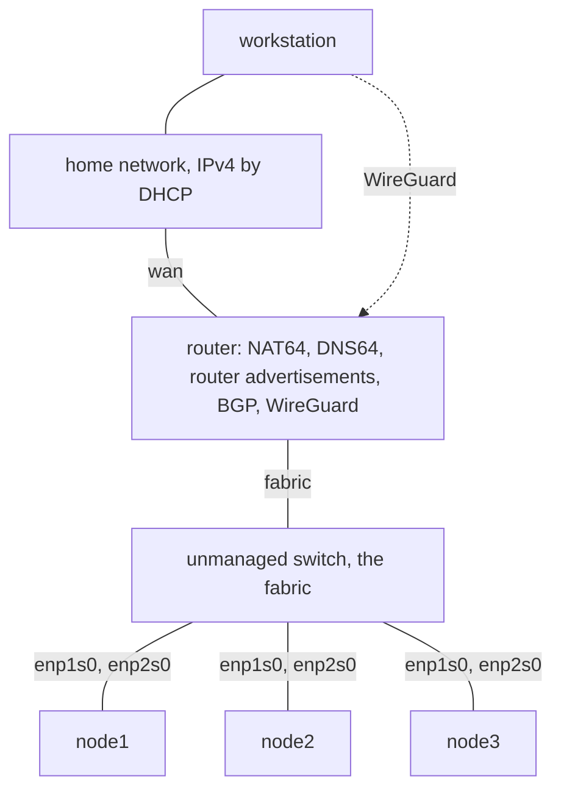

# Build a home lab

This tutorial builds the home lab of the
[homelab example](https://github.com/trevex/chalkos/tree/main/examples/homelab) on real machines:
a router on your home network and three Kubernetes control planes behind it, on an IPv6 fabric of
their own. You discover each machine's ports and disks, adapt the example's files to them, install
the four machines and bootstrap the cluster. At the end you test two failures: a node
keeps its address when one of its cables is pulled, and the Kubernetes API stays up when one
control plane goes down. Plan an afternoon; most of it goes into the first image builds and the
installs.

## What you build

The router connects the home network to the fabric, a switch that holds the router's second port
and both ports of each node. The workstation reaches the router at its address on the home network
and the fabric through a WireGuard tunnel to the router.



Every address comes from one unique local /48, `fdc8:a1b2:c3d4::/48` in the example. You replace it
with a random /48 of your own in [Prepare the files](#prepare-the-files).

| Use | Prefix or address |
| --- | --- |
| The fabric, which the router advertises | `fdc8:a1b2:c3d4:1::/64` |
| The router on the fabric: BGP neighbour, resolver and default router | `fdc8:a1b2:c3d4:1::1` |
| node1, node2 and node3, each on its dummy interface `node0` | `fdc8:a1b2:c3d4:ff::11`, `::12` and `::13` |
| The Kubernetes API's VIP | `fdc8:a1b2:c3d4:ff::10` |
| The WireGuard tunnel: the router and the workstation | `fdc8:a1b2:c3d4:f0::1` and `::2`, in `fdc8:a1b2:c3d4:f0::/64` |
| NAT64 prefix | `64:ff9b::/96` |
| AS numbers | 65000 for the router, 65001 for every node |
| The router on the home network | an IPv4 address by DHCP, `192.168.1.2` in the example |

The fabric carries IPv6 alone. The router's advertisements give every port on the fabric an
address by SLAAC, a default route, the resolver and the NAT64 prefix. The resolver answers a name
that has only IPv4 addresses with addresses in `64:ff9b::/96`, and the NAT64 carries connections to
them to the IPv4 internet, out of the router's port on the home network. A node's own address is a
/128 on its dummy interface `node0`. bird, a BGP daemon in the nodes' image, announces it to the
router over a session on each port, and the control plane that holds the API's VIP announces the
VIP the same way. The router then has two equal paths to each address. When a cable or port fails,
BFD ends that port's session within about a second, and the traffic takes the other port. The
nodes take only a default route from the router, so traffic between two nodes passes through the
router too: the router is the one machine of the design whose failure stops the cluster.

## Before you begin

You need:

- four amd64 machines with UEFI firmware, a TPM 2.0 and two Ethernet ports each, and a disk of
  at least 16 GiB for the router and a larger one for each node, which holds the containers'
  images and etcd; the [requirements](requirements.md) list the rest;
- an unmanaged switch with at least seven ports, and Ethernet cables;
- a USB stick of at least 1 GiB;
- your home network, whose router hands out IPv4 addresses by DHCP and lets you reserve an address
  for a MAC address;
- a workstation on the home network, an x86-64 Linux machine with
  [Nix](https://nixos.org/download/) and flakes enabled, git, and WireGuard's tools `wg` and
  `wg-quick` from your distribution;
- an age key or an SSH key of type ed25519 or RSA to encrypt the cluster's secrets to.

### Secure Boot is optional

The tutorial installs the machines without Secure Boot, with the unsigned images and installer.
Turn Secure Boot off in each machine's firmware setup. The steps marked optional add Secure Boot
with keys of your own: [Sign the images](#sign-the-images-optional) and
[Enrol the Secure Boot keys](#enrol-the-secure-boot-keys-optional). A machine whose firmware is in
Setup Mode gets the keys from chalkctl. For any other machine, enrol the db certificate in its
firmware as [Sign images for Secure Boot](../build/sign-images.md#firmware-not-in-setup-mode)
describes before you install it.

Without Secure Boot, the TPM still unlocks the disks at every boot. It seals their keys to PCR 7,
which then measures Secure Boot as off, so a machine that boots another system from a USB stick
unlocks them too. The encryption protects a disk taken out of its machine, and no longer the
machine itself. [Security model](../how-it-works/node/security.md) describes what else Secure Boot
protects.

Decide before you install a machine. Turning Secure Boot on later changes PCR 7: the machine then
asks for its recovery key at every boot until you install it again.

## Prepare the files

The example is part of the chalkos repository. Copy it into a repository of your own, and put it
under git, because Nix reads a flake from the files git tracks:

```sh
git clone https://github.com/trevex/chalkos
cp -r chalkos/examples/homelab homelab
cd homelab
git init && git add .
```

Run every later command in `homelab`. The example's files explain themselves in comments:

| File | Holds |
| --- | --- |
| `flake.nix` | The image builds: `router-metal`, `node-metal` and the installer. |
| `chalkos.yaml` | The inventory: the four nodes, the address chalkctl reaches each at, their images and files. |
| `router/router.yaml` | The router's ports, firewall, NAT64, resolver, BGP and WireGuard. |
| `router/secrets.yaml` | The router's WireGuard key and BGP password. |
| `cluster/cluster.yaml` | The Kubernetes cluster that all three nodes share. |
| `bgp/fabric.yaml`, `bgp/secrets.yaml` | The nodes' ports, their BGP neighbour, the router, and the password. |
| `nodes/node1.yaml` to `nodes/node3.yaml` | Each node's disk, address and router ID. |
| `extensions/` | bird and its `Speaker` and `Peer` kinds, which the nodes' image carries. |

### Get the tools

The flake's shell holds chalkctl and chalkbuild of the chalkos revision that `flake.lock` pins,
with kubectl, jq, openssl, wg, arp-scan and nc. Lock the flake's chalkos input and enter the shell:

```sh
nix flake lock
nix develop
```

Run every later command of this tutorial in that shell. chalkos is unreleased, so chalkctl and the
images come from the same revision.

The diagnostic `addresses`, which shows a machine's ports, prints JSON, as `ip -json address show`
does. Keep a jq filter in the shell that turns it into a line per port, with the port's name, MAC
address, state and addresses beyond the link:

```sh
ports='.[] | [.ifname, .address, .operstate,
  ([.addr_info[] | select(.scope == "global") | .local] | join(" "))] | @tsv'
```

### Generate the cluster's secrets

The secrets file holds the cluster's CAs and keys. Generate it encrypted to your key, and to a
backup key that you keep offline:

```console
$ chalkctl gen secrets --recipient "$(cat ~/.ssh/id_ed25519.pub)" \
    --recipient age1nmrqj76cqyf4ft8xtczufd3mtdk0xf2j7tevgwnzjp3zq9tffu3slx5eux
encrypted secrets.age to ssh-ed25519 AAAAC3NzaC1lZDI1NTE5AAAAIKMcR1DCFPGSdWXphQ3We8UmkMp2KdufUzVxxC6Hvo9k alice@workstation, age1nmrqj76cqyf4ft8xtczufd3mtdk0xf2j7tevgwnzjp3zq9tffu3slx5eux
wrote secrets.age and secrets.pub.json
```

[Generate the cluster's secrets with age](../operate/workstation.md#generate-the-clusters-secrets-with-age)
explains the file and its backup. The `age1` recipient here stands for your offline backup
key's public key. Then give the images and the installer the cluster's OS CA, so
that a machine waiting for its install accepts only a chalkctl that holds this cluster's secrets.
Add the line to the arguments of `chalkos.lib.mkImages` in `flake.nix`:

```nix
osCA = ./secrets.pub.json;
```

Without it, any machine on your home network could install the router while it waits in the
installer.

### Choose your own prefix

Generate the first 48 bits of a unique local prefix, and replace the example's in every file:

```sh
set -- $(od -An -N5 -tu1 /dev/urandom)
ula=$(printf 'fd%02x:%x:%x' "$1" $(($2 * 256 + $3)) $(($4 * 256 + $5)))
echo "$ula"
grep -rlF fdc8:a1b2:c3d4 --exclude-dir=.git . | xargs sed -i "s/fdc8:a1b2:c3d4/$ula/g"
```

The command prints a prefix such as `fd3b:99df:9be2`. The rest of this tutorial shows the example's
`fdc8:a1b2:c3d4`; read yours in its place.

### Make the WireGuard keys and the BGP password

Make a key pair for the router and one for the workstation. The example's `.gitignore` keeps the
private keys, `*.key`, out of git, as it keeps the images, the installer and the kubeconfig:

```sh
(umask 077 && wg genkey | tee router.key | wg pubkey > router.pub)
(umask 077 && wg genkey | tee workstation.key | wg pubkey > workstation.pub)
```

Replace the example's keys: the router's private key goes into `router/secrets.yaml`, and the
workstation's public key into the `WireGuardPeer` of `router/router.yaml`:

```sh
sed -i "s|uBjWXU2Bu/LvLVRo+dtAte3VHt75d9W7DPxsEhZrm24=|$(cat router.key)|" router/secrets.yaml
sed -i "s|cK0R7bvqvEfk07xvf9i71Jj0ATJEGaKZ3gs1zBXr1m0=|$(cat workstation.pub)|" router/router.yaml
```

The router and the nodes share one BGP password, in `router/secrets.yaml` and `bgp/secrets.yaml`.
Replace the example's with a random one in both:

```sh
sed -i "s/example-password/$(openssl rand -hex 16)/" router/secrets.yaml bgp/secrets.yaml
```

The two files now hold real secrets in plain text. Keep the repository private, or keep the two
files out of it, as
[Secret documents hold the services' secrets](../operate/workstation.md#secret-documents-hold-the-services-secrets)
describes.

## Build the images and the installer

Build the two images where the inventory expects them, and the installer:

```sh
git add .
nix build .#router-metal -o images/router-metal
nix build .#node-metal -o images/node-metal
nix build .#installer -o installer
```

The first build takes a while. The router's image carries the router layer and no Kubernetes; the
nodes' image carries Kubernetes and bird.

### Sign the images (optional)

Skip this step without Secure Boot. With it, create your Secure Boot keys in `keys/`, and sign
copies of the three builds with the db key, as
[Sign images for Secure Boot](../build/sign-images.md#create-the-keys) describes:

```sh
chalkctl secureboot new keys --name homelab
chalkbuild sign --key keys/db.key --cert keys/db.crt images/router-metal images/router-metal-signed
chalkbuild sign --key keys/db.key --cert keys/db.crt images/node-metal images/node-metal-signed
chalkbuild sign --key keys/db.key --cert keys/db.crt installer installer-signed
```

The example's `.gitignore` keeps the `.key` files out of git. Keep a backup of `keys/` offline:
whoever holds its keys decides what the machines boot.

Point the inventory's images at the signed copies. `chalkos.yaml` then reads:

```yaml title="chalkos.yaml"
apiVersion: chalkctl.chalkos.dev/v1alpha1
kind: Inventory
metadata: {name: homelab}
spec:
  images:
    # chalkbuild sign writes the signed copies of the builds here.
    router-metal: {source: {directory: images/router-metal-signed}}
    node-metal: {source: {directory: images/node-metal-signed}}
  groups:
    router: {imageName: router-metal, files: [router/*.yaml]}
    nodes: {imageName: node-metal, files: [cluster/*.yaml, bgp/fabric.yaml, bgp/secrets.yaml]}
  nodes:
    router: {address: 192.168.1.2, groups: [router]}
    node1: {address: "fdc8:a1b2:c3d4:ff::11", groups: [nodes], files: [nodes/node1.yaml]}
    node2: {address: "fdc8:a1b2:c3d4:ff::12", groups: [nodes], files: [nodes/node2.yaml]}
    node3: {address: "fdc8:a1b2:c3d4:ff::13", groups: [nodes], files: [nodes/node3.yaml]}
```

### Write the installer to a USB stick

Write the installer's ISO to the USB stick:

```sh
sudo dd if=installer/chalkos-installer.iso of=/dev/<usb-disk> \
  bs=4M conv=fsync status=progress
```

With Secure Boot, write the signed copy, `installer-signed/chalkos-installer.iso`, instead.
`<usb-disk>` is the stick's device, such as `sdb`; `lsblk` lists the candidates. The command
overwrites everything on the stick. The installer holds no config of a node: it takes addresses on
every Ethernet port, by DHCP and from router advertisements, and keeps the kernel's names for the
ports.

## Install the router

The router goes first, because the nodes' installers take their addresses from its advertisements
on the fabric.

### Boot the installer

Cable one of the router's ports to the home network and the other to the switch. Which port is
which does not matter yet: the next step finds out. Boot the router from the USB stick through
the firmware's boot menu. Once chalkd runs, the screen shows
[the console](../operate/console.md). Its header keeps chalkd's fingerprint on screen, and the
address that the home network's DHCP server gave the port it reaches:

```text
nixos  installer  up 1m
image 81bd81bd81bd
installer: chalkctl install installs nodes from here
fingerprint <fingerprint>
addresses 192.168.1.57
```

Note the address and the fingerprint, 64 hex characters. chalkctl reaches a node that a command
names at the node's address in `chalkos.yaml`, so put the installer's address there as the
router's for now, and the commands below need no `--address`:

```yaml title="chalkos.yaml"
    router: {address: 192.168.1.57, groups: [router]}
```

The commands check the machine's certificate with `--fingerprint`.

!!! tip "Find the installer without a screen"

    On a machine without a screen, look for the installer on the home network: chalkd listens on
    TCP port 50000. The flake's shell holds `arp-scan` and `nc`; this lists the home network's
    machines that answer on that port:

    ```sh
    sudo "$(command -v arp-scan)" --localnet --plain --quiet | awk '{print $1}' \
      | xargs -I {} nc -zv -w 1 {} 50000 2>&1 | grep -E "succeeded|open"
    ```

!!! note "--insecure in place of --fingerprint"

    When reading the console is impractical, pass `--insecure` in place of `--fingerprint`. chalkctl
    then accepts any certificate and prints the fingerprint it saw, as
    `chalkctl: the node's certificate fingerprint is <fingerprint>`. Compare it with the console
    when you can. `chalkctl install` sends the secrets only over a connection pinned to that
    fingerprint.

### Enrol the Secure Boot keys (optional)

Skip this step without Secure Boot, or when the router's firmware holds your db certificate
already. When its firmware is
in Setup Mode, as after you clear its keys in the firmware setup, it boots the installer without
checking it. Enrol your keys; `secureboot enroll` names no node, so it takes the address with
`--address`:

```console
$ chalkctl secureboot enroll --keys keys --address=192.168.1.57 --fingerprint=<fingerprint> \
    --secrets=secrets.age
...
the node reboots with Secure Boot enforced
chalkctl: the node's certificate fingerprint is now <new fingerprint>; compare it with the node's console and install with --fingerprint <new fingerprint>
Secure Boot is on; install the node with chalkctl install
```

The router reboots into the installer, now with Secure Boot on; pick the USB stick in the boot menu
if it boots something else. chalkd makes a new certificate at that boot: use the new fingerprint
from here on. [Sign images for Secure Boot](../build/sign-images.md#firmware-in-setup-mode-chalkctl-secureboot-enroll)
explains what to do when the enrolment fails.

When the router's network cards carry option ROMs, the node refuses the keys and names them: add
`--option-roms` to enrol their digests, as [Option ROMs](../build/sign-images.md#option-roms)
explains.

### Find the disk and the ports

List the disks:

```console
$ chalkctl disks router --fingerprint=<fingerprint> --secrets=secrets.age
DEVICE            SIZE    TYPE  MODEL                    SERIAL          WWN                   USE
/dev/nvme0n1      476.9G  nvme  Samsung SSD 980 512GB    S64DNF0R812345  eui.002538b811b2c3d4
...
```

The list goes on with the installer's own stick, whose use is `boot`. Pick the disk for the
system, and find its path below `/dev/disk/by-id`, which stays the same across boots. For an NVMe
disk it is `nvme-<model>_<serial>`, and for a SATA disk `ata-<model>_<serial>`, with each space of
the model as an underscore: `/dev/disk/by-id/nvme-Samsung_SSD_980_512GB_S64DNF0R812345` here. When
the path is in doubt, select the disk by its serial number instead, with
`disk: {serial: S64DNF0R812345}` in place of `path`. The installer refuses a disk
that holds data; [Replace what a disk holds](../operate/install.md#replace-what-a-disk-holds)
covers that case.

The diagnostic `addresses` lists the ports, and the jq filter of
[Get the tools](#get-the-tools) puts each on a line:

```console
$ chalkctl node diag router --fingerprint=<fingerprint> --secrets=secrets.age addresses \
  | jq -r "$ports"
lo	00:00:00:00:00:00	UNKNOWN
enp1s0	02:00:00:00:01:01	UP	192.168.1.57
enp2s0	02:00:00:00:01:02	UP
```

The port with the home network's address is the router's `wan`, and the other one, on the switch,
is its `fabric`. A port that shows `DOWN` has no carrier: check its cable.

### Adapt the router's files

`router/router.yaml` names the ports by their permanent MAC addresses in two `Link` documents,
which rename them to `wan` and `fabric` at the installed router's first boot. Every other document
names the ports by those names. The `addresses` diagnostic shows each port's current MAC address,
which on a plain port, without a bond or a VLAN, is its permanent one. Put the two into the `Link`
documents, and your disk into the `SystemDisk`:

```yaml title="router/router.yaml"
apiVersion: networkd.chalkos.dev/v1alpha1
kind: Link
metadata: {name: 10-wan}
spec:
  match: {permanentMACAddress: "02:00:00:00:01:01"}
  link: {name: wan}
---
apiVersion: networkd.chalkos.dev/v1alpha1
kind: Link
metadata: {name: 10-fabric}
spec:
  match: {permanentMACAddress: "02:00:00:00:01:02"}
  link: {name: fabric}
---
apiVersion: storage.chalkos.dev/v1alpha1
kind: SystemDisk
metadata: {name: system}
spec:
  disk: {path: /dev/disk/by-id/nvme-Samsung_SSD_980_512GB_S64DNF0R812345}
```

Reserve an IPv4 address for the `wan` port's MAC address on your home network's DHCP server. The
installed router takes it on `wan`, and chalkctl reaches it there once you put it into
`chalkos.yaml` after the install. The example reserves `192.168.1.2`.

Check the files against the images:

```sh
chalkctl validate
```

It prints a line per node, as
[Write a node's config](../operate/node-config.md#check-that-it-worked) shows, and names the
document and field of each mistake.

### Install

Install the router at the installer's address, which `chalkos.yaml` names for now:

```console
$ chalkctl install router --secrets=secrets.age --fingerprint=<fingerprint>
installing router onto /dev/disk/by-id/nvme-Samsung_SSD_980_512GB_S64DNF0R812345 from /home/alice/homelab/images/router-metal: chalkos <image>, sending <n> bytes of store, hash tree, UKI and boot loader
router is installed and reboots
chalkctl recovery-key router prints the key that unlocks it when its TPM fails
```

`<image>` is the start of the image's root hash, and `<n>` the size of what chalkctl sends. The
router reboots into its image, renames its ports and takes the reserved address on `wan`. Remove
the USB stick once the console's header shows `normal`, and put the reserved address back into
`chalkos.yaml`:

```yaml title="chalkos.yaml"
    router: {address: 192.168.1.2, groups: [router]}
```

!!! note "Wipe a disk that holds data"

    The installer refuses a disk that holds data, such as a disk from another machine or an
    earlier install of another image, and names what it found:

    ```text
    install: the target disk /dev/nvme0n1 (model "Samsung SSD 980 512GB", size 476.9G, serial "S64DNF0R812345") carries data (gpt ext4); pass --wipe-disk to replace it
    ```

    Check in `chalkctl disks` that the disk is the one you mean, and install again with
    `--wipe-disk`. The installer then clears the disk's partition tables and lays it out anew.
    Nothing on the disk can be recovered afterwards:

    ```sh
    chalkctl install router --secrets=secrets.age --fingerprint=<fingerprint> --wipe-disk
    ```

### Check the router

`chalkctl status` reaches the router at its address in the inventory:

```console
$ chalkctl status router --secrets=secrets.age
...
bgp: no sessions
nat64:
  INSTANCE  SESSIONS  BINDINGS  POOL TCP  POOL UDP  POOL ICMP
  nat64     0         0         4535      4535      4535
resolver: running
...
```

The router runs its config, its NAT64 and its resolver. It has no BGP session yet, because no
node runs. The `addresses` diagnostic shows the renamed ports, `wan` with the reserved address and
`fabric` with `fdc8:a1b2:c3d4:1::1`:

```console
$ chalkctl node diag router --secrets=secrets.age addresses | jq -r "$ports"
lo	00:00:00:00:00:00	UNKNOWN
wan	02:00:00:00:01:01	UP	192.168.1.2
fabric	02:00:00:00:01:02	UP	fdc8:a1b2:c3d4:1::1
wg0		UNKNOWN	fdc8:a1b2:c3d4:f0::1
...
```

## Connect the workstation

The workstation reaches the fabric through the router's WireGuard interface `wg0`. Its config for
wg-quick holds the workstation's private key, so create the file readable by root alone first:

```sh
sudo install -m 600 /dev/null /etc/wireguard/homelab.conf
```

Then write the config into it, with the workstation's private key and the router's public key:

```ini title="/etc/wireguard/homelab.conf"
[Interface]
PrivateKey = <contents of workstation.key>
Address = fdc8:a1b2:c3d4:f0::2/64

[Peer]
PublicKey = <contents of router.pub>
Endpoint = 192.168.1.2:51820
AllowedIPs = fdc8:a1b2:c3d4::/48
PersistentKeepalive = 25
```

`AllowedIPs` sends the whole /48 through the tunnel, and nothing else: the workstation reaches the
internet as before. Keep `PersistentKeepalive`: every config delivery to the router sets its
WireGuard peers anew, and the router reaches the workstation again only once the workstation sends
a packet. Bring the tunnel up and ping the router's fabric address:

```console
$ sudo wg-quick up homelab
$ ping -c 3 fdc8:a1b2:c3d4:1::1
PING fdc8:a1b2:c3d4:1::1 (fdc8:a1b2:c3d4:1::1) 56 data bytes
64 bytes from fdc8:a1b2:c3d4:1::1: icmp_seq=1 ttl=64 time=0.612 ms
...
```

The diagnostic `wireguard` shows the router's side of the tunnel, with the workstation's latest
handshake. The public keys are the example's; yours are those of `router.pub` and
`workstation.pub`:

```console
$ chalkctl node diag router --secrets=secrets.age wireguard interface=wg0
interface: wg0
  public key: N1efwZV4rLKHLJQIeOXqOmCOlJVUhEnnXMOqRPH2L0k=
  private key: (hidden)
  listening port: 51820

peer: cK0R7bvqvEfk07xvf9i71Jj0ATJEGaKZ3gs1zBXr1m0=
  endpoint: 192.168.1.20:41641
  allowed ips: fdc8:a1b2:c3d4:f0::2/128
  latest handshake: 9 seconds ago
  transfer: 1.02 KiB received, 892 B sent
```

[Run WireGuard](../router/wireguard.md) covers more peers, preshared keys and key rotation.

## Install the nodes

Install node1, node2 and node3 one after another, with the same steps.

### Boot the installer

Cable both of the node's ports to the switch and boot it from the USB stick. The router's
advertisements give each port an address of the fabric's prefix, and the console's header shows
both:

```text
nixos  installer  up 1m
image 81bd81bd81bd
installer: chalkctl install installs nodes from here
fingerprint <fingerprint>
addresses fdc8:a1b2:c3d4:1:0:ff:fe00:1101 fdc8:a1b2:c3d4:1:0:ff:fe00:1102
```

The header shows no link-local address. A port without an address of the fabric has no cable, or
the router sends no advertisements: [Troubleshooting](#troubleshooting) covers both. Note one of the
addresses and the fingerprint. Put the address into `chalkos.yaml` as node1's for now, quoted, as
YAML needs for an IPv6 address; the workstation reaches it over the tunnel:

```yaml title="chalkos.yaml"
    node1: {address: "fdc8:a1b2:c3d4:1:0:ff:fe00:1101", groups: [nodes], files: [nodes/node1.yaml]}
```

!!! tip "Find the installer through the router"

    When the node has no screen, find its ports in the router's neighbour table. Each of the
    installer's ports takes an address of the fabric's prefix with the same interface ID as its
    link-local address, so this lists every machine the router sees on `fabric` with its MAC
    address and its address of the fabric:

    ```sh
    chalkctl node diag router --secrets=secrets.age neighbours \
      | jq -r '.[] | select(.dev == "fabric" and (.dst | startswith("fe80::")))
          | [.lladdr, (.dst | sub("^fe80::"; "fdc8:a1b2:c3d4:1:"))] | @tsv'
    ```

    The output has a line for each port, here the two of node1:

    ```text
    02:00:00:00:11:01	fdc8:a1b2:c3d4:1:0:ff:fe00:1101
    02:00:00:00:11:02	fdc8:a1b2:c3d4:1:0:ff:fe00:1102
    ```

    The table also holds the ports of nodes installed before, whose MAC addresses the `addresses`
    diagnostic shows on each of them. A port the router has not talked to yet is missing from the
    table: boot one node at a time, and look again after a minute. Check that chalkd answers at an
    address before you use it:

    ```sh
    chalkctl node diag router --secrets=secrets.age tcp-connect \
      address=fdc8:a1b2:c3d4:1:0:ff:fe00:1101 port=50000
    ```

    Without the console you have no fingerprint to compare: reach the installer with `--insecure`
    in place of `--fingerprint`, as the note in [Boot the installer](#boot-the-installer) describes.

With Secure Boot, and when the node's firmware is in Setup Mode, enrol your keys at that address as
for the router, in [Enrol the Secure Boot keys](#enrol-the-secure-boot-keys-optional), and note
the new fingerprint.

### Find the disk and the ports

List the disks and the ports:

```console
$ chalkctl disks node1 --fingerprint=<fingerprint> --secrets=secrets.age
DEVICE            SIZE    TYPE  MODEL                    SERIAL          WWN                   USE
/dev/nvme0n1      931.5G  nvme  WD Blue SN580 1TB        24131D801234    eui.e8238fa6bf530001
...
$ chalkctl node diag node1 --fingerprint=<fingerprint> --secrets=secrets.age addresses \
  | jq -r "$ports"
lo	00:00:00:00:00:00	UNKNOWN
enp1s0	02:00:00:00:11:01	UP	fdc8:a1b2:c3d4:1:0:ff:fe00:1101
enp2s0	02:00:00:00:11:02	UP	fdc8:a1b2:c3d4:1:0:ff:fe00:1102
```

The disk's path is `/dev/disk/by-id/nvme-WD_Blue_SN580_1TB_24131D801234` here. The two ports are
`enp1s0` and `enp2s0`, the names the kernel gives them. The names follow from the ports' PCI slots,
so every machine of the same model shows the same two.

### Adapt the node's file

`bgp/fabric.yaml`, which every node gets, configures the ports: a `Network` document for each port,
which takes the router's advertisements, and the `Peer`, which runs a BGP session with the router
on each port. It names the ports `enp1s0` and `enp2s0`. When the `addresses` diagnostic shows other
names, replace `enp1s0` and `enp2s0` throughout `bgp/fabric.yaml` with them. You do this once, for
node1: node2 and node3 have the same names when they are the same model. A node whose ports have
other names, such as a machine of another model, takes `Network` and `Peer` documents of its own in
place of `bgp/fabric.yaml`, as the file's comment describes.

`nodes/node1.yaml` holds everything that differs between the nodes:

```yaml title="nodes/node1.yaml"
--8<-- "examples/homelab/nodes/node1.yaml"
```

Put your disk's path into the `SystemDisk`.

The rest of the file stays as it is. `node0` is a dummy interface that holds the node's address,
`fdc8:a1b2:c3d4:ff::11`, which no cable can take away. The `Node` document makes the node a
control plane, gives Kubernetes that address as the node's address, and names `node0` as the
interface the node adds the API's VIP to while it holds it. The `Speaker` gives bird the node's AS
number and router ID and announces the addresses of `node0`. node2 and node3 differ in their
address, `::12` and `::13`, and their router ID, `0.0.0.12` and `0.0.0.13`. Each node needs an
address and a router ID of its own, and the address in its `Network` and `Node` documents is the
one `chalkos.yaml` names for it.

### Install

Validate the files and install the node at the installer's address, which `chalkos.yaml` names for
now. Add `--wipe-disk` when the installer refuses the disk, as for the router:

```sh
chalkctl validate
chalkctl install node1 --secrets=secrets.age --fingerprint=<fingerprint>
```

chalkctl prints the lines that the router's install printed. The node reboots into its image,
brings up `node0` and starts bird, whose sessions announce the node's address to the router. Put
the node's own address back into `chalkos.yaml`, where chalkctl reaches it from now on:

```yaml title="chalkos.yaml"
    node1: {address: "fdc8:a1b2:c3d4:ff::11", groups: [nodes], files: [nodes/node1.yaml]}
```

Until the bootstrap, its status shows
that it waits:

```console
$ chalkctl status node1 --secrets=secrets.age
...
kubernetes controlplane: waiting for bootstrap or for the cluster at https://[fdc8:a1b2:c3d4:ff::10]:6443
...
```

Repeat the steps for node2 and node3.

## Bootstrap Kubernetes

Once the three nodes wait, bootstrap one of them and write a kubeconfig:

```console
$ chalkctl bootstrap node1 --secrets=secrets.age
bootstrapping node1; the control plane pulls its images and starts
node1 is bootstrapped; applied 19 objects
$ chalkctl kubeconfig --secrets=secrets.age
wrote kubeconfig; its certificate is valid for 8760h0m0s
```

The bootstrap starts etcd and the control plane on node1. node1 then wins the election for the VIP,
adds `fdc8:a1b2:c3d4:ff::10` to `node0`, and bird announces it. node2 and node3 find the cluster at
the endpoint and join etcd one after the other. Pulling the images through the NAT64 takes most of
the bootstrap's time. [Bootstrap and get a kubeconfig](../kubernetes/bootstrap.md) explains each step.

List the nodes through the VIP:

```console
$ export KUBECONFIG=$PWD/kubeconfig
$ kubectl get nodes
NAME    STATUS   ROLES    AGE   VERSION
node1   Ready    <none>   4m    v1.37.1
node2   Ready    <none>   2m    v1.37.1
node3   Ready    <none>   1m    v1.37.1
```

A node may show `NotReady` for the first minute, until flannel runs on it. `kubectl get nodes -o
wide` shows each node's address, its /128 on `node0`, as `INTERNAL-IP`. The three nodes are
control planes and run workloads too.

The nodes reach the IPv4 internet through the router. The diagnostic `dns-query` asks the node's
resolver, the router's, for the name `ipv4only.arpa`, which has IPv4 addresses alone; DNS64 answers
with addresses in the NAT64's prefix:

```console
$ chalkctl node diag node1 --secrets=secrets.age dns-query name=ipv4only.arpa type=AAAA
...
;; ANSWER SECTION:
ipv4only.arpa.	3600	IN	AAAA	64:ff9b::c000:ab
ipv4only.arpa.	3600	IN	AAAA	64:ff9b::c000:aa
...
$ chalkctl node diag node1 --secrets=secrets.age tcp-connect address=64:ff9b::101:101 port=443
connected to 64:ff9b::101:101 port 443
```

`64:ff9b::101:101` is the IPv4 address `1.1.1.1` in the NAT64's prefix. Pods resolve names through
CoreDNS, which asks the same resolver, so a pod reaches an IPv4-only host by its name:

```sh
kubectl run nat64-check --rm -it --restart=Never --image=busybox:1.37 -- nslookup github.com
```

The answer holds an address in `64:ff9b::/96` beside the host's IPv4 address.

## Check BGP and failover

### The sessions

Each node runs a session on each port. The diagnostic `bird-protocols` of the nodes' image shows
them as bird's `show protocols` prints them, named after the `Peer` and the port:

```console
$ chalkctl node diag node1 --secrets=secrets.age bird-protocols
...
Name           Proto      Table      State  Since         Info
...
router_enp1s0  BGP        ---        up     10:02:16.731  Established
router_enp2s0  BGP        ---        up     10:02:16.902  Established
```

The router accepts a session from every address of the fabric, and `chalkctl status` lists the six
under its peer `nodes`, each with the address of a node's port:

```console
$ chalkctl status router --secrets=secrets.age
...
bgp:
  VRF      PEER   NEIGHBOR                         STATE        UPTIME  RECEIVED  SENT  BFD
  default  nodes  fdc8:a1b2:c3d4:1:0:ff:fe00:1101  Established  12m4s   2         1     up
  default  nodes  fdc8:a1b2:c3d4:1:0:ff:fe00:1102  Established  12m3s   2         1     up
  default  nodes  fdc8:a1b2:c3d4:1:0:ff:fe00:1201  Established  9m40s   1         1     up
  default  nodes  fdc8:a1b2:c3d4:1:0:ff:fe00:1202  Established  9m40s   1         1     up
  default  nodes  fdc8:a1b2:c3d4:1:0:ff:fe00:1301  Established  7m12s   1         1     up
  default  nodes  fdc8:a1b2:c3d4:1:0:ff:fe00:1302  Established  7m11s   1         1     up
...
```

Each node sends its address on each session, and the holder of the VIP the VIP as well, so node1
shows 2 routes received. The router sends each node the default route alone. The routes to the
nodes' addresses have two next hops each, one per port:

```console
$ chalkctl node routes router fdc8:a1b2:c3d4:ff::/64 --secrets=secrets.age
DESTINATION                TYPE     PROTOCOL  TABLE  METRIC  NEXT HOPS
fdc8:a1b2:c3d4:ff::10/128  unicast  bgp       254    20      fe80::ff:fe00:1101 on fabric (weight 1), fe80::ff:fe00:1102 on fabric (weight 1)
fdc8:a1b2:c3d4:ff::11/128  unicast  bgp       254    20      fe80::ff:fe00:1101 on fabric (weight 1), fe80::ff:fe00:1102 on fabric (weight 1)
...
```

[Route with BGP](../router/bgp.md#deliver-and-check-the-sessions) explains the columns and the
BGP paths that follow the kernel's routes.

### Pull a cable

Start a ping of node1's address from the workstation, and pull one of node1's cables:

```sh
ping fdc8:a1b2:c3d4:ff::11
```

Within about a second, BFD ends the session on that port: `bird-protocols` on node1 no longer shows
it `Established`, the router's `bgp:` table loses the port's session, and the route to node1 keeps
one next hop. The ping goes on, losing a packet or two at most. Plug the cable back in, and the
session comes back within seconds.

### Take the VIP's holder down

`chalkctl status` shows which control plane holds the VIP:

```console
$ chalkctl status node1 --secrets=secrets.age
...
kubernetes controlplane: bootstrapped, node ready: True, vip holder, control plane current
...
```

The other two show `vip standby`. Reboot the holder:

```sh
chalkctl node reboot node1 --secrets=secrets.age
```

chalkctl drains node1 and keeps etcd's quorum while it reboots. Another control plane wins the
election, adds the VIP to its `node0`, and its bird announces it. `kubectl get nodes` answers again
once the router has the new route, within about 30 seconds. For a harder test, cut the holder's
power instead: its sessions end within BFD's second, and the VIP moves when its lease runs out.
Power it on again afterwards; the VIP stays with its new holder.

## Change things later

To change the lab, change its files, validate them, and deliver them to the nodes whose config
changes:

```sh
chalkctl validate
chalkctl apply node1 node2 node3 --secrets=secrets.age
```

[Change a node's config](../operate/change-config.md) covers previews, trials and rollbacks.
Deliver a change of the router's `management` interfaces or firewall with `--try`, so that the
router rolls it back when chalkctl loses it. A delivery renames a router port at once when its
`Link` document gives it a new name. Change every document that names the port in the same
delivery, its `Network`, firewall zone and management interfaces, and deliver it with
`chalkctl config apply router --try`, so that the router rolls it back when chalkctl loses it.

A new chalkos revision or a change to `extensions/` takes new images. Update the flake's lock with
`nix flake update chalkos`, and enter the shell of [Get the tools](#get-the-tools) again, so that
chalkctl matches the images. Build the images again, as in
[Build the images and the installer](#build-the-images-and-the-installer). With Secure Boot, remove
the signed copies of the old builds, which `chalkbuild sign` does not overwrite, and sign the new
ones:

```sh
rm -rf images/router-metal-signed images/node-metal-signed installer-signed
chalkbuild sign --key keys/db.key --cert keys/db.crt images/router-metal images/router-metal-signed
chalkbuild sign --key keys/db.key --cert keys/db.crt images/node-metal images/node-metal-signed
chalkbuild sign --key keys/db.key --cert keys/db.crt installer installer-signed
```

Then roll the images out to the nodes with `chalkctl upgrade`, as
[Upgrade nodes](../operate/upgrade.md) describes. chalkctl upgrades the control planes one at a
time, so the Kubernetes API stays up. The router is different: while it reboots, the nodes lose
their default route, and with it their traffic to each other and to the Kubernetes API. Upgrade it
in a step of its own, at a time when that pause suits you:

```sh
chalkctl upgrade --nodes node1,node2,node3 --secrets=secrets.age
chalkctl upgrade --nodes router --secrets=secrets.age
```

## Troubleshooting

### A node's port gets no address of the fabric

The router's advertisements give the ports their addresses. Check that the router's `fabric` port
holds `fdc8:a1b2:c3d4:1::1` with the `addresses` diagnostic, as in
[Check the router](#check-the-router). When `fabric` is missing and a port of the kernel's name
shows instead, the MAC address of the router's `Link` document is not the port's: correct it, and
deliver it with `chalkctl config apply router --try`, which renames the port at once. A node port
that shows `DOWN` has no carrier on the switch. An installed node configures only the ports that
`bgp/fabric.yaml` names: a port of another name takes no address, so put the names the `addresses`
diagnostic shows into `bgp/fabric.yaml`, as in [Adapt the node's file](#adapt-the-nodes-file).

### A BGP session does not come up

The router's `bgp:` table shows no line for a port that never connected. Check, on the node:

- the ports' names: the `addresses` diagnostic shows the names that the `Peer` of
  `bgp/fabric.yaml` lists, `enp1s0` and `enp2s0` in the example. bird runs no session on a port
  of another name;
- the password: the kernel drops TCP segments whose MD5 signature does not match, so neither side
  logs a refused session. The router has no `bgp:` line for the node, and on the node
  `chalkctl node diag node1 bird-protocols` shows the sessions in `Connect` or `Active` instead of
  `Established`, while `chalkctl logs node1 --unit=bird.service` shows its connection attempts
  failing. Compare the passwords of `router/secrets.yaml` and `bgp/secrets.yaml`, which must be
  the same.

The router's firewall accepts BGP and BFD from the fabric by itself, and the nodes' image opens
BFD's port.

### A name does not resolve, or a connection to the internet fails

On the router, `chalkctl status router` shows `resolver: running` and the NAT64's line. The
diagnostics `dns-query` and `nat64-sessions` show the resolver's answers and the NAT64's
connections, as [Translate to IPv4 and resolve names](../router/nat64-and-dns.md#deliver-and-check)
describes. A NAT64 connection needs the router's `wan` address and default route from the home
network's DHCP server.

### The router takes another address on the home network

The router identifies itself to the DHCP server with a DUID made from the `wan` port's MAC
address, the same at every boot, as the installer does for each port. Check that the reservation
names the MAC address that the `addresses` diagnostic shows for `wan`. A DHCP server that matches
a reservation against a client identifier of the bare MAC address finds none in a DUID. Have the
router send its MAC address as the identifier, in the `wan` port's `Network` of
`router/router.yaml`:

```yaml title="router/router.yaml"
apiVersion: networkd.chalkos.dev/v1alpha1
kind: Network
metadata: {name: 10-wan}
spec:
  match: {name: wan}
  network: {dhcp: ipv4, ipv6AcceptRA: false}
  dhcpv4: {clientIdentifier: mac}
```

Until the router has the reserved address, put the address it took, which its console shows, into
`chalkos.yaml` as the router's.

### The tunnel has no handshake

The `wireguard` diagnostic shows no `latest handshake` for the workstation's peer. Check that the
`WireGuardPeer` holds the contents of `workstation.pub`, that the workstation's config holds the
router's public key from `router.pub`, and that its `Endpoint` is the router's address on the home
network. After a delivery to the router, the tunnel works again once the workstation sends;
`PersistentKeepalive` makes it send within 25 seconds.

## What next

- [Status, logs and the console](../operate/status-and-logs.md) reads the rest of `chalkctl status`.
- [Run a router](../router/index.md) covers the router's firewall, BGP, NAT64 and WireGuard.
- [Run a highly available control plane](../kubernetes/ha-control-plane.md) explains the VIP's
  election, and how to replace a control plane.
- [Declare a config kind](../build/declare-a-kind.md) follows the homelab's bird extension, which
  declares the `Speaker` and `Peer` kinds.
