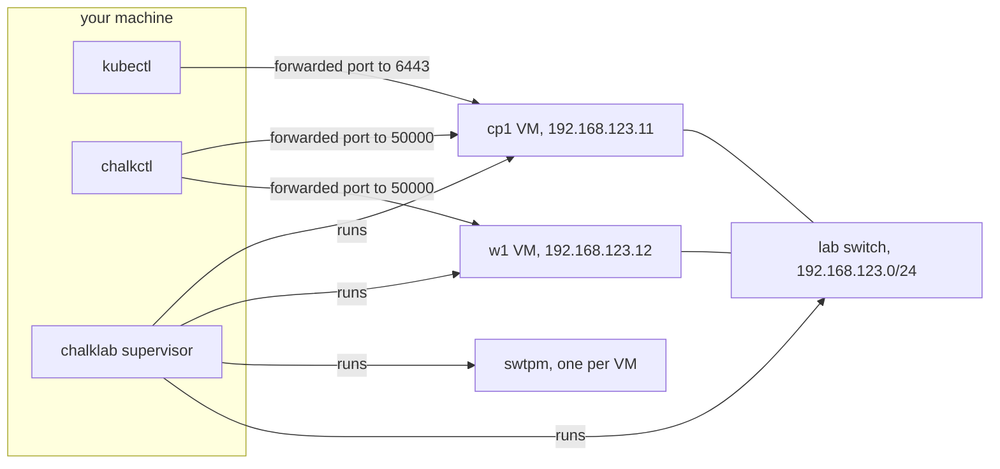

# Quick start: Kubernetes

This tutorial runs a chalkos cluster of one control plane and one worker on your machine, runs
kubectl against it, builds an image of your own, upgrades both nodes to it and removes the cluster
again. chalklab runs the two nodes as QEMU virtual machines, each with UEFI firmware, Secure Boot
and a TPM, so they go through the same install, bootstrap and upgrade steps as real machines.

The nodes start on the Kubernetes image that each chalkos release publishes for virtual machines,
which chalklab pulls from the registry. The cluster runs within a few minutes. Building your own
image at the end takes longer, because Nix downloads and builds it the first time.

## Before you begin

You need:

- an x86-64 Linux machine with [Nix](https://nixos.org/download/) and flakes enabled;
- read and write access to `/dev/kvm`, which most distributions give to members of the `kvm`
  group;
- about 5 GiB of free memory, 3 GiB for the control plane and 2 GiB for the worker, and about
  10 GiB of free disk for `/nix/store` and the lab;
- git.

You do not need root. [Requirements](requirements.md#lab-host) lists the details.

Nix gives you chalklab, chalkctl and kubectl from the `lab` template's development shell, and
builds your own image in the last part. [Releases](releases.md) lists the images chalkos
publishes.

## Terms you meet on this page

| Term | Meaning |
| --- | --- |
| published image | An image that a chalkos release pushes to `ghcr.io/trevex/chalkos`, signed with cosign. |
| secrets file | The one file that holds every CA and key of a cluster, written once by `chalkctl gen secrets`. |
| OS CA | The CA of the node API. chalkd and chalkctl trust only certificates that chain to it. |
| client file | A certificate of one role and its key, which lets chalkctl reach nodes without the secrets file. |
| maintenance mode | The mode chalkd runs in before a node is installed. It prints its certificate's fingerprint on the console. |
| slot | One of a node's two partition pairs, A and B, each holding one image. An upgrade writes the one not booted. |

The [glossary](../reference/glossary.md) defines every other term.

## Create the lab's files

The `lab` template holds a cluster that chalklab can run. Create a directory for it and
initialise it from the template:

<!-- x-release-please-start-version -->
```console
$ mkdir lab && cd lab
$ nix flake init -t github:trevex/chalkos/v0.2.1#lab
wrote: "/home/alice/lab/.gitignore"
wrote: "/home/alice/lab/README.md"
wrote: "/home/alice/lab/chalkos.yaml"
wrote: "/home/alice/lab/chalklab.yaml"
wrote: "/home/alice/lab/cluster/cluster.yaml"
wrote: "/home/alice/lab/flake.nix"
wrote: "/home/alice/lab/nodes/cp1.yaml"
wrote: "/home/alice/lab/nodes/w1.yaml"
```
<!-- x-release-please-end -->

YAML files describe the cluster. `chalkos.yaml` is the inventory: it names the two nodes, the
address chalkctl reaches each at, the image both run, and the files each gets, every file of
`cluster/` and its own file of `nodes/`. The image `node-kvm` is the published Kubernetes image
for virtual machines, `ghcr.io/trevex/chalkos/kubernetes-1.37-kvm`, named by the tag of the
template's release. `all` holds what every node gets: `node-kvm` as its image, and the files of
`cluster/` before its own. `chalklab.yaml` is the lab file, which names the nodes chalklab runs as
virtual machines. `flake.nix` pins chalkos as an input, gives a development shell with the tools,
and builds an image of your own, which the last part of this tutorial uses.

```yaml title="chalkos.yaml"
--8<-- "templates/lab/chalkos.yaml"
```

`cluster/cluster.yaml` gives Kubernetes with its defaults and the URL of its API server. The
inventory's `metadata.name` names the cluster in chalkctl's messages and the kubeconfig. Each
node's file says what the node is in Kubernetes, which disk holds its system, and its address on the
lab network, a private network between the virtual machines:

```yaml title="nodes/cp1.yaml"
apiVersion: kubernetes.chalkos.dev/v1alpha1
kind: Node
metadata: {name: default}
spec:
  type: controlplane
---
apiVersion: storage.chalkos.dev/v1alpha1
kind: SystemDisk
metadata: {name: system}
spec:
  disk: {path: /dev/vda}
---
apiVersion: networkd.chalkos.dev/v1alpha1
kind: Network
metadata: {name: 10-lab}
spec:
  match: {macAddress: "52:54:00:7b:00:11"}
  network: {address: [192.168.123.11/24]}
```

chalklab gives each virtual machine's card on the lab network the MAC address `chalklab.yaml`
names, which the node's `Network` document matches:

```yaml title="chalklab.yaml"
apiVersion: chalklab.chalkos.dev/v1alpha1
kind: Lab
metadata: {name: lab}
spec:
  inventory: ./chalkos.yaml
  nodes:
    cp1: {mac: "52:54:00:7b:00:11"}
    w1: {mac: "52:54:00:7b:00:12"}
```

Nix evaluates a flake in a git repository from the files git tracks, so put the files under git
before anything reads the flake:

```sh
git init && git add .
```

## Enter the development shell

The flake's development shell has chalklab, chalkctl and kubectl, from the chalkos version the
flake pins:

```sh
nix develop
```

The first run writes `flake.lock`, which records that version. Run every later command of this
tutorial in this shell.

## Generate the cluster's secrets

Every cluster has one secrets file with its CAs and
keys, written once by
[`chalkctl gen secrets`](../reference/cli/chalkctl_gen_secrets.md):

```console
$ chalkctl gen secrets --plaintext
wrote secrets.json and secrets.pub.json
warning: secrets.json holds the cluster's secrets unencrypted; protect it by other means, for example keep it out of version control with a .gitignore entry
```

`secrets.json` holds every secret of the cluster in plain text, including the OS
CA's key, which grants admin access to every node. The template's
`.gitignore` keeps it out of git. `secrets.pub.json` is the public part: `flake.nix` names it in the
`osCA` of `mkImages`, so an image you build trusts the OS CA. A real cluster encrypts its secrets
with age: `--recipient` in place of `--plaintext` writes `secrets.age`, which can live in the
repository.

The published image carries no OS CA, so until chalklab installs a node, the node accepts any
client in maintenance mode. That is fine on the lab's private network.
[Published images or your own](decisions.md#published-images-or-your-own) explains when it is not.

Commit the files, including `flake.lock`, so the lab keeps the same chalkos version:

```sh
git add . && git commit -m "A chalkos lab"
```

## Check the config against the image

[`chalkctl validate`](../reference/cli/chalkctl_validate.md) checks each node's config against the
schemas of the image the inventory names, without a node. It reads the image's contract from the
registry, and resolves the tag to the digest it names:

```console
$ chalkctl validate
cp1: valid for the image node-kvm at ghcr.io/trevex/chalkos/kubernetes-1.37-kvm@sha256:ea0dc23d410fb3f125b8c762cc7536c76ea7c1244384825ae976c4787e731830 (kubernetes-kvm on kvm, root hash c628af2ea405), config cff86e2957830b9ec4a10a6f6966660695c5a332fca12103d59f79ab4c1ccc15
w1: valid for the image node-kvm at ghcr.io/trevex/chalkos/kubernetes-1.37-kvm@sha256:ea0dc23d410fb3f125b8c762cc7536c76ea7c1244384825ae976c4787e731830 (kubernetes-kvm on kvm, root hash c628af2ea405), config dfa2ce25b9a19fdf23ffc416645164a75f85b3ac27a36da984839ff9f307a84d
```

`node-kvm` is the image's name in the inventory, and `kubernetes-kvm` the name the image records
itself.

## Create the lab

[`chalklab create`](../reference/cli/chalklab_create.md) starts the virtual machines, installs
both nodes and bootstraps the cluster. It reads `chalklab.yaml` and the inventory it names, and
the secrets file that `--secrets` names. First it resolves the image's tag to a digest, pulls the
image into the lab's state once, and copies it for each node:

<!-- x-release-please-start-version -->
```console
$ chalklab create --secrets secrets.json
creating the lab's Secure Boot keys in /home/alice/.local/state/chalklab/lab/keys
pulled ghcr.io/trevex/chalkos/kubernetes-1.37-kvm:v0.2.1 as ghcr.io/trevex/chalkos/kubernetes-1.37-kvm@sha256:<digest>
copying the image of cp1 from /home/alice/.local/state/chalklab/lab/images/sha256-<digest>
using cached ghcr.io/trevex/chalkos/kubernetes-1.37-kvm@sha256:<digest>
copying the image of w1 from /home/alice/.local/state/chalklab/lab/images/sha256-<digest>
```
<!-- x-release-please-end -->

Then it starts the virtual machines, installs both nodes and bootstraps the cluster:

```console
starting cp1, w1
wrote /home/alice/.local/state/chalklab/lab/chalkctl.json for chalklab with the admin role; its certificate expires on 2027-11-20
waiting for cp1 to come up in maintenance mode
cp1 runs in maintenance mode with the certificate fingerprint ce61718d04526692d2b5112b38c7f6e272adc15fff22110409d5fab0a43e2ca2
installing cp1 in place
cp1 is installed and reboots
chalkctl recovery-key cp1 prints the key that unlocks it when its TPM fails
waiting for w1 to come up in maintenance mode
w1 runs in maintenance mode with the certificate fingerprint 4b040ac6e13db789f2be0716cc52b91e17c0626fbbdec455559528a6292c09c8
installing w1 in place
w1 is installed and reboots
chalkctl recovery-key w1 prints the key that unlocks it when its TPM fails
waiting for cp1 to wait for its bootstrap
cp1: kubernetes controlplane: waiting for bootstrap or for the cluster at https://192.168.123.11:6443
bootstrapping cp1; the control plane pulls its images and starts
cp1 is bootstrapped; applied 19 objects
wrote /home/alice/.local/state/chalklab/lab/kubeconfig; its certificate is valid for 8760h0m0s

the lab lab runs cp1, w1; next:
  export KUBECONFIG=/home/alice/.local/state/chalklab/lab/kubeconfig
  export CHALKOSCONFIG=/home/alice/.local/state/chalklab/lab/chalkctl.json
  export CHALKOSINVENTORY=/home/alice/.local/state/chalklab/lab/chalkos.yaml
  kubectl get nodes
  chalkctl status cp1
  chalklab status
  chalklab destroy
The lab's inventory names unsigned images, which its firmware refuses; upgrade with a copy
signed by the lab's db key:
  chalklab sign <image dir> --out <signed dir>
  chalkctl upgrade --image <signed dir> --allow-downtime
```

The output follows the life of a node:

1. Both nodes boot the one image built for the `kvm` platform;
   what differs between them, such as cp1 being the control plane, travels separately as their
   config. chalklab pulls the image by its digest once and reuses it for the second node.
2. chalklab creates Secure Boot keys for this lab, enrols them in the firmware of the virtual
   machines and signs a copy of the image for each node with them. It writes the lab's
   inventory, `chalkos.yaml` in the lab's state, and an admin client file,
   `chalkctl.json`.
3. Each virtual machine boots its image in
   maintenance mode, where
   chalkd prints its certificate's fingerprint on the console.
   chalklab reads it there and runs `chalkctl install` with `--fingerprint`, so chalkctl talks
   only to that chalkd. The install creates the node's encrypted STATE and VAR partitions, sealed
   to its TPM, writes its config and certificates and reboots it.
4. After the reboot, cp1 waits to be bootstrapped. chalklab runs `chalkctl bootstrap`, which
   starts etcd and the control plane; the worker joins on its own.
5. Last, chalklab writes a kubeconfig that reaches the API server through its forwarded port.

The commands chalklab prints last export the kubeconfig for kubectl, and the client file and the
lab's inventory for chalkctl. chalkctl reads the client file `$CHALKOSCONFIG` names when a command
passes neither `--config` nor `--secrets`. It reads the inventory `$CHALKOSINVENTORY` names when a
command passes no `--inventory`.

The last lines are about upgrades. The nodes boot copies of the image that chalklab signed with
the lab's key, but the inventory names the unsigned image in the registry. The lab's firmware
refuses to boot an unsigned image, so an upgrade must use a copy that `chalklab sign` signed. The
section "Build your own image" does that.

The lab keeps its state, the pulled image, disks, keys and logs in `~/.local/state/chalklab/lab`,
after the lab file's `metadata.name`, or under `$XDG_STATE_HOME/chalklab` when that variable is
set; the commands on this page use the default path, and `chalklab status` prints the one in use.
A supervisor process keeps the virtual machines running after the command returns.

Each virtual machine has two network cards. One is on the lab network, a switch that connects
only the virtual machines, with the addresses the nodes' `Network` documents give them. The
other is QEMU's user-mode network, which reaches the internet and carries ports that chalklab
forwards from `127.0.0.1` on your machine: each node's chalkd and cp1's API server. The diagram
shows the layout.



### The lab's two inventories

The lab directory's `chalkos.yaml` names the nodes at their addresses on the lab network, such
as `192.168.123.11`. Your machine is not on the lab network, so chalkctl cannot reach a node at
that address. The lab's inventory, `~/.local/state/chalklab/lab/chalkos.yaml`, is a copy that
names each node at its forwarded port on `127.0.0.1` instead. It names the image by the digest
chalklab pulled, so it keeps naming the image the nodes booted even when the tag moves. Its file
paths are absolute, so it reads the YAML files of the lab directory: an edit of them reaches both
inventories.

Once you export `$CHALKOSINVENTORY`, every chalkctl command reads the lab's inventory. That
includes `chalkctl validate`, which reaches no node: both inventories name the same image and
files, so it gives the same answer with either. On real machines, which chalkctl reaches at their
own addresses, one inventory serves both.

## Use the cluster with kubectl

The kubeconfig reaches the API server through its forwarded port. Export it, the client file and
the lab's inventory, as `chalklab create` printed; the commands of this page rely on all three.
Then list the nodes:

```console
$ export KUBECONFIG=~/.local/state/chalklab/lab/kubeconfig
$ export CHALKOSCONFIG=~/.local/state/chalklab/lab/chalkctl.json
$ export CHALKOSINVENTORY=~/.local/state/chalklab/lab/chalkos.yaml
$ kubectl get nodes
NAME   STATUS   ROLES    AGE   VERSION
cp1    Ready    <none>   21s   v1.37.2
w1     Ready    <none>   12s   v1.37.2
```

The nodes may show `NotReady` for the first minute, until flannel, the network plugin, runs on
them. The control plane runs as static pods that chalkd writes, next to the add-ons the bootstrap
applied:

```console
$ kubectl get pods -A
NAMESPACE      NAME                          READY   STATUS              RESTARTS   AGE
kube-flannel   kube-flannel-ds-cggqw         0/1     Running             0          11s
kube-flannel   kube-flannel-ds-hjmxx         0/1     Running             0          11s
kube-system    coredns-559f6c778d-7n8w5      0/1     ContainerCreating   0          10s
kube-system    coredns-559f6c778d-nll95      0/1     ContainerCreating   0          10s
kube-system    etcd-cp1                      1/1     Running             0          16s
kube-system    kube-apiserver-cp1            1/1     Running             0          16s
kube-system    kube-controller-manager-cp1   1/1     Running             0          16s
kube-system    kube-proxy-5hwr6              1/1     Running             0          11s
kube-system    kube-proxy-qhpcq              1/1     Running             0          11s
kube-system    kube-scheduler-cp1            1/1     Running             0          16s
```

The flannel and CoreDNS pods show `0/1` until flannel has set up the pod network, within a minute
or two of the bootstrap.

## Look at a node with chalkctl

The nodes have no SSH and no login. chalkctl talks to chalkd on each node over mutual TLS instead,
with the client file `$CHALKOSCONFIG` names, and reaches them at the forwarded ports of the
inventory `$CHALKOSINVENTORY` names. [`chalkctl status`](../reference/cli/chalkctl_status.md)
shows what a node runs:

```console
$ chalkctl status cp1
config cff86e2957830b9ec4a10a6f6966660695c5a332fca12103d59f79ab4c1ccc15 (the inventory's)
platform kvm (the inventory's)
image c628af2ea405, booted from chalkos_1.efi
VOLUME  DISK    MOUNT POINT  STATE
var     system  /var         mounted
OUTPUT            HASH          STATE
bgp               e6940095ef08  rendered
chrony            0af9b0bd41ca  rendered
cluster-registry  e3b0c44298fc  rendered
networkd          4cd3700df352  rendered
kubernetes controlplane: bootstrapped, node ready: True, control plane current
kubernetes versions: API server 1.37.2, kubelet 1.37.2, control-plane pods current
certificates:
  node                      expires 2027-11-20
  OS CA                     expires 2036-11-17
  node CA                   expires 2031-11-19
  Kubernetes CA             expires 2036-11-17
  front-proxy CA            expires 2036-11-17
  etcd CA                   expires 2036-11-17
  Kubernetes control plane  expires 2027-11-20
  kubelet client            expires 2027-11-20
  kubelet serving           expires 2027-11-20
trust:
  OS CA                 fe3339dfcf022d78
  Kubernetes CA         1009654922c03a67 (issues)
  front-proxy CA        d95d4b468256d81c (issues)
  etcd CA               6786b86a968b7915 (issues)
  service-account keys  82d761319337ac88 (issues)
  encryption keys       a00b68962c54931d (issues)
time: synchronised to 192.53.103.108, offset +0.000005 s
```

Three lines matter at first:

- `config ... (the inventory's)`: the node runs the config the inventory gives it.
- `image c628af2ea405, booted from chalkos_1.efi`: the node runs the image whose root hash begins
  with `c628af2ea405`, the published image, from its first boot entry.
- `kubernetes controlplane: bootstrapped, node ready: True`: cp1 is bootstrapped, and its Node is
  Ready in Kubernetes.

The other lines list the node's volumes, the files it renders from its config, its certificates,
the CAs it trusts and its clock. The page on status, logs and the console, linked under "What
next", explains each of them.

[`chalklab status`](../reference/cli/chalklab_status.md) shows the lab itself: the virtual
machines, their forwarded ports and the lab's files.

```console
$ chalklab status
lab lab in /home/alice/.local/state/chalklab/lab; its supervisor runs as PID 1561221
NODE  TYPE          VM       CHALKD           API SERVER       FORWARDS  CONSOLE
cp1   controlplane  running  127.0.0.1:42647  127.0.0.1:35829  -         /home/alice/.local/state/chalklab/lab/cp1/console.log
w1    worker        running  127.0.0.1:35589  -                -         /home/alice/.local/state/chalklab/lab/w1/console.log
kubeconfig: /home/alice/.local/state/chalklab/lab/kubeconfig
inventory: /home/alice/.local/state/chalklab/lab/chalkos.yaml
client file: /home/alice/.local/state/chalklab/lab/chalkctl.json
Secure Boot db key: /home/alice/.local/state/chalklab/lab/keys/db.key
Secure Boot db certificate: /home/alice/.local/state/chalklab/lab/keys/db.crt
```

The serial console of a node is where its firmware, kernel and chalkd write.
[`chalklab console`](../reference/cli/chalklab_console.md) prints it and follows it until you
press Ctrl+C. On cp1 it shows chalkd in maintenance mode, the install, and chalkd in normal
mode after the reboot:

```console
$ chalklab console cp1
...
[   10.594406] chalkd[578]: chalkd: maintenance mode, accepting any client; certificate fingerprint ce61718d04526692d2b5112b38c7f6e272adc15fff22110409d5fab0a43e2ca2
...
[   12.773306] chalkd[578]: chalkd: installing in place
...
[   48.233627] chalkd[578]: chalkd: installed; rebooting
...
[    9.350434] chalkd[698]: chalkd: normal mode; certificate fingerprint 96be8ba7ae323ff71bfffe260c06158ba64c7aee2ba981f00f9ceb6ef0ef35e5
[    9.360269] chalkd[698]: chalkd: addresses 10.0.2.15 192.168.123.11; certificate fingerprint 96be8ba7ae323ff71bfffe260c06158ba64c7aee2ba981f00f9ceb6ef0ef35e5
...
[   27.344523] chalkd[698]: chalkd: kubernetes: applied 19 objects
```

`accepting any client` is the published image without an OS CA. After the install the node holds
the cluster's OS CA, and in normal mode it accepts only the cluster's clients.

## Change the nodes' config

A node's config is the YAML of its files, which changes without a new image.
[`chalkctl config apply`](../reference/cli/chalkctl_config_apply.md) delivers it to a running
node, which applies it in place; `chalkctl apply` is its short form. Add a file to `cluster/`
that gives every node another time server:

```yaml title="cluster/time.yaml"
apiVersion: time.chalkos.dev/v1alpha1
kind: TimeSync
metadata: {name: time}
spec:
  servers:
    - host: time.cloudflare.com
```

Check the nodes' config against the image, and deliver it to each node. Delivering config needs
the secrets file, which `--secrets` names; a client file does not suffice:

```console
$ chalkctl validate
cp1: valid for the image node-kvm at ghcr.io/trevex/chalkos/kubernetes-1.37-kvm@sha256:ea0dc23d410fb3f125b8c762cc7536c76ea7c1244384825ae976c4787e731830 (kubernetes-kvm on kvm, root hash c628af2ea405), config e5abd9da9d767c5d2d79a158766cde278a333fdc6c4fbc8891e7692eff99868f
w1: valid for the image node-kvm at ghcr.io/trevex/chalkos/kubernetes-1.37-kvm@sha256:ea0dc23d410fb3f125b8c762cc7536c76ea7c1244384825ae976c4787e731830 (kubernetes-kvm on kvm, root hash c628af2ea405), config b8b41769a31866ce5c70011cfa1826b0668f39e9b2eac69d7fc0f847bae277fd
$ chalkctl config apply cp1 --secrets secrets.json
cp1: config 1 added, 0 removed, 0 changed
restarted chalkos-chrony-dhcp.service
cp1 runs config e5abd9da9d767c5d2d79a158766cde278a333fdc6c4fbc8891e7692eff99868f
$ chalkctl config apply w1 --secrets secrets.json
w1: config 1 added, 0 removed, 0 changed
restarted chalkos-chrony-dhcp.service
w1 runs config b8b41769a31866ce5c70011cfa1826b0668f39e9b2eac69d7fc0f847bae277fd
```

Both commands read the lab's inventory, which takes `cluster/time.yaml` from this directory. Each
`config apply` first counts the documents the delivery adds, removes and changes against the
node's config: here the one `TimeSync`. The node then restarts the units the change affects, and
the last line names the config version it runs. `chalkctl status` now shows that version as the
inventory's.

## Build your own image

The published image holds the Kubernetes layer as chalkos ships it. A package, an extension or an
option of your own takes an image of your own, built with Nix from the template's flake. Its image,
`node-kvm`, starts from the same Kubernetes layer and carries the cluster's OS CA from
`secrets.pub.json`.

A node changes its software only by booting a new image. An
upgrade writes the new image into the node's inactive
slot and reboots into it; if the new image does not become
healthy, the node falls back to the image it ran before.

Any change to an image's modules makes a new image, which its store's root hash tells apart from
the one before; there is no version to raise. Edit `flake.nix` so the image `node-kvm` turns on
`chalkos.debug.tools`, which adds the tools `kubectl debug` uses on a node:

```diff
-            modules = [ chalkos.nixosModules.kubernetes ];
+            modules = [
+              chalkos.nixosModules.kubernetes
+              # The tools for kubectl debug.
+              { chalkos.debug.tools = true; }
+            ];
```

Commit the change and build the image into `images/node-kvm`. The flake passes its commit to
`mkImages` as `revision`, so chalkctl can say which commit each node runs. The first build takes
the longest part of this tutorial, while Nix downloads and builds the image's parts; the
template's `.gitignore` keeps `images/` out of git:

```sh
git commit -am "Add the debug tools"
nix build .#node-kvm -o images/node-kvm
```

The lab's firmware boots only images signed with the lab's Secure Boot key, and the build is
unsigned. [`chalklab sign`](../reference/cli/chalklab_sign.md) copies the image directory and
signs the copy with the lab's db key. The copy's directory must not exist yet, so remove the copy
from an earlier upgrade first:

```console
$ rm -rf images/node-kvm-signed
$ chalklab sign images/node-kvm --out images/node-kvm-signed
signed images/node-kvm-signed/chalkos.raw with the db key of the lab lab
```

[`chalkctl upgrade`](../reference/cli/chalkctl_upgrade.md) with `--image` gives the signed copy to
the nodes and rolls it through the cluster, one node at a time. On its own, `--image` picks the
nodes that run an image of its name, `node-kvm`. The nodes run the published image, which names
itself `kubernetes-kvm`, so `--nodes` names them:

```console
$ chalkctl upgrade --image images/node-kvm-signed --nodes cp1,w1 --allow-downtime
cp1 runs the image kubernetes-kvm; it gets node-kvm
w1 runs the image kubernetes-kvm; it gets node-kvm
upgrading node-kvm on kvm to 7986f78938ed (186d48b7ef31): cp1, w1
cp1: installing 7986f78938ed (186d48b7ef31)
cp1: config unchanged
cp1: installed 7986f78938ed (186d48b7ef31), staged as .staged-chalkos_2.efi
cp1: cordoned, evicted 2 pods, kept 6
cp1: activated 7986f78938ed (186d48b7ef31), which boots next as chalkos_2+3.efi
cp1: rebooting into 7986f78938ed (186d48b7ef31)
cp1: runs 7986f78938ed (186d48b7ef31), found healthy
cp1: uncordoned
w1: installing 7986f78938ed (186d48b7ef31)
w1: config unchanged
w1: installed 7986f78938ed (186d48b7ef31), staged as .staged-chalkos_2.efi
w1: cordoned, evicted 2 pods, kept 2
w1: activated 7986f78938ed (186d48b7ef31), which boots next as chalkos_2+3.efi
w1: rebooting into 7986f78938ed (186d48b7ef31)
w1: runs 7986f78938ed (186d48b7ef31), found healthy
w1: uncordoned
upgraded 2 nodes to 7986f78938ed (186d48b7ef31)
```

`7986f78938ed` begins the new image's root hash, and `186d48b7ef31` the commit it was built from.

`--allow-downtime` is needed because the lab has a single control plane: while cp1 reboots, etcd
has no quorum and the API server is down, and chalkctl refuses that unless told to accept it. In
a cluster of three control planes, the other two keep etcd and the API server running while one
reboots.

An upgrade sends each node its config from the inventory together with the image. The
`config unchanged` line compares that config with the one the node runs: `config apply` delivered
the `TimeSync` already, so nothing changes.

Each node goes through the same steps. chalkctl sends the image to chalkd, which writes it into
the inactive slot and stages its boot entry. chalkctl drains the node, and chalkd activates the
entry with three tries, `chalkos_2+3.efi`, one generation above the entry the node booted, so
systemd-boot boots it first. The node reboots into the new image with
boot counting. Once its
health check passes, the boot is
blessed, which removes the counter, and chalkctl
uncordons the node. A node whose new image is not found healthy within its three tries boots the
image before again, and chalkctl stops there and shows what the failed boot logged.

## Check that it worked

`chalkctl status` shows that w1 booted the new image from the blessed entry, which has lost its
`+3`:

```console
$ chalkctl status w1
config b8b41769a31866ce5c70011cfa1826b0668f39e9b2eac69d7fc0f847bae277fd (the inventory's)
platform kvm (the inventory's)
image 7986f78938ed (186d48b7ef31), booted from chalkos_2.efi
previous image c628af2ea405 (upgrade --rollback boots it)
its store's root hash is 7986f78938ed320bc54a75ad2ebd10329352f10e1fcb99c0fdeb25b034ad2f79, not that of the image node-kvm the inventory names, c628af2ea405dc1b9b319c555d15a3b3822953b0ae3cf8478927cb76bc074095; chalkctl upgrade --nodes w1 installs that image
VOLUME  DISK    MOUNT POINT  STATE
var     system  /var         mounted
OUTPUT            HASH          STATE
bgp               c7f2fa248b21  rendered
chrony            3b1ba1116223  rendered
cluster-registry  e3b0c44298fc  rendered
networkd          195ac3c4ec51  rendered
kubernetes worker: joined, node ready: True
kubernetes versions: API server 1.37.2, kubelet 1.37.2
certificates:
  node             expires 2027-11-20
  OS CA            expires 2036-11-17
  Kubernetes CA    expires 2036-11-17
  kubelet client   expires 2027-11-20
  kubelet serving  expires 2027-11-20
trust:
  OS CA          fe3339dfcf022d78
  Kubernetes CA  1009654922c03a67
time: synchronised to 162.159.200.1, offset +0.000000 s
```

A worker holds fewer certificates than a control plane: it issues none, so it holds no node CA and
no CA keys. Its time source is now `time.cloudflare.com`, at the address `162.159.200.1`. The
published image it ran before stays in the other slot, which `chalkctl upgrade --rollback` boots.

The lab's inventory still names the published image, so `chalkctl status` says that the node runs
another one. To make your build the lab's image, point `node-kvm` in `chalkos.yaml` at its
directory, `node-kvm: {source: {directory: images/node-kvm}}`, and create the lab again, as the
template's `README.md` describes.

Both nodes are `Ready` in Kubernetes again:

```console
$ kubectl get nodes
NAME   STATUS   ROLES    AGE     VERSION
cp1    Ready    <none>   5m30s   v1.37.2
w1     Ready    <none>   5m23s   v1.37.2
```

The new image has the debugging tools, so a debugging pod can run the node's own `cat` on its
files. `kubectl debug` starts one on w1, which prints the node's os-release and stops. The pod's
log names the image and its platform:

```console
$ kubectl debug node/w1 --image=busybox -- chroot /host /run/current-system/sw/bin/cat /etc/os-release
Creating debugging pod node-debugger-w1-42xwg with container debugger on node w1.
$ kubectl logs node-debugger-w1-42xwg
...
CHALKOS_BOOT_TRIES=3
CHALKOS_IMAGE="node-kvm"
CHALKOS_PLATFORM=kvm
...
IMAGE_ID=chalkos
IMAGE_VERSION=""
...
```

## Remove the lab

[`chalklab destroy`](../reference/cli/chalklab_destroy.md) stops the virtual machines and removes
the lab's state, including its disks, its keys and the pulled image:

```console
$ chalklab destroy
removed the lab in /home/alice/.local/state/chalklab/lab
```

The exported variables still name the removed lab's files, so clear them before chalkctl or kubectl
reads another cluster:

```sh
unset KUBECONFIG CHALKOSCONFIG CHALKOSINVENTORY
```

The files and your build stay, so `chalklab create --secrets secrets.json` makes the same cluster
again, and pulls the image the inventory names once more. A lab you keep stays on disk across a reboot of your
machine, but its virtual machines do
not start by themselves; `chalklab start` starts them again with their disks, TPM state and
ports.

## Fix a lab that does not start

`chalklab create` and `chalklab start` run each node as a QEMU virtual machine on KVM. Their
errors name the cause:

- `/dev/kvm does not exist: ...`: the machine has no hardware virtualisation, it is disabled in
  the firmware, or the kvm module is not loaded. chalklab needs an x86-64 machine with KVM.
- `you may not open /dev/kvm: ...`: join the `kvm` group and log in again. On NixOS, add the group
  to `users.users.<you>.extraGroups`.
- `<node> did not come up in maintenance mode: ...`: the VM booted, but chalkd did not print its
  fingerprint. The error names the console log, and `chalklab console <node>` shows it.
- `the lab <name> exists in ...; chalklab destroy removes it`: a lab of the lab file's name
  exists. `chalklab start` starts it again, and `chalklab destroy` removes it.

VMs that start but run slowly, or stop, usually lack memory. A lab gives a control plane 3072 MiB
and each other node 2048 MiB. `chalklab status` shows which VMs run.

## What next

The lab ran the steps an operator runs on real machines. From here, two paths lead on, and
[Published images or your own](decisions.md#published-images-or-your-own) helps you pick one.

To run the published images on your own machines,
[Build a cluster on real machines](../guides/cluster-on-machines.md) installs three machines from
the `cluster-metal` template with the published metal image and the release's installer.
[Releases](releases.md) lists the images and shows how to verify them. The operator guides cover
one task each: [Set up your workstation](../operate/workstation.md),
[Write a node's config](../operate/node-config.md) and [Install a node](../operate/install.md),
or [install it in a VM](../operate/install-vm.md).

To build and release your own images, start with
[Your first image flake](../build/first-image.md), then
[Write your first extension](../build/first-extension.md) on this lab.
[Release your own images](../guides/release-your-images.md) pushes your images to a registry of
your own, from which the nodes pull them as they pulled the published one.

[Quick start: router](quick-start-router.md) runs a router lab.

[Status, logs and the console](../operate/status-and-logs.md) explains every line of
`chalkctl status`. Keep the [command cheat sheet](../reference/cheat-sheet.md) at hand: it lists
the command and the credential for each common task.
