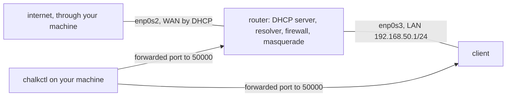

# Quick start: router

This tutorial runs a chalkos router and a client machine behind it on your machine. The router
takes its WAN address by DHCP, leases an address to the client, answers its DNS queries and
masquerades its traffic to the internet. You check each of these from the client, then change the
router's firewall on trial and remove the lab again. chalklab runs both machines as QEMU virtual
machines with UEFI firmware, Secure Boot and a TPM. It takes about 15 minutes, most of it Nix
building the two images the first time.

## Before you begin

You need:

- an x86-64 Linux machine with [Nix](https://nixos.org/download/) and flakes enabled;
- read and write access to `/dev/kvm`, which most distributions give to members of the `kvm`
  group;
- about 2 GiB of free memory, 1 GiB for the router and 768 MiB for the client, and about 10 GiB
  of free disk for `/nix/store` and the lab;
- git.

You do not need root. The tutorial builds both images from the `router-lab` template with
`nix build`.

## What the lab runs

Each virtual machine has two network cards. One is on QEMU's user-mode network, which reaches
the internet through your machine and carries the port that chalklab forwards to each node's
chalkd. The other is on the lab network, a switch between the two machines. The router's card on
the user-mode network is its WAN, and its card on the lab network is its LAN:



The client's card on the user-mode network has an address and no gateway. It carries chalkctl's
connections alone, so the client reaches the internet only through the router.

## Create the lab's files

Create a directory and initialise it from the `router-lab` template:

<!-- x-release-please-start-version -->
```console
$ mkdir router-lab && cd router-lab
$ nix flake init -t github:trevex/chalkos/v0.2.0#router-lab
wrote: "/home/alice/router-lab/.gitignore"
wrote: "/home/alice/router-lab/README.md"
wrote: "/home/alice/router-lab/chalklab.yaml"
wrote: "/home/alice/router-lab/chalkos.yaml"
wrote: "/home/alice/router-lab/flake.nix"
wrote: "/home/alice/router-lab/nodes/client.yaml"
wrote: "/home/alice/router-lab/nodes/router.yaml"
wrote: "/home/alice/router-lab/nodes"
```
<!-- x-release-please-end -->

The files:

| File | Holds |
| --- | --- |
| `flake.nix` | The two images: `router-kvm`, with the router layer, and `client-kvm`, without a layer. |
| `chalkos.yaml` | The inventory: the nodes `router` and `client`, the image each runs and its file. |
| `nodes/router.yaml` | The router's interfaces, firewall, NAT, DHCP server and resolver. |
| `nodes/client.yaml` | The client's interfaces. |
| `chalklab.yaml` | The lab file: the nodes chalklab runs, with their memory and MAC addresses. |

The router's file holds every document of its role. The firewall accepts the node API on the WAN
alone, where chalklab forwards its port:

```yaml title="nodes/router.yaml"
--8<-- "templates/router-lab/nodes/router.yaml"
```

Nix evaluates a flake from the files git tracks, so put the files under git:

```sh
git init && git add .
```

## Generate the secrets and build the images

Enter the flake's development shell, which has chalklab and chalkctl of the chalkos version the
flake pins. Run every later command of this tutorial in it:

```sh
nix develop
```

Generate the cluster's secrets with
[`chalkctl gen secrets`](../reference/cli/chalkctl_gen_secrets.md). `flake.nix` names their public
part, `secrets.pub.json`, so both images trust the cluster's OS CA:

```console
$ chalkctl gen secrets --plaintext
wrote secrets.json and secrets.pub.json
warning: secrets.json holds the cluster's secrets unencrypted; protect it by other means, for example keep it out of version control with a .gitignore entry
```

The template's `.gitignore` keeps `secrets.json` out of git. Commit the files with `flake.lock`,
then build both images where the inventory points and check the nodes' config against them with
[`chalkctl validate`](../reference/cli/chalkctl_validate.md):

```console
$ git add . && git commit -m "A chalkos router lab"
$ nix build .#router-kvm -o images/router-kvm
$ nix build .#client-kvm -o images/client-kvm
$ chalkctl validate
client: valid for the image client-kvm (client-kvm on kvm, root hash 5444e09efc9f), config 94f1f34ad29ff7bc1f152158df4504bbf4576fc6d9c230a5ee9fd77bed47dc10
router: valid for the image router-kvm (router-kvm on kvm, root hash 340bc1fd1ce4), config e3befdf104b789da4dd4f9c58b263905755e3428e7b9e9d560a75552e161b87e
```

## Create the lab

[`chalklab create`](../reference/cli/chalklab_create.md) starts both virtual machines and
installs each node. Neither runs Kubernetes, so there is no bootstrap:

```console
$ chalklab create --secrets secrets.json
creating the lab's Secure Boot keys in /home/alice/.local/state/chalklab/router-lab/keys
copying the image of client from /home/alice/router-lab/images/client-kvm
copying the image of router from /home/alice/router-lab/images/router-kvm
starting client, router
wrote /home/alice/.local/state/chalklab/router-lab/chalkctl.json for chalklab with the admin role; its certificate expires on 2027-11-16
waiting for client to come up in maintenance mode
client runs in maintenance mode with the certificate fingerprint f15e62a87b9f26521cf976582974196dcee913f5182612ad437e50b7d8e26918
installing client in place
client is installed and reboots
chalkctl recovery-key client prints the key that unlocks it when its TPM fails
waiting for router to come up in maintenance mode
router runs in maintenance mode with the certificate fingerprint e64303af2431eb6588fd5b2d17110d179a8b8b6b7260934aa7b7d424fca6a5bb
installing router in place
router is installed and reboots
chalkctl recovery-key router prints the key that unlocks it when its TPM fails

the lab router-lab runs client, router; next:
  export CHALKOSCONFIG=/home/alice/.local/state/chalklab/router-lab/chalkctl.json
  export CHALKOSINVENTORY=/home/alice/.local/state/chalklab/router-lab/chalkos.yaml
  chalkctl status client
  chalklab status
  chalklab destroy
The lab's inventory names unsigned images, which its firmware refuses; upgrade with a copy
signed by the lab's db key:
  chalklab sign <image dir> --out <signed dir>
  chalkctl upgrade --image <signed dir>
```

chalklab installs the nodes in the order of their names, so the client comes first. It takes its
LAN address once the router runs. Export the client file and the lab's inventory, as the output
says. chalkctl then reaches both nodes at their forwarded ports without further flags:

```sh
export CHALKOSCONFIG=~/.local/state/chalklab/router-lab/chalkctl.json
export CHALKOSINVENTORY=~/.local/state/chalklab/router-lab/chalkos.yaml
```

## Check the router

[`chalkctl status`](../reference/cli/chalkctl_status.md) shows what the router runs, and the state
of its router services last:

```console
$ chalkctl status router
config e3befdf104b789da4dd4f9c58b263905755e3428e7b9e9d560a75552e161b87e (the inventory's)
platform kvm (the inventory's)
image 340bc1fd1ce4, booted from chalkos_1.efi
VOLUME  DISK    MOUNT POINT  STATE
var     system  /var         mounted
OUTPUT           HASH          STATE
chrony           0af9b0bd41ca  rendered
dhcp-relay       e3b0c44298fc  rendered
frr              1a231e4f19d4  rendered
jool             e3b0c44298fc  rendered
kea              4a4da68c9a2f  rendered
networkd         8b35eed0386f  rendered
router-nftables  26bad37289d7  rendered
router-sysctl    469f31935ae7  rendered
unbound          23d0b4df374f  rendered
bgp: no sessions
resolver: running
dhcp4 default: running
  SUBNET  RANGE            LEASED  POOL
  lan     192.168.50.0/24  1       100
certificates:
  node   expires 2027-11-16
  OS CA  expires 2036-11-13
trust:
  OS CA  d30b96c517164302
time: synchronised to 192.53.103.104, offset -0.000838 s
```

Each output is a file the router renders from its config, such as `router-nftables` for the
firewall and `kea` for the DHCP server. The router runs no BGP, so it has no sessions. Its
resolver runs, and its DHCP server has leased one address of the subnet `lan`.
[`chalkctl node diag`](../reference/cli/chalkctl_node_diag.md) runs the diagnostic
`dhcp-leases`, which shows the lease:

```console
$ chalkctl node diag router dhcp-leases
VRF	SUBNET	ADDRESS	MAC	HOSTNAME	ENDS
default	lan	192.168.50.100	52:54:00:7c:00:02	client	2026-11-17T00:34:51Z
```

The client took the first address of the pool. Its MAC address is the one `chalklab.yaml` gives
its card on the lab network.

## Check the client

The diagnostic `route-get` shows the route the client takes to an address on the internet. It goes
through the router's LAN address, the gateway the DHCP server gave:

```console
$ chalkctl node diag client route-get address=1.1.1.1
[{"dst":"1.1.1.1","gateway":"192.168.50.1","dev":"enp0s3","prefsrc":"192.168.50.100","flags":[],"uid":63250,"cache":[]}]
```

`tcp-connect` opens a connection along that route. The firewall's policy `lan-wan` lets it out,
and the router masquerades it behind its WAN address:

```console
$ chalkctl node diag client tcp-connect address=1.1.1.1 port=443
connected to 1.1.1.1 port 443
```

`dns-query` asks the router's resolver for a name:

```console
$ chalkctl node diag client dns-query name=example.org type=A server=192.168.50.1
...
;; ANSWER SECTION:
example.org.	294	IN	A	104.20.26.136
example.org.	294	IN	A	172.66.157.237
...
;; SERVER: 192.168.50.1
...
```

## Open the node API to the LAN on trial

The router's firewall drops connections from the LAN to the router, except DHCP, DNS and the
traffic chalkos itself accepts. The node API on port 50000 is not among them:

```console
$ chalkctl node diag client tcp-connect address=192.168.50.1 port=50000
no connection to 192.168.50.1 port 50000 within 5 seconds
chalkctl: tcp-connect exited with status 124
```

Let the LAN reach the node API too. Add the LAN's card to the management interfaces in
`nodes/router.yaml`:

```yaml title="nodes/router.yaml"
apiVersion: router.chalkos.dev/v1alpha1
kind: Router
metadata: {name: router}
spec:
  management: {interfaces: [enp0s2, enp0s3]}
```

Validate the files and preview the change with
[`chalkctl config apply`](../reference/cli/chalkctl_config_apply.md) and `--diff`, which changes
nothing. Delivering config needs the secrets file:

```console
$ chalkctl validate
client: valid for the image client-kvm (client-kvm on kvm, root hash 5444e09efc9f), config 94f1f34ad29ff7bc1f152158df4504bbf4576fc6d9c230a5ee9fd77bed47dc10
router: valid for the image router-kvm (router-kvm on kvm, root hash 340bc1fd1ce4), config 891df0f1c1918a7506943eaa311ac4269b46821338424da6e4122fe2ea7cab26
$ chalkctl config apply router --secrets secrets.json --diff
router: config 0 added, 0 removed, 1 changed
~ Router "router"
    spec.management.interfaces[1]: (none) → "enp0s3"
```

A wrong management interface cuts chalkctl off from the router. Deliver the change with `--try`,
so that the router rolls it back by itself unless chalkctl reaches it again and confirms it:

```console
$ chalkctl config apply router --secrets secrets.json --try 2m
router: config 0 added, 0 removed, 1 changed
router: delivering config 891df0f1c1918a7506943eaa311ac4269b46821338424da6e4122fe2ea7cab26 on trial until 2026-11-16T12:37:41Z
router runs config 891df0f1c1918a7506943eaa311ac4269b46821338424da6e4122fe2ea7cab26 on trial; it rolls back to config e3befdf104b789da4dd4f9c58b263905755e3428e7b9e9d560a75552e161b87e by itself unless confirmed within 2m0s
router: waiting for a new connection and the node's health to confirm config 891df0f1c1918a7506943eaa311ac4269b46821338424da6e4122fe2ea7cab26
router keeps config 891df0f1c1918a7506943eaa311ac4269b46821338424da6e4122fe2ea7cab26: the trial is confirmed
```

chalkctl reached the router over a new connection on its WAN, so it confirmed the trial. The
router keeps the new config, and its firewall now accepts the node API from the LAN:

```console
$ chalkctl node diag client tcp-connect address=192.168.50.1 port=50000
connected to 192.168.50.1 port 50000
```

`chalkctl status router` now names the new config as the inventory's, and the config before it as
the one `chalkctl config rollback` restores.

## Remove the lab

[`chalklab destroy`](../reference/cli/chalklab_destroy.md) stops the virtual machines and removes
the lab's state, its disks and keys included:

```console
$ chalklab destroy
removed the lab in /home/alice/.local/state/chalklab/router-lab
```

Clear the variables, which name the removed lab's files:

```sh
unset CHALKOSCONFIG CHALKOSINVENTORY
```

The files and the images stay, so `chalklab create --secrets secrets.json` makes the same lab
again.

## What next

- [Set up a router](../router/set-up.md) covers the `Router` document and the node API's
  interfaces on a router of real machines.
- [Filter and translate traffic](../router/firewall-and-nat.md) explains zones, policies and NAT
  rules, and [Lease addresses with DHCP](../router/dhcp.md) the DHCP server.
- [Try a config change](../operate/change-config.md#try-a-config-change) explains trials and
  how to confirm one later.
- [The router's firewall](../how-it-works/router/firewall.md) shows the chains the router loads.
- [Quick start](quick-start-kubernetes.md) runs a Kubernetes cluster in the same way.
