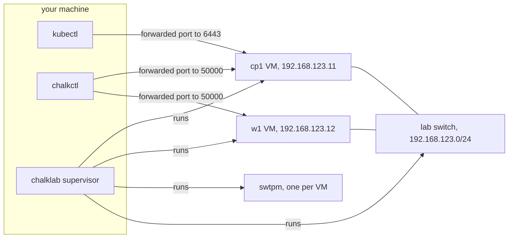

# Quick start

This tutorial builds a chalkos cluster of one control
plane and one worker on
your machine, runs kubectl against it, upgrades both nodes to a new image and removes the cluster
again. chalklab runs the two nodes as QEMU virtual machines,
each with UEFI firmware, Secure Boot and a
TPM, so they go through the same install, bootstrap and upgrade
steps as real machines. It takes about 15 minutes; most of that is Nix downloading and building the
image the first time.

## Before you begin

You need:

- an x86-64 Linux machine with [Nix](https://nixos.org/download/) and flakes enabled;
- read and write access to `/dev/kvm`, which most distributions give to members of the `kvm`
  group;
- about 5 GiB of free memory, 3 GiB for the control plane and 2 GiB for the worker, and about
  10 GiB of free disk for `/nix/store` and the lab;
- git.

You do not need root. [Requirements](requirements.md#lab-host) lists the details.

## Create the lab's files

The `lab` template holds a cluster that chalklab can run. Create a directory for it and
initialise it from the template:

```console
$ mkdir lab && cd lab
$ nix flake init -t github:trevex/chalkos#lab
wrote: "/home/alice/lab/.gitignore"
wrote: "/home/alice/lab/README.md"
wrote: "/home/alice/lab/chalkos.yaml"
wrote: "/home/alice/lab/chalklab.yaml"
wrote: "/home/alice/lab/cluster/cluster.yaml"
wrote: "/home/alice/lab/flake.nix"
wrote: "/home/alice/lab/nodes/cp1.yaml"
wrote: "/home/alice/lab/nodes/w1.yaml"
```

Nix builds the image; YAML files describe the cluster.
`flake.nix` pins chalkos as an input, builds the image the nodes run with `mkImages`, and
gives a development shell. `chalkos.yaml` is the inventory: it names the two nodes, the address
chalkctl reaches each at, the image both run, and the files each gets, every file of `cluster/` and
its own file of `nodes/`. The image `node-kvm` is the directory `images/node-kvm`, relative to the
inventory. `all` holds what every node gets: `node-kvm` as its image, and the files of `cluster/`
before its own. `chalklab.yaml` is the lab file, which names the nodes chalklab runs as virtual
machines.

```yaml title="chalkos.yaml"
apiVersion: chalkctl.chalkos.dev/v1alpha1
kind: Inventory
metadata: {name: lab}
spec:
  images:
    # nix build .#node-kvm -o images/node-kvm puts the image here.
    node-kvm: {source: {directory: images/node-kvm}}
  all: {imageName: node-kvm, files: [cluster/*.yaml]}
  nodes:
    cp1: {address: 192.168.123.11, files: [nodes/cp1.yaml]}
    w1: {address: 192.168.123.12, files: [nodes/w1.yaml]}
```

`cluster/cluster.yaml` gives Kubernetes with its defaults and the URL of its API server. The
inventory's `metadata.name` names the cluster in chalkctl's messages and the kubeconfig. Each
node's file says what the node is in Kubernetes, which disk holds its system, and its address on the
lab network, a private network between the virtual machines:

```yaml title="nodes/cp1.yaml"
apiVersion: kubernetes.chalkos.dev/v1alpha1
kind: Node
metadata: {name: default}
spec:
  type: controlplane
---
apiVersion: storage.chalkos.dev/v1alpha1
kind: SystemDisk
metadata: {name: system}
spec:
  disk: {path: /dev/vda}
---
apiVersion: networkd.chalkos.dev/v1alpha1
kind: Network
metadata: {name: 10-lab}
spec:
  match: {macAddress: "52:54:00:7b:00:11"}
  network: {address: [192.168.123.11/24]}
```

chalklab gives each virtual machine's card on the lab network the MAC address `chalklab.yaml`
names, which the node's `Network` document matches:

```yaml title="chalklab.yaml"
apiVersion: chalklab.chalkos.dev/v1alpha1
kind: Lab
metadata: {name: lab}
spec:
  inventory: ./chalkos.yaml
  nodes:
    cp1: {mac: "52:54:00:7b:00:11"}
    w1: {mac: "52:54:00:7b:00:12"}
```

Nix evaluates a flake in a git repository from the files git tracks, so put the files under git
before anything reads the flake:

```sh
git init && git add .
```

## Enter the development shell

The flake's development shell has chalklab, chalkctl and kubectl, from the chalkos version the
flake pins:

```sh
nix develop
```

The first run writes `flake.lock`, which records that version. Run every later command of this
tutorial in this shell.

## Generate the cluster's secrets

Every cluster has one secrets file with its CAs and
keys, written once by
[`chalkctl gen secrets`](../reference/cli/chalkctl_gen_secrets.md):

```console
$ chalkctl gen secrets --plaintext
wrote secrets.json and secrets.pub.json
warning: secrets.json holds the cluster's secrets unencrypted; protect it by other means, for example keep it out of version control with a .gitignore entry
```

`secrets.json` holds every secret of the cluster in plain text, including the OS
CA's key, which grants admin access to every node. The template's
`.gitignore` keeps it out of git. `secrets.pub.json` is the public part: `flake.nix` names it in the
`osCA` of `mkImages`, so the image trusts the OS CA. A real cluster encrypts its secrets with age:
`--recipient` in place of `--plaintext` writes `secrets.age`, which can live in the repository.

Commit the files, including `flake.lock`, so the lab keeps the same chalkos version:

```sh
git add . && git commit -m "A chalkos lab"
```

## Build the image

The image is built into `images/node-kvm`, where the inventory's image `node-kvm` points.
[`chalkctl validate`](../reference/cli/chalkctl_validate.md) then checks each node's config against
the image's schemas, without a node:

```console
$ nix build .#node-kvm -o images/node-kvm
$ chalkctl validate
cp1: valid for the image node-kvm (node on kvm, root hash c118f05709bc), config eca90aeb75db9d1ee363991f8e01e59fd04ffbb36823f8947a5ac8d938c12867
w1: valid for the image node-kvm (node on kvm, root hash c118f05709bc), config bbb7e69c2ce5c5d34e483d16ca6b8ff9941c2065319684d8399dbfa818c31a4d
```

The first build takes most of the tutorial's time. The template's `.gitignore` keeps `images/`
out of git.

## Create the lab

[`chalklab create`](../reference/cli/chalklab_create.md) starts the virtual machines, installs
both nodes and bootstraps the cluster. It reads `chalklab.yaml` and the inventory it names, and
the secrets file that `--secrets` names:

```console
$ chalklab create --secrets secrets.json
creating the lab's Secure Boot keys in /home/alice/.local/state/chalklab/lab/keys
copying the image of cp1 from /home/alice/lab/images/node-kvm
copying the image of w1 from /home/alice/lab/images/node-kvm
starting cp1, w1
wrote /home/alice/.local/state/chalklab/lab/chalkctl.json for chalklab with the admin role; its certificate expires on 2027-10-23
waiting for cp1 to come up in maintenance mode
cp1 runs in maintenance mode with the certificate fingerprint 1d3f7845a3931a0229c6b89a9455a9a57a6bd5d316aa7c2a2fd9d28d1ff668b3
installing cp1 in place
cp1 is installed and reboots
chalkctl recovery-key cp1 prints the key that unlocks it when its TPM fails
waiting for w1 to come up in maintenance mode
w1 runs in maintenance mode with the certificate fingerprint fbe5aacd9da13beca31cb62acf9a08fcda6daf341ab6415a1d996ea86ea3b818
installing w1 in place
w1 is installed and reboots
chalkctl recovery-key w1 prints the key that unlocks it when its TPM fails
waiting for cp1 to wait for its bootstrap
cp1: kubernetes controlplane: waiting for bootstrap or for the cluster at https://192.168.123.11:6443
bootstrapping cp1; the control plane pulls its images and starts
cp1 is bootstrapped; applied 19 objects
wrote /home/alice/.local/state/chalklab/lab/kubeconfig; its certificate is valid for 8760h0m0s

the lab lab runs cp1, w1; next:
  export KUBECONFIG=/home/alice/.local/state/chalklab/lab/kubeconfig
  export CHALKOSCONFIG=/home/alice/.local/state/chalklab/lab/chalkctl.json
  kubectl get nodes
  chalkctl status cp1 --inventory /home/alice/.local/state/chalklab/lab/chalkos.yaml
  chalklab status
  chalklab destroy
The lab's inventory names unsigned images, which the lab's firmware refuses: sign a copy of an
image with the lab's db key and upgrade the nodes of its variant with it:
  chalklab sign <image dir> --out <signed dir>
  chalkctl upgrade --image <signed dir> --inventory /home/alice/.local/state/chalklab/lab/chalkos.yaml --allow-downtime
```

The output follows the life of a node:

1. Both nodes boot the one image built for the `kvm` platform;
   what differs between them, such as cp1 being the control plane, travels separately as their
   config.
2. chalklab creates Secure Boot keys for this lab, enrols them in the firmware of the virtual
   machines and signs a copy of the image for each node with them. It writes the lab's
   inventory, `chalkos.yaml` in the lab's state, and an admin client file,
   `chalkctl.json`.
3. Each virtual machine boots its image in
   maintenance mode, where
   chalkd prints its certificate's fingerprint on the console.
   chalklab reads it there and runs [`chalkctl install`](../reference/cli/chalkctl_install.md)
   with `--fingerprint`, so chalkctl talks only to that chalkd. The install creates the node's
   encrypted STATE and VAR
   partitions, sealed to its TPM, writes its config and certificates and reboots it.
4. After the reboot, cp1 waits to be bootstrapped. chalklab runs
   [`chalkctl bootstrap`](../reference/cli/chalkctl_bootstrap.md), which starts etcd and the
   control plane; the worker joins on its own.
5. Last, chalklab writes a kubeconfig that reaches the API server through its forwarded port.

The commands chalklab prints last export the kubeconfig for kubectl and the client file for
chalkctl: chalkctl reads the client file `$CHALKOSCONFIG` names when a command passes neither
`--config` nor `--secrets`.

The last lines are about upgrades. The nodes boot copies of the image that chalklab signed with
the lab's key, but the inventory still names the unsigned build in `images/node-kvm`. The lab's
firmware refuses to boot an unsigned image, so an upgrade must use a copy that `chalklab sign`
signed. [Upgrade the cluster](#upgrade-the-cluster) does that.

The lab keeps its state, disks, keys and logs in `~/.local/state/chalklab/lab`, after the lab
file's `metadata.name`, or under `$XDG_STATE_HOME/chalklab` when that variable is set; the
commands on this page use the default path, and `chalklab status` prints the one in use. A
supervisor process keeps the virtual machines running after the command returns.

Each virtual machine has two network cards. One is on the lab network, a switch that connects
only the virtual machines, with the addresses the nodes' `Network` documents give them. The
other is QEMU's user-mode network, which reaches the internet and carries ports that chalklab
forwards from `127.0.0.1` on your machine: each node's chalkd and cp1's API server. The diagram
shows the layout.



### The lab's two inventories

The lab directory's `chalkos.yaml` names the nodes at their addresses on the lab network, such
as `192.168.123.11`. Your machine is not on the lab network, so chalkctl cannot reach a node at
that address. The lab's inventory, `~/.local/state/chalklab/lab/chalkos.yaml`, is a copy that
names each node at its forwarded port on `127.0.0.1` instead. Its paths are absolute, so it reads
the image and the YAML files of the lab directory: an edit there reaches both inventories.

Commands that reach a node, such as `chalkctl status`, `apply-config` and `upgrade`, take the lab's
inventory with `--inventory`. `chalkctl validate` reaches no node, so it reads `chalkos.yaml` in
the current directory. On real machines, which chalkctl reaches at their own addresses, one
inventory serves both.

## Use the cluster with kubectl

The kubeconfig reaches the API server through its forwarded port. Export it and the client file,
as `chalklab create` printed; the commands of this page rely on both. Then list the nodes:

```console
$ export KUBECONFIG=~/.local/state/chalklab/lab/kubeconfig
$ export CHALKOSCONFIG=~/.local/state/chalklab/lab/chalkctl.json
$ kubectl get nodes
NAME   STATUS   ROLES    AGE   VERSION
cp1    Ready    <none>   21s   v1.37.1
w1     Ready    <none>   12s   v1.37.1
```

The nodes may show `NotReady` for the first minute, until flannel, the network plugin, runs on
them. The control plane runs as static pods that chalkd writes, next to the add-ons the bootstrap
applied:

```console
$ kubectl get pods -A
NAMESPACE      NAME                          READY   STATUS              RESTARTS   AGE
kube-flannel   kube-flannel-ds-cggqw         0/1     Running             0          11s
kube-flannel   kube-flannel-ds-hjmxx         0/1     Running             0          11s
kube-system    coredns-559f6c778d-7n8w5      0/1     ContainerCreating   0          10s
kube-system    coredns-559f6c778d-nll95      0/1     ContainerCreating   0          10s
kube-system    etcd-cp1                      1/1     Running             0          16s
kube-system    kube-apiserver-cp1            1/1     Running             0          16s
kube-system    kube-controller-manager-cp1   1/1     Running             0          16s
kube-system    kube-proxy-5hwr6              1/1     Running             0          11s
kube-system    kube-proxy-qhpcq              1/1     Running             0          11s
kube-system    kube-scheduler-cp1            1/1     Running             0          16s
```

The flannel and CoreDNS pods show `0/1` until flannel has set up the pod network, within a minute
or two of the bootstrap.

## Look at a node with chalkctl

The nodes have no SSH and no login. chalkctl talks to chalkd on each node over mutual TLS instead,
with the client file `$CHALKOSCONFIG` names, and reaches them at the forwarded ports the lab's
inventory names. [`chalkctl status`](../reference/cli/chalkctl_status.md) shows what a node runs:

```console
$ chalkctl status cp1 --inventory ~/.local/state/chalklab/lab/chalkos.yaml
config eca90aeb75db9d1ee363991f8e01e59fd04ffbb36823f8947a5ac8d938c12867 (the inventory's)
platform kvm (the inventory's)
image c118f05709bc, booted from chalkos_1.efi
VOLUME  DISK    MOUNT POINT  STATE
var     system  /var         mounted
OUTPUT    HASH          STATE
chrony    0af9b0bd41ca  rendered
networkd  4cd3700df352  rendered
kubernetes controlplane: bootstrapped, node ready: True, control plane current
certificates:
  node                      expires 2027-10-23
  OS CA                     expires 2036-10-20
  node CA                   expires 2031-10-22
  Kubernetes CA             expires 2036-10-20
  front-proxy CA            expires 2036-10-20
  etcd CA                   expires 2036-10-20
  Kubernetes control plane  expires 2027-10-23
  kubelet client            expires 2027-10-23
  kubelet serving           expires 2027-10-23
trust:
  OS CA                 565e8681a31e67ad
  Kubernetes CA         81a7160f3a9d281a (issues)
  front-proxy CA        29251697e50c7f86 (issues)
  etcd CA               5b1ce52b5c76d977 (issues)
  service-account keys  253165238ca700d9 (issues)
  encryption keys       7cb633a23852b26f (issues)
time: synchronised to 192.53.103.108, offset -0.000000 s
```

The first lines say that the node runs the config the inventory gives it and the image whose
store's root hash begins with `c118f05709bc`, from its first boot entry, `chalkos_1.efi`. The
output table lists the files the image renders from the config, chrony's time sources and
systemd-networkd's network files, with the hash of each. The certificates section lists the
node's certificates and CAs with their expiry dates; the control plane renews the node's
certificates before they expire. The trust section lists the CAs and keys the node trusts by the
start of their fingerprints; `(issues)` marks the one the control plane signs with, which matters
during a rotation, when two are trusted.

[`chalklab status`](../reference/cli/chalklab_status.md) shows the lab itself: the virtual
machines, their forwarded ports and the lab's files.

```console
$ chalklab status
lab lab in /home/alice/.local/state/chalklab/lab; its supervisor runs as PID 2958683
NODE  TYPE          VM       CHALKD           API SERVER       CONSOLE
cp1   controlplane  running  127.0.0.1:44061  127.0.0.1:41483  /home/alice/.local/state/chalklab/lab/cp1/console.log
w1    worker        running  127.0.0.1:39137  -                /home/alice/.local/state/chalklab/lab/w1/console.log
kubeconfig: /home/alice/.local/state/chalklab/lab/kubeconfig
inventory: /home/alice/.local/state/chalklab/lab/chalkos.yaml
client file: /home/alice/.local/state/chalklab/lab/chalkctl.json
Secure Boot db key: /home/alice/.local/state/chalklab/lab/keys/db.key
Secure Boot db certificate: /home/alice/.local/state/chalklab/lab/keys/db.crt
```

The serial console of a node is where its firmware, kernel and chalkd write.
[`chalklab console`](../reference/cli/chalklab_console.md) prints it and follows it until you
press Ctrl+C. On cp1 it shows chalkd in maintenance mode, the install, and chalkd in normal
mode after the reboot:

```console
$ chalklab console cp1
...
[    9.145982] chalkd[553]: chalkd: maintenance mode, accepting clients of the OS CA; certificate fingerprint 1d3f7845a3931a0229c6b89a9455a9a57a6bd5d316aa7c2a2fd9d28d1ff668b3
...
[    9.692829] chalkd[553]: chalkd: installing in place
...
[   21.822035] chalkd[553]: chalkd: installed; rebooting
...
[    8.127204] chalkd[598]: chalkd: normal mode; certificate fingerprint c95873d0249afc22bdb9b21b0654ba661b0aef09f4f48b8470d6269925d84ec1
[    8.132998] chalkd[598]: chalkd: addresses 10.0.2.15 192.168.123.11; certificate fingerprint c95873d0249afc22bdb9b21b0654ba661b0aef09f4f48b8470d6269925d84ec1
...
[   27.297267] chalkd[598]: chalkd: kubernetes: applied 19 objects
```

## Change the nodes' config

A node's config is the YAML of its files, which changes without a new image.
[`chalkctl apply-config`](../reference/cli/chalkctl_apply-config.md) delivers it to a running
node, which applies it in place. Add a file to `cluster/` that gives every node another time
server:

```yaml title="cluster/time.yaml"
apiVersion: time.chalkos.dev/v1alpha1
kind: TimeSync
metadata: {name: time}
spec:
  servers:
    - host: time.cloudflare.com
```

Check the nodes' config against the image, and deliver it to each node. Delivering config needs
the secrets file, which `--secrets` names; a client file does not suffice:

```console
$ chalkctl validate
cp1: valid for the image node-kvm (node on kvm, root hash c118f05709bc), config 536473926d2f73ff319ee4039268c45cc4a560fbed6c66ddea6fb302274bae8d
w1: valid for the image node-kvm (node on kvm, root hash c118f05709bc), config b487fd854345430128ae7c6638e9397596502d2d2f430996daa528c1803a9615
$ chalkctl apply-config cp1 --inventory ~/.local/state/chalklab/lab/chalkos.yaml --secrets secrets.json
cp1: config 1 added, 0 removed, 0 changed
restarted chalkos-chrony-dhcp.service
cp1 runs config 536473926d2f73ff319ee4039268c45cc4a560fbed6c66ddea6fb302274bae8d
$ chalkctl apply-config w1 --inventory ~/.local/state/chalklab/lab/chalkos.yaml --secrets secrets.json
w1: config 1 added, 0 removed, 0 changed
restarted chalkos-chrony-dhcp.service
w1 runs config b487fd854345430128ae7c6638e9397596502d2d2f430996daa528c1803a9615
```

`chalkctl validate` read the local `chalkos.yaml`, and `apply-config` the lab's inventory; both
take `cluster/time.yaml` from this directory. Each `apply-config` first counts the documents the
delivery adds, removes and changes against the node's config: here the one `TimeSync`. The node
then restarts the units the change affects, and the last line names the config version it runs.
`chalkctl status` now shows that version as the inventory's.

## Upgrade the cluster

A node changes its software only by booting a new image. An
upgrade writes the new image into the node's inactive
slot and reboots into it; if the new image does not become
healthy, the node falls back to the image it ran before.

Any change to an image's modules makes a new image, which its store's root hash tells apart from
the one before; there is no version to raise. Edit `flake.nix` so the variant `node` turns on
[`chalkos.debug.tools`](../reference/options.md#chalkosdebugtools), which adds the tools
`kubectl debug` uses on a node:

```diff
-        variants.node = { };
+        # The tools for kubectl debug.
+        variants.node.modules = [ { chalkos.debug.tools = true; } ];
```

Commit the change and build the image again; `images/node-kvm` then points at the new build. The
flake passes its commit to `mkImages` as `revision`, so chalkctl can say which commit each node
runs:

```sh
git commit -am "Add the debug tools"
nix build .#node-kvm -o images/node-kvm
```

The lab's firmware boots only images signed with the lab's Secure Boot key, and the build is
unsigned. [`chalklab sign`](../reference/cli/chalklab_sign.md) copies the image directory and
signs the copy with the lab's db key. The copy's directory must not exist yet, so remove the copy
from an earlier upgrade first:

```console
$ rm -rf images/node-kvm-signed
$ chalklab sign images/node-kvm --out images/node-kvm-signed
signed images/node-kvm-signed/chalkos.raw with the db key of the lab lab
```

[`chalkctl upgrade`](../reference/cli/chalkctl_upgrade.md) with `--image` gives the signed copy to
the nodes that run its variant and rolls it through the cluster, one node at a time:

```console
$ chalkctl upgrade --image images/node-kvm-signed \
  --inventory ~/.local/state/chalklab/lab/chalkos.yaml --allow-downtime
upgrading node on kvm to 7c25ff03dff7 (7fbd2b83f4b9): cp1, w1
cp1: installing 7c25ff03dff7 (7fbd2b83f4b9)
cp1: config unchanged
cp1: installed 7c25ff03dff7 (7fbd2b83f4b9), which boots next as chalkos_2+3.efi
cp1: 7c25ff03dff7 (7fbd2b83f4b9) renders and checks any outputs it declares when it first boots; if one fails, the node falls back to the image it runs
cp1: cordoned, evicted 2 pods, kept 6
cp1: rebooting into 7c25ff03dff7 (7fbd2b83f4b9)
cp1: runs 7c25ff03dff7 (7fbd2b83f4b9), found healthy
cp1: uncordoned
w1: cordoned, evicted 2 pods, kept 2
w1: installing 7c25ff03dff7 (7fbd2b83f4b9)
w1: config unchanged
w1: installed 7c25ff03dff7 (7fbd2b83f4b9), which boots next as chalkos_2+3.efi
w1: 7c25ff03dff7 (7fbd2b83f4b9) renders and checks any outputs it declares when it first boots; if one fails, the node falls back to the image it runs
w1: rebooting into 7c25ff03dff7 (7fbd2b83f4b9)
w1: runs 7c25ff03dff7 (7fbd2b83f4b9), found healthy
w1: uncordoned
upgraded 2 nodes to 7c25ff03dff7 (7fbd2b83f4b9)
```

`7c25ff03dff7` begins the new image's root hash, and `7fbd2b83f4b9` the commit it was built from.

`--allow-downtime` is needed because the lab has a single control plane: while cp1 reboots, etcd
has no quorum and the API server is down, and chalkctl refuses that unless told to accept it. In
a cluster of three control planes, the other two keep etcd and the API server running while one
reboots.

An upgrade sends each node its config from the inventory together with the image. The
`config unchanged` line compares that config with the one the node runs: `apply-config` delivered
the `TimeSync` already, so nothing changes. chalkctl reads the image's root hash from the image
directory on this machine, and `chalkctl status` compares it with the root hash each node runs.

Each node goes through the same steps. chalkctl sends the image to chalkd, which writes it into
the inactive slot and adds a boot entry with three tries, `chalkos_2+3.efi`, one generation above
the entry the node booted, so systemd-boot boots it first. The node is
drained and reboots into the new image with
boot counting. Once its
health check passes, the boot is
blessed, which removes the counter, and chalkctl
uncordons the node. A node whose new image is not found healthy within its three tries boots the
image before again, and chalkctl stops there and shows what the failed boot logged.

## Check that it worked

`chalkctl status` shows that w1 booted the new image from the blessed entry, which has lost its
`+3`:

```console
$ chalkctl status w1 --inventory ~/.local/state/chalklab/lab/chalkos.yaml
config b487fd854345430128ae7c6638e9397596502d2d2f430996daa528c1803a9615 (the inventory's)
platform kvm (the inventory's)
image 7c25ff03dff7 (7fbd2b83f4b9), booted from chalkos_2.efi
VOLUME  DISK    MOUNT POINT  STATE
var     system  /var         mounted
OUTPUT    HASH          STATE
chrony    3b1ba1116223  rendered
networkd  195ac3c4ec51  rendered
kubernetes worker: joined, node ready: True
certificates:
  node             expires 2027-10-23
  OS CA            expires 2036-10-20
  Kubernetes CA    expires 2036-10-20
  kubelet client   expires 2027-10-23
  kubelet serving  expires 2027-10-23
trust:
  OS CA          565e8681a31e67ad
  Kubernetes CA  81a7160f3a9d281a
time: synchronised to 162.159.200.123, offset -0.000004 s
```

A worker holds fewer certificates than a control plane: it issues none, so it holds no node CA and
no CA keys. Its time source is now `time.cloudflare.com`, at the address `162.159.200.123`.

Both nodes are `Ready` in Kubernetes again:

```console
$ kubectl get nodes
NAME   STATUS   ROLES    AGE     VERSION
cp1    Ready    <none>   5m4s    v1.37.1
w1     Ready    <none>   4m55s   v1.37.1
```

The new image has the debugging tools, so a debugging pod can run the node's own `cat` on its
files. `kubectl debug` starts one on w1, which prints the node's os-release and stops. The pod's
log names the image's variant and platform:

```console
$ kubectl debug node/w1 --image=busybox -- chroot /host /run/current-system/sw/bin/cat /etc/os-release
Creating debugging pod node-debugger-w1-9f4z7 with container debugger on node w1.
$ kubectl logs node-debugger-w1-9f4z7
...
CHALKOS_BOOT_TRIES=3
CHALKOS_PLATFORM=kvm
CHALKOS_VARIANT=node
...
IMAGE_ID=chalkos
IMAGE_VERSION=""
...
```

## Remove the lab

[`chalklab destroy`](../reference/cli/chalklab_destroy.md) stops the virtual machines and removes
the lab's state, including its disks and keys:

```console
$ chalklab destroy
removed the lab in /home/alice/.local/state/chalklab/lab
```

The files and the image stay, so `chalklab create --secrets secrets.json` makes the same cluster
again. A lab you keep stays on disk across a reboot of your machine, but its virtual machines do
not start by themselves;
[`chalklab start`](../reference/cli/chalklab_start.md) starts them again with their disks, TPM
state and ports.

## Fix a lab that does not start

`chalklab create` and `chalklab start` run each node as a QEMU virtual machine on KVM. Their
errors name the cause:

- `/dev/kvm does not exist: ...`: the machine has no hardware virtualisation, it is disabled in
  the firmware, or the kvm module is not loaded. chalklab needs an x86-64 machine with KVM.
- `you may not open /dev/kvm: ...`: join the `kvm` group and log in again. On NixOS, add the group
  to `users.users.<you>.extraGroups`.
- `<node> did not come up in maintenance mode: ...`: the VM booted, but chalkd did not print its
  fingerprint. The error names the console log, and `chalklab console <node>` shows it.
- `the lab <name> exists in ...; chalklab destroy removes it`: a lab of the lab file's name
  exists. `chalklab start` starts it again, and `chalklab destroy` removes it.

VMs that start but run slowly, or stop, usually lack memory. A lab gives a control plane 3072 MiB
and each other node 2048 MiB. `chalklab status` shows which VMs run.

## What next

The lab ran the steps an operator runs on real machines. To run chalkos on your own machines,
follow the operator guides in order:

1. [Set up your workstation](../operate/workstation.md): get chalkctl, generate the cluster's
   secrets and choose the credentials each command needs.
2. [Write a node's config](../operate/node-config.md): name the nodes in an inventory and give
   each its files and image.
3. [Install a node](../operate/install.md): boot a physical machine or a VM into maintenance mode
   and install it.
