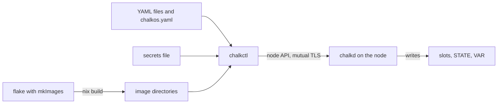

# What is chalkos

A chalkos cluster's nodes boot read-only images that Nix builds, take every setting of the
cluster from YAML documents, run a node agent instead of logins, and are upgraded by replacing the
whole image. Nix builds the images and nothing else; chalkctl delivers the images and the
documents to the nodes and never runs Nix. Most sections below link the How chalkos works page
that explains their part, and the glossary defines the terms.

The flowchart shows how the parts connect, from the flake and the YAML files to a running node.

## Nix builds images

A flake calls `chalkos.lib.mkImages`, which builds one image per
variant and platform. A
variant, such as the lab's `node`, is a set of NixOS modules: the software its nodes run, such as
the Kubernetes release, drivers and the services of extensions. A platform, `metal` or `kvm`, adds
the console, agents and drivers of a kind of machine. Each build is an
image directory holding the raw disk image and the JSON
Schemas of the config the image accepts. One image serves control planes and workers alike, and
every node of a variant and platform boots the same bytes, so an image holds nothing about a
particular cluster or node. An image has no version: its store's
root hash identifies it, and the git revision the flake
passes to `mkImages` says which commit it was built from. The flake's `flake.lock` pins the
chalkos version. See [Your first image flake](../build/first-image.md) and
[The image](../how-it-works/node/image.md).

## YAML documents configure the nodes

Everything that differs between clusters and nodes is a node's
config: config
documents in the style of Kubernetes objects, each of a
kind such as `Node`, `Network`, `SystemDisk`, `Cluster` or
an extension's own. The inventory,
`chalkos.yaml`, names each node, the address chalkctl reaches it at, the image it runs and the files
of its documents: files every node gets, files of groups and the node's own. Its `images` name the
image directories or registry references. `imageName` says which image a node runs: the node's own,
else that of its groups, else `spec.all.imageName`.
A node's name in the inventory goes into its node certificate at install and stays its name: its
Kubernetes node name, its partition UUIDs, its recovery key and by default its hostname derive from
it. `chalkctl validate` checks every node's documents against its image's schemas without reaching
a node; chalkctl delivers them at install and with `chalkctl apply-config`, and chalkd applies them
at every boot. See [Config and the inventory](../how-it-works/node/config.md).

## The secrets file stays with the operator

`chalkctl gen secrets` writes every secret of a cluster once into the
secrets file: the OS CA
that the node API trusts, the node CA, the Kubernetes CAs
and keys, and the secret that recovery keys derive from.
It is `secrets.age`, encrypted with age, or `secrets.json` in plain text with `--plaintext`.
Images carry only its public part, which `mkImages` takes as `osCA`, and the inventory names no
secrets: chalkctl reads the file only where `--secrets` names it. People who operate nodes without
the whole file get a client file, a certificate of the
client role reader, operator or admin. See
[Security model](../how-it-works/node/security.md).

## A node starts in maintenance mode

`mkImages` also builds the installer. A machine booted from the installer, or from a disk written
with a node's image, comes up in maintenance mode and waits for `chalkctl install`, which makes it
a node of the cluster. From then on the node runs in normal mode until it is reinstalled.
[How a node works](../how-it-works/node/overview.md) follows a node through the install, its boots,
upgrades and recoveries.

## The disk holds two slots and encrypted state

A system disk holds the ESP, two
slots for the read-only store,
STATE with the node's config and certificates, and VAR for
everything the node writes, such as etcd, containerd and logs. By default STATE and VAR are LUKS2
volumes whose keys the TPM unseals only under the same Secure
Boot state. See [Storage and
encryption](../how-it-works/node/storage.md).

## One bootstrap, then nodes join on their own

`chalkctl bootstrap` starts etcd and the API server on the first control
plane, once in the life of a cluster. Every other node
joins without a command: further control planes add themselves to etcd, and
workers register with the kubelet certificate that install gave
them. The `type` of a node's `Node` document makes it a control plane or a worker. When the
`Cluster` document declares a VIP for the API server, chalkd holds
it on one healthy control plane. See [How Kubernetes runs on a node](../how-it-works/kubernetes/overview.md) and
[Kubernetes networking](../how-it-works/kubernetes/networking.md).

## chalkd is the only way in

Nodes have no SSH and no login. chalkd serves the
[node API](../reference/api.md) on TCP port 50000 over mutual TLS and accepts only clients whose
certificate chains to the OS CA; the client role in the certificate decides which methods it may
call. Status, logs, config, reboots, upgrades, etcd membership and certificate rotation all go
through it. See [Architecture](../how-it-works/node/architecture.md) and
[Security model](../how-it-works/node/security.md).

## Upgrades replace the whole image

An upgrade starts with a new build: `nix build` writes a new image directory where the inventory's
images point. `chalkctl upgrade` gives each node the image the inventory names for it. The node
writes the image into its inactive slot and boots it on trial: a boot that passes the health
check is blessed, and a node whose new image never passes falls back to the image before.
chalkctl upgrades control planes one at a time and workers in batches, and stops at the first
rollback. A Kubernetes upgrade is an image upgrade too. See [Upgrades](../how-it-works/node/upgrades.md).

## Certificates renew themselves, CAs rotate on command

Each node of a Kubernetes cluster renews its node certificate through a control plane, and control
planes renew the Kubernetes leaf certificates in place, so no certificate of a running cluster
expires unattended. A node without Kubernetes, such as a router, reports in its status when its
node certificate needs `chalkctl node renew`. A CA or key changes only when an operator runs
`chalkctl rotate`, and rotating is also how access is revoked. See [Certificates](../how-it-works/node/certificates.md).

## Where chalkos fits

chalkos suits machines that should run as appliances, on bare metal or as virtual machines under
KVM. Every node of a variant boots the same verified image, and nobody logs in to change it. An
upgrade either becomes healthy or rolls back by itself. Today its nodes run Kubernetes. It suits
teams that already describe systems in Nix, because a variant can use any NixOS module. Only the
images need Nix. chalkctl reads the YAML files and the image directories a build produced, so the
machine that installs and operates the nodes needs no Nix, an airgapped one included.

chalkos is a poor fit where a node needs hand changes or interactive logins. Today it is also a
poor fit for machines that are neither x86-64 bare metal nor KVM virtual machines. Debugging goes
through the node API and, on a Kubernetes node, a privileged pod from `kubectl debug node/<node>`.

## Compared with Talos

chalkos follows the operating model of [Talos Linux](https://www.talos.dev/): an immutable OS
without logins, managed through a mutual-TLS API with a client file of a client role (reader,
operator or admin), A/B upgrades, and a control plane that holds its virtual IP through an etcd
election. It differs where Nix changes the trade-offs:

| Topic | Talos | chalkos |
| --- | --- | --- |
| Configuration | One machine configuration per node in Talos's own YAML schema, applied through the API. | YAML documents in the style of Kubernetes objects, one kind per concern, such as `Node`, `Network`, `SystemDisk` and `Cluster`, which an inventory assigns to nodes. chalkctl and chalkd check them against the JSON Schemas the image carries, and a NixOS module in the image can declare a kind of its own. |
| Images | One image for every node, extended with signed system extensions. | One image per variant and platform, built from NixOS modules, so a GPU variant carries the GPU drivers and the others do not. The kernel is nixpkgs's, with its modules filtered per image, so the binary cache keeps working. |
| Node certificates | Control planes hold the root CA's key. | Control planes hold a node CA, an intermediate that may issue only server and client certificates. The OS CA's key stays in the secrets file. |
| Upgrades | The node pulls an installer image from a registry. | chalkctl streams an image Nix built to chalkd, or chalkd pulls it from a registry by the digest chalkctl names, and writes it into the inactive slot. |
| Maturity | Released, with images for many clouds, hypervisors and boards. | Unreleased; bare metal and KVM on x86-64. |

## Compared with NixOS

A NixOS machine changes in place: `nixos-rebuild` builds a new generation into the writable
`/nix/store` on the machine and switches to it. A chalkos node has neither a Nix daemon nor
`switch-to-configuration`. Its store is a read-only erofs file system that dm-verity checks block
by block. Its root is a tmpfs and its `/etc` is read-only, so the running system is exactly the
image that was built and signed. A change to its software becomes a new image. chalkd writes it
into the inactive slot and boots it with boot counting, and a boot that does not become healthy
returns to the image before without anyone at the console.

The module system stays from NixOS. A variant's modules are ordinary NixOS modules, so services,
kernel settings and packages are declared as on any NixOS machine. The cost is that every change
to a node's software is an image upgrade with a reboot. Only a node's config changes without one:
hostname, network, labels, taints, storage, time servers, the cluster's Kubernetes settings and
extension documents.
