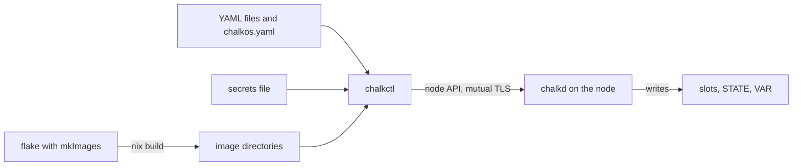

# chalkos in five minutes

A chalkos cluster's nodes boot read-only images that Nix builds, take every setting of the
cluster from YAML documents, run a node agent instead of logins, and are upgraded by replacing the
whole image. Nix builds the images and nothing else; chalkctl delivers the images and the
documents to the nodes and never runs Nix. Each section below ends with the concept page that
explains its part; the [glossary](../reference/glossary.md) defines the terms.

The flowchart shows how the parts connect, from the flake and the YAML files to a running node.

## Nix builds images

A flake calls `chalkos.lib.mkImages`, which builds one [image](../reference/glossary.md#image) per
[variant](../reference/glossary.md#variant) and [platform](../reference/glossary.md#platform). A
variant, such as the lab's `node`, is a set of NixOS modules: the software its nodes run, such as
the Kubernetes release, drivers and the services of extensions. A platform, `metal` or `kvm`, adds
the console, agents and drivers of a kind of machine. Each build is an
[image directory](../reference/glossary.md#image-directory) holding the raw disk image and the JSON
Schemas of the config the image accepts. One image serves control planes and workers alike, and
every node of a variant and platform boots the same bytes, so an image holds nothing about a
particular cluster or node. An image has no version: its store's
[root hash](../reference/glossary.md#root-hash) identifies it, and the git revision the flake
passes to `mkImages` says which commit it was built from. The flake's `flake.lock` pins the
chalkos version. See [Variants and platforms](../concepts/variants.md) and
[The image](../concepts/image.md).

## YAML documents configure the nodes

Everything that differs between clusters and nodes is a node's
[config](../reference/glossary.md#config): [config
documents](../reference/glossary.md#config-document) in the style of Kubernetes objects, each of a
[kind](../reference/glossary.md#kind) such as `Node`, `Network`, `SystemDisk`, `Kubernetes` or
an extension's own. The [inventory](../reference/glossary.md#inventory),
`chalkos.yaml`, names each node, the address chalkctl reaches it at, the image it runs and the files
of its documents: files every node gets, files of groups and the node's own. Its `images` name the
image directories, and `image` on a node, on a group or for every node says which one a node runs.
`chalkctl validate` checks every node's documents against its image's schemas without reaching a
node; chalkctl delivers them at install and with `chalkctl apply-config`, and chalkd applies them at
every boot. chalkctl reads only these files and the image directories, so a machine without Nix, an
airgapped one included, manages the cluster. See [Config and the inventory](../concepts/config.md).

## The secrets file stays with the operator

`chalkctl gen secrets` writes every secret of a cluster once into the
[secrets file](../reference/glossary.md#secrets-file): the [OS CA](../reference/glossary.md#os-ca)
that the node API trusts, the [node CA](../reference/glossary.md#node-ca), the Kubernetes CAs
and keys, and the secret that [recovery keys](../reference/glossary.md#recovery-key) derive from.
It is `secrets.age`, encrypted with age, or `secrets.json` in plain text with `--plaintext`.
Images carry only its public part, which `mkImages` takes as `osCA`, and the inventory names no
secrets: chalkctl reads the file only where `--secrets` names it. People who operate nodes without
the whole file get a [client file](../reference/glossary.md#client-file), a certificate of the
[client role](../reference/glossary.md#client-role) reader, operator or admin. See
[Security model](../concepts/security.md).

## A node starts in maintenance mode

`mkImages` also builds the [installer](../reference/glossary.md#installer): a raw image and an ISO
that install images of every platform. A machine booted from the installer, or a disk written with a
node's image, comes up in [maintenance mode](../reference/glossary.md#maintenance-mode): chalkd
serves a self-signed certificate and prints its fingerprint and the node's addresses on the console.
`chalkctl install` checks that fingerprint and sends the node its config, its certificates and its
share of the secrets, plus the image the inventory names for the node when the node runs the
installer. chalkd partitions the disk, seals [STATE](../reference/glossary.md#state) to the
[TPM](../reference/glossary.md#tpm), marks the node installed and reboots it into [normal
mode](../reference/glossary.md#normal-mode). See [Architecture](../concepts/architecture.md).

## The disk holds two slots and encrypted state

A system disk holds the [ESP](../reference/glossary.md#esp), two
[slots](../reference/glossary.md#slot) for the read-only [store](../reference/glossary.md#store),
STATE with the node's config and certificates, and [VAR](../reference/glossary.md#var) for
everything the node writes, such as etcd, containerd and logs. By default STATE and VAR are LUKS2
volumes whose keys the TPM unseals only under the same [Secure
Boot](../reference/glossary.md#secure-boot) state. See [Storage and
encryption](../concepts/storage.md).

## One bootstrap, then nodes join on their own

`chalkctl bootstrap` starts etcd and the API server on the first
[control plane](../reference/glossary.md#control-plane), once in the life of a cluster. Every
other node joins without a command: further control planes add themselves to etcd, and
[workers](../reference/glossary.md#worker) register with the kubelet certificate that install
gave them. The `type` of a node's `Node` document makes it a control plane or a worker. When the
cluster's `Kubernetes` document declares a [VIP](../reference/glossary.md#vip) for the API server,
chalkd holds it on one healthy control plane. See
[Kubernetes on chalkos](../concepts/kubernetes.md) and [Networking](../concepts/networking.md).

## chalkd is the only way in

Nodes have no SSH and no login. [chalkd](../reference/glossary.md#chalkd) serves the
[node API](../reference/api.md) on TCP port 50000 over mutual TLS and accepts only clients whose
certificate chains to the OS CA; the client role in the certificate decides which methods it may
call. Status, logs, config, reboots, upgrades, etcd membership and certificate rotation all go
through it. See [Architecture](../concepts/architecture.md) and
[Security model](../concepts/security.md).

## Upgrades replace the whole image

An upgrade starts with a new build: `nix build` writes a new image directory where the inventory's
images point. `chalkctl upgrade` streams each node the image the inventory names for it, with the
node's config, and chalkd writes it into the inactive slot. The node checks the config against the
new image's schemas before the image becomes its next boot, then reboots into it with [boot
counting](../reference/glossary.md#boot-counting): a boot that passes the [health
check](../reference/glossary.md#health-check) is [blessed](../reference/glossary.md#blessed-boot),
and an image that uses up its tries, three by default, without one gives way to the image before.
chalkctl upgrades control planes one at a time and workers in batches, and stops at the first
[rollback](../reference/glossary.md#rollback). A Kubernetes upgrade is an image upgrade too. See
[Upgrades](../concepts/upgrades.md) and [Boot, health and
rollback](../concepts/boot-and-rollback.md).

## Certificates renew themselves, CAs rotate on command

Each node renews its [node certificate](../reference/glossary.md#node-certificate) through a
control plane, which signs it with the node CA, and control planes renew the Kubernetes leaf
certificates in place, so no certificate of a running cluster expires unattended. A CA or key
changes only when an operator runs `chalkctl rotate`, which replaces it in
[rotation](../reference/glossary.md#rotation) phases that keep every node reachable; rotating is
also how access is revoked. See [Certificates](../concepts/certificates.md).
