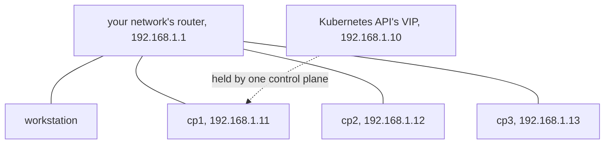

# Build a cluster on real machines

This tutorial builds a Kubernetes cluster of three control planes on three real machines, from
the `cluster-metal` template. Each machine has one Ethernet port on your network and a static IPv4
address. The Kubernetes API answers at a VIP, a fourth address that one control plane holds at a
time. You generate the cluster's secrets, take the image and the installer from a chalkos release
or build your own, find each machine's disk and port, install the three machines and bootstrap the
cluster. Plan an afternoon; the installs take most of it, and the first build of your own image
adds an hour or so.

## What you build

The three nodes sit on your network beside the workstation. The network's router gives the
installer an address by DHCP. Each installed node then takes the static address its file names:



| Use | Address in the template |
| --- | --- |
| The network and its router, the nodes' gateway and DNS server | `192.168.1.0/24` and `192.168.1.1` |
| cp1, cp2 and cp3 | `192.168.1.11`, `192.168.1.12` and `192.168.1.13` |
| The Kubernetes API's VIP | `192.168.1.10` |

You replace these with free addresses of your own network in
[Choose the addresses](#choose-the-addresses). The three nodes are control planes, and they run
workloads too. etcd keeps its quorum while one of them is down, so the Kubernetes API stays up
during an upgrade.

## Before you begin

You need:

- three amd64 machines with UEFI firmware, a TPM 2.0 and an Ethernet port each, and a disk each
  that holds the system region of about 7.4 GiB and room for etcd and the containers' images; the
  [requirements](../get-started/requirements.md) list the rest;
- a network with a DHCP server, and four IPv4 addresses on it that the DHCP server does not hand
  out;
- a USB stick of at least 1 GiB;
- a workstation on that network, an x86-64 Linux machine with
  [Nix](https://nixos.org/download/) and flakes enabled, and git;
- an age key or an SSH key of type ed25519 or RSA to encrypt the cluster's secrets to.

### The published image or your own

The steps that differ between the two paths show a tab for each. Pick one before you start:

- The published image is the Kubernetes image for physical machines that a chalkos
  [release](../get-started/releases.md) publishes, `ghcr.io/trevex/chalkos/kubernetes-1.37-metal`,
  with the release's installer. You build nothing, and each machine pulls the image from the
  registry while it installs, so it needs a route and DNS to `ghcr.io`. The image and the
  installer carry no OS CA and no Secure Boot signature.
- Your own image is the template's `node-metal`, which you build with Nix, with your own
  installer. Both carry the cluster's OS CA, and you can sign both for Secure Boot. Build your own
  when the cluster needs Secure Boot, an extension, a package or an option of its own.

Without an OS CA, a machine that waits in the installer accepts any client until you install it,
so another machine on the network could install it first. On a network that only you use, that
does not matter; on a shared network, build your own.
[Published images or your own](../get-started/decisions.md#published-images-or-your-own) explains
the choice.

### Secure Boot is optional

The tutorial installs the machines without Secure Boot, with the unsigned image and installer.
Turn Secure Boot off in each machine's firmware setup. With your own image, the steps marked
optional add Secure Boot with keys of your own:
[Sign the image and the installer](#sign-the-image-and-the-installer-optional)
and [Enrol the Secure Boot keys](#enrol-the-secure-boot-keys-optional). A machine whose firmware is
in Setup Mode gets the keys from chalkctl. For any other machine, enrol the db certificate in its
firmware as
[Enrol the certificate without Setup Mode](../operate/secure-boot.md#enrol-the-certificate-without-setup-mode)
describes before you install it. The published image always runs without Secure Boot.

Without Secure Boot, the TPM still unlocks the disks at every boot. It seals their keys to PCR 7,
which then measures Secure Boot as off, so a machine that boots another system from a USB stick
unlocks them too. The encryption then protects a disk taken out of its machine, and no longer the
machine itself.

Decide before you install a machine. Turning Secure Boot on later changes PCR 7: the machine then
asks for its recovery key at every boot until you install it again.
[Decisions before you install](../get-started/decisions.md) lists this choice with the others the
template makes for you.

## Prepare the files

Create a directory for the cluster and initialise it from the template:

<!-- x-release-please-start-version -->
```console
$ mkdir cluster && cd cluster
$ nix flake init -t github:trevex/chalkos/v0.3.0#cluster-metal
wrote: "/home/alice/cluster/.gitignore"
wrote: "/home/alice/cluster/README.md"
wrote: "/home/alice/cluster/chalkos.yaml"
wrote: "/home/alice/cluster/cluster/cluster.yaml"
wrote: "/home/alice/cluster/cluster"
wrote: "/home/alice/cluster/flake.nix"
wrote: "/home/alice/cluster/nodes/cp1.yaml"
wrote: "/home/alice/cluster/nodes/cp2.yaml"
wrote: "/home/alice/cluster/nodes/cp3.yaml"
wrote: "/home/alice/cluster/nodes"
```
<!-- x-release-please-end -->

Nix reads a flake from the files git tracks, so put them under git:

```sh
git init && git add .
```

Run every later command in `cluster`. The files explain themselves in comments:

| File | Holds |
| --- | --- |
| `flake.nix` | Your own image `node-metal` with the Kubernetes layer, the installer, and the development shell. |
| `chalkos.yaml` | The inventory: the three nodes, the address chalkctl reaches each at, their image and files. |
| `cluster/cluster.yaml` | The Kubernetes cluster all three nodes share, with its VIP and its pinned images. |
| `nodes/cp1.yaml` to `nodes/cp3.yaml` | Each node's disk, MAC address and static address. |

### Get the tools

The flake's shell holds chalkctl and chalkbuild of the chalkos revision that `flake.lock` pins,
with kubectl and jq. Enter it; the first run writes `flake.lock`:

```sh
nix develop
```

Run every later command of this tutorial in that shell, so that chalkctl and the image come from
the same chalkos release: the release whose tag the flake's `chalkos` input names, which is the
release of the published image you take too.

The diagnostic `addresses`, which shows a machine's ports, prints JSON, as `ip -json address show`
does. Keep a jq filter in the shell that turns it into a line per port, with the port's name, MAC
address, state and addresses beyond the link:

```sh
ports='.[] | [.ifname, .address, .operstate,
  ([.addr_info[] | select(.scope == "global") | .local] | join(" "))] | @tsv'
```

### Generate the cluster's secrets

The secrets file holds the cluster's CAs and keys. Generate it with
[`chalkctl gen secrets`](../reference/cli/chalkctl_gen_secrets.md), encrypted to your key and to
a backup key that you keep offline:

```console
$ chalkctl gen secrets --recipient "$(cat ~/.ssh/id_ed25519.pub)" \
    --recipient age1nmrqj76cqyf4ft8xtczufd3mtdk0xf2j7tevgwnzjp3zq9tffu3slx5eux
encrypted secrets.age to ssh-ed25519 AAAAC3NzaC1lZDI1NTE5AAAAIKMcR1DCFPGSdWXphQ3We8UmkMp2KdufUzVxxC6Hvo9k alice@workstation, age1nmrqj76cqyf4ft8xtczufd3mtdk0xf2j7tevgwnzjp3zq9tffu3slx5eux
wrote secrets.age and secrets.pub.json
```

The `age1` recipient here stands for your offline backup key's public key.

=== "Published image"

    The published image and the release's installer carry no OS CA, so a machine that waits in
    the installer accepts any client. Each node gets the cluster's OS CA at its install, and
    accepts only the cluster's clients from then on.

=== "Your own image"

    `flake.nix` names `secrets.pub.json` in the `osCA` of `mkImages` already. The image and the
    installer therefore carry the cluster's OS CA, and a machine that waits in the installer
    accepts only a chalkctl that holds this cluster's secrets.

### Choose the addresses

The template's addresses fit a network of `192.168.1.0/24` whose router is `192.168.1.1`. Pick
four free addresses of your network outside its DHCP server's range: one for each node and one for
the VIP. When your network has another prefix, such as `192.168.10.0/24`, replace the template's
throughout:

```sh
grep -rlF 192.168.1. --exclude-dir=.git . | xargs sed -i 's/192\.168\.1\./192.168.10./g'
```

Check the result in three places, and change what differs on your network:

- `chalkos.yaml` names the address chalkctl reaches each node at.
- `cluster/cluster.yaml` names the VIP in `vip.addresses` and in the `endpoint`.
- Each node's `Network` document in `nodes/` gives its static address, the prefix length, the
  gateway and the DNS server. The address must be the one `chalkos.yaml` names for the node.

### Commit the files

Commit the files, `flake.lock`, `secrets.age` and `secrets.pub.json` included, so the cluster
keeps the same chalkos revision and secrets:

```sh
git add . && git commit -m "A chalkos cluster"
```

The template's `.gitignore` keeps the builds, the Secure Boot keys and the kubeconfig out of git.

## Get the image and the installer

=== "Published image"

    Copy the reference of `kubernetes-1.37-metal` with its digest from the notes of the release
    whose tag `flake.nix` names, and name it as the source of `node-metal` in `chalkos.yaml`. The
    digest pins the image, so the inventory keeps naming the same image even when a tag moves:

    ```yaml title="chalkos.yaml"
    apiVersion: chalkctl.chalkos.dev/v1alpha1
    kind: Inventory
    metadata: {name: cluster}
    spec:
      images:
        node-metal: {source: {oci: "ghcr.io/trevex/chalkos/kubernetes-1.37-metal:<tag>@sha256:<digest>"}}
      all: {imageName: node-metal, files: [cluster/*.yaml]}
      nodes:
        cp1: {address: 192.168.1.11, files: [nodes/cp1.yaml]}
        cp2: {address: 192.168.1.12, files: [nodes/cp2.yaml]}
        cp3: {address: 192.168.1.13, files: [nodes/cp3.yaml]}
    ```

    `<tag>` is the release's tag, such as the one in `flake.nix`, and `<digest>` the image's
    digest from the release notes. [Verify an image](../get-started/releases.md#verify-an-image)
    checks the image's signature with cosign before you commit the change:

    ```sh
    git commit -am "Run the published image"
    ```

    Download the installer, `chalkos-installer.iso`, from the same release, and check it against
    the release's `SHA256SUMS` and signature, as
    [Download chalkctl and the installer](../get-started/releases.md#download-chalkctl-and-the-installer)
    shows. The installer carries no config of any node.

=== "Your own image"

    Build the image where the inventory expects it, and the installer:

    ```console
    $ nix build .#node-metal -o images/node-metal
    $ nix build .#installer -o installer
    $ ls installer/
    chalkos-installer.iso  chalkos-installer.iso.json  chalkos-installer.raw  metadata.json  repart-output.json
    ```

    The first build takes a while. The image carries the Kubernetes layer; the installer carries
    no config of any node.

### Sign the image and the installer (optional)

Skip this step with the published image, or without Secure Boot. With your own image and Secure
Boot, create your Secure Boot keys in `keys/`, and sign copies of both builds with the db key:

```sh
chalkctl secureboot new keys --name cluster
chalkbuild sign --key keys/db.key --cert keys/db.crt images/node-metal images/node-metal-signed
chalkbuild sign --key keys/db.key --cert keys/db.crt installer installer-signed
```

The template's `.gitignore` keeps the `.key` files out of git. Keep a backup of `keys/` offline:
whoever holds its keys decides what the machines boot. Point the inventory's image at the signed
copy in `chalkos.yaml`:

```yaml title="chalkos.yaml"
apiVersion: chalkctl.chalkos.dev/v1alpha1
kind: Inventory
metadata: {name: cluster}
spec:
  images:
    # chalkbuild sign writes the signed copy of the build here.
    node-metal: {source: {directory: images/node-metal-signed}}
  all: {imageName: node-metal, files: [cluster/*.yaml]}
  nodes:
    cp1: {address: 192.168.1.11, files: [nodes/cp1.yaml]}
    cp2: {address: 192.168.1.12, files: [nodes/cp2.yaml]}
    cp3: {address: 192.168.1.13, files: [nodes/cp3.yaml]}
```

### Write the installer to a USB stick

Write the installer's ISO to the USB stick:

=== "Published image"

    ```sh
    sudo dd if=chalkos-installer.iso of=/dev/<usb-disk> \
      bs=4M conv=fsync status=progress
    ```

=== "Your own image"

    ```sh
    sudo dd if=installer/chalkos-installer.iso of=/dev/<usb-disk> \
      bs=4M conv=fsync status=progress
    ```

    With Secure Boot, write the signed copy, `installer-signed/chalkos-installer.iso`, instead.

`<usb-disk>` is the stick's device, such as `sdb`; `lsblk` lists the candidates. The command
overwrites everything on the stick. The installer takes an address by DHCP on every Ethernet port
and keeps the kernel's names for the ports.

## Install the nodes

Install cp1, cp2 and cp3 one after another, with the same steps. The steps show cp1.

### Boot the installer

Cable the machine's port to the network and boot it from the USB stick through the firmware's
boot menu. Once chalkd runs, the screen shows the console. Its header keeps chalkd's fingerprint
on screen, and the address the DHCP server gave the port:

```text
nixos  installer  up 1m
image 81bd81bd81bd
installer: chalkctl install installs nodes from here
fingerprint <fingerprint>
addresses 192.168.1.57
```

Note the address and the fingerprint, 64 hex characters. chalkctl reaches a node at its address
in `chalkos.yaml`, so put the installer's address there as cp1's for now, and the commands below
need no `--address`:

```yaml title="chalkos.yaml"
    cp1: {address: 192.168.1.57, files: [nodes/cp1.yaml]}
```

The commands check the machine's certificate with `--fingerprint`. When reading the console is
impractical, pass `--insecure` in place of `--fingerprint`. chalkctl then accepts any certificate
and prints the fingerprint it saw, as
`chalkctl: the node's certificate fingerprint is <fingerprint>`. Compare it with the console when
you can.

### Enrol the Secure Boot keys (optional)

Skip this step with the published image, without Secure Boot, or when the machine's firmware
holds your db certificate already. When its firmware is in Setup Mode, as after you clear its keys
in the firmware setup, it boots the installer without checking it. Enrol your keys with
[`chalkctl secureboot enroll`](../reference/cli/chalkctl_secureboot_enroll.md), which names no
node, so it takes the address with `--address`:

```console
$ chalkctl secureboot enroll --keys keys --address=192.168.1.57 --fingerprint=<fingerprint> \
    --secrets=secrets.age
...
the node reboots with Secure Boot enforced
chalkctl: the node's certificate fingerprint is now <new fingerprint>; compare it with the node's console and install with --fingerprint <new fingerprint>
Secure Boot is on; install the node with chalkctl install
```

The machine reboots into the installer, now with Secure Boot on; pick the USB stick in the boot
menu if it boots something else. chalkd makes a new certificate at that boot: use the new
fingerprint from here on. When the machine's network card carries an option ROM, the node refuses
the keys and names it: add `--option-roms` to enrol its digest.

### Find the disk and the port

List the machine's disks with [`chalkctl disks`](../reference/cli/chalkctl_disks.md):

```sh
chalkctl disks cp1 --fingerprint=<fingerprint> --secrets=secrets.age
```

It prints a line per disk with its device, size, type, model, serial number, WWN and use. The
installer's own stick shows the use `boot`. Pick the disk for the system, and find its path below
`/dev/disk/by-id`, which stays the same across boots. For an NVMe disk it is
`nvme-<model>_<serial>`, and for a SATA disk `ata-<model>_<serial>`, with each space of the model
as an underscore. When the path is in doubt, select the disk by its serial number instead, with
`disk: {serial: <serial>}` in place of `path`. The installer refuses a disk that holds data.

The diagnostic `addresses`, which
[`chalkctl node diag`](../reference/cli/chalkctl_node_diag.md) runs, lists the ports, and the jq
filter of "Get the tools" puts each on a line:

```sh
chalkctl node diag cp1 --fingerprint=<fingerprint> --secrets=secrets.age addresses \
  | jq -r "$ports"
```

The port that shows the installer's address is the one on your network. Note its MAC address, the
second column. A port that shows `DOWN` has no carrier: check its cable.

### Adapt the node's file

`nodes/cp1.yaml` holds everything that differs between the nodes:

```yaml title="nodes/cp1.yaml"
--8<-- "templates/cluster-metal/nodes/cp1.yaml"
```

Put your disk's path into the `SystemDisk`, and the port's MAC address into the `match` of the
`Network` document. The `Network` gives that port the node's static address, so the port keeps it
whatever name the kernel gives it. The `Node` document makes the node a control plane. It names no
interface for the VIP, so the node adds the VIP to the port that holds its address while it is the
VIP's holder.

Check the files against the image with
[`chalkctl validate`](../reference/cli/chalkctl_validate.md):

```sh
chalkctl validate
```

It prints a line per node, and names the document and field of each mistake.

### Install

Install the node with [`chalkctl install`](../reference/cli/chalkctl_install.md), at the
installer's address, which `chalkos.yaml` names for now:

```sh
chalkctl install cp1 --secrets=secrets.age --fingerprint=<fingerprint>
```

chalkctl prints the disk and the image it installs, with the image directory it sends or, for the
published image, the reference the installer pulls the image from. The installer then needs its
route and DNS to `ghcr.io`. Then chalkctl prints that the node is installed and reboots, and how
to read its recovery key. When the installer refuses the
disk because it holds data, check in `chalkctl disks` that the disk is the one you mean, and
install again with `--wipe-disk`. The installer then clears the disk, and nothing on it can be
recovered.

The node reboots into its image and takes its static address. Remove the USB stick once the
console's header shows `normal`, and put the node's own address back into `chalkos.yaml`, where
chalkctl reaches it from now on:

```yaml title="chalkos.yaml"
    cp1: {address: 192.168.1.11, files: [nodes/cp1.yaml]}
```

Until the bootstrap, the `kubernetes controlplane` line of
[`chalkctl status`](../reference/cli/chalkctl_status.md) says that the node is waiting for
bootstrap or for the cluster at the VIP:

```sh
chalkctl status cp1 --secrets=secrets.age
```

Repeat the steps for cp2 and cp3, each with its own file and the address its installer shows.

## Bootstrap Kubernetes

Once the three nodes wait, bootstrap one of them with
[`chalkctl bootstrap`](../reference/cli/chalkctl_bootstrap.md), and write a kubeconfig with
[`chalkctl kubeconfig`](../reference/cli/chalkctl_kubeconfig.md):

```sh
chalkctl bootstrap cp1 --secrets=secrets.age
```

Then write a kubeconfig:

```console
$ chalkctl kubeconfig --secrets=secrets.age
wrote kubeconfig; its certificate is valid for 8760h0m0s
```

The bootstrap starts etcd and the control plane on cp1. cp1 then wins the election for the VIP and
adds it to its port. cp2 and cp3 find the cluster at the endpoint and join etcd one after the
other. Pulling the components' images takes most of the bootstrap's time.

## Check that it worked

List the nodes through the VIP:

```sh
export KUBECONFIG=$PWD/kubeconfig
kubectl get nodes
```

The three nodes show `Ready`. A node may show `NotReady` for the first minute, until flannel runs
on it. `kubectl get nodes -o wide` shows each node's static address as `INTERNAL-IP`.

`chalkctl status` shows which control plane holds the VIP. Its `kubernetes controlplane` line shows
`vip holder`, and that of the other two `vip standby`:

```sh
chalkctl status cp1 --secrets=secrets.age
```

To see the VIP move, reboot its holder with `chalkctl node reboot cp1 --secrets=secrets.age`.
chalkctl drains cp1 and keeps etcd's quorum while it reboots. Another control plane wins the
election and announces the VIP once the old holder's lease of 10 seconds runs out. `kubectl get
nodes` then answers again.

## Change things later

To change the cluster, change its files, validate them, and deliver them to the nodes whose config
changes:

```sh
chalkctl validate
chalkctl apply cp1 cp2 cp3 --secrets=secrets.age
```

A new chalkos release takes a new image. Change the tag in the `chalkos` input's URL of
`flake.nix` and update the flake's lock with `nix flake update chalkos`. Enter the shell again, so
that chalkctl matches the image. chalkctl upgrades the control planes one at a time, so the
Kubernetes API stays up:

=== "Published image"

    Name the new release's image by its digest in `chalkos.yaml`, as in
    [Get the image and the installer](#get-the-image-and-the-installer), and roll it out with
    `chalkctl upgrade`. Each node pulls the image from the registry:

    ```sh
    chalkctl validate
    chalkctl upgrade --secrets=secrets.age
    ```

=== "Your own image"

    Build the image again, sign it again with Secure Boot, and roll it out with
    `chalkctl upgrade`. A change to `flake.nix` takes the same steps:

    ```sh
    nix build .#node-metal -o images/node-metal
    chalkctl upgrade --secrets=secrets.age
    ```

To move from the published image to your own, build it as the tab "Your own image" of
[Get the image and the installer](#get-the-image-and-the-installer) shows, point `node-metal` in
`chalkos.yaml` at the build, and upgrade. The nodes keep their config and their OS CA.

## Troubleshooting

### The installer shows no address

The port has no cable or no carrier, or the network's DHCP server gives the port no address.
Check the cable and the switch port, and that the DHCP server serves the machine's network.

### chalkctl does not reach the installed node

The node took another address than the one `chalkos.yaml` names. Check the address in the
console's header. When the MAC address of the node's `Network` document is not the port's, the
image runs DHCP on the port instead, and the header shows the address DHCP gave it. Correct the
MAC address in the node's file, and deliver the file to that address:

```sh
chalkctl config apply cp1 --secrets=secrets.age --address=<address>
```

Keep the address in `chalkos.yaml` and in the node's `Network` the same, because chalkctl never
reads it from the node's config.

### The Kubernetes API does not answer at the VIP

The VIP's holder announces it with gratuitous ARP on its port. Check that no other machine of the
network uses the VIP's address, and that the address lies outside the DHCP server's range.
`chalkctl status` on each node shows which one holds it.

## What next

- [Status, logs and the console](../operate/status-and-logs.md) reads the rest of `chalkctl status`.
- [Run a highly available control plane](../kubernetes/ha-control-plane.md) explains the VIP's
  election, and how to replace a control plane.
- [Upgrade nodes](../operate/upgrade.md) and [Change a node's config](../operate/change-config.md)
  cover the cluster's next changes.
- [Recurring tasks](../operate/recurring-tasks.md) lists what to back up and renew over the
  cluster's life.
- [Your first image flake](../build/first-image.md) and
  [Release your own images](release-your-images.md) build your own images and push them
  to a registry of your own, from which the nodes pull them as they pull the published one.

These pages explain the steps of this tutorial in more depth:

- [Set up your workstation](../operate/workstation.md) explains the secrets file, its backup and
  the client files.
- [Sign images for Secure Boot](../build/sign-images.md#create-the-keys) and
  [Enrol Secure Boot keys](../operate/secure-boot.md) cover the keys, a failed enrolment and the
  cards' option ROMs.
- [The console on the machine's screen](../operate/console.md) describes what the installer shows.
- [Install a node](../operate/install.md) covers a disk that holds data and an install that
  stopped.
- [Bootstrap and get a kubeconfig](../kubernetes/bootstrap.md) explains each step of the bootstrap.
