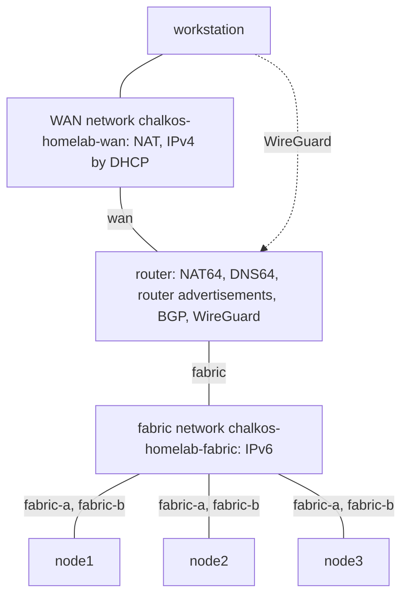

# Build a home lab

This tutorial builds the home lab of the
[homelab example](https://github.com/trevex/chalkos/tree/main/examples/homelab) as libvirt VMs on
your workstation: a router and up to three Kubernetes control planes behind it, on an IPv6 fabric
of their own. The example's `vm/vm.sh` creates the VMs with the ports and disks the example's files
name, so you install them with the files as they are. You install the router and the nodes from
the installer on a virtual USB stick, bootstrap the cluster, and test two failures: a node keeps
its address when one of its cables is pulled, and the Kubernetes API stays up when one control
plane goes down. Plan an afternoon; most of it goes into the first image builds and the installs.

The same files run on real machines. Notes titled "On real hardware" say what changes at each step:
the ports' MAC addresses, the disks' serials and the router's address on your home network.

The lab builds its own images with Nix rather than run the published ones, so that the images and
the installer carry the cluster's OS CA and can be signed for Secure Boot.
[Published images or your own](../get-started/decisions.md#published-images-or-your-own) compares
the two paths.

!!! info "An advanced IPv6 and BGP setup"

    The lab's BGP fabric, IPv6-only nodes, NAT64 and WireGuard tunnel show the router layer and
    the Kubernetes layer's BGP speaker together; a home network does not need them. This guide
    covers what differs from
    [Build a cluster on real machines](cluster-on-machines.md), which has one network, IPv4 and no
    router of chalkos. That guide explains the steps this one shares with it in more depth.

## What you build

The router connects the WAN network to the fabric, which holds the router's second port and both
ports of each node. libvirt NATs the WAN network to your workstation's uplink. The workstation
reaches the router at its address on the WAN network, and the fabric through a WireGuard tunnel to
the router.



Every address of the fabric comes from one unique local /48, `fdc8:a1b2:c3d4::/48` in the example.
You replace it with a random /48 of your own in [Prepare the files](#prepare-the-files).

| Use | Prefix or address |
| --- | --- |
| The fabric, which the router advertises | `fdc8:a1b2:c3d4:1::/64` |
| The router on the fabric: resolver and the BGP neighbour of each node's `fabric-a` | `fdc8:a1b2:c3d4:1::1` |
| The router's second address on the fabric: the BGP neighbour of each node's `fabric-b` | `fdc8:a1b2:c3d4:1::2` |
| node1, node2 and node3, each on its dummy interface `node0` | `fdc8:a1b2:c3d4:ff::11`, `::12` and `::13` |
| The Kubernetes API's VIP | `fdc8:a1b2:c3d4:ff::10` |
| The WireGuard tunnel: the router and the workstation | `fdc8:a1b2:c3d4:f0::1` and `::2`, in `fdc8:a1b2:c3d4:f0::/64` |
| NAT64 prefix | `64:ff9b::/96` |
| AS numbers | 65000 for the router, 65001 for every node |
| The WAN network and the workstation on it | `192.168.246.0/24` and `192.168.246.1` |
| The router on the WAN network | `192.168.246.2`, the network's static lease for the router's `wan` port |

The fabric carries IPv6 alone. The router's advertisements give every port on the fabric an address
by SLAAC, a default gateway, the resolver and the NAT64 prefix. The resolver answers a name that has
only IPv4 addresses with addresses in `64:ff9b::/96`, and the NAT64 carries connections to them to
the IPv4 internet, out of the router's `wan` port. A node's own address is a /128 on its dummy
interface `node0`. FRR, the BGP speaker of the nodes' image, announces it to the router over a
session on each port, each to one of the router's two addresses on the fabric, and the control
plane that holds the API's VIP announces the VIP the same way. The router then has two equal paths
to each address. When a cable or port fails, BFD ends that port's session within about a second,
and the router forwards over the other port. In the other direction, networkd uses the default
gateway from the surviving port's advertisements when a port loses carrier. The installer and
installed nodes reach the workstation and the IPv4 internet before BGP comes up. Traffic between
nodes' routed addresses passes through the router, so the cluster still depends on the router.

## Before you begin

You need:

- an x86-64 Linux workstation with KVM and about 6 GiB of free memory for the router and one node,
  or 14 GiB for the router and three nodes;
- system libvirt (`qemu:///system`) with `virsh`, OVMF, the UEFI firmware for QEMU, and swtpm, the
  TPM emulator, and your user in the `libvirt` group, so that it manages the VMs without sudo; on
  NixOS, `virtualisation.libvirtd.enable` and `virtualisation.libvirtd.qemu.swtpm.enable` provide
  them;
- room in libvirt's storage pool `default`, `/var/lib/libvirt/images`, for disks that grow to
  32 GiB for the router and 64 GiB for each node;
- [Nix](https://nixos.org/download/) with flakes enabled, git, and WireGuard's tools `wg` and
  `wg-quick` from your distribution;
- an age key or an SSH key of type ed25519 or RSA to encrypt the cluster's secrets to;
- optionally virt-manager, which shows a VM's screen.

!!! note "On real hardware"

    You need four amd64 machines with UEFI firmware, a TPM 2.0 and two Ethernet ports each, a disk
    of at least 16 GiB for the router and a larger one for each node, which holds the containers'
    images and etcd; the [requirements](../get-started/requirements.md) list the rest. You also need
    an unmanaged switch with at least seven ports, a USB stick of at least 1 GiB, and a home router
    that hands out IPv4 addresses by DHCP and reserves an address for a MAC address. Your home
    network takes the place of the WAN network, the switch that of the fabric, and the workstation
    sits on the home network.

### Secure Boot is optional

The guide installs the lab without Secure Boot, with the unsigned images and installer. Decide
before you create the VMs: `vm/vm.sh create --secure-boot` gives them UEFI firmware with Secure Boot
in Setup Mode, which accepts your keys from `chalkctl secureboot enroll`. Turning Secure Boot on
after the install changes PCR 7, and the node then asks for its recovery key at every boot until
you install it again. The steps marked "with Secure Boot" add it.

## Prepare the files

The example is part of the chalkos repository. Copy it into a repository of your own, and put it
under git, because Nix reads a flake from the files git tracks:

```sh
git clone https://github.com/trevex/chalkos
cp -r chalkos/examples/homelab homelab
cd homelab
git init && git add .
```

Run every later command in `homelab`. The example's files explain themselves in comments:

| File | Holds |
| --- | --- |
| `flake.nix` | Builds `router-metal`, `node-metal` and the installer. |
| `chalkos.yaml` | The inventory: the four nodes, the address chalkctl reaches each at, their images and files. |
| `router/router.yaml` | The router's ports, disk, firewall, resolver, BGP and WireGuard. |
| `router/nat64.yaml` | The router's NAT64, the fabric's way to the IPv4 internet. |
| `router/secrets.yaml` | The router's WireGuard key and BGP password. |
| `cluster/cluster.yaml` | The Kubernetes cluster that all three nodes share. |
| `bgp/fabric.yaml`, `bgp/secrets.yaml` | The nodes' ports, their BGP sessions with the router, and the password. |
| `nodes/node1.yaml` to `nodes/node3.yaml` | Each node's ports, disk, address and BGP speaker. |
| `chalkos-air-gapped.yaml`, `air-gapped/` | The lab without internet access, an optional variant near the end of this tutorial. |
| `vm/vm.sh` | Creates and runs the VMs; `vm/vm.sh help` lists its commands. |

### Get the tools

The flake's shell holds chalkctl and chalkbuild of the chalkos revision that `flake.lock` pins,
with kubectl, jq, openssl, wg, arp-scan, nc, crane and yq. Lock the flake's chalkos input and
enter the shell:

```sh
nix flake lock
nix develop
```

Run every later command of this tutorial in that shell, so that chalkctl and the images come from
the same chalkos release. `vm/vm.sh` uses your workstation's libvirt, which the shell leaves on the
path.

The diagnostic `addresses`, which shows a machine's ports, prints JSON, as `ip -json address show`
does. Keep a jq filter in the shell that turns it into a line per port, with the port's name, MAC
address, state and addresses beyond the link:

```sh
ports='.[] | [.ifname, .address, .operstate,
  ([.addr_info[] | select(.scope == "global") | .local] | join(" "))] | @tsv'
```

### Generate the cluster's secrets

Generate the secrets file and issue yourself a client file with the operator role, as
[Generate the cluster's secrets](cluster-on-machines.md#generate-the-clusters-secrets) and
[Issue your client file](cluster-on-machines.md#issue-your-client-file) describe. Then give the
images and the installer the cluster's OS CA, so that a machine waiting for its install accepts
only your chalkctl. Add the line to the arguments of `chalkos.lib.mkImages` in `flake.nix`:

```nix
osCA = ./secrets.pub.json;
```

Without it, any machine on the WAN network could install the router while it waits in the
installer.

### Choose your own prefix

Generate the first 48 bits of a unique local prefix, and replace the example's in every file:

```sh
set -- $(od -An -N5 -tu1 /dev/urandom)
ula=$(printf 'fd%02x:%x:%x' "$1" $(($2 * 256 + $3)) $(($4 * 256 + $5)))
echo "$ula"
grep -rlF fdc8:a1b2:c3d4 --exclude-dir=.git . | xargs sed -i "s/fdc8:a1b2:c3d4/$ula/g"
```

The command prints a prefix such as `fd3b:99df:9be2`. The rest of this tutorial shows the example's
`fdc8:a1b2:c3d4`; read yours in its place.

### Make the WireGuard keys and the BGP password

Make a key pair for the router and one for the workstation. The example's `.gitignore` keeps the
private keys, `*.key`, out of git, as it keeps the images, the installer and the kubeconfig:

```sh
(umask 077 && wg genkey | tee router.key | wg pubkey > router.pub)
(umask 077 && wg genkey | tee workstation.key | wg pubkey > workstation.pub)
```

Replace the example's keys: the router's private key goes into `router/secrets.yaml`, and the
workstation's public key into the `WireGuardPeer` of `router/router.yaml`:

```sh
sed -i "s|uBjWXU2Bu/LvLVRo+dtAte3VHt75d9W7DPxsEhZrm24=|$(cat router.key)|" router/secrets.yaml
sed -i "s|cK0R7bvqvEfk07xvf9i71Jj0ATJEGaKZ3gs1zBXr1m0=|$(cat workstation.pub)|" router/router.yaml
```

The router and the nodes share one BGP password, in `router/secrets.yaml` and `bgp/secrets.yaml`.
Replace the example's with a random one in both:

```sh
sed -i "s/example-password/$(openssl rand -hex 16)/" router/secrets.yaml bgp/secrets.yaml
```

The two files now hold real secrets in plain text. Keep the repository private, or keep the two
files out of it.

## Build the images and the installer

Build the two images the inventory names where it expects them, and the installer:

```console
$ git add .
$ nix build .#router-metal -o images/router-metal
$ nix build .#node-metal -o images/node-metal
$ nix build .#installer -o installer
$ ls installer/
chalkos-installer.iso  chalkos-installer.iso.json  chalkos-installer.raw  metadata.json  repart-output.json
```

The first build takes a while. The router's image carries the router layer and no Kubernetes; the
nodes' image carries Kubernetes and its BGP speaker, FRR. The installer holds no config of a node:
it takes addresses on every Ethernet port, by DHCP and from router advertisements, and keeps the
kernel's names for the ports. `vm/vm.sh` plugs its raw image, `chalkos-installer.raw`, into a VM
as a USB stick.

With Secure Boot, create your keys in `keys/` and sign copies of the three builds with the db key:

```sh
chalkctl secureboot new keys --name homelab
chalkbuild sign --key keys/db.key --cert keys/db.crt images/router-metal images/router-metal-signed
chalkbuild sign --key keys/db.key --cert keys/db.crt images/node-metal images/node-metal-signed
chalkbuild sign --key keys/db.key --cert keys/db.crt installer installer-signed
```

Then point the images of `chalkos.yaml` and `chalkos-air-gapped.yaml` at the signed copies,
`images/router-metal-signed` and `images/node-metal-signed`. Keep a backup of `keys/` offline:
whoever holds its keys decides what the machines boot.

!!! note "On real hardware"

    Write the installer's ISO, `installer/chalkos-installer.iso` or its signed copy, to the USB
    stick, as
    [Write the installer to a USB stick](cluster-on-machines.md#write-the-installer-to-a-usb-stick)
    describes.

## Create the VMs

Create the lab's networks and VMs:

```sh
vm/vm.sh create --nodes 3
```

`vm/vm.sh` uses system libvirt, `qemu:///system`, and checks first that it has OVMF and swtpm. It
defines the two networks, starts them and marks them to start with libvirt. It defines the router
and the nodes, switched off, each with UEFI firmware, a TPM 2.0, an empty disk and virtio network
ports. The MACs and the disk serials are those the example's files select:

| VM | Memory, vCPUs, disk | Ports | Disk serial |
| --- | --- | --- | --- |
| router | 2 GiB, 2, 32 GiB | `wan` `02:00:00:00:01:01` on the WAN network, `fabric` `02:00:00:00:01:02` on the fabric | `chalkos-router` |
| node1 | 4 GiB, 4, 64 GiB | `fabric-a` `02:00:00:00:11:01` and `fabric-b` `02:00:00:00:11:02`, both on the fabric | `chalkos-node1` |
| node2, node3 | as node1 | as node1, with `12` and `13` in place of `11` | `chalkos-node2`, `chalkos-node3` |

`--nodes 1` or `--nodes 2` creates fewer nodes; run `create` again with a larger number to add the
others later, which leaves the existing VMs as they are. The inventory lists node1 to node3 all the
same. With fewer nodes, skip the steps for the missing ones and leave them out of every command
that names nodes. The test of the VIP in [Check BGP and failover](#check-bgp-and-failover) needs
three. `vm/vm.sh status` shows the VMs' states and disks.

## Install the router

The router goes first, because the nodes' installers take their addresses from its advertisements
on the fabric.

### Boot the installer

Plug the installer in as a USB stick, start the router and open its serial console:

```sh
vm/vm.sh insert router
vm/vm.sh start router
vm/vm.sh console router
```

The stick comes second in the boot order, after the empty system disk, so the firmware boots the
installer. With Secure Boot, insert the signed copy with
`vm/vm.sh insert router installer-signed/chalkos-installer.raw` instead. Ctrl+] leaves the console.
Its header shows chalkd's fingerprint, 64 hex characters, and the address the WAN network's DHCP
server gave the `wan` port:

```text
nixos  installer  up 1m
image 81bd81bd81bd
installer: chalkctl install installs nodes from here
fingerprint <fingerprint>
addresses 192.168.246.2
```

The WAN network leases `192.168.246.2` to the router's MAC, the address `chalkos.yaml` names for
the router, so the commands below need no `--address`. They check the machine's certificate with
`--fingerprint`.

### Enrol the Secure Boot keys (optional)

Skip this step without Secure Boot. The VM's firmware is in Setup Mode, so it boots the signed
installer without checking it. Enrol your keys with
[`chalkctl secureboot enroll`](../reference/cli/chalkctl_secureboot_enroll.md):

```sh
chalkctl secureboot enroll --keys keys --address=192.168.246.2 --fingerprint=<fingerprint> \
  --option-roms --secrets=secrets.age
```

`--option-roms` adds the digests of the option ROMs the firmware loaded to db, here those of the
virtio network ports. The router reboots into the installer with Secure Boot on, and chalkd makes a
new certificate: use the new fingerprint that chalkctl and the console print from here on.

!!! note "On real hardware"

    Clear the machine's Secure Boot keys in its firmware setup, which puts it into Setup Mode,
    and boot the signed installer from the USB stick. Then run the same command, with the
    installer's address. The node names any option ROM db would not allow;
    [Enrol the Secure Boot keys](cluster-on-machines.md#enrol-the-secure-boot-keys-optional) in
    the cluster guide describes the choices.

### Install

`router/router.yaml` names the ports by their permanent MAC addresses in two `Link` documents,
which rename them to `wan` and `fabric` at the installed router's first boot, and selects the
system disk by its serial:

```yaml title="router/router.yaml"
apiVersion: networkd.chalkos.dev/v1alpha1
kind: Link
metadata: {name: 10-wan}
spec:
  match: {permanentMACAddress: "02:00:00:00:01:01"}
  link: {name: wan}
---
apiVersion: networkd.chalkos.dev/v1alpha1
kind: Link
metadata: {name: 10-fabric}
spec:
  match: {permanentMACAddress: "02:00:00:00:01:02"}
  link: {name: fabric}
---
apiVersion: storage.chalkos.dev/v1alpha1
kind: SystemDisk
metadata: {name: system}
spec:
  disk: {serial: chalkos-router}
```

Every other document names the ports `wan` and `fabric`.
[`chalkctl disks`](../reference/cli/chalkctl_disks.md) shows the disk with that serial:

```console
$ chalkctl disks router --fingerprint=<fingerprint>
DEVICE    SIZE  TYPE  MODEL          SERIAL          WWN  USE
/dev/sda  32G   hdd   QEMU HARDDISK  chalkos-router
...
```

Check the files against the images, and install the router:

```console
$ chalkctl validate
...
$ chalkctl install router --secrets=secrets.age --fingerprint=<fingerprint>
installing router onto serial "chalkos-router" from /home/alice/homelab/images/router-metal: chalkos <image>, sending <size> of store, hash tree, UKI and boot loader
router is installed and reboots
chalkctl recovery-key router prints the key that unlocks it when its TPM fails
```

`chalkctl validate` prints a line per node, and names the document and field of each mistake. The
router reboots into its image, renames its ports and takes `192.168.246.2` on `wan` again. Unplug
the stick once the console's header shows `normal`:

```sh
vm/vm.sh eject router
```

When `eject` says the router has not released the stick yet, run it again. The installer refuses a
disk that holds data; `--wipe-disk` replaces it, as
[Replace what a disk holds](../operate/install.md#replace-what-a-disk-holds) describes. To install
a VM again, insert the stick, start the VM and press Esc while the firmware starts: its boot
manager lists the stick, which comes after the installed disk in the boot order.

!!! note "On real hardware"

    Cable one of the router's ports to the home network and the other to the switch, and boot the
    router from the USB stick. The console shows the address the home router's DHCP server gave
    the installer; pass it to each command with `--address=<address>` until the install. The
    `addresses` diagnostic lists the ports: the one with that address is `wan`, the other one
    `fabric`. Put their MAC addresses into the two `Link` documents, and the serial of the system
    disk, which `chalkctl disks` shows, into the `SystemDisk`:

    ```sh
    chalkctl node diag router --address=<address> --fingerprint=<fingerprint> addresses \
      | jq -r "$ports"
    ```

    On a plain port, without a bond or a VLAN, the current MAC address the diagnostic shows is
    the permanent one. Reserve an IPv4 address for the `wan` port's MAC on the home router; the
    installed router takes it.

### Check the router

`chalkctl status` reaches the router at its address in the inventory:

```console
$ chalkctl status router
...
bgp: no sessions
nat64:
  INSTANCE  SESSIONS  BINDINGS  POOL TCP  POOL UDP  POOL ICMP
  nat64     0         0         4535      4535      4535
resolver: running
...
```

The router runs its config, its NAT64 and its resolver. It has no BGP session yet, because no
node runs. The `addresses` diagnostic shows the renamed ports, `wan` with its lease and `fabric`
with its two addresses, `fdc8:a1b2:c3d4:1::1` and `::2`:

```console
$ chalkctl node diag router addresses | jq -r "$ports"
lo	00:00:00:00:00:00	UNKNOWN
wan	02:00:00:00:01:01	UP	192.168.246.2
fabric	02:00:00:00:01:02	UP	fdc8:a1b2:c3d4:1::2 fdc8:a1b2:c3d4:1::1
wg0		UNKNOWN	fdc8:a1b2:c3d4:f0::1
...
```

## Connect the workstation

The workstation reaches the fabric through the router's WireGuard interface `wg0`. Its config for
wg-quick holds the workstation's private key, so create the file readable by root alone first:

```sh
sudo install -m 600 /dev/null /etc/wireguard/homelab.conf
```

Then write the config into it, with the workstation's private key and the router's public key:

```ini title="/etc/wireguard/homelab.conf"
[Interface]
PrivateKey = <contents of workstation.key>
Address = fdc8:a1b2:c3d4:f0::2/64

[Peer]
PublicKey = <contents of router.pub>
Endpoint = 192.168.246.2:51820
AllowedIPs = fdc8:a1b2:c3d4::/48
PersistentKeepalive = 25
```

`AllowedIPs` sends the whole /48 through the tunnel, and nothing else: the workstation reaches the
internet as before. Keep `PersistentKeepalive`: every config delivery to the router sets its
WireGuard peers anew, and the router reaches the workstation again only once the workstation sends
a packet. Bring the tunnel up and ping the router's fabric address:

```console
$ sudo wg-quick up homelab
$ ping -c 3 fdc8:a1b2:c3d4:1::1
PING fdc8:a1b2:c3d4:1::1 (fdc8:a1b2:c3d4:1::1) 56 data bytes
64 bytes from fdc8:a1b2:c3d4:1::1: icmp_seq=1 ttl=64 time=0.612 ms
...
```

The diagnostic `wireguard` shows the router's side of the tunnel, with the workstation's latest
handshake. The public keys are the example's; yours are those of `router.pub` and
`workstation.pub`:

```console
$ chalkctl node diag router wireguard interface=wg0
interface: wg0
  public key: N1efwZV4rLKHLJQIeOXqOmCOlJVUhEnnXMOqRPH2L0k=
  private key: (hidden)
  listening port: 51820

peer: cK0R7bvqvEfk07xvf9i71Jj0ATJEGaKZ3gs1zBXr1m0=
  endpoint: 192.168.246.1:41641
  allowed ips: fdc8:a1b2:c3d4:f0::2/128
  latest handshake: 9 seconds ago
  transfer: 1.02 KiB received, 892 B sent
```

!!! note "On real hardware"

    The router's address is the reservation on your home router. Put it in place of
    `192.168.246.2` in `chalkos.yaml`, `chalkos-air-gapped.yaml` and the `Endpoint` above.

## Install the nodes

Install node1, node2 and node3 one after another, with the same steps.

### Boot the installer

Plug the installer in, start the node and open its console, as for the router:

```sh
vm/vm.sh insert node1
vm/vm.sh start node1
vm/vm.sh console node1
```

The router's advertisements give each port an address of the fabric's prefix, made from the port's
MAC address, and the console's header shows both:

```text
nixos  installer  up 1m
image 81bd81bd81bd
installer: chalkctl install installs nodes from here
fingerprint <fingerprint>
addresses fdc8:a1b2:c3d4:1:0:ff:fe00:1101 fdc8:a1b2:c3d4:1:0:ff:fe00:1102
```

The header shows no link-local address. A port without an address of the fabric has no link, or
the router sends no advertisements: [Troubleshooting](#troubleshooting) covers both. The
workstation reaches the installer over the tunnel. `chalkos.yaml` names node1's own address, which
the node takes only once installed, so pass the installer's with `--address`. With Secure Boot,
enrol your keys at that address as for the router, and note the new fingerprint.

### Check the node's file

`bgp/fabric.yaml`, which every node gets, configures the ports `fabric-a` and `fabric-b`: a
`Network` document for each, which takes the default gateway and other settings from the router's
advertisements, and a `BGPPeer` for each, which announces the node's address and the VIP to the
router. `nodes/node1.yaml` holds everything that differs between the nodes:

```yaml title="nodes/node1.yaml"
--8<-- "examples/homelab/nodes/node1.yaml"
```

The two `Link` documents give the ports the names `bgp/fabric.yaml` uses, by the MAC addresses of
node1's VM, and the `SystemDisk` selects the disk by its serial. `node0` is a dummy interface that
holds the node's address, `fdc8:a1b2:c3d4:ff::11`, which no cable can take away. The `Node`
document makes the node a control plane, gives Kubernetes that address as the node's address, and
names `node0` as the interface the node adds the API's VIP to while it holds it. The `BGPSpeaker`
gives FRR the node's AS number and router ID and announces the addresses of `node0`. node2 and
node3 differ in their MACs, disk serial, address, `::12` and `::13`, and router ID, `0.0.0.12` and
`0.0.0.13`. Each node needs an address and a router ID of its own, and the address in its `Network`
and `Node` documents is the one `chalkos.yaml` names for it.

!!! note "On real hardware"

    Cable both of the node's ports to the switch and boot it from the USB stick. Put the ports'
    MAC addresses, which the `addresses` diagnostic shows, into the node's `Link` documents, and
    its disk's serial from `chalkctl disks` into its `SystemDisk`. Which port is `fabric-a` does
    not matter. A node without a screen shows no address and fingerprint: the router's neighbour
    table lists the installer's ports, each with the fabric address it takes from its link-local
    one. Boot one node at a time, so the new lines are its own, and reach the installer with
    `--insecure` in place of `--fingerprint`:

    ```sh
    chalkctl node diag router neighbours \
      | jq -r '.[] | select(.dev == "fabric" and (.dst | startswith("fe80::")))
          | [.lladdr, (.dst | ltrimstr("fe80::") | split(":") | [range(4 - length) | "0"] + .
            | "fdc8:a1b2:c3d4:1:" + join(":"))] | @tsv'
    ```

### Install

Validate the files and install the node at the installer's address:

```sh
chalkctl validate
chalkctl install node1 --secrets=secrets.age \
  --address=fdc8:a1b2:c3d4:1:0:ff:fe00:1101 --fingerprint=<fingerprint>
```

chalkctl prints the lines that the router's install printed. The node reboots into its image,
brings up `node0` and starts FRR, whose sessions announce the node's address to the router. Unplug
the stick once the console's header shows `normal`:

```sh
vm/vm.sh eject node1
```

chalkctl reaches the node at its own address from now on. Until the bootstrap, its status shows that
it waits:

```console
$ chalkctl status node1
...
kubernetes controlplane: waiting for the cluster at https://[fdc8:a1b2:c3d4:ff::10]:6443; bootstrap only the first control plane of a new cluster
...
```

Repeat the steps for node2 and node3, with the installer addresses that end in `1201` and `1301`.

## Bootstrap Kubernetes

Once the nodes wait, bootstrap one of them and write a kubeconfig:

```console
$ chalkctl bootstrap node1 --secrets=secrets.age
bootstrapping node1; the control plane pulls its images and starts
node1 is bootstrapped; applied 19 objects
$ chalkctl kubeconfig --secrets=secrets.age
wrote kubeconfig; its certificate is valid for 24h0m0s
```

The bootstrap starts etcd and the control plane on node1. node1 then wins the election for the VIP,
adds `fdc8:a1b2:c3d4:ff::10` to `node0`, and FRR announces it. node2 and node3 find the cluster at
the endpoint and join etcd one after the other. Pulling the images through the NAT64 takes most of
the bootstrap's time.

List the nodes through the VIP:

```console
$ export KUBECONFIG=$PWD/kubeconfig
$ kubectl get nodes
NAME    STATUS   ROLES    AGE   VERSION
node1   Ready    <none>   4m    v1.37.2
node2   Ready    <none>   2m    v1.37.2
node3   Ready    <none>   1m    v1.37.2
```

A node may show `NotReady` for the first minute, until flannel runs on it. `kubectl get nodes -o
wide` shows each node's address, its /128 on `node0`, as `INTERNAL-IP`. The three nodes are
control planes and run workloads too. `chalkctl status` without a node prints a line per node of
the inventory; a node whose VM you did not create shows as `unreachable`:

```console
$ chalkctl status
NODE    IMAGE    BOOT     CONFIG       PROBLEMS
router  <image>  healthy  inventory's  0
node1   <image>  healthy  inventory's  0
node2   <image>  healthy  inventory's  0
node3   <image>  healthy  inventory's  0
```

The nodes reach the IPv4 internet through the router. The diagnostic `dns-query` asks the node's
resolver, the router's, for the name `ipv4only.arpa`, which has IPv4 addresses alone; DNS64 answers
with addresses in the NAT64's prefix:

```console
$ chalkctl node diag node1 dns-query name=ipv4only.arpa type=AAAA
...
;; ANSWER SECTION:
ipv4only.arpa.	3600	IN	AAAA	64:ff9b::c000:ab
ipv4only.arpa.	3600	IN	AAAA	64:ff9b::c000:aa
...
$ chalkctl node diag node1 tcp-connect address=64:ff9b::101:101 port=443
connected to 64:ff9b::101:101 port 443
```

`64:ff9b::101:101` is the IPv4 address `1.1.1.1` in the NAT64's prefix. Pods resolve names through
CoreDNS, which asks the same resolver, so they reach IPv4-only hosts by their names too.

## Check BGP and failover

### The sessions

Each node runs a session on each port, to the router's address that the port's `BGPPeer` names.
The diagnostic `bgp-summary` of the nodes' image shows them as FRR's `show bgp summary` prints
them, a line for each of the router's addresses, `fdc8:a1b2:c3d4:1::1` and `fdc8:a1b2:c3d4:1::2`.
A session that is up shows the number of prefixes received where a session that is down shows its
state. The IPv4 section shows both sessions as `NoNeg`, because the router's peer `nodes` carries
IPv6 alone. `bfd-peers` shows the BFD session that watches each:

```sh
chalkctl node diag node1 bgp-summary
chalkctl node diag node1 bfd-peers
```

The router accepts a session from every address of the fabric, and `chalkctl status` lists them
under its peer `nodes`, each with the address of a node's port:

```console
$ chalkctl status router
...
bgp:
  VRF      PEER   NEIGHBOR                         STATE        UPTIME  RECEIVED  SENT  BFD
  default  nodes  fdc8:a1b2:c3d4:1:0:ff:fe00:1101  Established  12m4s   2         0     up
  default  nodes  fdc8:a1b2:c3d4:1:0:ff:fe00:1102  Established  12m3s   2         0     up
  default  nodes  fdc8:a1b2:c3d4:1:0:ff:fe00:1201  Established  9m40s   1         0     up
  default  nodes  fdc8:a1b2:c3d4:1:0:ff:fe00:1202  Established  9m40s   1         0     up
  default  nodes  fdc8:a1b2:c3d4:1:0:ff:fe00:1301  Established  7m12s   1         0     up
  default  nodes  fdc8:a1b2:c3d4:1:0:ff:fe00:1302  Established  7m11s   1         0     up
...
```

Each node sends its address on each session, and the holder of the VIP the VIP as well, so node1
shows 2 routes received. The router sends zero BGP routes. The routes to the nodes' addresses have
two next hops each, one per port:

```console
$ chalkctl node routes router fdc8:a1b2:c3d4:ff::/64
DESTINATION                TYPE     PROTOCOL  TABLE  METRIC  NEXT HOPS
fdc8:a1b2:c3d4:ff::10/128  unicast  bgp       254    20      fe80::ff:fe00:1101 on fabric (weight 1), fe80::ff:fe00:1102 on fabric (weight 1)
fdc8:a1b2:c3d4:ff::11/128  unicast  bgp       254    20      fe80::ff:fe00:1101 on fabric (weight 1), fe80::ff:fe00:1102 on fabric (weight 1)
...
```

### Pull a cable

Start a ping of node1's address from the workstation in a second terminal, and pull the cable of
node1's port `fabric-a`:

```sh
ping fdc8:a1b2:c3d4:ff::11
vm/vm.sh link node1 a down
```

Within about a second, BFD ends the session on that port: `bgp-summary` on node1 shows a state in
place of that session's count of received prefixes, the router's `bgp:` table loses the port's
session, and the route to node1 keeps one next hop. The ping goes on, losing a packet or two at
most. Plug the cable back in, and the session comes back within seconds:

```sh
vm/vm.sh link node1 a up
```

### Take the VIP's holder down

This test needs three nodes: a cluster of one or two control planes loses etcd's quorum while one
reboots. `chalkctl status` shows which control plane holds the VIP:

```console
$ chalkctl status node1
...
kubernetes controlplane: bootstrapped, node ready: True, vip holder, control plane current
...
```

The other two show `vip standby`. Reboot the holder:

```sh
chalkctl node reboot node1
```

chalkctl drains node1 and keeps etcd's quorum while it reboots. Another control plane wins the
election, adds the VIP to its `node0`, and its FRR announces it. `kubectl get nodes` answers again
once the router has the new route, within about 30 seconds. For a harder test, cut the holder's
power with `vm/vm.sh poweroff node1` instead: its sessions end within BFD's second, and the VIP
moves when its lease runs out. Start it again with `vm/vm.sh start node1`; the VIP stays with its
new holder.

!!! note "On real hardware"

    Pull one of node1's cables from the switch in place of `vm/vm.sh link`, and cut a node's
    power in place of `vm/vm.sh poweroff`.

## Change things later

To change the lab, change its files, validate them, and deliver them to the nodes whose config
changes:

```sh
chalkctl validate
chalkctl apply node1 node2 node3 --secrets=secrets.age
```

Deliver a change of the router's ports, `management` interfaces or firewall on trial, so that the
router rolls it back when chalkctl loses it:

```sh
chalkctl config apply router --try 5m --secrets=secrets.age
```

A delivery renames a router port at once when its `Link` document gives it a new name, so change
every document that names the port in the same delivery.

New images reach the lab as on any cluster: build them again, sign copies of them when the
lab uses Secure Boot, and roll them out with `chalkctl upgrade`, as
[Change things later](cluster-on-machines.md#change-things-later) in the cluster guide and
[Upgrade nodes](../operate/upgrade.md) describe. While the router reboots, traffic between the
nodes' routed addresses, to the Kubernetes API and to the internet stops, so upgrade the router in
a step of its own. Name the nodes, so that the upgrade reaches only the VMs you created:

```sh
chalkctl upgrade node1 node2 node3 --secrets=secrets.age
chalkctl upgrade router --secrets=secrets.age
```

The VMs keep running until you stop them. `vm/vm.sh shutdown <vm>` shuts one down, and
`vm/vm.sh start <vm>` starts it again; start the router first. `vm/vm.sh cleanup` deletes the whole
lab: the VMs with their disks, firmware variables and TPMs, and both networks. The files and the
secrets stay. To build the lab again, start at [Create the VMs](#create-the-vms).

## Run the lab without internet access (optional)

The example holds a variant that cuts the fabric off the internet: `chalkos-air-gapped.yaml`, its
inventory, gives the router `air-gapped/router.yaml` in place of `router/nat64.yaml`, so the router
drops its NAT64 and serves the nodes' time, and gives the nodes `air-gapped/nodes.yaml`, which
turns the cluster registry on. The workstation keeps its tunnel and its own internet access.
Follow [Build an air-gapped cluster](air-gapped.md) from
[Prepare on a connected machine](air-gapped.md#prepare-on-a-connected-machine) on, with
`CHALKOSINVENTORY=chalkos-air-gapped.yaml` and the lab's nodes in place of `cp1` to `cp3`. Deliver
the router's config with `--try 5m`, as it changes the firewall. DNS queries still leave through
the router's resolver, so the variant is no strict air gap. To connect the lab again, unset
`CHALKOSINVENTORY` and deliver the config of `chalkos.yaml` the same way.

## Troubleshooting

### A VM does not boot the installer

The firmware boots the system disk first and the stick only when the disk boots nothing. To boot
the installer on a VM that has a system, press Esc while the firmware starts, which the VM's
console shows, and pick the stick in the boot manager. After `vm/vm.sh insert`,
`vm/vm.sh status <vm>` lists the stick among the VM's disks as `sdc`.

### The router is not at 192.168.246.2

The WAN network leases `192.168.246.2` to the MAC `02:00:00:00:01:01` alone. `vm/vm.sh status`
shows the router's lease. When the router has none, check with the `addresses` diagnostic, at the
address its console shows, that the `wan` port has that MAC. A port that keeps its kernel name
means the MAC of its `Link` document is not the port's. On real hardware the home router's
reservation has to match the `wan` port's MAC; the router sends that MAC as its DHCP client
identifier.

### A node's port gets no address of the fabric

The router's advertisements give the ports their addresses. Check that the router's `fabric` port
holds `fdc8:a1b2:c3d4:1::1` with the `addresses` diagnostic, as in
[Check the router](#check-the-router). When `fabric` is missing and a port of the kernel's name
shows instead, the MAC address of the router's `Link` document is not the port's: correct it, and
deliver it with `chalkctl config apply router --try 5m`, which renames the port at once. A node
port that shows `DOWN` has no link: `vm/vm.sh link <node> a up` or `b up` plugs its cable back in.
An installed node configures only the ports named `fabric-a` and `fabric-b`: a port that keeps its
kernel name takes no address, because the MAC of the node's `Link` document is not its own.

### A BGP session does not come up

The router's `bgp:` table shows no line for a port that never connected. Without a session the
router has no route to the node's address, so chalkctl does not reach the node there. The node
still answers at its ports' addresses of the fabric, through its advertised default gateway. Each
is the fabric's prefix with the port's MAC, `fdc8:a1b2:c3d4:1:0:ff:fe00:1101` and `...:1102` for
node1; pass one with `--address`:

```sh
chalkctl node diag node1 \
  --address=fdc8:a1b2:c3d4:1:0:ff:fe00:1101 bgp-summary
```

Check, on the node:

- the ports' names: the `addresses` diagnostic shows `fabric-a` and `fabric-b`, the names that the
  `BGPPeer` documents of `bgp/fabric.yaml` list. FRR runs no session on a port of another name;
- the password: the kernel drops TCP segments whose MD5 signature does not match, so neither side
  logs a refused session. The router has no `bgp:` line for the node, and on the node
  `chalkctl node diag node1 bgp-summary` shows the sessions in `Connect` or `Active` instead of a
  count of received prefixes. Compare the passwords of `router/secrets.yaml` and
  `bgp/secrets.yaml`, which must be the same.

The router's firewall accepts BGP and BFD from the fabric by itself, and each node opens BFD's
port to its `BGPPeer`s with `bfd`.

### A name does not resolve, or a connection to the internet fails

On the router, `chalkctl status router` shows `resolver: running` and the NAT64's line. The
diagnostics `dns-query` and `nat64-sessions` show the resolver's answers and the NAT64's
connections, as [Translate to IPv4 and resolve names](../router/nat64-and-dns.md#deliver-and-check)
describes. A NAT64 connection needs the router's `wan` address and default route from the WAN
network's DHCP server.

### The tunnel has no handshake

The `wireguard` diagnostic shows no `latest handshake` for the workstation's peer. Check that the
`WireGuardPeer` holds the contents of `workstation.pub`, that the workstation's config holds the
router's public key from `router.pub`, and that its `Endpoint` is the router's address on the WAN
network. After a delivery to the router, the tunnel works again once the workstation sends;
`PersistentKeepalive` makes it send within 25 seconds.

## What next

- [Status, logs and the console](../operate/status-and-logs.md) reads the rest of `chalkctl status`.
- [Run a router](../router/index.md) covers the router's firewall, BGP, NAT64 and WireGuard.
- [Run a highly available control plane](../kubernetes/ha-control-plane.md) explains the VIP's
  election, and how to replace a control plane.
- [Announce addresses with BGP](../kubernetes/bgp.md) covers the nodes' BGP speaker: its peers,
  the default route, its diagnostics and the deliveries it refuses.
- [Write a BGP extension](bgp-extension.md) writes a BGP speaker of your own for the lab's nodes.
