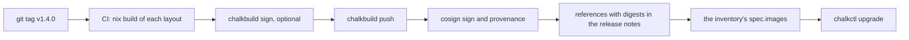

# Release your own images

This guide is for an image author whose cluster runs images of its own: with the cluster's OS CA,
signed for Secure Boot, or with extensions, packages or options of its own. It sets up a release
pipeline for them. At the end, pushing a tag `v<version>` builds every image of the cluster's
flake, pushes it to the GitHub Container Registry, signs it with cosign and attests its
provenance, and the release notes list each image by digest. The inventory names those digests,
and `chalkctl upgrade` rolls them out. A last section runs the same steps as one script, for any
CI system or a workstation.

[Published images or your own](../get-started/decisions.md#published-images-or-your-own) explains
when a cluster needs images of its own. [Publish images to a registry](../build/publish-images.md)
covers each step of this guide by hand.

## What you build

A release goes from a tag to the nodes in these steps:



The images travel as OCI images in a registry, so each node pulls its image itself on an install
or an upgrade, and the workstation sends no image over the network. The inventory names each
image by digest, so every command and every node reads exactly the image the release built, even
when a tag moves. cosign signs that digest, and anyone can check that the repository's release
workflow made it before the inventory names it.

The guide uses an example repository, `github.com/example/cluster`, whose flake builds one image,
`node-metal`, and releases it as `ghcr.io/example/node-metal`. Replace `example` with your own
GitHub user or organisation, and `cluster` with your repository.

## Before you begin

- A cluster flake in a GitHub repository, such as the `cluster-metal` template of
  [Build a cluster on real machines](cluster-on-machines.md) or the flake of
  [Your first image flake](../build/first-image.md).
- The cluster's `secrets.pub.json`, committed beside `flake.nix`, as `chalkctl gen secrets` writes
  it. The secrets file itself never enters the repository.
- For machines that enforce Secure Boot, the db key and certificate of
  [Sign images for Secure Boot](../build/sign-images.md#create-the-keys).
- Nix with flakes on the workstation, as [Requirements](../get-started/requirements.md#build-host)
  describes, and the [GitHub CLI](https://cli.github.com/) and
  [cosign](https://docs.sigstore.dev/cosign/) to check a release.

## Prepare the flake

The flake pins chalkos to a release, keeps the version of its own images in `version.nix`, records
the release's tag and commit in each image, and exposes each image's OCI layout as a package.

Pin the `chalkos` input to a release tag, not to a branch, so that a build of the same commit
always takes the same chalkos. The images, chalkctl and chalkbuild then all come from that release.

Create `version.nix`, which holds the version of the next release and nothing else:

```nix title="version.nix"
"1.4.0"
```

The release's git tag is `v` and this version, `v1.4.0`. Nix cannot read git tags, so the flake
reads the version from this file instead, and the workflow fails when the tag and the file differ.

Then build the images with `tag` and `revision`, and expose their layouts:

```nix title="flake.nix"
{
  description = "The images of the example cluster";

  inputs.chalkos.url = "github:trevex/chalkos/v0.7.1"; # x-release-please-version

  outputs =
    { self, chalkos, ... }:
    let
      system = "x86_64-linux";
      inherit (chalkos.inputs.nixpkgs) lib;
      # The release's version, whose git tag is v<version>.
      version = import ./version.nix;
      images = chalkos.lib.mkImages {
        osCA = ./secrets.pub.json;
        # The release's tag and the commit, which chalkctl shows beside an image's root hash and
        # the OCI manifest records as annotations.
        tag = "v${version}";
        revision = self.rev or self.dirtyRev or null;
        # Links each image's package in the GitHub Container Registry to the repository.
        modules = [
          {
            chalkos.imageDirectory.annotations."org.opencontainers.image.source" =
              "https://github.com/example/cluster";
          }
        ];
        images = [
          {
            name = "node-metal";
            platform = "metal";
            modules = [ chalkos.nixosModules.kubernetes ];
          }
        ];
      };
    in
    {
      # node-metal and the installer, and each image's OCI layout as <image>-oci, which the
      # release workflow builds and pushes.
      packages.${system} = {
        inherit (images) node-metal installer;
      }
      // lib.mapAttrs' (name: oci: lib.nameValuePair "${name}-oci" oci) (chalkos.lib.ociOf images);
    };
}
```

`chalkos.lib.ociOf images` returns each image's OCI layout by the image's name, so a new image in
the list gets its package `<image>-oci` without another line. The workflow releases every package
whose name ends in `-oci`.

Each image records `v1.4.0` as its tag and the commit as its revision. chalkctl shows both beside
the root hash, as in `3fa9c1e2b7d0 (v1.4.0, a1b2c3d4e5f6)`, and they become the manifest's
annotations `org.opencontainers.image.version` and `org.opencontainers.image.revision`. Neither
reaches the store, so a build of the same commit between two releases has the same root hash
under the previous tag, and its revision tells the two apart.
[`tag`](../reference/mkimages.md#tag) and [`revision`](../reference/mkimages.md#revision) describe
the arguments.

Check that the flake lists the layout:

```sh
nix eval --json .#packages.x86_64-linux --apply builtins.attrNames
```

It prints `["installer","node-metal","node-metal-oci"]`. Commit `flake.nix`, `flake.lock`,
`version.nix` and `secrets.pub.json`.

## Add the workflow

Save this workflow as `.github/workflows/release-images.yml` in the repository. It runs on every
pushed tag that starts with `v`:

```yaml title=".github/workflows/release-images.yml"
--8<-- "docs/guides/release-your-images/release-images.yml"
```

The workflow has three jobs:

| Job | Permissions | What it does |
| --- | --- | --- |
| `plan` | `contents: read` | Fails when the tag is not `v` and the version of `version.nix`, or when `flake.lock` does not lock the inputs `flake.nix` names. Lists the packages `<image>-oci` as the matrix of `image`, each with its repository `ghcr.io/<owner>/<image>`. |
| `image <name>` | `contents: read`, `packages: write`, `id-token: write`, `attestations: write` | One job per image: builds its layout, signs it for Secure Boot when the secrets exist, pushes it with `chalkbuild push`, signs the pushed digest with `cosign sign` and attests its provenance in the registry. |
| `notes` | `contents: write` | Appends each image's reference with its tag and digest to the tag's GitHub release, and creates the release when the tag has none. |

The workflow grants no permission at the top, and each job only what it uses: `packages: write`
pushes to the GitHub Container Registry, `id-token: write` gets the OIDC token that Sigstore turns
into a signing certificate, `attestations: write` stores the provenance, and `contents: write`
edits the release. The checkouts keep no credentials.

chalkbuild comes from the chalkos that `flake.lock` locks:
`nix build --inputs-from . chalkos#chalkbuild` builds the same chalkbuild as the images' chalkos,
with no version to keep in step and no download or checksum to check. Nix is installed for the
images anyway. The static `chalkbuild-linux-amd64` of a chalkos release works too, but its version
and checksum would then need updating at every chalkos release.

`chalkbuild push` prints the reference of the pushed manifest by digest, which the step compares
with the digest of the layout's `index.json`, so the job fails if the registry stored anything
else. cosign then signs that digest.

### Set up the repository

Before the first tag, set these in the repository's settings:

1. For Secure Boot, the repository secrets `DB_KEY` and `DB_CERT`, the PEM db key and certificate.
   The step writes the key to a file only it can read, signs the layout and removes the file.
   Without `DB_KEY` the step signs nothing and the job pushes the unsigned layout.
2. Optionally, a [Cachix](https://www.cachix.org/) cache: the repository variable `CACHIX_NAME`
   and the secret `CACHIX_AUTH_TOKEN`. A release then reuses what earlier builds pushed. Without
   it, every release builds all that `cache.nixos.org` does not hold, which can take an hour or so.

The workflow's `GITHUB_TOKEN` pushes the images, so the repository needs no registry credentials.
The GitHub Container Registry creates each package as private on its first push. Make it public in
the package's settings, or give the nodes credentials for it in a `Registry` document, as
[Registries and mirrors](../operate/registries.md) describes. The annotation
`org.opencontainers.image.source` links the package to the repository.

An image you publish, like a release image of chalkos, holds third-party free software under
licences such as the GNU GPL, so publishing it brings the same obligations that chalkos meets for
its own releases, as [Licences and source](../get-started/releases.md#licences-and-source)
describes. The `flake.lock` of each tag fixes the corresponding source of every component, and
`nix flake archive` of the tag fetches it. Keep the tags, and answer requests for the source for
as long as the licences require: for a written offer under the GPL, three years after each
release.

### Tag a release

Push the tag of the version in `version.nix`:

```sh
git tag v1.4.0
git push origin v1.4.0
```

A tag that a workflow creates with its own `GITHUB_TOKEN`, such as one from release-please run
with that token, starts no workflow. Push the tag yourself, or create it with a GitHub App's token.
When a job fails, "Re-run failed jobs" builds the same commit: the push sends the same digest
again, and the `notes` job replaces the section it added before.

The release notes end with a section like this one:

```text
## Images

ghcr.io/example/node-metal:v1.4.0@sha256:<digest>
```

## Pin the digests and roll out

Copy each reference into the inventory's `spec.images`, as the image's `oci` source:

```yaml title="chalkos.yaml"
apiVersion: chalkctl.chalkos.dev/v1alpha1
kind: Inventory
metadata: {name: cluster}
spec:
  images:
    node-metal: {source: {oci: "ghcr.io/example/node-metal:v1.4.0@sha256:<digest>"}}
  all: {imageName: node-metal, files: [cluster/*.yaml]}
  nodes:
    cp1: {address: 192.168.1.11, files: [nodes/cp1.yaml]}
    cp2: {address: 192.168.1.12, files: [nodes/cp2.yaml]}
    cp3: {address: 192.168.1.13, files: [nodes/cp3.yaml]}
```

The nodes pull by the digest. The tag in the reference only tells a reader which release it is.
Check each node's config against the new image, which chalkctl reads from the registry:

```sh
chalkctl validate
```

Then upgrade one node and the rest, as [Upgrade nodes](../operate/upgrade.md#upgrade-one-node-then-all)
describes:

```sh
chalkctl upgrade --nodes cp3 --secrets=secrets.age
chalkctl upgrade --secrets=secrets.age
```

A new machine installs the same image: `chalkctl install` sends the installer the reference, and
the installer pulls it, as [Install a node](../operate/install.md) describes.

The workflow could also open a pull request against the inventory with the new digests. Keep it
as a job of its own after `notes`, with `contents: write` and `pull-requests: write`, that edits
the `oci` sources with the references the `image` jobs uploaded, runs `chalkctl validate` and opens
the pull request with `gh pr create`. Such a job needs the inventory in the same repository as the
images, and it skips the moment when someone reads the release notes before the digests change.

## Verify what you pulled

cosign checks that this repository's release workflow, run on the tag, signed the digest:

```sh
cosign verify ghcr.io/example/node-metal@sha256:<digest> \
  --certificate-identity https://github.com/example/cluster/.github/workflows/release-images.yml@refs/tags/v1.4.0 \
  --certificate-oidc-issuer https://token.actions.githubusercontent.com
```

The signature is keyless: Sigstore issued its certificate to the workflow run, and the identity is
the workflow's file at the ref the run started on, here the tag `refs/tags/v1.4.0`. `cosign verify`
fails when another workflow, another tag or another repository signed the digest. To accept any
tag of the workflow, pass
`--certificate-identity-regexp '^https://github\.com/example/cluster/\.github/workflows/release-images\.yml@refs/tags/v'`
in place of `--certificate-identity`.

The GitHub CLI checks the provenance attestation, which records the commit and the run that built
the image:

```sh
gh attestation verify oci://ghcr.io/example/node-metal@sha256:<digest> --repo example/cluster
```

Both read the registry with the credentials of `docker login`, so a private package needs a login
first.

## Follow chalkos releases

A new chalkos release changes one line, the tag in the URL of the `chalkos` input.
[Renovate](https://docs.renovatebot.com/) can open a pull request for it. Its `nix` manager does
not: it updates `flake.lock` alone and leaves a tag in `flake.nix` as it is. A custom regex manager
finds the tag instead and takes new versions from the releases of `trevex/chalkos`:

```json5 title="renovate.json5"
--8<-- "docs/guides/release-your-images/renovate.json5"
```

A custom manager changes `flake.nix` and nothing else; only Renovate's own managers update lock
files, and running a command after an update, `postUpgradeTasks`, exists only when you host
Renovate yourself. The pull request therefore has a `flake.lock` that still locks the old release,
and a tag pushed on it would fail in the `plan` job, whose `nix eval --no-update-lock-file`
refuses a lock file that does not match `flake.nix`. Lock the new release on the pull request's
branch and push it:

```sh
nix flake lock
git commit -m "build(deps): lock chalkos" flake.lock
git push
```

`nix flake lock` locks again every input whose URL changed and leaves the others as they are.
A workflow on Renovate's branches can run the same commands, with a GitHub App's token so that the
push starts CI.

Before chalkos 1.0, the commands and the node API change between releases, so run the chalkctl of
the release the images come from. `nix develop` in the cluster-metal template brings that chalkctl,
since it comes from the same `chalkos` input. `chalkctl version` prints its version. Upgrade the
nodes to the images of a new chalkos release before you use the new chalkctl for anything else,
and read the release notes of every chalkos release in between.

## Release without GitHub Actions

The same steps run as one script on any CI system, or on a workstation with Nix, jq and cosign:

```sh title="release-images.sh"
--8<-- "docs/guides/release-your-images/release-images.sh"
```

Run it on a clean checkout of the tag, logged in to the registry with `docker login`:

```sh
git checkout v1.4.0
REGISTRY=registry.example.com/cluster COSIGN_KEY=cosign.key ./release-images.sh
```

| Variable | What it does |
| --- | --- |
| `REGISTRY` | The registry and path to push to; each image goes to `$REGISTRY/<image>`. Required. |
| `DB_KEY_FILE`, `DB_CERT_FILE` | The db key and certificate. When `DB_KEY_FILE` is set, the script signs each layout for Secure Boot before the push. |
| `COSIGN_KEY` | A cosign key, as `cosign generate-key-pair` writes it, that signs each pushed digest. |
| `COSIGN_KEYLESS` | `1` signs keyless instead, where the CI system has an OIDC token that Sigstore accepts, such as GitLab CI's. |

The script writes the references with their digests to `images.txt`. Check a signature made with
a key against its public key:

```sh
cosign verify --key cosign.pub registry.example.com/cluster/node-metal@sha256:<digest>
```

## Check that it worked

The tag's GitHub release lists every image by digest, and the run's summary shows the same list.
`cosign verify` and `gh attestation verify` accept each digest. `chalkctl validate` names the image
by the digest it read:

```text
cp1: valid for the image node-metal at ghcr.io/example/node-metal@sha256:<digest> (node-metal on metal, root hash <root-hash>), config <hash>
```

After the upgrade, `chalkctl status` shows the image's root hash with the release's tag and
revision on each node.

## What next

- [Test and roll out an image](../build/test-and-roll-out.md) checks an image before the nodes
  get it.
- [Sign images for Secure Boot](../build/sign-images.md) creates the db key and enrols it.
- [Registries and mirrors](../operate/registries.md) gives the nodes credentials for a private
  package, or a mirror close to them.
- [Bring the images across](air-gapped.md#bring-the-images-across) carries released images into
  an air gap.
