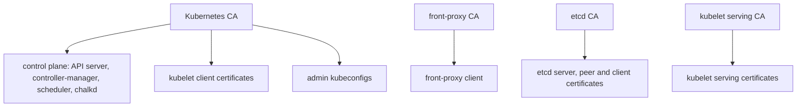

# Kubernetes certificates

A Kubernetes cluster on chalkos takes its CAs and keys from the cluster's secrets file instead of
`kubeadm init`. Each node receives its part in its Kubernetes share at install, and a control plane
issues its own certificates from the CAs in its share at every boot. The last field of a control
plane's Kubernetes line in `chalkctl status` says whether the control plane runs on them:

```text
kubernetes controlplane: bootstrapped, node ready: True, vip holder, control plane current
kubernetes versions: API server 1.37.2, kubelet 1.37.2, control-plane pods current
```

`control plane current` means that the API server and etcd serve the current certificates and the
API server answers ready.

## The CAs and keys of a cluster come from the secrets file

The secrets file holds four CAs and two keys for Kubernetes, beside the OS CA and the node CA
that [Certificates](../node/certificates.md) describes:

- the Kubernetes CA, which issues the certificates of the API server, the controllers and chalkd,
  the kubelets' client certificates, and admin kubeconfigs;
- the front-proxy CA, which issues the certificate the API server presents to aggregated API
  servers;
- the etcd CA, which issues etcd's server and peer certificates and those of its clients;
- the kubelet serving CA, which issues the kubelets' serving certificates. The API server alone
  trusts it, when it connects to a kubelet;
- the service-account key, which signs service-account tokens with ES256;
- the encryption key, with which the API server encrypts Secrets in etcd, using secretbox.

The CAs live ten years and the keys have no expiry. A control plane's share holds all of them
with their keys. A worker's share holds the certificates of the Kubernetes CA and of the kubelet
serving CA, and a kubelet client certificate. The worker uses the kubelet serving CA's certificate
only to name the issuer of its kubelet's serving certificate in its status.
[Certificates](../../reference/certificates.md) in the reference lists their lifetimes and the
status notes about them.

The CAs that grant different access must not share a key, and the secrets file is refused when
two of them do. An etcd CA that was also the Kubernetes CA would give every certificate the
Kubernetes CA issues full access to etcd. A kubelet serving CA that was also the Kubernetes CA
would let a kubelet's serving certificate pass as the API server's.

Kubeconfigs, the `kube-root-ca.crt` ConfigMap that pods read, and every other client of the API
server trust the Kubernetes CA alone. A kubelet serving certificate, even one approved by mistake,
therefore never verifies as the API server for the names it carries.

The diagram shows what each Kubernetes CA issues.



## A control plane issues its certificates at every boot

A control plane issues these certificates from the CAs in its share at every boot:

- the API server's serving certificate, which names the cluster endpoint, every VIP, the node's
  addresses and the `kubernetes` service names;
- the API server's clients of the kubelets and of etcd;
- the front-proxy client;
- etcd's server and peer certificates;
- the certificates in the kubeconfigs of the controller-manager and the scheduler.

Each lives one year. They are written to `/run/chalkos/kubernetes/pki`, a tmpfs that is mounted
into the static pods as `/etc/kubernetes/pki`, so they never reach a disk.

chalkd renews the whole set once two thirds of the lifetime of the one that expires first have
passed, and replaces the directory in one step. The previous set stays in
`/run/chalkos/kubernetes/pki.old`, because running containers keep the directory they mounted.
Each static pod carries a hash of the certificates it mounts in the annotation
`chalkos.dev/certificates`. A renewal changes the hash, so the kubelet starts each pod again on
the new files.

chalkd's own clients of the API server and of etcd are certificates it issues itself in memory,
valid for one hour and replaced at half their lifetime. The API server client is in
`system:masters`, because chalkd creates the RBAC bindings everything else depends on.

## Kubelets renew their own certificates

A kubelet authenticates with a client certificate for `system:node:<node>` in the group
`system:nodes`. A worker receives the first one in its share at install, issued for its name, and
its kubelet registers at the cluster endpoint with it. A control plane issues its own at every
boot. The kubelet renews the certificate itself, once 70 to 90% of its lifetime have passed,
through a certificate request. The controller-manager approves such a request for a node that
renews its own, through the RBAC binding chalkd applies for it.

Every kubelet also requests a serving certificate, which the API server checks when it fetches
logs or runs `kubectl exec`. The controller-manager signs it with the kubelet serving CA, and the
API server verifies it against that CA's bundle, `kubelet-serving-ca.crt`, alone. chalkd on the
control planes approves such a request when all of these hold:

- the node asks for its own name;
- the certificate is for server use only;
- its addresses are ones the node's Node object lists as internal or external IPs;
- its DNS names are the node's name or the host name its Node object lists.

A kubelet writes its Node object's addresses itself, so chalkd also refuses a request that names
an address or a name standing for the cluster or for another node:

- an address in the cluster's pod or service ranges;
- a VIP of the cluster;
- the cluster endpoint's host, a name or an address. An endpoint address is allowed when the
  cluster has no VIP: it is then the address of a control plane, whose own certificate holds it;
- the cluster domain and every name below it, every name below `.svc`, and `kubernetes` and the
  names below it, such as `kubernetes.default`;
- an address or a name that another Node object lists.

The check proves that no other node and no cluster service claims the address. It does not prove
that the node owns the address: a node can still claim an unused address of its network.

chalkd leaves every other request pending. The approver runs from the moment the API server is
ready, beside the apply of the add-ons. Both kubelet certificates live in `/var/lib/kubelet/pki`
on VAR.

A worker that lost VAR falls back to the kubelet client certificate in its share, which may have
expired since install. Its status then shows
`expired; deliver a new one with chalkctl config apply <node> --kubernetes-share`, and that command
delivers a new one:

```sh
chalkctl config apply <node> --kubernetes-share
```

## Admin kubeconfigs carry the group chalkos:cluster-admins

[`chalkctl kubeconfig`](../../reference/cli/chalkctl_kubeconfig.md) writes an admin kubeconfig from
the secrets file, for the cluster endpoint. Its client certificate is in the group
`chalkos:cluster-admins`, which chalkd's RBAC add-on binds to `cluster-admin`. It is valid for a
day unless `--ttl` says otherwise. The group is used instead of `system:masters` because RBAC can
take a group's access away, which it cannot do for `system:masters`.
[Get a kubeconfig](../../kubernetes/bootstrap.md#get-a-kubeconfig) describes its flags.

## A rotation replaces the Kubernetes CAs and keys

[`chalkctl rotate`](../../reference/cli/chalkctl_rotate.md) rotates three Kubernetes kinds in the
same four phases as the OS CA, accept, switch, refresh and finish, which
[A rotation replaces a CA in four phases](../node/certificates.md#a-rotation-replaces-a-ca-in-four-phases)
explains:

- `kubernetes-ca` replaces the Kubernetes, front-proxy, etcd and kubelet serving CAs. The kubelets
  request new serving certificates, which the new kubelet serving CA signs. The rotation pauses
  after the accept and the refresh phases.
- `service-account-key` replaces the key that signs service-account tokens. It pauses after the
  refresh.
- `encryption-key` replaces the key that encrypts Secrets in etcd. The refresh rewrites every
  encrypted object under the new key. It pauses after the refresh.

The finish has guards. A service-account key is removed only an hour after every control plane
applied the switch, by which time the kubelets have renewed the tokens of running pods. `--now`
removes it earlier and refuses the tokens not renewed yet. An encryption key is removed only once
etcd holds no object encrypted with it.

A kubeconfig holds the CA certificates it verifies the API server with, and a rotation cannot reach
it. Kubeconfigs from before a `kubernetes-ca` rotation stop verifying the API server at the switch
and are refused at the finish. Kubeconfigs issued after the accept phase carry both CAs and keep
working through the rotation and after it. They still trust the old CA after the finish, so whoever
holds the old CA's key could pose as the API server to them, until they are issued again.

Rotating `kubernetes-ca` is also how a leaked kubeconfig is revoked, and it retires every other
kubeconfig of the old CA. The default validity of a day limits how long a leak matters.
[Rotate the Kubernetes CAs and keys](../../kubernetes/rotate-kubernetes-cas.md) gives the steps.

## Revoking a node cuts off its writes and renewals

A revoked node can no longer renew its certificates or change anything in the cluster. A control
plane lists the revoked nodes in its status:

```text
revoked nodes:
  w1  since 2026-10-23T22:42:25Z
```

[`chalkctl node revoke`](../../reference/cli/chalkctl_node_revoke.md) asks a control plane to add
the node's name and the time, with the time its entry expires, to the ConfigMap
`kube-system/chalkos-revoked-nodes`, and to delete the node's Node object. The list takes effect
in three places:

- A control plane's RenewNodeCertificate refuses a certificate that names a listed node. The
  node's status shows the refusal on its node certificate:
  `renewal failing: the control plane at 192.168.100.11:50000: permission_denied: node w1 is revoked since 2026-10-23T22:42:25Z; chalkctl node unrevoke w1 lets it renew again`.
  The node's certificate has the role `node`, which allows that one method alone, so the node
  can call nothing else.
- chalkd's approver leaves the node's kubelet serving certificate requests pending.
- The ValidatingAdmissionPolicy `chalkos-revoked-nodes` denies every create, update, delete and
  connect by the user `system:node:<name>` of a listed node, on subresources too. The kubelet can
  neither register its Node again nor request a new client certificate:
  `nodes "w1" is forbidden: ValidatingAdmissionPolicy 'chalkos-revoked-nodes' with binding 'chalkos-revoked-nodes' denied request: node w1 is revoked since 2026-10-23T22:42:25Z`.

The policy takes no parameters. chalkd writes the revoked names into the policy's CEL expression
itself, and the policy fails closed. A control plane writes the policy again from the ConfigMap
after each revoke and unrevoke. Every control plane also compares the ConfigMap's resource version
with the one it last applied the policy from, about every 10 seconds, and applies the policy again
when they differ or its last apply failed. So the policy follows a ConfigMap edited by hand, or a
revocation whose apply was cancelled, within about 10 seconds. The API server that chalkctl went
through denies the node's writes within seconds. The other control planes' API servers pick up
the policy shortly after.

`chalkctl node revoke` first asks every other control plane whether it reads the revoked nodes,
and refuses while one does not answer or cannot read the list. `--skip-read-check` revokes the node anyway.

chalkctl reads the list as well. `chalkctl rotate` reads it before each phase and skips the listed
nodes, so no rotation hands a revoked node a certificate. `chalkctl node renew` and
`chalkctl config apply --kubernetes-share` refuse a listed node unless `--ignore-revoked` is given, and
`chalkctl install` refuses to install a node under a listed name unless `--ignore-revoked` is given. All
four refuse to run while no control plane says which nodes are revoked. `chalkctl rotate
--ignore-revoked` skips no node, as during an outage of the API server, and every node of the
inventory then takes part. Each of these commands refreshes the revocations afterwards, as
[A command with --ignore-revoked refreshes the revocation](#a-command-with-ignore-revoked-refreshes-the-revocation)
describes. install counts a control plane that does not answer as an
installed node as one not installed yet, so a cluster's first nodes install while the others
wait.

[`chalkctl node unrevoke`](../../reference/cli/chalkctl_node_unrevoke.md) removes the name and
applies the policy again. A node's old certificates chain to the OS CA, which chalkd trusts with
every node CA it signed, and to the Kubernetes CA. So the control plane unrevokes the node only
when every OS CA and Kubernetes CA it trusts was made after the revocation, and refuses otherwise.
`--allow-old-ca` unrevokes it anyway, and the old certificates work again until they expire. The check
compares the revocation time, taken from the control plane's clock, with the time chalkctl made
the CA, taken from the workstation's clock. The two clocks must agree: a workstation clock far
ahead can make a CA from before the revocation pass the check.

### Pruning drops entries that keep no node out

An entry keeps its node out while one of the node's certificates is valid and chains to a CA the
cluster trusts. Pruning removes an entry once neither holds, and applies the policy again. It
drops an entry in two cases:

- Every certificate of the node has expired. A revoked node renews none, so its last certificate
  was issued at the revocation at the latest, or at the entry's refresh after a command with
  `--ignore-revoked` handed it one, which sets the entry's time anew. chalkos issues node
  certificates for a year, and the controller-manager signs kubelet client certificates for its
  `cluster-signing-duration`, a year unless the Cluster's extra flags set it longer. When a
  control plane revokes a node or refreshes its entry, it stores the entry's expiry in the entry:
  the longer of the two validities after the entry's time, plus two days for a certificate signing request
  approved before that moment and signed later. With the defaults, an entry expires a year and two
  days after the revocation. A later
  revocation or refresh moves the expiry later, never earlier, so lowering the flag shortens no
  stored expiry. An entry without a stored expiry, such as one written by hand, expires by the
  flag that the control plane reads when it prunes.
- The OS CA and the Kubernetes CA that the control plane trusts were both made after the
  revocation, so none of the node's certificates chains to a trusted CA. This is the check that
  `chalkctl node unrevoke` makes.

An entry revoked at an unknown time, such as one whose time was broken by a hand edit, matches
neither case and stays until it is unrevoked.

Control planes drop no entry by themselves. Every prune goes through PruneRevoked, which chalkctl
calls once it has checked the secrets file.
[`chalkctl node prune-revoked`](../../reference/cli/chalkctl_node_prune-revoked.md) calls it to
drop the expired entries. `chalkctl rotate os-ca --finish` and `chalkctl rotate kubernetes-ca --finish`
call it through a control plane once every node confirmed the finish, and print what it dropped:

```text
dropped 1 node from the revoked nodes, which nothing lets back in: w1
the revoked nodes fill 0% of their room
```

The finish of the first of the two rotations drops no entry for the CAs, because the other CA is
still older than the revocations. When this prune fails, the finish still completes, and chalkctl warns
`the revoked nodes were not pruned: ...; once that is fixed, prune them with chalkctl node prune-revoked`.
PruneRevoked drops the entries for rotated CAs too, so call it only while no rotation runs: the
nodes apply the finish of a rotation one after another, and until every node has, one may still
trust the old CA that a revoked node's certificates chain to. With the secrets file,
`chalkctl node prune-revoked` refuses while the file records a rotation of the OS CA or the
Kubernetes CAs. A client file records no rotation, so with a client file the command
cannot tell whether one runs.

### A command with --ignore-revoked refreshes the revocation

`chalkctl node renew`, `chalkctl install`, `chalkctl config apply --kubernetes-share` and
`chalkctl rotate` hand a revoked node left in the inventory certificates or CAs when they run
with `--ignore-revoked`. Both pruning rules count from the entry's time, and a certificate issued
after it would outlive the entry. So such a command reads the list before it hands anything out,
and once it has, also when the delivery failed, has a control plane refresh the entry of each
node it found listed: RevokeNode with `refresh` sets the entry's time to now and applies the
policy again. A node listed before the hand-out and dropped from the list since, as by a prune
run meanwhile, is revoked again. When no control plane said beforehand which nodes are revoked,
the command reads the list again afterwards. rotate reads before every phase and refreshes after
it. The entry then expires a full validity after the last certificate the node got, and a CA
made before the refresh lets no prune drop it. chalkctl prints each refresh:

```text
refreshed the revocation of w1: revoked since 2026-11-27T18:00:00Z
```

`chalkctl install` reads the list as its check does: a control plane that does not answer counts
as not installed yet, so installing the cluster's first nodes refreshes nothing. A control plane
installed while no other one was bootstrapped may hold the list itself, so its refresh waits for
a later command, as below.

When the refresh fails, or no control plane says which nodes are revoked, the command fails. Its
error names the nodes and `chalkctl node revoke <node> --refresh`, which refreshes an entry by
hand. rotate keeps the phase applied. The secrets file records each revocation not refreshed
under `unrefreshedRevocations`, so the record outlasts the run:

- rotate and `chalkctl node prune-revoked` refresh the recorded revocations first, as does every
  later command run with `--ignore-revoked`, and drop those refreshed from the record.
- While the record holds a node, rotate's finish prunes nothing and
  `chalkctl node prune-revoked` refuses.
- A prune that does not read the record, as `chalkctl node prune-revoked` with a client file, may
  drop a recorded node's entry. The record notes whether the node was listed when it was handed
  certificates, and the next chalkctl command that retries the refresh revokes a node noted as
  listed again. Until then, without `--ignore-revoked`, rotate skips and names any recorded node,
  and `chalkctl node renew`, `chalkctl install` and `chalkctl config apply --kubernetes-share`
  refuse it.
- Each entry of the record carries the time chalkctl recorded it. A command clears only the
  entries it read before it refreshed, so a failure that another command records for the same
  node in the meantime stays recorded.
- `chalkctl node revoke <node> --refresh` retries the node's recorded refresh: it refreshes the
  entry, or revokes the node again when the list dropped it, and clears the record.
- `chalkctl node unrevoke <node>` drops the node from the record, also when the list dropped it
  already, so that no retry revokes it again. Unrevoke a recorded node with the secrets file: with
  the secrets file from standard input, which chalkctl cannot write back, or with a client file,
  which holds no record, the command warns that the record may still hold the node.

The secrets file from standard input records nothing: a refresh that succeeds for a recorded node
warns that the record still holds it, and the next refresh retried with the secrets file clears
it. A refresh never lists a node it did not find revoked.

A revoked node that got certificates of a new CA this way stays listed after the rotation's
finish, as the CA predates the refresh. Removing revoked nodes from the inventory before such a
command hands them nothing, and keeps the rules above as they are.

### Revocation leaves reads and the certificates valid

A revocation shuts out a node's writes and renewals. Beside the gaps that
[A node's access ends with its certificate](../node/security.md#a-nodes-access-ends-with-its-certificate)
lists for every node, it leaves these:

- The API server's admission sees writes alone. The kubelet can still read what every kubelet
  may: Services, Endpoints and EndpointSlices, and a few cluster-scoped kinds such as Nodes and
  RuntimeClasses. The Secrets and ConfigMaps of the pods bound to the node stay readable until the
  pod garbage collector deletes those pods, shortly after their Node is gone.
- A control plane's disk holds the Kubernetes CA's key beside the node CA's. Rotating `os-ca` and
  `kubernetes-ca` cuts off a revoked control plane, or a stolen copy of its disk. A former control
  plane's etcd and front-proxy certificates, and any kubelet serving certificate it signs with the
  kubelet serving CA's key, stay valid until the `kubernetes-ca` rotation has finished.
- A renewal already in flight when the revoke lands can still complete, and the node then holds a
  node certificate valid for a year. The policy still denies its kubelet's writes.
- A cluster-admin can edit or delete the ConfigMap and the policy with kubectl. Renewals follow
  the ConfigMap at once, and the policy follows it within about 10 seconds. An edited or deleted
  policy stays so until the ConfigMap changes or chalkd restarts. Deleting the ConfigMap unrevokes
  every node. Editing the ConfigMap by hand skips the checks that chalkctl node revoke and
  chalkctl node unrevoke make.
- A control plane renews node certificates only while it can read the list from its API server.
  During a long outage of the API server, renewals stop, the control plane's own included.
  `chalkctl node renew --ignore-revoked` renews a node's certificate without asking the control planes.
- A control plane that still runs a chalkd from before node revocation renews a revoked node's
  node certificate until it is upgraded. The API server denies the node's writes all the same.
  `chalkctl node revoke` refuses while such a control plane runs, unless `--skip-read-check` is given.
- The list has a size limit. The API server compiles no expression longer than 100,000
  characters, so a control plane refuses a revocation that would make the policy's map longer
  than 90,000: about 2,000 short names, or about 300 names of the longest length Kubernetes
  allows. The refusal carries the reason `REVOKED_LIST_FULL`. RevokeNode answers with the map's
  length and the limit, and `chalkctl node revoke` and `chalkctl status` warn once the list is more
  than 80% full. [Pruning drops entries that keep no node out](#pruning-drops-entries-that-keep-no-node-out)
  describes how the list shrinks.
- An entry's expiry follows `cluster-signing-duration` as the control plane reads it when it
  revokes or refreshes. A kubelet client certificate signed before the flag was lowered keeps its
  longer validity, so a node revoked while it holds one can outlast its entry. After lowering the
  flag, wait out the old validity before you prune. That includes the prune that `chalkctl rotate
  os-ca --finish` runs. Otherwise, rotate the Kubernetes CA, whose finish leaves such a certificate
  chaining to no trusted CA.
- Every rotation skips a revoked node left in the inventory, and other commands still reach it
  until it is removed from the inventory.
- The cluster registry checks no revocation list, so a revoked node's certificate still pulls
  from it until the certificate expires or `os-ca` rotates.

## The cluster registry serves the node certificate

The [cluster registry](overview.md#the-cluster-registry-serves-images-from-the-control-planes)
serves HTTPS, TLS 1.3 at least, with the node's node certificate, which names the node's static
addresses. Its endpoints are such addresses, so containerd and chalkctl verify an endpoint by the
OS CA, as they verify chalkd.

chalkos-registry runs as a user of its own, which cannot read STATE. systemd hands it copies of
`/state/chalkd/node.pem` and `/state/chalkd/ca.crt` as credentials of its unit, and the registry
reads them once as it starts. A path unit watches both files. When chalkd renews the node
certificate, or a rotation changes the OS CAs, it restarts the registry, which then serves the new
certificate. containerd passes over the endpoint to the next one while it restarts.

The registry takes a client certificate when the client offers one, and checks it per request:

- A pull, any GET or HEAD request, the catalog included, needs a certificate of the OS CA: a
  node's or a client file's of any role. containerd presents the node certificate, which the
  `hosts.toml` of each mirrored host names as `client` beside the OS CAs as `ca`, and reads both
  files again for every pull, so a renewed node certificate takes effect at the next pull
  without a restart of containerd. The registry drops an `Authorization` header from a read, so
  credentials containerd sends along mean nothing there.
- Every other request needs a client certificate of the admin role: a push, a delete, and
  garbage collection through `POST /chalkos/v1/gc`. The registry verifies the certificate against
  the OS CAs again at the time of each request, after the handshake did, and reads its role as
  chalkd does. A certificate the node CA issued is a node's, whatever its Organization, so no node
  writes.

A client certificate that does not verify against the OS CAs fails the TLS handshake, before any
request. A request without a certificate, or with one that no longer verifies when the request
comes, such as one that expired on a kept connection, gets 401; a write with a certificate of
another role gets 403. The message of a refused read starts with
`reading the registry needs a certificate of the OS CA`, that of a refused write with
`writing to the registry needs a client certificate of the admin role`. `chalkctl registry list`
reads with the client file or the secrets file like any other command. `chalkctl registry push`,
`delete` and `gc` authenticate with the one-hour admin certificate chalkctl issues from the secrets
file, or with an admin client file.

## Limits

- Nothing revokes a single kubeconfig. It works until its certificate expires or the Kubernetes CA
  is rotated.
- The approver of kubelet serving certificates checks a request against the addresses the Node
  object lists. A kubelet reports those addresses itself. The approver refuses the cluster's
  addresses and names and those of the other nodes, but a node can still claim an unused address
  of its network. Only the API server trusts such a certificate, when it connects to a kubelet.
- A control plane holds every Kubernetes CA key. Taking one over gives full access to the
  cluster's Kubernetes.

## Related pages

- [Certificates](../node/certificates.md): the OS CA, the node CA and how a rotation runs.
- [Certificates](../../reference/certificates.md) in the reference: every CA and certificate with
  its lifetime.
- [The control plane](control-plane.md): the static pods that run on these certificates.
- [Security model](../node/security.md): what a node's certificates grant and how its access ends.
- [Add and remove nodes](../../operate/add-remove-nodes.md#revoke-a-removed-node): revoking a node.
- [Rotate the Kubernetes CAs and keys](../../kubernetes/rotate-kubernetes-cas.md).
