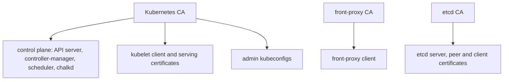

# Kubernetes certificates

A Kubernetes cluster on chalkos takes its CAs and keys from the cluster's secrets file instead of
`kubeadm init`. Each node receives its part in its Kubernetes share at install, and a control plane
issues its own certificates from the CAs in its share at every boot. The last field of a control
plane's Kubernetes line in `chalkctl status` says whether the control plane runs on them:

```text
kubernetes controlplane: bootstrapped, node ready: True, vip holder, control plane current
```

`control plane current` means that the API server and etcd serve the current certificates and the
API server answers ready.

## The CAs and keys of a cluster come from the secrets file

The secrets file holds three CAs and two keys for Kubernetes, beside the OS CA and the node CA
that [Certificates](../node/certificates.md) describes:

- the Kubernetes CA, which issues the certificates of the API server, the controllers, chalkd and
  the kubelets, and admin kubeconfigs;
- the front-proxy CA, which issues the certificate the API server presents to aggregated API
  servers;
- the etcd CA, which issues etcd's server and peer certificates and those of its clients;
- the service-account key, which signs service-account tokens with ES256;
- the encryption key, with which the API server encrypts Secrets in etcd, using secretbox.

The CAs live ten years and the keys have no expiry. A control plane's share holds all of them
with their keys. A worker's share holds the Kubernetes CA's certificate and a kubelet client
certificate. [Certificates](../../reference/certificates.md) in the reference lists their
lifetimes and the status notes about them.

The CAs that grant different access must not share a key, and the secrets file is refused when
two of them do. An etcd CA that was also the Kubernetes CA would give every certificate the
Kubernetes CA issues full access to etcd.

The diagram shows what each Kubernetes CA issues.



## A control plane issues its certificates at every boot

A control plane issues these certificates from the CAs in its share at every boot:

- the API server's serving certificate, which names the cluster endpoint, every VIP, the node's
  addresses and the `kubernetes` service names;
- the API server's clients of the kubelets and of etcd;
- the front-proxy client;
- etcd's server and peer certificates;
- the certificates in the kubeconfigs of the controller-manager and the scheduler.

Each lives one year. They are written to `/run/chalkos/kubernetes/pki`, a tmpfs that is mounted
into the static pods as `/etc/kubernetes/pki`, so they never reach a disk.

chalkd renews the whole set once two thirds of the lifetime of the one that expires first have
passed, and replaces the directory in one step. The previous set stays in
`/run/chalkos/kubernetes/pki.old`, because running containers keep the directory they mounted.
Each static pod carries a hash of the certificates it mounts in the annotation
`chalkos.dev/certificates`. A renewal changes the hash, so the kubelet starts each pod again on
the new files.

chalkd's own clients of the API server and of etcd are certificates it issues itself in memory,
valid for one hour and replaced at half their lifetime. The API server client is in
`system:masters`, because chalkd creates the RBAC bindings everything else depends on.

## Kubelets renew their own certificates

A kubelet authenticates with a client certificate for `system:node:<node>` in the group
`system:nodes`. A worker receives the first one in its share at install, issued for its name, and
its kubelet registers at the cluster endpoint with it. A control plane issues its own at every
boot. The kubelet renews the certificate itself, once 70 to 90% of its lifetime have passed,
through a certificate request. The controller-manager approves such a request for a node that
renews its own, through the RBAC binding chalkd applies for it.

Every kubelet also requests a serving certificate, which the API server checks when it fetches
logs or runs `kubectl exec`. chalkd on the control planes approves such a request when all of
these hold:

- the node asks for its own name;
- the certificate is for server use only;
- its addresses are ones the node's Node object lists.

chalkd leaves every other request pending. The approver runs from the moment the API server is
ready, beside the apply of the add-ons. Both kubelet certificates live in `/var/lib/kubelet/pki`
on VAR.

A worker that lost VAR falls back to the kubelet client certificate in its share, which may have
expired since install. Its status then shows
`expired; deliver a new one with chalkctl apply-config <node> --kubernetes-share`, and that command
delivers a new one:

```sh
chalkctl apply-config <node> --kubernetes-share
```

## Admin kubeconfigs carry the group chalkos:cluster-admins

[`chalkctl kubeconfig`](../../reference/cli/chalkctl_kubeconfig.md) writes an admin kubeconfig from
the secrets file, for the cluster endpoint. Its client certificate is in the group
`chalkos:cluster-admins`, which chalkd's RBAC add-on binds to `cluster-admin`. It is valid for one
year unless `--ttl` says otherwise. The group is used instead of `system:masters` because RBAC can
take a group's access away, which it cannot do for `system:masters`.
[Get a kubeconfig](../../kubernetes/bootstrap.md#get-a-kubeconfig) describes its flags.

## A rotation replaces the Kubernetes CAs and keys

[`chalkctl rotate`](../../reference/cli/chalkctl_rotate.md) rotates three Kubernetes kinds in the
same four phases as the OS CA, accept, switch, refresh and finish, which
[A rotation replaces a CA in four phases](../node/certificates.md#a-rotation-replaces-a-ca-in-four-phases)
explains:

- `kubernetes-ca` replaces the Kubernetes, front-proxy and etcd CAs. The kubelets request new
  serving certificates. The
  rotation pauses after the accept and the refresh phases.
- `service-account-key` replaces the key that signs service-account tokens. It pauses after the
  refresh.
- `encryption-key` replaces the key that encrypts Secrets in etcd. The refresh rewrites every
  encrypted object under the new key. It pauses after the refresh.

The finish has guards. A service-account key is removed only an hour after every control plane
applied the switch, by which time the kubelets have renewed the tokens of running pods. `--force`
removes it earlier and refuses the tokens not renewed yet. An encryption key is removed only once
etcd holds no object encrypted with it.

A kubeconfig holds the CA certificates it verifies the API server with, and a rotation cannot reach
it. Kubeconfigs from before a `kubernetes-ca` rotation stop verifying the API server at the switch
and are refused at the finish. Kubeconfigs issued after the accept phase carry both CAs and keep
working through the rotation and after it. They still trust the old CA after the finish, so whoever
holds the old CA's key could pose as the API server to them. Issue them again once the rotation is
finished.

Rotating `kubernetes-ca` is also how a leaked kubeconfig is revoked, and it retires every other
kubeconfig of the old CA. Short `--ttl` values on kubeconfigs limit how long a leak matters.
[Rotate the Kubernetes CAs and keys](../../kubernetes/rotate-kubernetes-cas.md) gives the steps.

## Limits

- Nothing revokes a single kubeconfig. It works until its certificate expires or the Kubernetes CA
  is rotated.
- The approver of kubelet serving certificates checks a request against the addresses the Node
  object lists. A kubelet reports those addresses itself, so the check stops a node from claiming
  another node's name, not from claiming an address it does not own.
- A control plane holds every Kubernetes CA key. Taking one over gives full access to the
  cluster's Kubernetes.

## Related pages

- [Certificates](../node/certificates.md): the OS CA, the node CA and how a rotation runs.
- [Certificates](../../reference/certificates.md) in the reference: every CA and certificate with
  its lifetime.
- [The control plane](control-plane.md): the static pods that run on these certificates.
- [Rotate the Kubernetes CAs and keys](../../kubernetes/rotate-kubernetes-cas.md).
