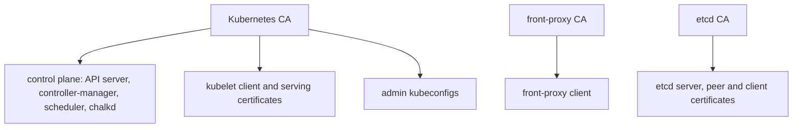

# Kubernetes certificates

A Kubernetes cluster on chalkos takes its CAs and keys from the cluster's secrets file instead of
`kubeadm init`. Each node receives its part in its Kubernetes share at install, and a control plane
issues its own certificates from the CAs in its share at every boot. The last field of a control
plane's Kubernetes line in `chalkctl status` says whether the control plane runs on them:

```text
kubernetes controlplane: bootstrapped, node ready: True, vip holder, control plane current
```

`control plane current` means that the API server and etcd serve the current certificates and the
API server answers ready.

## The CAs and keys of a cluster come from the secrets file

The secrets file holds three CAs and two keys for Kubernetes, beside the OS CA and the node CA
that [Certificates](../node/certificates.md) describes:

- the Kubernetes CA, which issues the certificates of the API server, the controllers, chalkd and
  the kubelets, and admin kubeconfigs;
- the front-proxy CA, which issues the certificate the API server presents to aggregated API
  servers;
- the etcd CA, which issues etcd's server and peer certificates and those of its clients;
- the service-account key, which signs service-account tokens with ES256;
- the encryption key, with which the API server encrypts Secrets in etcd, using secretbox.

The CAs live ten years and the keys have no expiry. A control plane's share holds all of them
with their keys. A worker's share holds the Kubernetes CA's certificate and a kubelet client
certificate. [Certificates](../../reference/certificates.md) in the reference lists their
lifetimes and the status notes about them.

The CAs that grant different access must not share a key, and the secrets file is refused when
two of them do. An etcd CA that was also the Kubernetes CA would give every certificate the
Kubernetes CA issues full access to etcd.

The diagram shows what each Kubernetes CA issues.



## A control plane issues its certificates at every boot

A control plane issues these certificates from the CAs in its share at every boot:

- the API server's serving certificate, which names the cluster endpoint, every VIP, the node's
  addresses and the `kubernetes` service names;
- the API server's clients of the kubelets and of etcd;
- the front-proxy client;
- etcd's server and peer certificates;
- the certificates in the kubeconfigs of the controller-manager and the scheduler.

Each lives one year. They are written to `/run/chalkos/kubernetes/pki`, a tmpfs that is mounted
into the static pods as `/etc/kubernetes/pki`, so they never reach a disk.

chalkd renews the whole set once two thirds of the lifetime of the one that expires first have
passed, and replaces the directory in one step. The previous set stays in
`/run/chalkos/kubernetes/pki.old`, because running containers keep the directory they mounted.
Each static pod carries a hash of the certificates it mounts in the annotation
`chalkos.dev/certificates`. A renewal changes the hash, so the kubelet starts each pod again on
the new files.

chalkd's own clients of the API server and of etcd are certificates it issues itself in memory,
valid for one hour and replaced at half their lifetime. The API server client is in
`system:masters`, because chalkd creates the RBAC bindings everything else depends on.

## Kubelets renew their own certificates

A kubelet authenticates with a client certificate for `system:node:<node>` in the group
`system:nodes`. A worker receives the first one in its share at install, issued for its name, and
its kubelet registers at the cluster endpoint with it. A control plane issues its own at every
boot. The kubelet renews the certificate itself, once 70 to 90% of its lifetime have passed,
through a certificate request. The controller-manager approves such a request for a node that
renews its own, through the RBAC binding chalkd applies for it.

Every kubelet also requests a serving certificate, which the API server checks when it fetches
logs or runs `kubectl exec`. chalkd on the control planes approves such a request when all of
these hold:

- the node asks for its own name;
- the certificate is for server use only;
- its addresses are ones the node's Node object lists.

chalkd leaves every other request pending. The approver runs from the moment the API server is
ready, beside the apply of the add-ons. Both kubelet certificates live in `/var/lib/kubelet/pki`
on VAR.

A worker that lost VAR falls back to the kubelet client certificate in its share, which may have
expired since install. Its status then shows
`expired; deliver a new one with chalkctl apply-config <node> --kubernetes-share`, and that command
delivers a new one:

```sh
chalkctl apply-config <node> --kubernetes-share
```

## Admin kubeconfigs carry the group chalkos:cluster-admins

[`chalkctl kubeconfig`](../../reference/cli/chalkctl_kubeconfig.md) writes an admin kubeconfig from
the secrets file, for the cluster endpoint. Its client certificate is in the group
`chalkos:cluster-admins`, which chalkd's RBAC add-on binds to `cluster-admin`. It is valid for one
year unless `--ttl` says otherwise. The group is used instead of `system:masters` because RBAC can
take a group's access away, which it cannot do for `system:masters`.
[Get a kubeconfig](../../kubernetes/bootstrap.md#get-a-kubeconfig) describes its flags.

## A rotation replaces the Kubernetes CAs and keys

[`chalkctl rotate`](../../reference/cli/chalkctl_rotate.md) rotates three Kubernetes kinds in the
same four phases as the OS CA, accept, switch, refresh and finish, which
[A rotation replaces a CA in four phases](../node/certificates.md#a-rotation-replaces-a-ca-in-four-phases)
explains:

- `kubernetes-ca` replaces the Kubernetes, front-proxy and etcd CAs. The kubelets request new
  serving certificates. The
  rotation pauses after the accept and the refresh phases.
- `service-account-key` replaces the key that signs service-account tokens. It pauses after the
  refresh.
- `encryption-key` replaces the key that encrypts Secrets in etcd. The refresh rewrites every
  encrypted object under the new key. It pauses after the refresh.

The finish has guards. A service-account key is removed only an hour after every control plane
applied the switch, by which time the kubelets have renewed the tokens of running pods. `--force`
removes it earlier and refuses the tokens not renewed yet. An encryption key is removed only once
etcd holds no object encrypted with it.

A kubeconfig holds the CA certificates it verifies the API server with, and a rotation cannot reach
it. Kubeconfigs from before a `kubernetes-ca` rotation stop verifying the API server at the switch
and are refused at the finish. Kubeconfigs issued after the accept phase carry both CAs and keep
working through the rotation and after it. They still trust the old CA after the finish, so whoever
holds the old CA's key could pose as the API server to them, until they are issued again.

Rotating `kubernetes-ca` is also how a leaked kubeconfig is revoked, and it retires every other
kubeconfig of the old CA. Short `--ttl` values on kubeconfigs limit how long a leak matters.
[Rotate the Kubernetes CAs and keys](../../kubernetes/rotate-kubernetes-cas.md) gives the steps.

## Revoking a node cuts off its writes and renewals

A revoked node can no longer renew its certificates or change anything in the cluster. A control
plane lists the revoked nodes in its status:

```text
revoked nodes:
  w1  since 2026-10-23T22:42:25Z
```

[`chalkctl node revoke`](../../reference/cli/chalkctl_node_revoke.md) asks a control plane to add
the node's name and the time to the ConfigMap `kube-system/chalkos-revoked-nodes`, and to delete
the node's Node object. The list takes effect in three places:

- A control plane's RenewNodeCertificate refuses a certificate that names a listed node. The
  node's status shows the refusal on its node certificate:
  `renewal failing: the control plane at 192.168.100.11:50000: permission_denied: node w1 is revoked since 2026-10-23T22:42:25Z; chalkctl node unrevoke w1 lets it renew again`.
  The node's certificate has the role `node`, which allows that one method alone, so the node
  can call nothing else.
- chalkd's approver leaves the node's kubelet serving certificate requests pending.
- The ValidatingAdmissionPolicy `chalkos-revoked-nodes` denies every create, update, delete and
  connect by the user `system:node:<name>` of a listed node, on subresources too. The kubelet can
  neither register its Node again nor request a new client certificate:
  `nodes "w1" is forbidden: ValidatingAdmissionPolicy 'chalkos-revoked-nodes' with binding 'chalkos-revoked-nodes' denied request: node w1 is revoked since 2026-10-23T22:42:25Z`.

The policy takes no parameters. chalkd writes the revoked names into the policy's CEL expression
itself, and the policy fails closed. A control plane writes the policy again from the ConfigMap
after each revoke and unrevoke. Every control plane also compares the ConfigMap's resource version
with the one it last applied the policy from, about every 10 seconds, and applies the policy again
when they differ or its last apply failed. So the policy follows a ConfigMap edited by hand, or a
revocation whose apply was cancelled, within about 10 seconds. The API server that chalkctl went
through denies the node's writes within seconds. The other control planes' API servers pick up
the policy shortly after.

`chalkctl node revoke` first asks every other control plane whether it reads the revoked nodes.
A control plane whose chalkd predates node revocation renews the node's certificate regardless,
so the command refuses while one does not answer, cannot read the list, or does not say it read
it. `--force` revokes the node anyway.

chalkctl reads the list as well. `chalkctl rotate` reads it before each phase and skips the listed
nodes, so no rotation hands a revoked node a certificate. `chalkctl node renew` and
`chalkctl apply-config --kubernetes-share` refuse a listed node unless `--force` is given, and
`chalkctl install` refuses to install a node under a listed name unless `--force` is given. All
four refuse to run while no control plane says which nodes are revoked. `chalkctl rotate
--ignore-revoked` rotates without the list, as during an outage of the API server, and every node
of the inventory then takes part. install counts a control plane that does not answer as an
installed node as one not installed yet, so a cluster's first nodes install while the others
wait.

[`chalkctl node unrevoke`](../../reference/cli/chalkctl_node_unrevoke.md) removes the name and
applies the policy again. A node's old certificates chain to the OS CA, which chalkd trusts with
every node CA it signed, and to the Kubernetes CA. So the control plane unrevokes the node only
when every OS CA and Kubernetes CA it trusts was made after the revocation, and refuses otherwise.
`--force` unrevokes it anyway, and the old certificates work again until they expire. The check
compares the revocation time, taken from the control plane's clock, with the time chalkctl made
the CA, taken from the workstation's clock. The two clocks must agree: a workstation clock far
ahead can make a CA from before the revocation pass the check.

### Revocation leaves reads and the certificates valid

A revocation shuts out a node's writes and renewals. Beside the gaps that
[A node's access ends with its certificate](../node/security.md#a-nodes-access-ends-with-its-certificate)
lists for every node, it leaves these:

- The API server's admission sees writes alone. The kubelet can still read what every kubelet
  may: Services, Endpoints and EndpointSlices, and a few cluster-scoped kinds such as Nodes and
  RuntimeClasses. The Secrets and ConfigMaps of the pods bound to the node stay readable until the
  pod garbage collector deletes those pods, shortly after their Node is gone.
- A control plane's disk holds the Kubernetes CA's key beside the node CA's. Rotating `os-ca` and
  `kubernetes-ca` cuts off a revoked control plane, or a stolen copy of its disk. A former control
  plane's etcd and front-proxy certificates stay valid until the `kubernetes-ca` rotation has
  finished.
- A renewal already in flight when the revoke lands can still complete, and the node then holds a
  node certificate valid for a year. The policy still denies its kubelet's writes.
- A cluster-admin can edit or delete the ConfigMap and the policy with kubectl. Renewals follow
  the ConfigMap at once, and the policy follows it within about 10 seconds. An edited or deleted
  policy stays so until the ConfigMap changes or chalkd restarts. Deleting the ConfigMap unrevokes
  every node. Editing the ConfigMap by hand skips the checks that chalkctl node revoke and
  chalkctl node unrevoke make.
- A control plane renews node certificates only while it can read the list from its API server.
  During a long outage of the API server, renewals stop, the control plane's own included.
  `chalkctl node renew --force` renews a node's certificate without asking the control planes.
- A control plane that still runs a chalkd from before node revocation renews a revoked node's
  node certificate until it is upgraded. The API server denies the node's writes all the same.
  `chalkctl node revoke` refuses while such a control plane runs, unless `--force` is given.
- The list has a size limit. The API server compiles no expression longer than 100,000
  characters, so a control plane refuses a revocation that would make the policy's map longer
  than 90,000: about 2,000 short names, or about 300 names of the longest length Kubernetes
  allows. Unrevoking names once the CAs were rotated keeps the list short.
- Every rotation skips a revoked node left in the inventory, and other commands still reach it
  until it is removed from the inventory.

## Limits

- Nothing revokes a single kubeconfig. It works until its certificate expires or the Kubernetes CA
  is rotated.
- The approver of kubelet serving certificates checks a request against the addresses the Node
  object lists. A kubelet reports those addresses itself, so the check stops a node from claiming
  another node's name, not from claiming an address it does not own.
- A control plane holds every Kubernetes CA key. Taking one over gives full access to the
  cluster's Kubernetes.

## Related pages

- [Certificates](../node/certificates.md): the OS CA, the node CA and how a rotation runs.
- [Certificates](../../reference/certificates.md) in the reference: every CA and certificate with
  its lifetime.
- [The control plane](control-plane.md): the static pods that run on these certificates.
- [Security model](../node/security.md): what a node's certificates grant and how its access ends.
- [Add and remove nodes](../../operate/add-remove-nodes.md#revoke-a-removed-node): revoking a node.
- [Rotate the Kubernetes CAs and keys](../../kubernetes/rotate-kubernetes-cas.md).
