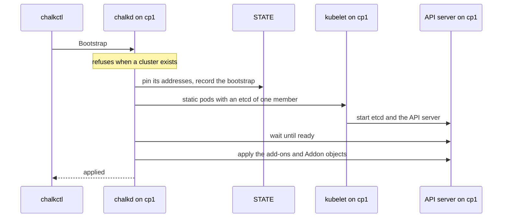
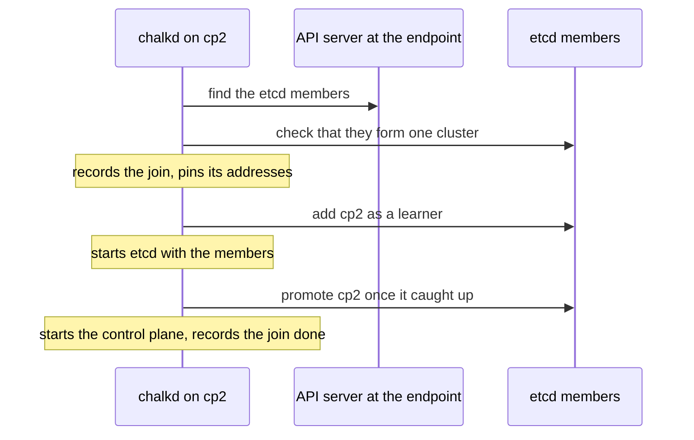
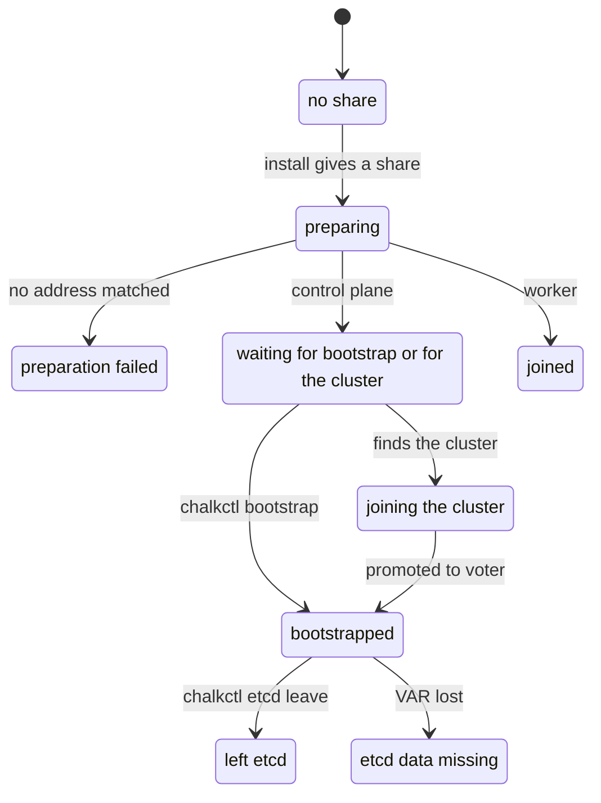

# The control plane

Every control plane runs etcd, the API server, the controller-manager and the scheduler as static
pods that chalkd renders. One control plane starts the cluster with `chalkctl bootstrap`, and the
others join it on their own. A healthy control plane that holds the VIP reports this line in
[`chalkctl status`](../../reference/cli/chalkctl_status.md):

```text
kubernetes controlplane: bootstrapped, node ready: True, vip holder, control plane current
```

The line names the node's kind and state, whether its Node is Ready, its VIP role and whether the
control plane runs on its current certificates.

## chalkd renders the control plane as static pods

chalkd renders the static pods of etcd, the API server, the controller-manager and the scheduler
into `/run/chalkos/kubernetes/manifests`, where the kubelet picks them up. Their certificates are
issued at every boot into `/run/chalkos/kubernetes/pki`. That directory is a tmpfs, mounted into
the pods as `/etc/kubernetes/pki`. [Kubernetes certificates](certificates.md) explains how the pods
start again on renewed certificates.

etcd keeps its data on VAR in `/var/lib/etcd`. `chalkos-controlplane.service` makes the directory
at boot on a node whose `Node` document has the type `controlplane`. The same unit opens the API
server's and etcd's ports in the firewall on such a node, as
[Kubernetes networking](networking.md#the-control-plane-ports-open-only-on-control-planes)
describes.

## The flags follow kubeadm with a few access choices

The flags of the control plane are close to kubeadm's. chalkos makes a few choices of its own:

- The API server talks to its node's own etcd member only.
- The API server authorises with `Node,RBAC` and admits with `NodeRestriction`.
- The API server allows anonymous requests only to `/livez`, `/readyz` and `/healthz`.
- The API server has `--enable-bootstrap-token-auth=false`.
- The API server encrypts Secrets in etcd with the cluster's encryption key.
- The controller-manager runs without the `bootstrapsigner` and `tokencleaner` controllers,
  because no node joins with a token.

`extraArgs` of the `Cluster` document adds or overrides flags per component of the control plane:
`etcd`, `kube-apiserver`, `kube-controller-manager` and `kube-scheduler`. `kubeletExtraArgs` of a
node's `Node` document does the same for its kubelet. Each is a map of flags named without their
leading dashes. A name holds letters, digits, `_`, `.` and `-`, and starts with a letter or digit.
A kubelet flag's name and value hold no whitespace or backslash.

chalkos refuses the flags that decide who may do what, and the kubelet flags that set where it
finds its configuration, credentials and static pods. It also refuses the API server flags that
conflict with its own. A refused flag stays refused when it is spelt with `_` for `-`, which the
components accept. [Kubernetes](../../reference/kubernetes.md#protected-api-server-flags) lists
the refused and conflicting flags. [Configure Kubernetes](../../kubernetes/configure.md) shows how
to add flags.

## chalkctl bootstrap starts the cluster once

One control plane initialises etcd, once, with
[`chalkctl bootstrap`](../../reference/cli/chalkctl_bootstrap.md):

```sh
chalkctl bootstrap <node>
```

The sequence shows the bootstrap of a first control plane, cp1.



chalkd records the bootstrap on STATE before it starts anything. A failure after that point is
retried by the next boot, and never initialises a second cluster. chalkd then renders the static
pods with an etcd of one member, waits for the API server, and applies chalkos's add-ons and the
objects of the node's `Addon` documents. chalkctl waits until they are applied, up to `--timeout`,
which is 20 minutes by default.

The node refuses to bootstrap in these cases, because a cluster exists and the node joins it
instead:

- it is bootstrapped already;
- it has joined or is joining a cluster;
- it holds etcd data;
- it has left etcd;
- it finds the cluster's API server answering at the endpoint.

## Further control planes join etcd on their own

Every other control plane joins on its own; there is no join command. A control plane that is not
bootstrapped looks for the cluster at the endpoint. It finds the etcd members through the API
server there, which must present a certificate of the cluster's Kubernetes CA, and joins through
them. The sequence shows a second control plane, cp2, joining.



A learner receives etcd's data without voting, so a member that is still catching up never counts
toward the quorum. etcd accepts one learner at a time, so control planes that boot together join
one after another. A node that was interrupted resumes from its markers on STATE. The join gives
up on a promotion that does not complete within 10 minutes, and tries again later.

## A stale etcd member stops a join

The join stops when etcd has a member of the node's name that the node did not add itself. Such a
member belongs to a control plane that was reinstalled without leaving etcd. The node's status says
why the join stopped. chalkos never removes that stale member automatically, because only the
operator knows whether the machine that owned it is gone.
[`chalkctl etcd`](../../reference/cli/chalkctl_etcd.md) manages the membership:

```sh
chalkctl etcd members
chalkctl etcd remove-member <node>
chalkctl etcd leave <node>
```

`remove-member` removes another node's member. `leave` takes a node out itself: it releases the
node's VIPs, stops its control plane, deletes its etcd data and unpins its addresses. Both refuse
when the voters left would have fewer healthy members than their quorum. `remove-member --force`
removes a member anyway. A node that left joins again only after a reinstall.

## Workers join with the certificate from their share

A worker receives a kubelet client certificate for its own node name in its share at install. Its
kubelet registers at the cluster endpoint with that certificate, so the worker needs no token and
no join step. [Kubernetes certificates](certificates.md#kubelets-renew-their-own-certificates)
explains how the kubelet renews it and gets its serving certificate.

## One healthy control plane holds the VIP

A VIP is an address of the API server that one healthy control plane holds at a time. The status
line names a control plane's role as `vip holder` or `vip standby`. When a control plane's own
etcd member is unhealthy, its API server fails its readiness and the VIP moves to another control
plane. [How does the VIP move between control planes?](../node/networking.md#how-does-the-vip-move-between-control-planes)
describes the election.

## The control plane applies the add-ons and the Addon documents

After the API server is ready, chalkd applies a list of objects with server-side apply, as field
manager `chalkd`. It takes over fields that other managers changed, so chalkos's objects always
win. chalkd renders the first objects from the node's cluster: RBAC bindings, kube-proxy, the pod
network and CoreDNS. The objects of the node's `Addon` documents come last.
[Add-ons](../../reference/kubernetes.md#add-ons) lists the objects in the order chalkd applies
them.

An `Addon` document holds any Kubernetes objects, for example a namespace for the cluster's
applications:

```yaml
apiVersion: kubernetes.chalkos.dev/v1alpha1
kind: Addon
metadata: {name: apps}
spec:
  objects:
    - apiVersion: v1
      kind: Namespace
      metadata: {name: apps}
```

chalkd applies the list at bootstrap. It applies it again on every bootstrapped control plane each
time it starts its Kubernetes work:

- at boot;
- after the node's cluster changed;
- when [`chalkctl apply-config`](../../reference/cli/chalkctl_apply-config.md) delivers changed
  `Addon` documents, which restarts no unit.

An image upgrade or a changed config therefore rolls out changed add-ons without a separate step.
An object that an `Addon` document no longer holds is not deleted.

From the moment the API server is ready, chalkd also runs the approver of kubelet serving
certificates, beside the apply. An object that fails to apply therefore does not leave kubelets
without serving certificates.

## Addon documents stay on the control planes

Only control planes apply the `Addon` objects to the cluster's API. An `Addon` may sit in the files
every node gets, but chalkctl delivers `Addon` documents only to the nodes whose `Node` document
has the type `controlplane`. Workers never hold them. A worker given one anyway applies nothing
and restarts nothing.

The objects may include Secrets. A control plane therefore keeps its `Addon` documents in its
stored config on STATE, which only root reads. chalkd never writes them below
`/run/chalkos/config` for the node's services, and `chalkcfg` does not print them.

## The status line names the Kubernetes state

The state in the Kubernetes line of `chalkctl status` names what the node waits for, or why it
stopped. The diagram shows how a node moves between the states.



A bootstrapped control plane and a joined worker can add a problem to their state, such as an
address that differs from the etcd peer URL. [Kubernetes status states](../../reference/kubernetes.md#kubernetes-status-states)
lists every state and its meaning. [Troubleshoot Kubernetes](../../kubernetes/troubleshooting.md)
acts on them.

## Limits

- An object removed from an `Addon` document is not deleted from the cluster. kubectl deletes it.
- chalkos has no etcd backup or restore command. etcd's data lives only on the control planes'
  VAR partitions.
- The API server on a control plane uses only its own etcd member. When that member is unhealthy,
  that node's API server fails its readiness and the VIP moves to another control plane.
- A cluster of one or two control planes loses etcd's quorum, and with it the API server, while a
  control plane reboots. A cluster needs three control planes to stay up; one is enough for a lab.
- chalkos never removes a stale etcd member on its own.

## Related pages

- [How Kubernetes runs on a node](overview.md): the components, the share and the config.
- [Bootstrap and get a kubeconfig](../../kubernetes/bootstrap.md#bootstrap-the-first-control-plane)
  for the bootstrap, and [Run a highly available control plane](../../kubernetes/ha-control-plane.md)
  for joins and membership changes.
- [`chalkctl bootstrap`](../../reference/cli/chalkctl_bootstrap.md) and
  [`chalkctl etcd`](../../reference/cli/chalkctl_etcd.md).
- [Kubernetes](../../reference/kubernetes.md) for the flags, add-ons and status states.
