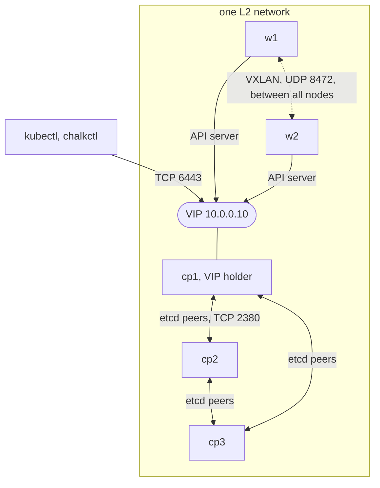
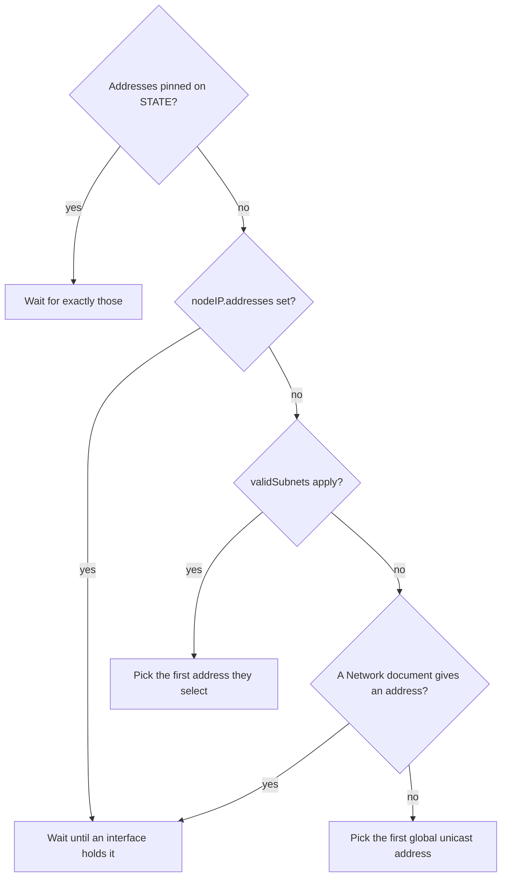
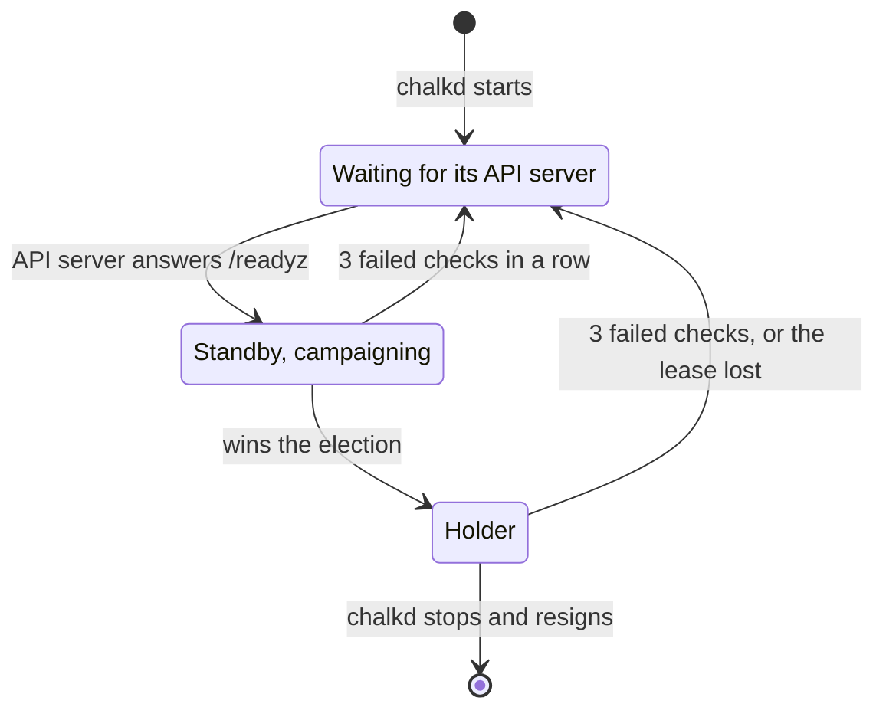

# Kubernetes networking

A Kubernetes cluster on chalkos runs on the node's host network, which
[Networking](../node/networking.md) describes. On top of it, each node picks one address per IP
family of the cluster, the control planes share a VIP, flannel carries the pods' traffic between
nodes, and kube-proxy and CoreDNS give pods their services and names. The diagram shows a cluster
of three control planes and two workers on one L2 network, with cp1 holding the VIP.



## Each node picks one address per family before the kubelet starts

A node with Kubernetes registers one address of each IP family of the cluster. On a control plane,
its certificates name the same addresses, and etcd and the API server advertise the primary
family's. Before the kubelet starts, `chalkos-kubernetes.service` picks them and writes them to
`/run/chalkos/kubernetes/node-ip`.

A family's address is fixed or picked:

- Fixed: `nodeIP.addresses` of the node's [`Node`](../../reference/kinds.md#node) document, at most
  one address per family. By default it is the first address of each family among the
  `network.address` keys of the node's `Network` documents, in the order of their names, unless
  subnets to pick from apply to the node. The node waits until an interface holds the address.
- Picked: the node takes the first of its global unicast addresses that `nodeIP.validSubnets` of
  the [`Cluster`](../../reference/kinds.md#cluster) document selects, or `nodeIP.validSubnets` of
  the node's own `Node` document, which replaces the cluster's list as a whole. A leading `!`
  excludes a subnet. Addresses are compared IPv4 before IPv6, then by interface name and address,
  so the choice does not depend on the order the kernel lists them in. With no subnets, every
  global unicast address qualifies.

The diagram shows how the node decides for each family.



The node never picks an address in the pod or service ranges or on an interface of the pod network
or kube-proxy (`flannel*`, `cni*`, `veth*`, `kube-*`). It takes the endpoint's address or a VIP only
when nothing else of the family matches, because those move between control planes. With flannel
and two families, the node's IPv4 and IPv6 addresses must be on one interface.

```yaml
apiVersion: kubernetes.chalkos.dev/v1alpha1
kind: Cluster
metadata: {name: default}
spec:
  endpoint: https://10.0.0.10:6443
  nodeIP:
    validSubnets: [10.0.0.0/24, "!10.0.0.200/29"]
```

A subnet that starts with `!` is quoted, because YAML reads an unquoted `!` as a tag.

DHCP leases and addresses that a routing daemon adds can arrive late, so the node looks for its
addresses every second, up to `nodeIP.timeout` of the `Cluster` document, 300 seconds by default.
A node that finds none runs neither the kubelet nor static pods. Its status stays in the state
`preparation failed: <reason>`, and the reason names the filter and the addresses the node has:

```text
kubernetes worker: preparation failed: no ipv4 node address matches validSubnets 10.0.0.0/24 (the node has 192.168.1.20 on enp1s0), 5m0s after chalkos-node-addresses.target
```

## A routing daemon can provide the node's addresses

A node's addresses do not have to come from networkd. A routing daemon, such as a BGP speaker an
extension adds to a variant, can announce an address on a loopback or dummy interface. Such a unit
orders itself before `chalkos-node-addresses.target`, which every image defines, and is wanted by
it. The preparation starts after the target and still waits up to `nodeIP.timeout` for the
addresses.

An address on a loopback interface needs the `Flannel` document's `spec.mtu`, because flannel would
take the loopback's MTU. When it is set, a dummy interface holding a node's address needs an MTU of
at least its value, 20 more for an IPv6 address. Otherwise the node refuses to prepare, with a
message such as `the node's address 10.0.0.11 is on the loopback interface lo, whose MTU flannel
would take; set the Flannel document's spec.mtu`.

## A control plane's addresses are pinned once it joins etcd

etcd's peers know a member by the address it joined with, and the control plane's certificates
name that address. When a control plane becomes an etcd member, by bootstrap or by joining, chalkd
pins the addresses it picked on STATE. Every later boot waits for exactly those, whatever the
subnets say. A control plane's addresses can still change in its config, but a `Network` change
that drops a pinned address stops the preparation, so the control plane starts no etcd:

```text
pinned address 10.0.0.11 is not present, 5m0s after chalkos-node-addresses.target; restore it, or remove the node's etcd member with chalkctl etcd remove-member cp1 and reinstall the node
```

[`chalkctl etcd leave`](../../reference/cli/chalkctl_etcd_leave.md) removes the pin together with
the node's member. A node whose pinned address is gone runs no etcd member that could answer, so it
leaves with `chalkctl etcd leave <node> --force`, which removes its member through the other
members.

## The address families of a cluster are fixed once it exists

`ipFamilies` of the `Cluster` document lists the families of the cluster, the primary one first:
`[ipv4]` by default, or both in either order. Every node has one address of each family, pods get
one of each, and services get one of each family they ask for.

Each family has its own ranges, fields of the `Cluster` document keyed by `ipv4` and `ipv6`:

| Field | IPv4 default | IPv6 default |
| --- | --- | --- |
| `podCIDRs` | `10.244.0.0/16` | `fd00:10:244::/56` |
| `serviceCIDRs` | `10.96.0.0/12` | `fd00:10:96::/112` |
| `dnsIPs` | the service range's 10th address, `10.96.0.10` | the service range's 10th address, `fd00:10:96::a` |
| `nodeCIDRMaskSizes` | `24` | `64` |

A cluster with IPv6 as its primary family and IPv4 beside it, on the default ranges:

```yaml
apiVersion: kubernetes.chalkos.dev/v1alpha1
kind: Cluster
metadata: {name: default}
spec:
  endpoint: https://10.0.0.10:6443
  ipFamilies: [ipv6, ipv4]
```

The cluster DNS service has an address of the primary family alone, as kubeadm's does, because the
kubelet gives pods one name server. It still answers A and AAAA queries.

The families and their order, the pod ranges, the service ranges and the DNS addresses are fixed
once the cluster exists, as
[How Kubernetes runs on a node](overview.md#the-ranges-of-a-cluster-are-fixed-once-it-exists)
explains. A worker whose Node lacks a pod range of one of the cluster's families reports
`joined: <problem>` in its status.

## One healthy control plane holds the VIP

A VIP is an address of the API server that no single machine owns. One healthy control plane holds
it at a time, so the cluster endpoint stays reachable while a control plane reboots or fails.
`vip.addresses` of the `Cluster` document takes at most one address per family. The document's
`endpoint` is then one of them, or a name that resolves to them. The document goes into the files
every node gets:

```yaml
apiVersion: kubernetes.chalkos.dev/v1alpha1
kind: Cluster
metadata: {name: default}
spec:
  endpoint: https://10.0.0.10:6443
  vip: {addresses: [10.0.0.10]}
```

chalkd on every bootstrapped control plane takes part in an election held in etcd under
`/chalkos/vip`. When it starts, it removes any VIP a chalkd before it left behind. It campaigns only
while its local API server answers `/readyz`. The winner adds every VIP to an interface as a /32 or
/128 host address. It announces each address it adds 3 times, 1 second apart, with gratuitous
ARP and unsolicited neighbour advertisements, so switches and neighbours send its traffic to the
new holder at once. While it holds the VIPs, it checks every 2 seconds and adds back an address
that has gone missing, which it then announces again.

The interface is the one `vip.interface` of the node's `Node` document names, or else the one
holding the node's address of that family. The interface is the node's own, so it goes into the
node's `Node` document, and only on a control plane: chalkctl and chalkd refuse `vip.interface` on
a worker, which never holds the VIP.

The election runs on an etcd lease of 10 seconds, and every control plane checks its API server
every 2 seconds. The diagram shows the states of one control plane's chalkd.



What happens to the VIP depends on how its holder stops:

- When the holder's API server fails three checks in a row, the holder removes the addresses and
  resigns, and another control plane takes over.
- When the holder stops, it resigns and revokes its lease, so the next one takes over without
  waiting.
- When the holder crashes or loses its network, the VIP is unheld until the lease expires, within
  10 seconds. A holder that cannot renew the lease removes the addresses 2 seconds before etcd
  could let it expire, so two nodes never announce the same address.
- Without an etcd quorum nobody can win the election, and nobody holds the VIP.

A control plane's API server also fails its readiness when its own etcd member is unhealthy, so the
VIP moves away from a control plane whose etcd member fails.
[`chalkctl status`](../../reference/cli/chalkctl_status.md) shows each control plane as
`vip holder` or `vip standby` in its Kubernetes line.

## flannel carries pod traffic in VXLAN

chalkd applies the pod network as an add-on: flannel, unless
[`chalkos.cni.provider`](../../reference/image-options.md#chalkoscniprovider) is `none`. flannel carries
pod traffic between nodes in VXLAN on UDP port 8472, one device per family (`flannel.1` and
`flannel-v6.1`). flanneld uses exactly the node's addresses as the kubelet registered them, and
masquerades what pods send to other nodes behind them.

flannel's devices get the MTU of the interface holding the node's address, minus 50. `spec.mtu` of
the [`Flannel`](../../reference/kinds.md#flannel) document sets the network's MTU instead, and is
required when the node's address is on a loopback interface. IPv6 VXLAN needs 70 bytes rather than
50, so with IPv6 in use set it to the network's MTU minus 20:

```yaml
apiVersion: kubernetes.chalkos.dev/v1alpha1
kind: Flannel
metadata: {name: default}
spec:
  mtu: 1480
```

A cluster has at most one `Flannel` document, and every node holds the same one. chalkctl refuses an
inventory whose nodes hold different `Flannel` specs. Only images whose pod network is flannel
accept the document; for another image it is an unknown kind. An image built with
`chalkos.cni.provider = "none"` in its variant's modules installs no pod network and ships every CNI
reference plugin, for clusters whose `Addon` documents bring their own. Opening that network's ports
is then up to the variant's NixOS modules.

## The firewall accepts VXLAN only for the node's own addresses

VXLAN carries pod packets unauthenticated, so the firewall accepts it only when it is sent to one of
the node's own addresses. It accepts it on the interface that holds the address. When the address
is on a loopback or dummy interface, it accepts it on any interface but those of the pod network
and kube-proxy, where pods could send it. The node picks its addresses after the firewall started,
so a table of chalkos's own, `chalkos-vxlan`, which the preparation fills with the addresses it
picked, marks such packets for the firewall to accept. No VXLAN is accepted while the addresses
are being picked or when none are found.
[VXLAN rule](../../reference/ports-and-firewall.md#vxlan-rule) lists the table's chains and marks.

`vxlanSourceSubnets` of the `Flannel` document narrows this to sources in the given ranges, one or
more per family. They must hold every node's addresses and may not overlap the pod or service
ranges. With them, the node also drops VXLAN that pods send through it to those ranges. The node
masquerades pod traffic behind its own address, which lies in the ranges, so the other nodes would
take such VXLAN for this node's own. Without them, VXLAN is accepted from any source, so pods can
reach the other nodes' VXLAN port too. The node reads the pod ranges from its `Cluster` document and the source ranges from its `Flannel`
document. While it cannot, it drops all VXLAN it forwards.

[`chalkctl validate`](../../reference/cli/chalkctl_validate.md) refuses a node whose fixed addresses,
or the subnets it picks its addresses from, lie outside the ranges. A node that picks its addresses
at boot checks the picked ones against the ranges again, and refuses to prepare Kubernetes when one
lies outside.

## kube-proxy and CoreDNS give pods services and names

chalkd applies kube-proxy as a DaemonSet in nftables mode, the mode the node's firewall and flannel
use too. kube-proxy serves NodePorts only on the node's own addresses, one per family, as the
kubelet registered them. chalkd applies CoreDNS at the primary family's address of the `Cluster`
document's `dnsIPs`. The kubelet configuration of every node names the cluster's DNS address and
domain, so pods resolve through CoreDNS.

## The control plane ports open only on control planes

Every node with Kubernetes accepts the kubelet's port 10250, the NodePort range 30000 to 32767 and
marked VXLAN. `chalkos-controlplane.service` opens the API server's port 6443 and etcd's ports 2379
and 2380 on a node whose `Node` document has the type `controlplane`, and closes them on a worker.
It does this at boot and whenever the `Node` document changes, through a table of chalkos's own,
`chalkos-controlplane`, that marks the ports for the firewall to accept.
[Ports and firewall](../../reference/ports-and-firewall.md) lists the ports and the tables.

## Limits

- The VIP's only mode is `l2`: its holder announces it with ARP and neighbour advertisements, so
  the control planes must share one L2 network, through which clients reach the VIP. chalkos has
  no BGP announcement of the VIP. A load balancer or a DNS name in front of the control planes
  works instead.
- On control planes, etcd's ports 2379 and 2380 are open to every source, not only to the
  cluster's nodes. etcd accepts only clients and peers with a certificate of its CA there.
- Packets a control plane receives lose the packet mark bit `0x02000000`, which the firewall's rule
  for the control plane's ports uses, so a pod network of the cluster's own
  (`chalkos.cni.provider = "none"`) must not use it.
- The address families and their order, the pod ranges, the service ranges and the DNS addresses
  of a cluster are fixed once it exists. A change needs a new cluster.
- Within `vxlanSourceSubnets` a source address can be forged. The kernel drops an IPv4 packet that
  claims the node's own address as its source, but has no such check for IPv6.
- A control plane whose pinned address is gone does not start etcd or the control plane until the
  address returns, or until the node leaves etcd with `chalkctl etcd leave --force` and is
  reinstalled.

## Related pages

- [Networking](../node/networking.md): the host network a Kubernetes node runs on.
- [How Kubernetes runs on a node](overview.md) and [The control plane](control-plane.md).
- [Run a highly available control plane](../../kubernetes/ha-control-plane.md) and
  [Plan a cluster](../../kubernetes/plan.md).
- [Configure Kubernetes](../../kubernetes/configure.md#flannel-sets-the-pod-networks-mtu-and-vxlan-sources)
  for the `Flannel` document.
- [Troubleshoot Kubernetes](../../kubernetes/troubleshooting.md#pods-on-different-nodes-cannot-reach-each-other)
  for VXLAN and MTU problems.
- [Ports and firewall](../../reference/ports-and-firewall.md).
- [Config kinds](../../reference/kinds.md) for every field of `Cluster`, `Node` and `Flannel`.
