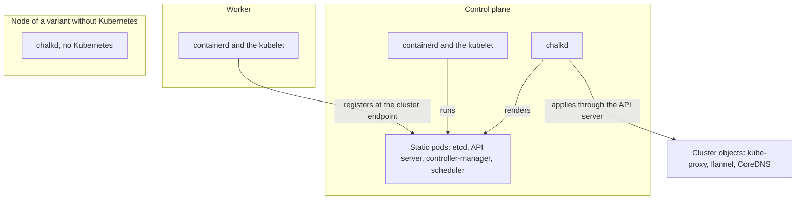

# How Kubernetes runs on a node

chalkos runs upstream Kubernetes in the layout kubeadm uses, without kubeadm. The `Node` document
of a node gives its type, and the type decides which components run. The diagram shows the
components of each type of node.



containerd and the kubelet are systemd units of the image. etcd, the API server, the
controller-manager and the scheduler run as static pods from the upstream images. chalkd renders
them on every control plane. Certificates come from the cluster's secrets file instead of
`kubeadm init`. Control planes join etcd on their own, and chalkd applies the cluster's add-ons at
every boot. The image fixes the Kubernetes release. Every setting of the cluster and of each node
is a config document. [The control plane](control-plane.md) explains the static pods, the
bootstrap, the joins and the add-ons.

## The image fixes one Kubernetes version

Each image runs one Kubernetes version:
[`chalkos.kubernetes.package`](../../reference/options.md#chalkoskubernetespackage), which is
nixpkgs's `kubernetes` by default. Nodes run its kubelet. The control plane runs the upstream
images of the same version from `registry.k8s.io`, so a node's kubelet and control plane always
run the same version. etcd, the pause image and CoreDNS have their own images under
[`chalkos.kubernetes.images`](../../reference/options.md#chalkoskubernetesimagesetcd). So a
Kubernetes upgrade is an image upgrade, which [Kubernetes upgrades](upgrades.md)
describes.

## The type of a node decides what runs

`spec.type` of the node's [`Node`](../../reference/kinds.md#node) document decides what the node is
in Kubernetes, so control planes and workers boot the same image. A `controlplane` runs
containerd, the kubelet, and etcd and the control plane as static pods. A `worker` runs containerd
and the kubelet. The images of a variant built with
[`kubernetes = false`](../../reference/options.md#variantskubernetes) run no Kubernetes and have no
`Node` kind, so their nodes have no type.
[Components by node type](../../reference/kubernetes.md#components-by-node-type) lists them in one
table.

A node keeps its type once it holds its Kubernetes share. chalkd refuses config that changes the
type, because the share holds certificates for that type.

## The Kubernetes share holds the secrets of a node

The Kubernetes share is the set of Kubernetes secrets a node receives at install, which chalkd
keeps on STATE. On a control plane, it holds the cluster, front-proxy and etcd CAs with their keys,
the service-account key, the encryption key and the node CA. On a worker, it holds the cluster CA
certificate and a kubelet client certificate. A node without a Kubernetes share, which is not
installed yet, runs no kubelet. `chalkctl apply-config --kubernetes-share` gives an installed node
a share. [Kubernetes certificates](certificates.md) describes what the control plane issues from
it.

## Four kinds of document describe the cluster

The image fixes what it ships: the Kubernetes release, the images of its components and the pod
network. It records them in `/etc/chalkos/kubernetes/image.json`. Everything else is config, in
documents of the kinds of the group `kubernetes.chalkos.dev`:

- One [`Cluster`](../../reference/kinds.md#cluster) document, which is required. It holds the URL
  of the cluster's API server, the address families and ranges, the DNS domain and address, how
  nodes pick their addresses, the VIP, scheduling on control planes and extra flags of the control
  plane's components.
- One [`Node`](../../reference/kinds.md#node) document, which is required. It holds the node's
  type and its own labels, taints, addresses, extra flags of its kubelet and the interface it holds
  the VIP on.
- At most one [`Flannel`](../../reference/kinds.md#flannel) document, on images with flannel. It
  holds the MTU flannel assumes and the ranges its VXLAN must come from.
- Any number of [`Addon`](../../reference/kinds.md#addon) documents, which hold Kubernetes objects
  the control planes apply.

The cluster's documents go into the files the inventory gives every node, so all nodes hold the
same ones. A node's `Node` goes into its own file, as
[Config and the inventory](../node/config.md#the-inventory-gives-each-node-a-set-of-files)
describes.

On an image with Kubernetes, the node's config must hold one `Cluster` and one `Node` document.
[`chalkctl validate`](../../reference/cli/chalkctl_validate.md) and chalkd refuse a set without
one, with one of these messages:

```text
no Cluster: the config of a node whose image runs Kubernetes holds one Cluster document
no Node: the config of a node whose image runs Kubernetes holds one Node document
```

The `Cluster` document names the cluster endpoint, the URL of the API server, which every node
names alike. Every other field has a default. A cluster on IPv4 with the default ranges
needs no more than the lab template's document:

```yaml
# Kubernetes with its defaults: IPv4, the pod range 10.244.0.0/16 and the service range
# 10.96.0.0/12.
apiVersion: kubernetes.chalkos.dev/v1alpha1
kind: Cluster
metadata: {name: default}
spec:
  # cp1 on the lab network: the API server of the only control plane.
  endpoint: https://192.168.123.11:6443
```

chalkctl delivers the documents at install and with
[`chalkctl apply-config`](../../reference/cli/chalkctl_apply-config.md). At boot and on every
apply, chalkd builds the node's cluster from its `Node`, `Cluster` and `Flannel` documents and
`image.json`. It writes the result to `/run/chalkos/kubernetes/cluster.json`.

## Every node holds the same cluster documents

Every node of an inventory whose set holds a `Cluster` document must hold the same `Cluster` spec
and the same `Flannel` spec, or no `Flannel` document on any of them, because each node builds the
cluster from its own documents. The specs compare as written, whatever the documents are called: a
field left to its default differs from one set to the default value. Only the order of the
`Flannel` document's `vxlanSourceSubnets` makes no difference. `chalkctl validate` and every
chalkctl command that reads the inventory refuse an inventory whose nodes differ. The error names
the first field that differs, in the order of the fields' names, and the nodes of each of its
values:

```text
chalkos.yaml: the nodes hold different Flannel specs: spec.mtu is 1400 on cp1 and cp2, 1450 on w1; every node of the cluster holds the same Cluster and Flannel specs
```

A node without the `Flannel` document is named as holding none, as in `none on w1`.

So the cluster's documents belong in the files every node gets. What differs from node to
node goes into each node's `Node` document instead, which chalkctl does not compare:

- `type`, `controlplane` or `worker`;
- `labels` and `taints`;
- `nodeIP.addresses` and `nodeIP.validSubnets`, the node's own addresses or the subnets it picks
  them from;
- `kubeletExtraArgs`, the extra flags of the node's kubelet;
- `vip.interface`, the interface a control plane adds the VIP to, which a worker leaves null.

## The ranges of a cluster are fixed once it exists

A changed cluster restarts `chalkos-kubernetes` and the kubelet, as their
[effect](../../build/react-to-changes.md#built-into-chalkos) says. chalkd on a control plane then
starts its Kubernetes work again, so the static pods and add-ons follow the new settings.

Some settings are fixed once the cluster exists: `ipFamilies`, the pod ranges of `podCIDRs`, the
service ranges of `serviceCIDRs` and the addresses of `dnsIPs`. The certificates, etcd and the
ranges the control plane allocated were made for them. On a node that holds a Kubernetes share,
`chalkctl apply-config` is refused when it changes them:

```text
the config changes the cluster's podCIDRs from ipv4 10.244.0.0/16 to ipv4 10.245.0.0/16; they are fixed once the cluster exists, so keep them, or reinstall the node into a new cluster
```

The [change rules](../../build/guard-changes.md) of the `Cluster` kind decide this.

## chalkos-kubernetes prepares a node before its kubelet starts

containerd and the kubelet run as systemd units from the image. Before the kubelet starts,
`chalkos-kubernetes.service` prepares the node. It picks the node's addresses, as
[Kubernetes networking](networking.md) describes, and issues a control plane's certificates. It
writes the kubelet's kubeconfig and per-node flags below `/run/chalkos/kubernetes`.

chalkd renders the kubelet's configuration from the node's cluster into
`/run/chalkos/kubernetes/kubelet/config.json`. The configuration is the same on every node of the
cluster:

- webhook authentication and authorisation;
- no anonymous access and no read-only port;
- the systemd cgroup driver;
- the cluster's DNS address and domain;
- `rotateCertificates` and `serverTLSBootstrap`.

The kubelet gets what differs per node as flags in `$KUBELET_ARGS`. These are the node name, which
is the node's [name in the inventory](../node/config.md#a-nodes-name-is-its-key-in-the-inventory),
and the addresses, labels, taints and extra flags of its `Node` document. The homelab example's
worker carries fast storage and keeps other workloads off:

```yaml
apiVersion: kubernetes.chalkos.dev/v1alpha1
kind: Node
metadata: {name: default}
spec:
  type: worker
  labels: {node.kubernetes.io/storage: ssd}
  taints: [{key: dedicated, value: storage, effect: NoSchedule}]
```

A control plane is tainted `node-role.kubernetes.io/control-plane:NoSchedule` unless the `Cluster`
document sets `allowSchedulingOnControlPlanes: true`. The kubelet applies the labels and taints,
this taint among them, only when it registers the node. So `labels`, `taints` and
`allowSchedulingOnControlPlanes` are fixed once the node holds a Kubernetes share, and kubectl
changes them on the Kubernetes node. `kubeletExtraArgs` of a node's `Node` document adds flags to
its kubelet. [Protected kubelet flags](../../reference/kubernetes.md#protected-kubelet-flags) lists
the flags chalkos refuses there.

## containerd pulls through the mirrors of the node

containerd pulls through the endpoints of the `Mirror` documents. It tries them in order before
the registry itself. Each document names one registry, as image references name it, in
`spec.registry`:

```yaml
apiVersion: oci.chalkos.dev/v1alpha1
kind: Mirror
metadata: {name: docker.io}
spec:
  registry: docker.io
  endpoints: [https://mirror.example.com]
```

`chalkos-registry-mirrors.service` writes containerd's
`/run/containerd/certs.d/<registry>/hosts.toml` from the `Mirror` and
[`Registry`](../../reference/kinds.md#registry) documents. It runs before containerd starts and
whenever the documents change. containerd reads those files on every pull. Each file lists the
endpoints as the `Mirror` names them, then the registry itself.

A registry whose `Registry` sets `insecure` is reached over HTTP. It gets a file even without a
`Mirror`. An `http://` endpoint needs a `Registry` of its host with `insecure: true`, because
nothing authenticates what a plain HTTP endpoint serves.

## Pods pull private images with node credentials

A [`Registry`](../../reference/kinds.md#registry) with `username` and `password` gives every pod on
the node the images of its host, without `imagePullSecrets`:

```yaml
apiVersion: oci.chalkos.dev/v1alpha1
kind: Registry
metadata: {name: ghcr}
spec:
  host: ghcr.io
  username: robot
  password: {secretRef: {name: registry, key: token}}
```

The kubelet runs chalkd as its image credential provider. It asks chalkd for the credentials of an
image's host, and hands them to containerd as it hands over those of a pull secret.

The kubelet matches the `host`, in lower case and port included, against the image's host as the
pod spec writes it. It names Docker Hub `docker.io`. The comparison is case-sensitive, so
`GHCR.io/org/app` gets no credentials. An IPv6 host needs its port, `443` included, in both the
`Registry` and the image. The kubelet reads a bracketed address without a port as a glob character
class, so chalkd refuses such a `Registry` with credentials.

`chalkos-registry-credentials.service` writes the provider's configuration and the credentials to
`/run/chalkos/kubernetes/credential-provider/`. Only root reads its `credentials.json`. A node
without a `Registry` that has credentials runs the kubelet without a credential provider. When the
unit fails, the kubelet still starts and pulls without the node's credentials.

The kubelet reads the provider's configuration when it starts, and keeps each answer for 5
minutes. So a change of a `Registry`, or of a password it references, restarts both
`chalkos-registry-credentials.service` and `kubelet.service`. The restart empties that cache, and
running pods keep running.

### A mirror receives the credentials of its registry

containerd sends the credentials the kubelet gives it for the image's registry to every endpoint of
a `Mirror` that asks for credentials, and to the token service such an endpoint names. This holds
for credentials from the node's `Registry` and from an `imagePullSecret` alike. The kubelet passes
them without the host they belong to, so containerd 2.4 cannot tell a mirror from the registry. In
other words, a mirror of an authenticated registry receives that registry's credentials. An
`http://` endpoint, allowed by an `insecure` `Registry` of its host, receives them over plain HTTP.
The credentials of an endpoint's own `Registry` do not reach containerd.

chalkd pulls OS images through the same `Mirror` documents. It authenticates each endpoint with the
`Registry` of the endpoint's host instead, and sends each host only its own credentials, as
[Pull through a mirror](../../operate/registries.md#pull-through-a-mirror) describes. The
[`e2e-kubernetes`](../../contribute/testing.md#end-to-end-tests) check pins this behaviour. Its
worker pulls a private image through a mirror endpoint that accepts only the credentials of the
image's registry.

## Limits

- A node keeps its type, labels and taints once it holds a Kubernetes share. A new type needs a
  reinstall, and kubectl changes labels and taints.
- Node credentials hold for every pod on the node, in every namespace. Any pod scheduled there can
  pull every image those credentials read. Images that only some workloads may read need an
  `imagePullSecret` in their namespace.
- A mirror of an authenticated registry receives that registry's credentials on container pulls,
  so it needs the trust the registry has.
- Image hosts in a pod spec match a `Registry` only in lower case.

## Related pages

- [The control plane](control-plane.md): the static pods, the bootstrap, the joins and the add-ons.
- [Kubernetes networking](networking.md), [Kubernetes certificates](certificates.md) and
  [Kubernetes upgrades](upgrades.md).
- [Config and the inventory](../node/config.md): how the Kubernetes documents reach the nodes.
- [Configure Kubernetes](../../kubernetes/configure.md) and
  [Registries and mirrors](../../operate/registries.md) for the tasks.
- [Config kinds](../../reference/kinds.md#cluster) for every field of `Cluster`, `Node`, `Flannel`
  and `Addon`, and [Kubernetes](../../reference/kubernetes.md) for the components, flags, add-ons
  and status states.
