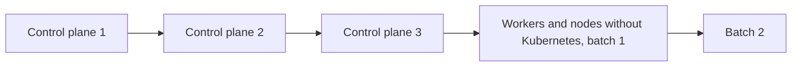
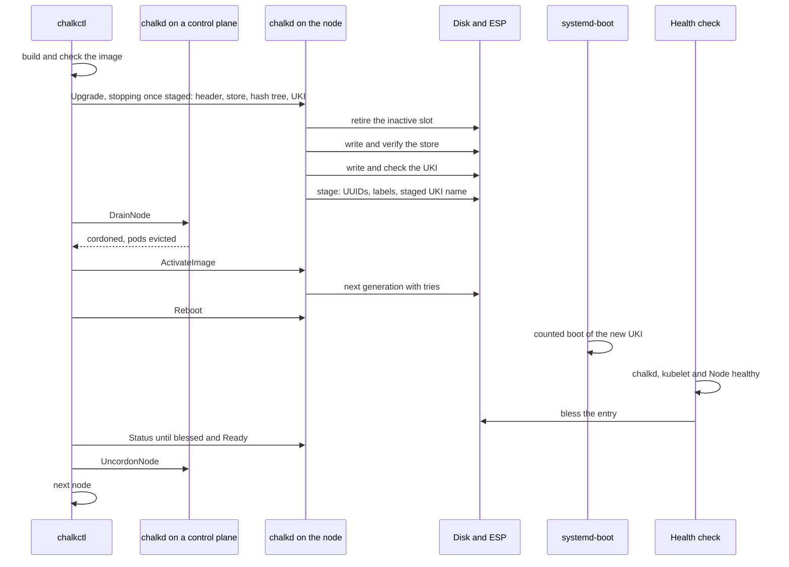

# Kubernetes upgrades

A new Kubernetes release reaches a cluster in two steps. The control plane moves first, through
config: `chalkctl apply-config` delivers the new image references to the control planes one at a
time, then to the other nodes. The kubelets follow in a new image, because each image fixes its
kubelet's release: `chalkctl upgrade` rolls the image through the cluster. The diagram shows the
order of an upgrade; a rollout of config takes the control planes in the same order, then the other
nodes one at a time.



## A kubelet upgrade is an image upgrade

A new kubelet release is a new image built with a new
[`chalkos.kubernetes.version`](../../reference/image-options.md#chalkoskubernetesversion) or
nixpkgs release, installed like any other, because the image fixes the kubelet's release, as
[The image fixes the kubelet, the config names the other images](overview.md#the-image-fixes-the-kubelet-the-config-names-the-other-images)
describes. The control plane, kube-proxy and the add-ons run the images the `Cluster` document
names, so their versions change with the config. The image's checker refuses a config whose API
server is older than the new image's kubelet, so the control plane's images move to the new
release before the kubelets do. They move through config, as
[The control plane rolls out through config](#the-control-plane-rolls-out-through-config)
describes, and `chalkctl upgrade` refuses an image whose kubelet would be newer than the oldest API
server the control planes run. The steps a single node takes, from the image to the bless, are on
[Upgrades](../node/upgrades.md).

The config an upgrade carries meets the new image's change rules, and a change of a fixed
Kubernetes setting is refused. The check of the config against the image includes the cluster it
gives.

## The control plane rolls out through config

Each node's Kubernetes status reports the Kubernetes version of the API server its running config
names and the release of its image's kubelet. A bootstrapped control plane also reports whether
its static pods run the images its config names. chalkctl reads these through each node's chalkd,
so the checks need no access to the Kubernetes API.

`chalkctl apply-config` compares the API server of each named node's new config with the one the
config the node runs names, patch releases included. It reads that config from the node's chalkd,
as `--diff` does. When none changes, it delivers to the nodes one after the other, as for any
config, and asks no node's Kubernetes side anything, so the delivery also reaches a node whose
Kubernetes side does not answer. When one changes, the run is ordered:

1. chalkctl reads the versions of every node with a `Node` document and holds the config's API server to
   the skew policy against them: at most one minor from every running API server, no older minor
   without `--allow-downgrade`, no kubelet newer and none more than three minors older. The nodes
   of a run get one API server, and a node that is no control plane gets it only once every
   control plane runs it. A node that does not answer stops the run, since its kubelet may be the
   oldest.
2. The control planes get the config one at a time, in the order of their names. Before each,
   chalkctl checks etcd's quorum, as before a reboot. It delivers the config on trial, and the node
   restarts its preparation and its kubelet, which replaces the static pods with ones of the new
   images. chalkctl then waits until the node's Node is Ready and the mirror pods of
   kube-apiserver, kube-controller-manager and kube-scheduler on the node name the new images and
   are Ready. The kubelet replaces a static pod and its mirror pod together, so a Ready mirror pod
   that names the new image belongs to the new pod. A Node whose Ready condition names the
   container network as its only cause, `NetworkReady=false`, passes too: a cluster created
   without a CNI keeps its Nodes NotReady until one runs, and the static pods use the host's
   network. Then chalkctl confirms the trial, which the node keeps only once its own health check,
   the kubelet's health included, passes.
3. The other nodes get the config after the last control plane.

A control plane whose static pods do not come up by the trial's deadline stops the run, and
chalkctl rolls its config back at once; the node itself would roll it back only at the trial's
deadline. The nodes done before it keep the new API server, which the skew policy allows, and
chalkctl prints which nodes run which version. etcd's image is not part of the check: its version
is not one the rollout compares, and the API server answers only while etcd serves.

Run again, the same command continues. A node that runs the delivery's config already gets nothing,
and a control plane among them is checked with the same wait before the run goes on. A node with an
open trial stops the run until `chalkctl apply-config confirm` or `rollback` ends the trial. `--try`
and `chalkctl apply-config confirm` wait for the same check on every trial, so a trial
that `--until deliver` left open is confirmed only once the node's static pods run the new images.

## Control planes roll first, one at a time

`chalkctl upgrade` upgrades the control planes first, one at a time, then the workers and nodes
without Kubernetes in batches of `--max-unavailable`, 1 by default. Control planes go first across
every image and platform, and within each group the nodes go in the order of their names. This
order also keeps every kubelet at or behind its API server's version, as Kubernetes requires.

For each node, chalkctl:

1. reads what the node runs and its boot status;
2. streams the image, or tells the node to pull it from the registry, unless the node has it
   staged or active already; the node stages it;
3. on a control plane, checks that etcd keeps its quorum while the node reboots;
4. drains the node;
5. activates the image, which then boots next;
6. reboots the node;
7. waits until the node runs the new image's root hash, its boot was found healthy and its Node is
   Ready;
8. uncordons the node, if the upgrade cordoned it.

Steps 3 to 8 are the step `chalkctl node reboot` runs, with the activation in step 5 left to
`chalkctl node activate`. The sequence shows a worker's upgrade.



A run over a cluster of three control planes prints this, shortened. On cp1 a pod without a
controller, `default/debug`, stays where it is:

```text
upgrading node on metal to 3fa9c1e2b7d0 (v1.5.0, a1b2c3d4e5f6): cp1, cp2, cp3
cp1: installing 3fa9c1e2b7d0 (v1.5.0, a1b2c3d4e5f6)
cp1: installed 3fa9c1e2b7d0 (v1.5.0, a1b2c3d4e5f6), staged as .staged-chalkos_2.efi
cp1: cordoned, evicted 2 pods, kept 7
cp1: keeps pods without a controller: default/debug; nothing starts them elsewhere, and they are deleted for good if the node stays down longer than their tolerations allow
cp1: activated 3fa9c1e2b7d0 (v1.5.0, a1b2c3d4e5f6), which boots next as chalkos_2+3.efi
cp1: rebooting into 3fa9c1e2b7d0 (v1.5.0, a1b2c3d4e5f6)
cp1: runs 3fa9c1e2b7d0 (v1.5.0, a1b2c3d4e5f6), found healthy
cp1: uncordoned
cp2: installing 3fa9c1e2b7d0 (v1.5.0, a1b2c3d4e5f6)
...
upgraded 3 nodes to 3fa9c1e2b7d0 (v1.5.0, a1b2c3d4e5f6)
```

## etcd keeps its quorum while a control plane reboots

etcd needs a majority of its voting members to answer, and the API server needs etcd. Before a
control plane that is an etcd member reboots, chalkctl asks for etcd's members through a control
plane. It requires that enough of the other voters are healthy to make a majority of all voters. A
learner refuses the check until it has joined as a voter. etcd may need a moment after the
previous control plane came back, so the check is retried for up to a minute.

With one or two control planes, the others can never be a majority, so etcd and the API server are
down while one reboots. chalkctl refuses that unless `--allow-downtime` accepts it. A lab's single
control plane always needs the flag.

## A control plane's chalkd drains each node

Drains run on a control plane's chalkd, through the Kubernetes layer's
[DrainNode](../../reference/api.md#kubernetes-method-drainnode) method, because an operator's
client file carries no Kubernetes credentials. chalkd cordons the node, marks it with the
annotation `chalkos.dev/upgrade-cordon` and evicts its pods through the eviction API, so
PodDisruptionBudgets hold. It keeps DaemonSet pods, mirror pods, finished pods and pods without a
controller, which nothing would start elsewhere, and chalkctl names those. Pods with emptyDir volumes are evicted
only with `--delete-emptydir-data`, which deletes their data. Without it, a node that runs such a
pod is not drained, the run stops and the node stays cordoned. A drain that does not finish within
`--timeout`, 30 minutes by default, stops the run and leaves the node cordoned.

Each node is drained once its image is staged, and its image is activated after the drain, right
before it reboots. A drain that fails leaves the image staged and not active, so the node keeps
booting its current image. An activation that fails after the drain leaves the image staged too:
the node does not reboot, chalkctl uncordons it, and the run stops. `--until stage` and
`--until activate` drain no node.
`chalkctl node reboot` drains a node the same way, and `--no-drain` skips the drain.

## A stopped run leaves its nodes cordoned

A run stops at the first node that fails. A node that rolled back stays cordoned for an operator
to look at. A run also stops when a drain times out, when a control plane would take etcd's quorum
with it, or when a node does not come back healthy and Ready within `--timeout`. A node whose image
fails to activate after its drain is uncordoned before the run stops, as it does not reboot.

The root hashes the nodes run and their cordons say how far a run got. Running the same command
again continues from there:

- A node that runs the new image with a blessed boot is skipped, or only uncordoned once its Node
  is Ready.
- A node is uncordoned only if the annotation `chalkos.dev/upgrade-cordon` shows that the upgrade
  cordoned it, so a node an operator cordoned stays cordoned.

## Add-ons follow the new image and the new config

chalkd applies chalkos's add-ons on every bootstrapped control plane each time it starts its
Kubernetes work, at boot and after the node's cluster changed among others. An image upgrade or a
delivery of config therefore rolls out changed add-ons without a separate step, as
[The control plane](control-plane.md#the-control-plane-applies-the-add-ons-and-the-addon-documents)
describes.

In a rollout of config, the first control plane that gets the config applies the add-ons, so
kube-proxy's DaemonSet moves to the new image then, while the other control planes still run the
old API server. Within a patch release the skew policy allows that; in a minor upgrade, kube-proxy
runs one minor ahead of the API servers not yet rolled until the rollout finishes.

## Limits

- chalkctl checks Kubernetes's
  [version skew policy](https://kubernetes.io/releases/version-skew-policy/) across the nodes for
  the API server and the kubelet alone. The image's checker holds the controller-manager, the
  scheduler and kube-proxy to the API server and the kubelet of the same config and image.
- A control plane that stays on the old config while a rollout stopped applies the add-ons of its
  own config when its chalkd restarts, so kube-proxy's image may move back until the rollout
  finishes.
- Every node must answer for a rollout of a new API server, and every control plane for an
  upgrade. A node that is down blocks the run until it is back or out of the inventory.
- A cluster of one or two control planes loses etcd's quorum, and with it the API server, while a
  control plane reboots during an upgrade.
- The health check decides on chalkd, etcd, the API server and the kubelet. An image that breaks
  only workloads is blessed, and the run continues.

## Related pages

- [Upgrades](../node/upgrades.md): how a single node installs and boots a new image.
- [The control plane](control-plane.md) for etcd membership.
- [Upgrade Kubernetes](../../kubernetes/upgrade-kubernetes.md) for the task.
