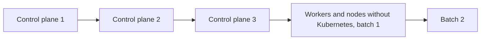

# Kubernetes upgrades

A new Kubernetes version reaches a cluster in a new image. Each image runs one Kubernetes version,
so `chalkctl upgrade` rolls the version through the cluster with the image. The diagram shows the
order in which a run upgrades the nodes.

## A Kubernetes upgrade is an image upgrade

The image fixes the Kubernetes release: its kubelet, and the upstream images of the same version
that the control plane runs. A node's kubelet and control plane therefore always run the same
version. [How Kubernetes runs on a node](overview.md#the-image-fixes-one-kubernetes-version)
describes what the image fixes. The steps a single node takes, from the image to the bless, are on
[Upgrades](../node/upgrades.md).

## Control planes roll first, one at a time

`chalkctl upgrade` upgrades the control planes first, one at a time, then the workers and nodes
without Kubernetes in batches of `--max-unavailable`, 1 by default. Control planes go first across
every image and platform. This also keeps every kubelet at or behind its API server's version, as
Kubernetes requires.
[How does an upgrade roll through a cluster?](../node/upgrades.md#how-does-an-upgrade-roll-through-a-cluster)
explains the quorum check and the drain of each node.

## Add-ons follow the new image

chalkd applies chalkos's add-ons on every bootstrapped control plane each time it starts its
Kubernetes work, at boot among others. An image upgrade therefore rolls out changed add-ons without
a separate step, as [The control plane](control-plane.md#the-control-plane-applies-the-add-ons-and-the-addon-documents)
describes.

## Limits

- A cluster of one or two control planes loses etcd's quorum, and with it the API server, while a
  control plane reboots during an upgrade.

## Related pages

- [Upgrades](../node/upgrades.md): how a single node installs and boots a new image.
- [Upgrade Kubernetes](../../kubernetes/upgrade-kubernetes.md) for the task.
