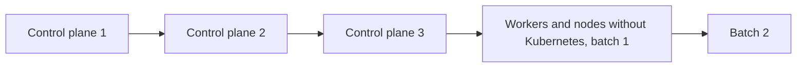
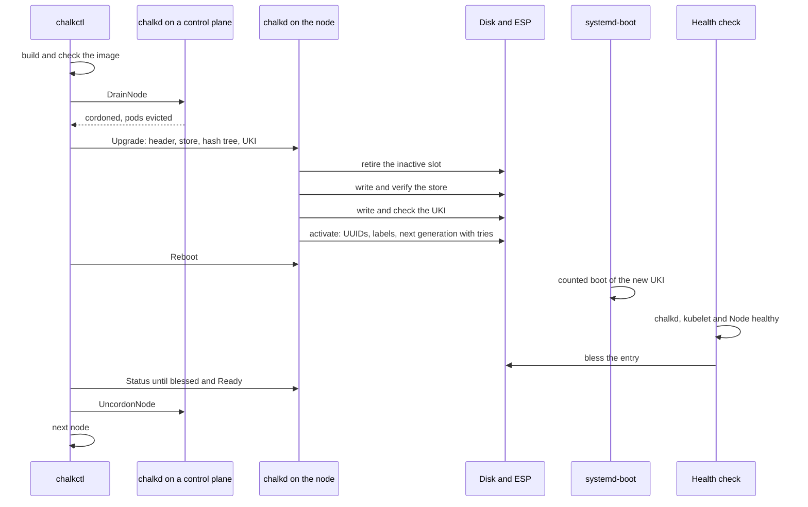

# Kubernetes upgrades

A new Kubernetes version reaches a cluster in a new image. Each image runs one Kubernetes version,
so `chalkctl upgrade` rolls the version through the cluster with the image. The diagram shows the
order in which a run upgrades the nodes.



## A Kubernetes upgrade is an image upgrade

There is no separate Kubernetes upgrade. A new Kubernetes release is a new image built with a new
[`chalkos.kubernetes.package`](../../reference/image-options.md#chalkoskubernetespackage), installed like
any other, because the image fixes the release of the kubelet and the control plane, as
[The image fixes one Kubernetes version](overview.md#the-image-fixes-one-kubernetes-version)
describes. The steps a single node takes, from the image to the bless, are on
[Upgrades](../node/upgrades.md).

The config an upgrade carries meets the new image's change rules, and a change of a fixed
Kubernetes setting is refused. The check of the config against the image includes the cluster it
gives.

## Control planes roll first, one at a time

`chalkctl upgrade` upgrades the control planes first, one at a time, then the workers and nodes
without Kubernetes in batches of `--max-unavailable`, 1 by default. Control planes go first across
every image and platform, and within each group the nodes go in the order of their names. This
order also keeps every kubelet at or behind its API server's version, as Kubernetes requires.

For each node, chalkctl:

1. reads what the node runs and its boot status;
2. on a control plane, checks that etcd keeps its quorum while the node reboots;
3. on a worker, drains the node;
4. streams the image, or tells the node to pull it from the registry, unless the node has it
   installed already;
5. on a control plane, drains the node;
6. reboots the node;
7. waits until the node runs the new image's root hash, its boot was found healthy and its Node is
   Ready;
8. uncordons the node, if the upgrade cordoned it.

The sequence shows a worker's upgrade.



A run over a cluster of three control planes prints this, shortened. On cp1 a pod without a
controller, `default/debug`, stays where it is:

```text
upgrading node on metal to 3fa9c1e2b7d0 (v1.5.0, a1b2c3d4e5f6): cp1, cp2, cp3
cp1: installing 3fa9c1e2b7d0 (v1.5.0, a1b2c3d4e5f6)
cp1: installed 3fa9c1e2b7d0 (v1.5.0, a1b2c3d4e5f6), which boots next as chalkos_2+3.efi
cp1: 3fa9c1e2b7d0 (v1.5.0, a1b2c3d4e5f6) renders and checks any outputs it declares when it first boots; if one fails, the node falls back to the image it runs
cp1: cordoned, evicted 2 pods, kept 7
cp1: keeps pods without a controller: default/debug; nothing starts them elsewhere, and they are deleted for good if the node stays down longer than their tolerations allow
cp1: rebooting into 3fa9c1e2b7d0 (v1.5.0, a1b2c3d4e5f6)
cp1: runs 3fa9c1e2b7d0 (v1.5.0, a1b2c3d4e5f6), found healthy
cp1: uncordoned
cp2: installing 3fa9c1e2b7d0 (v1.5.0, a1b2c3d4e5f6)
...
upgraded 3 nodes to 3fa9c1e2b7d0 (v1.5.0, a1b2c3d4e5f6)
```

## etcd keeps its quorum while a control plane reboots

etcd needs a majority of its voting members to answer, and the API server needs etcd. Before a
control plane that is an etcd member reboots, chalkctl asks for etcd's members through a control
plane. It requires that enough of the other voters are healthy to make a majority of all voters. A
learner refuses the check until it has joined as a voter. etcd may need a moment after the
previous control plane came back, so the check is retried for up to a minute.

With one or two control planes, the others can never be a majority, so etcd and the API server are
down while one reboots. chalkctl refuses that unless `--allow-downtime` accepts it. A lab's single
control plane always needs the flag.

## A control plane's chalkd drains each node

Drains run on a control plane's chalkd, through the Kubernetes layer's
[DrainNode](../../reference/api.md#kubernetes-method-drainnode) method, because an operator's
client file carries no Kubernetes credentials. chalkd cordons the node, marks it with the
annotation `chalkos.dev/upgrade-cordon` and evicts its pods through the eviction API, so
PodDisruptionBudgets hold. It keeps DaemonSet pods, mirror pods, finished pods and pods without a
controller, which nothing would start elsewhere, and chalkctl names those. Pods with emptyDir volumes are evicted
only with `--delete-emptydir-data`, which deletes their data. Without it, a node that runs such a
pod is not drained, the run stops and the node stays cordoned. A drain that does not finish within
`--timeout`, 30 minutes by default, stops the run and leaves the node cordoned.

A worker is drained before its image is sent. A control plane gets its image first and is drained
right before it reboots. `--no-reboot` installs on every node without draining it.

## A stopped run leaves its nodes cordoned

A run stops at the first node that fails. A node that rolled back stays cordoned for an operator
to look at. A run also stops when a drain times out, when a control plane would take etcd's quorum
with it, or when a node does not come back healthy and Ready within `--timeout`.

The root hashes the nodes run and their cordons say how far a run got. Running the same command
again continues from there:

- A node that runs the new image with a blessed boot is skipped, or only uncordoned once its Node
  is Ready.
- A node is uncordoned only if the annotation `chalkos.dev/upgrade-cordon` shows that the upgrade
  cordoned it, so a node an operator cordoned stays cordoned.

## Add-ons follow the new image

chalkd applies chalkos's add-ons on every bootstrapped control plane each time it starts its
Kubernetes work, at boot among others. An image upgrade therefore rolls out changed add-ons without
a separate step, as [The control plane](control-plane.md#the-control-plane-applies-the-add-ons-and-the-addon-documents)
describes.

## Limits

- chalkctl does not check Kubernetes's
  [version skew policy](https://kubernetes.io/releases/version-skew-policy/) beyond upgrading
  control planes first. An image that skips a Kubernetes minor version is not refused.
- A cluster of one or two control planes loses etcd's quorum, and with it the API server, while a
  control plane reboots during an upgrade.
- The health check decides on chalkd, etcd, the API server and the kubelet. An image that breaks
  only workloads is blessed, and the run continues.

## Related pages

- [Upgrades](../node/upgrades.md): how a single node installs and boots a new image.
- [The control plane](control-plane.md) for etcd membership.
- [Upgrade Kubernetes](../../kubernetes/upgrade-kubernetes.md) for the task.
