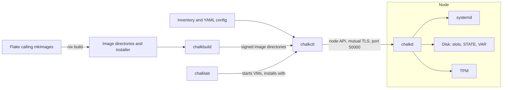
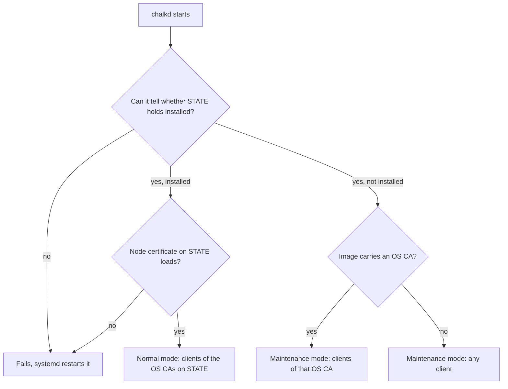

# Architecture

chalkos builds signed, read-only images with Nix and configures the machines that boot them with
YAML documents, through one agent on each node. This page names the parts, says where each one
runs and explains the two modes of the agent. [How a node works](overview.md) follows a node
through the stages of its life.

The diagram shows how the parts connect.



The parts fall into four groups:

- On the operator's machine, a flake calls `chalkos.lib.mkImages`, which Nix evaluates into the
  images of the cluster's variants, one per platform, and an installer.
- Also on the operator's machine, chalkctl reads an inventory of the cluster's nodes and their
  YAML config files and drives the nodes. chalklab runs a whole cluster as local virtual machines.
- On the machine that holds the Secure Boot db key, the operator's or a build machine,
  chalkbuild signs a copy of each image directory Nix builds, so the key never enters
  `/nix/store`.
- On every node, chalkd serves the node API, installs and upgrades the node and applies its
  config.

## Nix builds the software and the config carries the rest

Nix builds the software a node runs: the operating system, Kubernetes and chalkd.
[`chalkos.lib.mkImages`](../../reference/options.md#mkimages-arguments) evaluates one NixOS system
per variant and platform. Each system comes from chalkos's node modules, the platform's modules,
the modules every variant shares and the variant's own. Nix builds each into an unsigned raw disk
image in an image directory. It also builds one installer, which installs images of every
platform. mkImages takes no node, address or cluster setting. Its only input of a cluster is the
optional public part of its secrets, for the OS CA. So one image serves every node the
[inventory](../../reference/kinds.md#inventory) runs on it, control planes and workers alike.
[Variants and platforms](../../build/variants-and-platforms.md) explains variants, platforms and
the order of their modules.

Everything that differs between nodes is config, delivered at runtime. The split keeps one image
per variant and platform, so a cluster of three control planes and fifty workers of one variant
builds and signs one image per platform. A change to what the image fixes, such as the kernel or a
service, is a new image and an [upgrade](upgrades.md). A change to the config, such as the
hostname or the time servers, is a change to YAML files, delivered with
[`chalkctl apply-config`](../../reference/cli/chalkctl_apply-config.md) without a reboot. A storage
change that would destroy data is refused there and takes a reset or a reinstall, as
[Additive changes apply while the node runs](storage.md#additive-changes-apply-while-the-node-runs)
describes.
[Boot and the image](../../reference/boot.md#what-an-image-fixes-and-what-config-delivers) lists
what falls on each side, and
[Variants and platforms](../../build/variants-and-platforms.md#add-a-variant-only-for-other-software)
draws the line in detail. [Config and the inventory](config.md) explains the config side.

## chalkctl and chalklab run on the operator's machine

chalkctl reads the cluster from an inventory, `chalkos.yaml` in the current directory or the file
`--inventory` names. The inventory names each node, the address chalkctl reaches it at, the YAML
files of its config and the image it runs, by the image directory of its build. chalkctl reads
the image directory when a command needs the image. Without an inventory, a command that only
reaches a node works with a client file and `--address`. [Config and the inventory](config.md)
describes the files.

chalkctl authenticates with the secrets file, which holds every CA key of the cluster, or with a
client file, which holds one certificate of the reader, operator or admin role. Installs, config
changes and rotations need the secrets file. Upgrades, reboots, status and logs work with a client
file, so the people who operate a cluster need not hold its CA keys.
[Clients authenticate with the secrets file or a client file](security.md#clients-authenticate-with-the-secrets-file-or-a-client-file)
explains both.

chalklab runs the nodes a lab file names as QEMU virtual machines on one machine, each with
Secure Boot and a TPM. It never builds images. It copies the `kvm` image the inventory names for
each node, signs the copy with lab keys it enrols in the VMs' firmware, boots each node and
installs it with chalkctl. A lab is how the [quick start](../../get-started/quick-start.md) runs.

## A node runs its image from a read-only store

A node runs its image from a read-only store checked by dm-verity, with its root file system in
memory. What it writes goes to two encrypted partitions. STATE, 128 MiB by default, holds the
node's config, certificates and Kubernetes secrets. VAR, mounted at `/var`, holds etcd,
containerd, the kubelet and logs. [The image](image.md) describes the disk, and
[Storage and encryption](storage.md) describes STATE and VAR.

At every boot, two units in the initrd unlock STATE and mount VAR. A unit before networkd applies
the config on STATE. Then chalkd starts and serves the node API, and on a counted boot a health
check decides whether a new image is healthy.
[Boot and the image](../../reference/boot.md#boot-units) lists the units.

chalkd runs as root, because it partitions disks, enrols TPM keyslots, writes EFI variables,
mounts volumes and sets the hostname. It restarts whenever it stops, with no limit, because it is
the only way to reach the node.
[Architecture for developers](../../contribute/architecture.md#chalkd-runs-with-a-narrow-sandbox)
describes its sandbox.

!!! note "On the shipped variant, chalkd also runs the control plane"

    On a control plane, chalkd renders the static pods of etcd, the API server, the
    controller-manager and the scheduler. It holds the VIP when elected, renews the node
    certificates of the cluster and drains nodes for upgrades.
    [The control plane](../kubernetes/control-plane.md) covers that side.

## The installed marker decides chalkd's mode

chalkd runs in one of two modes, and the file `installed` on STATE decides which. The flowchart
shows how chalkd picks the mode when it starts.



### Maintenance mode serves a node that is not installed

A machine reaches maintenance mode in one of two ways:

- It boots the installer, from a USB disk, an ISO or a network boot. The installer never touches
  the medium it boots from. It writes the node's image to another disk.
- It boots its image directly, written to its disk with `dd`, used as a VM's disk or created by
  chalklab. On the first boot, systemd-repart adds slot B and an empty STATE behind the
  partitions the image ships with. STATE has no `installed` file, so chalkd starts in maintenance
  mode.

In maintenance mode, chalkd serves a self-signed certificate and prints its SHA-256 fingerprint
and the node's addresses on the console:

```text
chalkd: maintenance mode, accepting clients of the OS CA; certificate fingerprint <fingerprint>
chalkd: addresses <addresses>; certificate fingerprint <fingerprint>
```

It accepts only reads (node information, disks and logs), a reboot and an install. Whom it
accepts depends on whether the image carries an OS CA, as
[A node in maintenance mode is trusted by its fingerprint](security.md#a-node-in-maintenance-mode-is-trusted-by-its-fingerprint)
explains. [Install a node](../../operate/install.md) covers the install as a task.

### Normal mode serves an installed node

In normal mode, chalkd serves its node certificate and accepts only clients whose certificate
chains to the OS CAs on STATE. Each method is open to the client roles allowed to call it, and the
install method is closed.

When chalkd cannot read STATE well enough to tell whether the node is installed, it fails and
restarts. It never falls back to maintenance mode, which would offer an installed node for a new
install.

## chalkctl and chalkd talk over the node API

They use the [node API](../../reference/api.md): Connect RPC over HTTPS with TLS 1.3 on TCP port
50000, with a client certificate on every call. chalkd takes the client's role from the
certificate and checks the certificate again for every request, as
[chalkd checks the role of every request](security.md#chalkd-checks-the-role-of-every-request)
explains. [Roles and credentials](../../reference/access.md) lists what each role may call.

## Limits

- An image without an OS CA accepts any client in maintenance mode. Build images with mkImages'
  `osCA` set for machines on a network others can reach.
- [How a node works](overview.md#what-chalkos-does-not-do) lists what chalkos leaves to the
  operator, such as enrolling Secure Boot keys.

## Related pages

- [Variants and platforms](../../build/variants-and-platforms.md),
  [Config and the inventory](config.md) and [The image](image.md) for what Nix builds and what a
  node receives.
- [Security model](security.md) for the client roles and what Secure Boot and the TPM protect.
- [Install a node](../../operate/install.md) for the install as a task.
- [`chalkctl install`](../../reference/cli/chalkctl_install.md) and the
  [node API](../../reference/api.md) for the details.
- [Architecture for developers](../../contribute/architecture.md) for the code's layout, chalkd's
  sandbox and the steps of an install.
