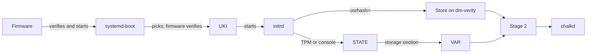
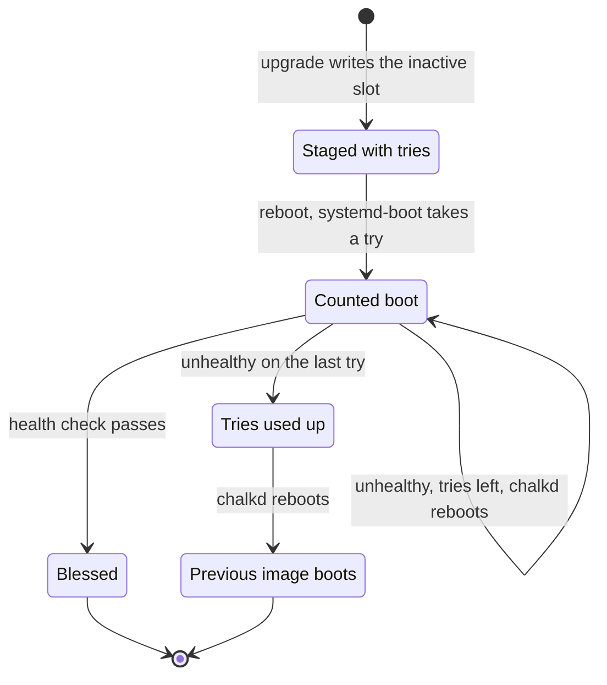
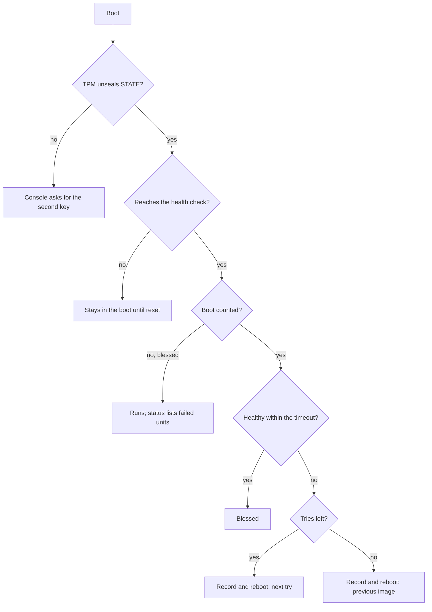

# Boot, health and rollback

A node that rolled back from a new image reports it in the first lines of
[`chalkctl status`](../../reference/cli/chalkctl_status.md):

```text
image <image>, booted from chalkos_<generation>.efi
upgrade to <new-image> failed: rolled back to <image>
  <the failed boot's last journal lines>
```

A node boots a chain of signed and hashed parts, from the firmware to chalkd, and each part checks
the next. After an upgrade, systemd-boot gives the new image a fixed number of tries, and chalkd
decides whether each try is healthy. A new image that never becomes healthy is replaced by the
one the node ran before. A bad image therefore leaves a node running its previous image after a
few reboots.

## The boot chain checks each part before it starts the next

The boot chain runs from the firmware through systemd-boot and the UKI to the initrd. The initrd
opens the store and the node's partitions before the system starts.



1. The UEFI firmware starts systemd-boot from the ESP. With Secure Boot on, it first checks
   systemd-boot's signature against db and dbx.
2. systemd-boot picks a UKI and asks the firmware to start it. The firmware checks the UKI's
   signature the same way, as [The image](image.md#the-uki-is-checked-against-db-and-dbx-before-anything-runs-it)
   describes.
3. The UKI's stub starts the kernel with the initrd and command line the UKI carries, so its
   signature covers both.
4. The initrd opens the store and the node's partitions.
5. Stage 2 applies the node's config, starts the network and starts chalkd.

systemd-boot boots the first UKI in `/EFI/Linux` whose tries are not used up. Among a node's
UKIs, the highest generation in the file name `chalkos_<generation>.efi` comes first, so the entry
installed last boots first. Once its tries are used up, systemd-boot passes over it to the
previous generation. chalkd sets no EFI variable to choose the entry.
[Boot](../../reference/boot.md#systemd-boot-sort-rules) lists the sort rules.

## The initrd opens the store and the node's partitions

The initrd prepares the root file system in three steps:

- systemd-repart compares the boot disk with the image's partition definitions. On the first boot
  of an image it adds slot B and an empty STATE. On later boots everything is there, and it
  changes nothing. It runs only on the disk systemd-boot was loaded from, which udev marks, so a
  second disk with the same image is never touched.
- The kernel command line's `usrhash=` names the store's root hash. systemd finds the data and
  hash partitions whose UUIDs derive from it, opens them with dm-verity and mounts the store
  read-only.
- `chalkos-state.service` unlocks and mounts STATE, and `chalkos-storage.service` then creates any
  missing volume and unlocks and mounts VAR. The TPM unseals their keys, and when it refuses, the
  console asks for the second key: the node's recovery key or a password.
  [The initrd unlocks STATE first, then VAR](storage.md#the-initrd-unlocks-state-first-then-var)
  describes both units.

## Stage 2 applies the config before the network starts

Stage 2 starts the node's own services in order:

1. `chalkos-config.service` applies the config that STATE keeps for the booted image, its
   [config slot](config.md#a-node-keeps-one-config-slot-per-image), before networkd starts. The config
   holds the hostname, the documents services read and the outputs rendered from them, networkd's
   units and chrony's time servers among them. A fallback boots the previous image with its own
   slot, so it runs the config it ran. An image without a slot fails here, and its boot is not
   found healthy.
2. systemd-networkd brings up the network.
3. chalkd starts. It finds the `installed` marker on STATE and serves in normal mode, or finds
   none and serves in maintenance mode.
4. On a boot that systemd-boot counts, `chalkos-health.service` decides whether the boot is
   healthy.

!!! note "On the shipped variant, Kubernetes starts once the network is online"

    On an image with Kubernetes, `chalkos-kubernetes.service` waits for
    `chalkos-node-addresses.target`, which follows `network-online.target`, and then prepares the
    node's certificates and configuration. containerd and the kubelet follow. chalkd does not wait
    for this preparation, so it answers while the node's addresses settle.

[Boot](../../reference/boot.md#boot-units) lists the units with their commands.

## A new image's entry boots a fixed number of times

An upgrade installs the new UKI as `chalkos_<generation>+<tries>.efi`. `<generation>` is one above
the highest generation on the ESP. `<tries>` is the new image's
[`chalkos.upgrade.bootTries`](../../reference/options.md#chalkosupgradeboottries), 3 by default.
The number travels in the image's os-release as `CHALKOS_BOOT_TRIES`, so the image being installed
sets it, not the one running.

Before each boot of the entry, systemd-boot renames the file to count the try: `+3` becomes
`+2-1`, then `+1-2`, then `+0-3`. Once the system decides the boot is good,
`systemd-bless-boot.service` renames the file to `chalkos_<generation>.efi`, without a counter.
The entry is a normal, blessed entry from then on. An entry at `+0` is used up, and systemd-boot
skips it. The diagram shows the states of a new image's entry.



The previous image's entry stays on the ESP throughout, and the upgrade never touches its slot, so
the fallback boots exactly what the node ran before.

## The health check decides whether a counted boot is good

`chalkos-health.service` runs `chalkd health` on every boot that systemd-boot counts, and only
then. Only `systemd-bless-boot.service` pulls in `boot-complete.target`, which requires the health
unit. The check repeats every 5 seconds until the node is healthy or
[`chalkos.upgrade.healthTimeout`](../../reference/options.md#chalkosupgradehealthtimeout) passes,
300 seconds by default.

Every check starts with chalkd. It must complete a TLS handshake with the node's own certificate
on port 50000, because a node that chalkd cannot serve cannot be managed and must fall back. On a
node without Kubernetes, and on the shipped variant on a node without a Kubernetes share or a
control plane not bootstrapped yet, two more criteria follow. The node's config must have been
applied, and no unit of the boot may have failed. A unit of the boot is one that
`multi-user.target` or `sysinit.target` pulls in. Jobs that timers and sockets
start do not count, nor do the units listed in
[`chalkos.upgrade.healthIgnoreUnits`](../../reference/options.md#chalkosupgradehealthignoreunits).

When the check passes, the unit succeeds, `boot-complete.target` is reached and
`systemd-bless-boot` blesses the entry. A blessed image is never rolled back.

!!! note "On the shipped variant, a cluster node is healthy when its Kubernetes parts are"

    A Kubernetes node that is part of a cluster is checked on its Kubernetes parts in place of
    its units, after the chalkd check. A Kubernetes node whose preparation failed is unhealthy. A
    worker is healthy when its kubelet's `/healthz` answers and its Node is registered. A control
    plane that is an etcd member is healthy when its local etcd member answers, its API server is
    ready and its kubelet's `/healthz` answers. A node that is not yet part of a cluster is checked
    like a node without Kubernetes.

## Each kind of failure leaves the node in a known state

A boot can fail before chalkd runs, in the health check, or after the image was blessed. The
diagram shows where each failure leaves the node.



### The TPM refuses or chalkd cannot read STATE

When the TPM does not unseal STATE, for example after Secure Boot was turned off or db changed,
the console asks for the recovery key or password. The node never drops to maintenance mode,
which would let someone at the console install it anew.
[Storage and encryption](storage.md#a-changed-pcr-7-sends-the-unlock-to-the-console) explains the
causes.

chalkd decides its mode from STATE alone. When it cannot read STATE to tell whether the node is
installed, it fails and restarts, as
[The installed marker decides chalkd's mode](architecture.md#the-installed-marker-decides-chalkds-mode)
describes.

### A boot that hangs is never decided

The health check runs late in the boot, after chalkd starts. A counted boot that hangs before
then is never decided by it, for example at the initrd's console prompt for a disk's second key,
or in `chalkos-config.service`. The node stays in that boot until someone resets it. Only then
does systemd-boot take the next try, or fall back once the tries are used up. A power reset from
a BMC or a hypervisor is enough.

### An unhealthy boot is recorded and rebooted

When the timeout passes, chalkd records the failure. It writes the last 30 journal lines of chalkd
and the health check during this boot to `/var/lib/chalkd/failed-boot` on VAR, headed by the root
hash of the store that booted and the generation of its entry. The record lives on VAR because the
image the node falls back to must read it. The journal cannot serve: the read-only image gets a new
machine ID at every boot, so each boot's journal stays apart.

Then chalkd reboots the node, but only when a reboot leads systemd-boot on. A reboot leads on to
another try while the entry has tries left, and on the last try to an entry the node can fall
back to. A reboot of a boot that is not counted, or of a used-up entry booted because nothing else
is left, would boot the same image again in a loop. chalkd leaves such a node running and logs
why. A health check that ends before it decides, stopped by its unit's timeout or crashed, is
handled the same way.

After the last try, systemd-boot skips the used-up entry and boots the previous image, whose slot
and UKI the upgrade never touched. Its entry carries no counter, so its boot is not counted, and
no health check runs.

### A blessed image is never rolled back

A blessed image that fails at a later boot stays. The health check does not run on its boots, so
nothing rolls back, and status lists the failed units. The check also judges only what it checks:
a new image whose workloads fail while the parts the check covers are healthy is blessed.

[Recover a node](../../operate/recover-node.md) and
[Troubleshooting](../../operate/troubleshooting.md) cover the fixes.

## Status reports the boot from the ESP

chalkd reads the boot from the ESP whenever it reports status: the entry it booted, whether that
boot was blessed, an entry of the image with tries left that boots next, and a used-up entry it
fell back from. The used-up UKI stays on the ESP until the next upgrade removes it. The record on
VAR is removed once a counted boot is found healthy.
[Status, logs and the console](../../operate/status-and-logs.md#the-platform-and-image-lines-name-what-the-node-booted)
explains each image line. `chalkctl upgrade` stops at a node that rolled back, as
[Upgrades](upgrades.md#a-rolled-back-node-stops-the-run) describes.

## Limits

- Rollback protects the first boots of a new image only. Once blessed, an image stays, even if it
  fails later.
- The health check does not cover workloads. A regression that only workloads notice is blessed.
- A hang before the health check, such as a console prompt, needs a reset from outside. The node
  cannot reboot itself from there.
- Each try lasts up to the health timeout plus a reboot. With the defaults, a bad image runs for
  about 15 minutes before the node is back on its previous image.
- An upgrade never updates or rolls back systemd-boot.

## Related pages

- [The image](image.md) for the UKI, the store and the slots.
- [Upgrades](upgrades.md) for how a new image is installed.
- [Storage and encryption](storage.md) for STATE, VAR and their keys.
- [Security model](security.md) for what Secure Boot and PCR 7 protect.
- [Upgrade nodes](../../operate/upgrade.md#a-node-that-fails-its-health-check-rolls-back) for
  what to do after a rollback.
- [Recover a node](../../operate/recover-node.md) and
  [Troubleshooting](../../operate/troubleshooting.md).
