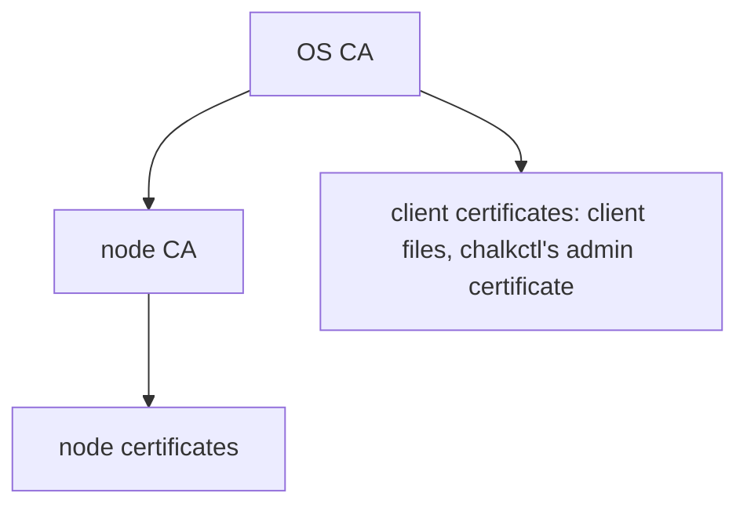
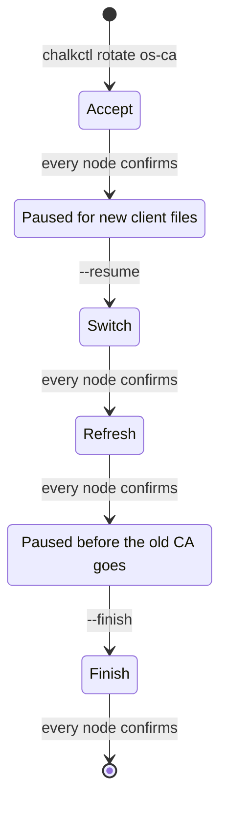

# Certificates

`chalkctl status` lists the certificates a node holds and the CAs it trusts. For a node without
Kubernetes whose node certificate is due for renewal, it prints lines such as these. `<date>` is
an expiry date, `<fingerprint>` the first 16 hex digits of the CA certificate's SHA-256
fingerprint, `<server>` the time server the clock follows and `<offset>` the clock's offset from
it in seconds.

```text
certificates:
  node   expires <date>  the node certificate expires on <date>; this image cannot renew it on its own; run chalkctl node renew w1
  OS CA  expires <date>
trust:
  OS CA  <fingerprint>
time: synchronised to <server>, offset <offset> s
```

Two certificate authorities authenticate the node API that chalkd serves: the OS CA and the node
CA below it. `chalkctl gen secrets` generates them once and keeps them in the secrets file. This
page explains what each one issues, how the certificates are renewed, how a CA is replaced, and
why a node's clock decides what it accepts. [Certificates](../../reference/certificates.md) in the
reference lists every CA and certificate with its lifetime and renewal point.

!!! note "On the shipped variant, three more CAs and two keys serve Kubernetes"

    The secrets file also holds the Kubernetes, front-proxy and etcd CAs, the service-account key
    and the encryption key. [Kubernetes certificates](../kubernetes/certificates.md) explains what
    they issue and how they are rotated.

## The OS CA issues clients and the node CA

The OS CA is the root of the node API. It lives ten years and issues two things:

- client certificates, with the role in their Organization;
- the node CA, an intermediate that lives five years.

The node CA issues node certificates and nothing else. It exists so that control planes can renew
node certificates without holding the OS CA's key. Its extended key usages allow TLS servers and
clients alone, and its path length of 0 forbids any CA below it. A control plane that is taken
over can therefore issue node certificates, but no client certificate of a role and no CA. chalkd
gives any certificate that chains through the node CA the role `node`, whatever its subject says,
as [Security model](security.md#chalkd-checks-the-role-of-every-request) explains.

The diagram shows the two branches below the OS CA: node certificates through the node CA, and
client certificates directly.



Every CA has an ECDSA P-256 key, and no two CAs of a secrets file may share one. Every certificate
chalkos issues is capped at its CA's own expiry and backdated by an hour, so a node whose clock
lags slightly still accepts it.

## A node certificate carries the node's name

A node's node certificate is what chalkd serves and what it presents to renew itself. Its subject
is the node's name in the inventory, which chalkd takes as the node's name. It also names the host
name the node's `Host` document gives and the node's addresses. It lives one year and is stored
with its key and the node CA's certificate in one file on STATE, `/state/chalkd/node.pem`. chalkctl
issues the first one at install.

Client certificates come from the OS CA directly. A client file from
[`chalkctl config new`](../../reference/cli/chalkctl_config_new.md) holds one, valid for one year
by default (`--ttl`). A command that reads the secrets file issues itself an admin certificate that
lives one hour and exists only in memory.

## A node renews its certificate through a control plane

chalkd checks its node certificate about hourly on every node in normal mode. Once two thirds of
its lifetime have passed, the certificate is due. An image whose layer issues node certificates,
Kubernetes on the shipped variant, then renews it, and any other image reports it.

On a Kubernetes node, chalkd creates a new key and asks a control plane for a certificate through
the Kubernetes layer's [RenewNodeCertificate](../../reference/api.md#kubernetes-method-renewnodecertificate), on
port 50000 of the cluster endpoint's host. It authenticates with its current certificate, and the
control plane signs exactly the names of that certificate, whatever the request asks for. A
control plane signs its own with the node CA it holds. A failed attempt keeps the current
certificate and is retried after a minute, doubling up to an hour.

A node whose image runs no Kubernetes, such as a router, reaches no control plane, so it does not
renew its node certificate by itself. Once the certificate is due, chalkd logs
`node certificate is due for renewal and expires <time>; nothing on this node renews it` once,
and the status shows the line above with the expiry date, or `expired on` after it.
[`chalkctl node renew`](../../reference/cli/chalkctl_node_renew.md) issues a new certificate from
the secrets file and delivers it.

`chalkctl node renew` also renews a node whose certificate expired, for example after a year
switched off. Such a node cannot renew itself, because the control plane no longer accepts the
certificate it authenticates with. To reach it, chalkctl verifies the expired certificate as of
its start date, so it trusts the node's old key. Someone who holds a leaked, expired key of that
node and sits in its network path could receive the new certificate instead. A node that renews
before expiry never needs this.
[Node certificates renew through a control plane](../../operate/access.md#node-certificates-renew-through-a-control-plane)
gives the steps.

## The clock decides whether a certificate is valid

Certificates are checked against the node's clock, so a node whose clock is off refuses valid
certificates and accepts expired ones. Nodes keep time with chrony, from the servers
[Networking](networking.md#chrony-keeps-the-clock-with-authenticated-servers) describes.

chrony steps a clock that is more than a second off during its first three updates, instead of
slewing it for hours. Until then, chalkd and the control plane may refuse certificates that are
valid. NTS authenticates the time servers with certificates too, so chrony skips their time check
until it has set the clock once. The hour by which every certificate is backdated covers a clock
that lags a little.

The status reports the clock as `time: synchronised to <source>, offset <seconds> s`, or as
`time: not synchronised; certificates are checked against this clock`.

## A rotation replaces a CA in four phases

[`chalkctl rotate os-ca`](../../reference/cli/chalkctl_rotate.md) replaces the OS CA, and with it
the node CA, across the cluster. It runs in four phases. Every node confirms a phase in its status
before the next one starts, so no node ever presents a certificate that another node does not
trust yet:

1. Accept: every node trusts the new OS CA besides the old one.
2. Switch: the new CAs issue.
3. Refresh: every node gets a node certificate of the new node CA.
4. Finish: the old OS CA is removed, and whatever it issued is refused from then on.

The diagram shows the phases and the two pauses in which the operator acts before the rotation
goes on.



chalkctl says at each pause what to do. After the accept phase, client files issued carry both OS
CAs and keep working through the rotation and after it:

```sh
chalkctl rotate os-ca
chalkctl rotate os-ca --resume
chalkctl rotate os-ca --finish
```

The secrets file records the phase reached, so a rotation that stopped, at an unreachable node for
example, continues with `--resume`. One rotation runs at a time, and one chalkctl command at a time
changes the secrets file, holding `<file>.lock`. The file is updated in place and its previous
version kept as `<file>.prev`, unless `--out` names a new file. An encrypted file is encrypted
again to the recipients recorded inside it.

[`chalkctl rotate node-ca`](../../reference/cli/chalkctl_rotate.md) replaces the node CA alone, in
one go without pausing, on every kind of node. The accept and the finish change nothing on the
nodes, because they trust the OS CA the new node CA chains to. The switch delivers the new node CA
to the nodes that hold it, the control planes on the shipped variant; on a cluster without
Kubernetes no node holds it. The refresh issues every node a certificate of it from the secrets
file. Control planes come first, then the other nodes by name. Node certificates of the old node CA
stay valid until they expire, because they chain to the same OS CA.

chalkctl writes the secrets file once per phase, so after a rotation `<file>.prev` holds the
version the last phase wrote.

## A rotation leaves client files behind

A client file holds the OS CA certificates it verifies the nodes with, and a rotation cannot reach
it. Client files from before an `os-ca` rotation stop verifying the nodes at the switch and are
refused at the finish. Files issued after the accept phase carry both OS CAs. Images and installer
media carry the OS CA too, so after an `os-ca` rotation they are built again from the new
`secrets.pub.json`. Older ones fail to install.

Files issued during a rotation still trust the old OS CA when they verify the nodes after the
finish, so whoever holds the old CA's key could pose as a node to them until they are issued
again.

## Access is revoked by rotating its CA

chalkos keeps no list of revoked certificates, so a certificate stays valid until it expires or
its CA is removed. A leaked client file is revoked by rotating `os-ca`, which also retires every
other client file of the old OS CA. Short `--ttl` values on client files limit how long a leak
matters.

`chalkctl rotate node-ca` revokes nothing: chalkd trusts every node CA the OS CA signed, so only
an `os-ca` rotation retires the certificates of the old node CA.

!!! note "On the shipped variant, chalkctl node revoke shuts out one node"

    A node is revoked by name with `chalkctl node revoke`. Its certificates then renew no more, and
    the API server denies its kubelet every write. The certificates themselves stay valid until
    they expire.
    [Revoking a node cuts off its writes and renewals](../kubernetes/certificates.md#revoking-a-node-cuts-off-its-writes-and-renewals)
    explains what that covers.

## Limits

- There is no revocation of a single certificate. Revoking one revokes all of its CA.
- The CAs are not renewed automatically. A CA in its last year shows in the status, the node CA
  in its last 18 months, and a rotation replaces it.
- Nodes whose image runs no Kubernetes renew their node certificates only through
  `chalkctl node renew`.
- Recovering a node whose certificate expired trusts the node's old key.
- A control plane holds the node CA. Taking one over lets the attacker issue node certificates, but
  no client certificate of the node API.

## Related pages

- [Security model](security.md): client roles, the secrets file and client files.
- [Kubernetes certificates](../kubernetes/certificates.md): the Kubernetes CAs and their rotation.
- [Certificates](../../reference/certificates.md) in the reference: every CA and certificate, its
  lifetime and the status notes.
- [Manage access and certificates](../../operate/access.md) and
  [Recover a node](../../operate/recover-node.md).
- [`chalkctl rotate`](../../reference/cli/chalkctl_rotate.md) and
  [`chalkctl node renew`](../../reference/cli/chalkctl_node_renew.md).
