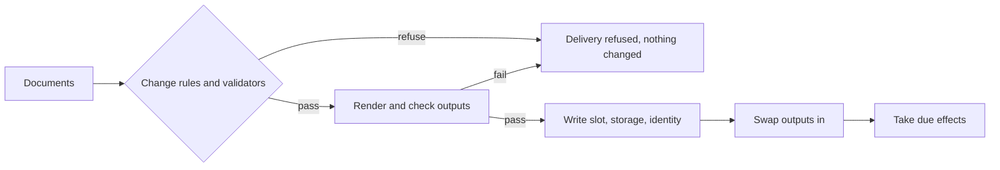
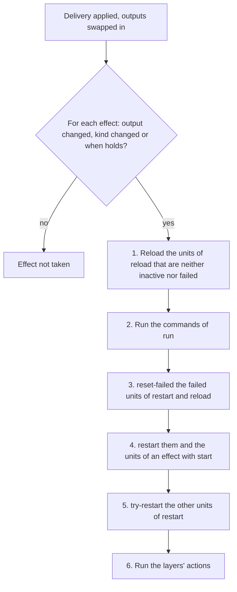

# The config pipeline

A delivery of config to a node either changes nothing or changes everything it carries. When the
`Peer` documents of the [BGP extension example](../../guides/bgp-extension.md) give bird a config that its own parser rejects,
`chalkctl config apply` fails, and its error names the output:

```text
output bird-conf: its check refused the rendered files (exit 1); see the node's journal
```

The node then still runs its old documents, its old `bird.conf` and an unreloaded bird. This page
explains the stages that make that so. The build pages show how an image declares each stage:
[rules](../../build/guard-changes.md), [validators](../../build/validate-config.md),
[outputs](../../build/render-config.md) and [effects](../../build/react-to-changes.md).

## A delivery passes four stages

The node's documents pass through rules, validators, outputs and effects, in that order:



The diagram shows the two stages that can refuse a delivery before it changes anything, and the
three that follow once it passes both. In detail, a delivery to the running image, a
[`chalkctl config apply`](../../reference/cli/chalkctl_config_apply.md), runs these steps:

1. chalkd checks the documents against the image's schemas and its change rules, then runs the
   image's validators in the renderers' sandbox. A rule that fails, or a validator that reports
   refusals or fails, refuses the delivery.
2. chalkd records the effects' baseline, unless one exists: the running slot's config, the facts
   the effects' `when` rules read and the hash of each output's files.
3. chalkd renders every output from the new documents into a staging directory below
   `/run/chalkos/outputs/.staging`, then runs each output's check. A renderer that reports
   refusals, or a renderer or check that fails, refuses the delivery, and nothing on the node has
   changed. The refusal shows what the renderers reported, each refusal once, and names any other
   failed output with its exit status.
4. chalkd writes the config slot, the storage and the node's identity.
5. chalkd swaps each output's link to its staged files.
6. chalkd takes the effects whose outputs or kinds changed, or whose `when` holds.

`config apply` prints the units the effects restarted.

A dry run, `chalkctl config apply --dry-run`, runs the checks of steps 1 and 3, then works out
step 6 without taking it. It records no baseline and no output failure, discards the staged files
and answers with the plan: the outputs whose files would change, and the effects step 6 would take
with what fires each. Effects whose `when`
compares facts before and after the delivery see the facts as they are, since nothing changed.

## chalkctl and chalkd both run the rules

chalkd evaluates every rule, with its facts, each time it writes a config slot and before it
changes anything:

- `chalkctl config apply` for the running image, with the running image's rules;
- `chalkctl config apply` while an image is staged, `chalkctl config apply --staged` and upgrades,
  with the rules of the image the slot is for, which that image's own chalkd evaluates;
- `chalkctl install`, with the rules of the image it installs: in place the running image's, from
  the installer those that the image's own chalkd evaluates once its store is on the target disk.

An image checks config for itself before it boots: the node or the installer runs the image's
`chalkd check` with the image's store in place of its own. The image's rules therefore compile
with the CEL library of the image's chalkd, and may call any function that chalkd has, whatever
the running image's or the installer's chalkd has.

chalkctl evaluates the rules that read no facts, because the facts are the node's. `chalkctl
validate` has no running config, so it runs the rules of kinds and the rules of fields that do not
read `oldSelf`. `chalkctl config apply` fetches the node's config first and runs those rules
against it too, so a change that the `asn` rule of the BGP extension refuses fails without
reaching the node. The `Rack` rule of the extensions example reads a fact, so it runs on the node
alone.

`chalkctl storage reset` evaluates the storage kinds' rules against STATE's storage records
without the volume it resets, which it recreates like a new one.

## Rules compare with the running config alone

Rules compare the config with the running image's config. No rule reads the slot of another
image. An image that does not run compares with the running config as
[An image that does not run checks its own config](#an-image-that-does-not-run-checks-its-own-config)
describes.

## Null means the node does not know

Facts describe the node, and a rule reads the facts that its own image declares. chalkd loads the
facts on the machine the node runs on:

- When the running image checks the config, as for `chalkctl config apply` to its own slot, the
  facts are the running image's. A command fact runs the running image's program.
- When an image that does not run checks the config, as for an upgrade, a delivery to a staged
  image or an install from the installer, the facts are those that image's `facts.json` declares.
  A file fact reads the file on this machine, and a command fact runs that image's program from
  its store. A newer image's rules therefore get the facts it adds during the upgrade to it.

Several cases give null, so a rule treats null as unknown:

- A file fact whose file is missing.
- Every fact at an install in place, so a repeated install does not read what an earlier attempt
  left on STATE.
- A fact of what the node holds, such as a file on STATE, at an install from the installer. The
  installer's machine has no STATE, but its hardware is the node's, so a command fact that reads
  the disks finds the node's disks.

An install also has no running config: rules of fields that read `oldSelf` do not run, and the
rules of kinds see no `oldDocuments`. The `Rack` rule therefore accepts any location at install.

## Built-in rules and facts

The storage kinds read three facts. `recorded` is the storage section STATE records. `disks`
says, for each volume with a disk of its own, whether its disk is pinned and plugged in, and what
a changed reference finds. `fallback` says whether a fallback secret was sent, and whether it
opens the node's fallback keyslot.

The storage kinds' messages show what the `disks` fact found: a volume's disk reference, the
identity of its pinned disk and of the disk a changed reference finds, and why a disk cannot be
found.

A reset recreates its volume like a new one, so a node with a fallback needs the fallback secret.
`chalkos-storage facts fallback` checks it against the password keyslots of STATE and the volumes
before the reset. The volume being reset may hold the node's only password keyslot. A secret that
does not open that keyslot then refuses the reset, and so does a keyslot cryptsetup cannot read,
as when its header is damaged, although the reset would wipe it.

!!! note "Kubernetes: the Node and Cluster kinds keep the node's share"

    Images with Kubernetes add rules that keep, once the node holds a Kubernetes share, the
    `Node`'s type, labels and taints, and the `Cluster`'s `allowSchedulingOnControlPlanes`,
    `ipFamilies`, and the ranges and DNS addresses of the families both configs have. Ranges and
    addresses compare as what they denote; an unset DNS address is the 10th of its service range.
    The fact `share` holds the kind of the node's share and the SHA-256 of each of its other keys,
    so its certificates and private keys stay out. The fact `cluster` is the node's cluster as
    chalkd last wrote it.

## chalkd takes the due effects in one order

Once a delivery is applied, chalkd collects every effect that fires and takes their actions
together:



The diagram shows the decision for each effect and the order of the actions of all due effects:

1. chalkd reloads, in one `systemctl reload`, the units of `reload` that are neither inactive nor
   failed, such as an active unit or one that is starting. An inactive unit reads its config when
   it starts, a failed one chalkd restarts in step 4, and a unit chalkd also restarts gets no
   reload. systemctl queues the job of each unit it is given one at a time, and systemd holds a
   job back only for jobs already queued. chalkd therefore names each unit after the units it is
   ordered after, by its `After=` or their `Before=`, so the reloads keep the units' order. Each
   restart in steps 4 and 5 is ordered the same way, but every restart comes after every reload.
   These separate commands can put a dependent reload before the restart of its failed
   prerequisite. An explicit effect prerequisite puts them in separate batches.
2. It runs the `run` commands, each once, in the order of their effects' names.
3. It runs `systemctl reset-failed` on the units of `restart` and `reload` that failed. The new
   config may be what they lacked, systemd reloads no failed unit, and their earlier failures
   would count against their start limit.
4. It restarts, in one `systemctl restart`, those failed units and the units of an effect with
   `start`. `systemctl restart` starts a unit that does not run.
5. It restarts the other units in one `systemctl try-restart`. A unit that runs, or ran and stays
   active, restarts. A unit that never started or was stopped stays so.
6. It runs the layers' actions that the effects' `chalkd` options name, each once, on what
   chalkd itself holds.

!!! note "Kubernetes: chalkd's own loops"

    The Kubernetes layer's loops run inside chalkd and have no unit, so an effect acts on them
    through its `chalkd` option. `kubernetes:restart` starts every Kubernetes loop again, and
    each reads the cluster when it starts. `kubernetes:reload` starts the control plane's loop
    again, which reads the share and applies the control plane's objects. chalkd runs each due
    action once, however many effects name it. chalkos's own Kubernetes effects use them; an
    image without the Kubernetes layer has neither.

chalkd takes the due effects in batches and uses this action order within each batch. A batch
holds the effects whose due prerequisites ran in an earlier batch, so a delivery whose effects
name no prerequisite takes them all in one batch. chalkd runs a dependent batch once the needed
effects have succeeded. If a systemctl command covering several units fails, chalkd treats the
actions in that command as failed for prerequisite purposes. Effects outside the failed
dependency chains can still run. A readiness probe runs before its effect, with its own
deadline, and a timeout has the same effect on its dependents as a failed action. A retry or a
trial rollback still uses the baseline described below.

On a router, the `networkd` effect runs after `vrf`, so networkd creates a VRF again only once
`chalkos-vrf.service` removed the old one. A delivery whose `chalkos-vrf.service` fails
therefore reloads no networkd, and no effect that runs after `networkd`, such as `frr` or
`resolvers`. The delivery fails, and a retry takes those effects again.

Once chalkd writes the slot, the node runs the delivered config, and the rest of the delivery
goes on when chalkctl goes away: a layer action left out would leave chalkd's loops on the config
from before. chalkd stopping ends it, and so does the earliest of 10 minutes, the deadline of the
request and, for `--try`, the trial's deadline. The rollback at a trial's deadline keeps its own bound
of 5 minutes. When the effects end early or a batch fails,
chalkd still runs the layer actions of the due effects that did not run, and the error says
whether the time ran out or chalkd stopped.

## Built-in outputs and effects

Every image renders the node's network and time servers as outputs of its own. A delivery checks
them as it checks an extension's, and every boot renders them before networkd and chrony start.
[Built-ins](../../reference/builtins.md#outputs) lists these outputs and the
[effects](../../reference/builtins.md#effects) of every image and of images with Kubernetes.

The output `networkd` writes one unit per document to `/run/systemd/network`, named as the
document with its kind's suffix, such as `20-enp1s0.network`. networkd has no offline validator,
so the schemas guard it: they accept exactly the sections and keys of the image's networkd, and
refuse a value that spans lines. Its units take precedence over the image's own in
`/etc/systemd/network`. The output owns `/run/systemd/network`, so a unit written there by other
means is gone once the link replaces the directory.

The output `chrony` writes `servers.sources`, one `server` line per server of the `TimeSync`, or
chalkos's own servers without one. Its check parses the file with `chronyd -p` and accepts only
`server` lines of a host name or address. Its effect runs `chalkd chrony-reload-sources`, which
runs `chronyc reload sources` while `chronyd.service` is active. The time servers that DHCP
announces are no output, because they come from the network at runtime.

!!! note "Kubernetes: effects on the share and chalkd's loops"

    Images with Kubernetes add effects that restart their services and act on chalkd's own
    loops. Their `when` rules leave out a share that differs in its node CA alone, and
    `chalkd-share` also fires on a control plane when the objects of the `Addon` documents
    changed. chalkd acts on its loops also when a delivery fails part way, as when it cannot
    write the cluster file, the node certificate, the share or the slot.

## The baseline survives a failed delivery

A delivery can fail after step 4, as when a restart fails. Until a delivery is applied whole, the
effects compare with the baseline. It holds the state from before the first delivery that failed
part way, in `/run/chalkd/effects-baseline.json`, readable by root alone, with `Secret` values as
their hashes. A retry, or another delivery, renders again and plans the effects of the failed
delivery, including the reloads and restarts that succeeded. An identical retry may reuse
completed batches as described below. The delivery that succeeds removes the file. A delivery
refused before it changed anything leaves the file as it was.

The file also records each delivery since the baseline as an attempt, including a delivery without
config changes, which can change a fact alone. Before step 4, chalkd adds the delivery's config and
the hashes of its outputs and kinds. Once the delivery has made its changes, chalkd adds the facts
that the effects' `when` rules read. The next delivery compares with every attempt as well as with
the baseline. A delivery of the config from before the failure therefore takes the effects that the
failed delivery took on its own config. This also holds when chalkd stopped part way through a
delivery, because the attempt is recorded first. In the comparison with an attempt, `oldConfig`
and `oldFacts` hold the attempt's config and facts. An attempt without facts, such as one that
chalkd stopped before it loaded them, makes every `when` that reads a fact hold. A retry that reads
the same facts as an earlier run replaces that run's attempt. The file keeps the 16 newest
attempts.

A delivery without config, such as a Kubernetes share, the OS CAs or a node certificate, renders
from the running slot's documents and does not change them. It runs no validator. An output that
fails then goes to the status and the journal, the delivery goes ahead, and the output keeps the
files it served.

## Live activation records its progress

The version in the running slot describes what is stored. The live activation record in
`/state/activation.json` tracks the target version, the current or failed step, and
the last version whose activation finished. It contains phase and effect names, version
hashes, and a checkpoint hash. Status can read it while a delivery is running. If the daemon
stops mid-apply, the record shows the step it had reached. A record chalkd cannot write fails no
delivery: chalkd logs the failure to the journal and removes the old record, so no later retry
resumes from its checkpoints. Status then says that the record could not be written, and a
record of an earlier delivery that chalkd could not remove shows no step of the delivery that
runs. Boot health continues to describe what happened when loading and starting the config at
boot.

On an ordinary retry of the identical stored config in the same boot, chalkd can skip a
contiguous prefix of completed effect batches. The due effects and rendered output hashes
must still match, and the units in each skipped batch must still be active. Only batches
containing declarative unit actions qualify. Commands, layer actions, runtime rules, and
readiness probes run again. Any unfinished batch is retried. A changed plan, reboot, or
rollback uses the usual effect replay rules.

## Every boot renders the outputs again

`/run` is a tmpfs, so no rendered file survives a reboot. `chalkos-config.service` renders every
output from the booted slot's documents before services start, runs the checks, and swaps in each
output that passes. The outputs render for the node's name, the subject of its node certificate on
STATE. A node certificate that cannot be read fails `chalkos-config.service` before any output
renders.

Because every boot renders again, a renderer must be pure: the same documents must always give the same files. A renderer
that reads nothing but its input renders at boot the files that the delivery checked. A renderer
that read node state, such as an interface's address, could render a file at boot that no
delivery checked. So a service that needs node state reads that part itself.

The boot runs no validators. Every config slot was written only after the checker of the image
that boots it passed the documents, validators and renderers included, so the renderers get
documents the image's validators passed.

A renderer or check that fails fails `chalkos-config.service` once the rest of the config is
applied, and so fails the boot's [health check](boot-and-rollback.md). A boot that the boot loader
counts then falls back to the previous image and its config. A boot that was blessed already comes
up degraded: the output holds no files, its services read none, and `chalkctl status` names the
output.

## An image that does not run checks its own config

A staged image's validators and renderers live in its own store. Before an upgrade writes the
image's config slot, and for every `chalkctl config apply` while an image is staged, with or
without `--staged`, the node mounts that store read-only and runs the image's own `chalkd check`
in a transient unit, `chalkos-check.service`, with the image's store in place of its own. The
checker runs every check of a delivery against the image's schemas, rules, validators and
renderers. Its rules compare the config with the running slot's documents as they were
delivered, with the image's own defaults filled in. A refusal refuses the upgrade or the delivery
before the image's config slot is written. The image renders its outputs again at its first boot,
from the same documents.

The checker gets the documents with their Secret values hashed, as renderers always do, and
asks the running chalkd for the facts its rules read. chalkd loads the facts the image
declares, and runs their commands from the image's store. The unit runs as a user of its own,
without capabilities, network or access to STATE, `/var` and `/run/chalkos`, within 512 MiB
and two minutes. Its validators, renderers and checks share those two minutes, and each of them
may take up to 30 seconds. What its validators, renderers and checks write to standard error is
in the unit's journal: `chalkctl logs <node> --unit=chalkos-check.service`.

An install in place runs the running image's validators, and renders and checks the outputs with
its renderers, before it installs anything, and the boot that follows renders them again. An
install from the installer has the installed image check the config the same way, once the
image's store is in slot A of the target disk and before STATE holds the node's config. The
installer's chalkd loads the facts the image declares from its own machine, the one the node runs
on. Its own code only translates the config for the storage it lays the disk out with, which must
match the storage the image's checker gets from the config.

## Limits

- A renderer reads documents and the node's name alone.
- chalkctl cannot run an image's renderers, so `chalkctl config apply --diff` shows the documents
  a delivery changes, not the rendered files. It runs only the validators it links, the router
  layer's `router` on router images, so `chalkctl validate` accepts a config that another
  validator of the image refuses on the node.
- An effect's `when` compares documents as written, so a change that makes no difference to the
  unit still fires the effect, such as a value spelt another way that means the same.

## Related pages

- [Guard changes with rules and facts](../../build/guard-changes.md) for the rules and facts an
  image declares.
- [Validate config with a program](../../build/validate-config.md) for validators.
- [Render config files](../../build/render-config.md) for outputs and their checks.
- [React to changes](../../build/react-to-changes.md) for effects.
- [Extension runtime](../../reference/extension-runtime.md) for what rules and programs read, and
  their limits.
- [Config and the inventory](config.md) for how documents reach a node.
