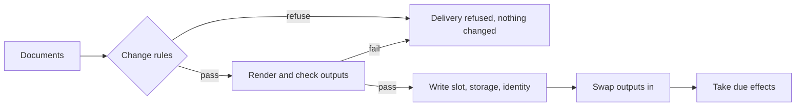

# The config pipeline

A delivery of config to a node either changes nothing or changes everything it carries. When the
`Peer` documents of the homelab's BGP extension give bird a config that its own parser rejects,
`chalkctl apply-config` fails, and its error names the output:

```text
output bird-conf: its check refused the rendered files (exit 1); see the node's journal
```

The node then still runs its old documents, its old `bird.conf` and an unreloaded bird. This page
explains the stages that make that so. The build pages show how an image declares each stage:
[rules](../../build/guard-changes.md), [outputs](../../build/render-config.md) and
[effects](../../build/react-to-changes.md).

## A delivery passes four stages

The node's documents pass through rules, outputs and effects, in that order:



The diagram shows the two stages that can refuse a delivery before it changes anything, and the
three that follow once it passes both. In detail, a delivery to the running image, a
[`chalkctl apply-config`](../../reference/cli/chalkctl_apply-config.md), runs these steps:

1. chalkd checks the documents against the image's schemas and its change rules. A rule that
   fails refuses the delivery.
2. chalkd records the effects' baseline, unless one exists: the running slot's config, the facts
   the effects' `when` rules read and the hash of each output's files.
3. chalkd renders every output from the new documents into a staging directory below
   `/run/chalkos/outputs/.staging`, then runs each output's check. A renderer or check that fails
   refuses the delivery, and nothing on the node has changed.
4. chalkd writes the config slot, the storage and the node's identity.
5. chalkd swaps each output's link to its staged files.
6. chalkd takes the effects whose outputs or kinds changed, or whose `when` holds.

`apply-config` prints the units the effects restarted.

## The baseline survives a failed delivery

A delivery can fail after step 4, as when a restart fails. Until a delivery is applied whole, the
effects compare with the baseline. It holds the state from before the first delivery that failed
part way, in `/run/chalkd/effects-baseline.json`, readable by root alone, with `Secret` values as
their hashes. A retry, or another delivery, renders again and takes every effect of the failed
delivery again, the reloads and restarts that succeeded included, because what it compares with
predates them. The delivery that succeeds removes the file. A delivery refused before it changed
anything leaves the file as it was.

The file also records each delivery since the baseline as an attempt, including a delivery without
config changes, which can change a fact alone. Before step 4, chalkd adds the delivery's config and
the hashes of its outputs and kinds. Once the delivery has made its changes, chalkd adds the facts
that the effects' `when` rules read. The next delivery compares with every attempt as well as with
the baseline. A delivery of the config from before the failure therefore takes the effects that the
failed delivery took on its own config. This also holds when chalkd stopped part way through a
delivery, because the attempt is recorded first. In the comparison with an attempt, `oldConfig`
and `oldFacts` hold the attempt's config and facts. An attempt without facts, such as one that
chalkd stopped before it loaded them, makes every `when` that reads a fact hold. A retry that reads
the same facts as an earlier run replaces that run's attempt. The file keeps the 16 newest
attempts.

A delivery without config, such as a Kubernetes share, the OS CAs or a node certificate, renders
from the running slot's documents and does not change them. An output that fails then goes to the
status and the journal, the delivery goes ahead, and the output keeps the files it served.

## Every boot renders the outputs again

`/run` is a tmpfs, so no rendered file survives a reboot. `chalkos-config.service` renders every
output from the booted slot's documents before services start, runs the checks, and swaps in each
output that passes. The outputs render for the node's name, the subject of its node certificate on
STATE. A node certificate that cannot be read fails `chalkos-config.service` before any output
renders.

A renderer or check that fails fails `chalkos-config.service` once the rest of the config is
applied, and so fails the boot's [health check](boot-and-rollback.md). A boot that the boot loader
counts then falls back to the previous image and its config. A boot that was blessed already comes
up degraded: the output holds no files, its services read none, and `chalkctl status` names the
output.

## An upgrade renders at first boot

A staged image's renderers live in its own store, which cannot run before that image boots. Its
outputs are rendered and checked at its first boot, and a failure falls back as at any boot.
[`chalkctl upgrade`](../../reference/cli/chalkctl_upgrade.md) says so for each node it installs an
image on, in a line that ends with `renders and checks any outputs it declares when it first
boots; if one fails, the node falls back to the image it runs`. The rules of the new image run
before the upgrade writes anything, as [Upgrades](upgrades.md) describes.

The image build renders each output's examples, so a failure at first boot comes from documents
the examples do not cover.

An install in place renders and checks the outputs with the running image's renderers before it
installs anything, and the boot that follows renders them again. An install from the installer
cannot run the installed image's renderers, so that image renders its outputs at its first boot.

## Limits

- A renderer reads documents and the node's name alone. A service that needs node state reads that
  part itself.
- chalkctl cannot run an image's renderers, so `chalkctl apply-config --diff` shows the documents
  a delivery changes, not the rendered files.
- chalkctl runs only the rules that read no facts. The others run on the node.
- An effect's `when` compares documents as written, so a change that makes no difference to the
  unit still fires the effect, such as a value spelt another way that means the same.
- An output of a staged image is checked at its first boot, after the upgrade wrote the image and
  its config.

## Related pages

- [Guard changes with rules and facts](../../build/guard-changes.md) for the rules and facts an
  image declares.
- [Render config files](../../build/render-config.md) for outputs, their checks and their
  sandbox.
- [React to changes](../../build/react-to-changes.md) for effects and the order chalkd takes them
  in.
- [Config and the inventory](config.md) for how documents reach a node.
