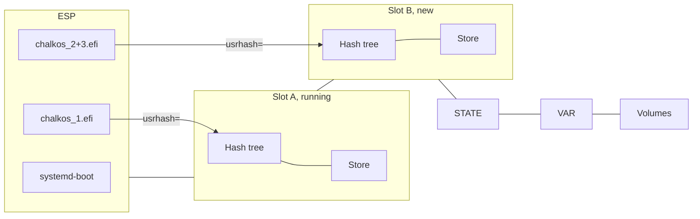
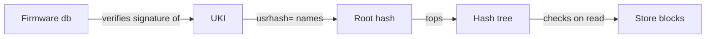

# The image

An image is the whole operating system of a node in one unsigned raw disk image: systemd-boot, a
UKI with the kernel and initrd, and a read-only Nix store. `chalkos.lib.mkImages` builds one per
variant and platform, and every node of that variant and platform boots the same bytes. The
diagram shows a node's system disk after an upgrade, with the image it runs in slot A and the new
one in slot B.

The ESP, the two slots and STATE form the system region, which the image fixes. VAR and the
volumes come from the node's config. One signature on the UKI covers the whole store, so the
firmware's signature check extends to every block the node reads, and an upgrade replaces all of
it at once.

## An image holds the ESP and one slot

The raw image holds three partitions:

- the ESP, 1 GiB, with systemd-boot as `/EFI/BOOT/BOOTX64.EFI`, or `BOOTAA64.EFI` on arm64, and
  the UKI as `/EFI/Linux/chalkos_1.efi`;
- slot A's hash tree, 128 MiB, labelled `store-verity_<hash16>`;
- slot A's data, 3 GiB, the store as erofs, labelled `store_<hash16>`.

On the image's first boot, systemd-repart in the initrd adds slot B, two partitions of the same
sizes labelled `_empty`, and STATE, 128 MiB, encrypted and sealed to the TPM. The installer lays
out the same partitions on its target disk in one run. VAR and further volumes come from the
node's `SystemDisk` and `Volume` documents at install, as [Storage and encryption](storage.md)
describes.

The sizes are the defaults of the image's
[`chalkos.disk`](../../reference/image-options.md#chalkosdiskstoresize) options. A slot's size is fixed at
install, and it is the room every later upgrade has.
[Image and partition layout](../../reference/image-layout.md) lists every partition with its GPT
type and label.

## A node cannot change its own system

A node built from an image cannot drift from it, because images use NixOS's image-based appliance
profile:

- There is no Nix daemon and no `switch-to-configuration`, so the system cannot be rebuilt on the
  node.
- The root file system is a tmpfs, so nothing written outside STATE and VAR survives a reboot.
- `/etc` is assembled from the image at boot and stays read-only.
- Users and groups are fixed at build time. Nodes have no interactive logins, so no account needs
  a password or an SSH key.
- The image avoids Perl and keeps interpreters out where it can.

What a node must keep goes to two partitions. STATE holds its config, certificates and secrets.
VAR, mounted at `/var`, holds what its services write and the logs.

## The store is a compressed erofs file system

A slot's data partition holds the store as an erofs file system with 4 KiB blocks. It is
compressed with zstd at level 9 in 64 KiB clusters (`-zzstd,level=9 -C65536`). These settings
come within 3% of zstd level 15's size at a sixth of its build time, and the kernel's erofs reads
zstd. An upgrade sends the compressed file system, so the compression shrinks every transfer by
the same factor.

The initrd mounts the store read-only at `/usr` and binds its `nix/store` to `/nix/store`. The
store holds no kernel and no initrd, because the UKI carries both. The build fails if anything
brings them back into the system's closure.

## dm-verity ties every block of the store to the UKI

dm-verity checks every block of the store against a hash tree when it is read, so a modified block
fails to read. The tree's top hash, the root hash, is on the UKI's kernel command line as
`usrhash=`. The firmware verifies the UKI's signature before it starts it, so its check covers the
whole store. The diagram shows the chain from the firmware's db to the blocks of the store.

The data and the hash tree both use 4 KiB blocks. dm-verity refuses blocks smaller than a disk's
logical block size, so 512-byte blocks would not open on 4Kn disks. 4 KiB blocks also make the
tree an eighth of the size, about 2 MiB for an image with Kubernetes.

The initrd finds the store by its partition UUIDs, never by its labels. systemd derives both from
the root hash: the data partition's UUID is the hash's first 128 bits, and the hash tree's is its
last 128 bits. A slot that holds another store, or a store written in part, has other UUIDs, so
the UKI cannot boot it. For the same reason kernel modules need no signatures of their own: they
live in the store, which the root hash pins.

## The UKI is checked against db and dbx before anything runs it

Three programs check a UKI's Secure Boot signature against the firmware's db and dbx:

- The firmware checks systemd-boot and the UKI at every boot, when Secure Boot is on.
- chalkd checks the UKI of an upgrade when it arrives, before it can boot.
- The installer checks the UKI and the boot loader when it receives them, before it writes them.

chalkd and the installer check only while Secure Boot is enforced: on, and not in setup mode.
They check as the firmware will at the next boot. The signature must come from a certificate in
db, or from one that a certificate in db signed. dbx must list neither the UKI's digest nor any
certificate of its signature's chain. A dbx entry of a type chalkd cannot read refuses every UKI,
because the firmware might revoke the UKI by it. A refused UKI stops the upgrade or the install
with `Secure Boot would refuse the UKI: ...`, and nothing boots it.

chalkctl checks no signature: it sends the image as the image directory holds it. `chalkbuild
sign` checks each signed copy against the certificate it signed with, so a wrong key fails on the
machine that signs. [Security model](security.md) explains what the signature protects against.

## The UKI carries the kernel, the initrd and the image's name

The UKI is one EFI binary. Its stub starts the kernel with the initrd and the command line the UKI
carries, so its signature covers all of them:

- the kernel;
- the initrd, compressed with zstd at level 19, which makes it a tenth smaller than NixOS's
  default;
- the kernel command line, with `usrhash=` and the platform's console settings;
- os-release, which names the image.

chalkd reads os-release from the UKI before it installs an image, because the signature covers
it. `IMAGE_ID` is `chalkos`, or `chalkos-installer` on the installer. `CHALKOS_VARIANT` and
`CHALKOS_PLATFORM` name the variant and platform; the installer has neither.
`CHALKOS_BOOT_TRIES` carries the image's
[`chalkos.upgrade.bootTries`](../../reference/image-options.md#chalkosupgradeboottries). `IMAGE_VERSION`
is empty, so systemd-boot orders the image's entries by their generation. chalkd refuses an image
whose image ID or platform differs from the node's. [os-release fields](../../reference/os-release.md)
lists every field.

The UKI is about 44 MiB for an image with Kubernetes. Most of it is the initrd, which carries the
file system tools systemd-repart needs to create volumes, and the libraries of systemd's TPM and
crypto support.

## The ESP holds systemd-boot and a UKI per slot

systemd-boot is the boot loader the firmware starts from the ESP's default path, so a disk boots
without a firmware boot entry. It lists the UKIs in `/EFI/Linux` and boots the first whose tries
are not used up, in an order of its own. A node names its UKIs `chalkos_<generation>.efi`. The
image and an install write generation 1, and each upgrade writes the generation above the highest
on the ESP. systemd-boot compares the numbers as numbers, so the entry an upgrade installed last
boots first, a downgrade's too. [Boot](../../reference/boot.md#systemd-boot-sort-rules) lists
systemd-boot's sort rules.

The ESP holds a UKI per slot and, during an upgrade, a third, temporary copy. An upgrade replaces
the UKI and the store, never systemd-boot, so a node keeps the boot loader it was installed with.
[Boot, health and rollback](boot-and-rollback.md) follows the boot from systemd-boot on.

## Two slots keep the previous image for a rollback

A slot is a pair of partitions that holds one image's store: its hash tree and its data. A node
has two, A and B. It boots one slot while an upgrade writes the other, so the image it ran before
stays on disk for a rollback.

Nothing records which slot is active; the partitions say it. A slot in use has the partition UUIDs
derived from its root hash and the labels `store_<hash16>` and `store-verity_<hash16>`, where
`<hash16>` is the first 16 hex characters of the root hash. A slot not in use has random UUIDs and
the label `_empty` on both partitions. The labels name the store for people and tools, and the
boot never reads them. An upgrade first gives the inactive slot random UUIDs and the label
`_empty`. It then writes the slot, verifies it, and only then gives it the UUIDs and labels of its
root hash. [Upgrades](upgrades.md) describes the steps.

## The root hash identifies an image

An image is its store's root hash. Two builds of the same modules from the same inputs (the same
chalkos, `flake.lock` and OS CA) have the same store and so the same root hash. An image that
changes in any byte of its store has another. chalkd and chalkctl compare images by the root hash
alone. An upgrade to the root hash a node runs changes nothing, and any other root hash is a new
image. No version needs raising for a new build. The build refuses `system.image.version`, because
systemd-boot would order the entries by it before their generation.

chalkctl shows an image as the first 12 hex characters of its root hash. The git tag and revision
it was built from follow when they are known, as in `3fa9c1e2b7d0 (v1.5.0, a1b2c3d4e5f6)`.
mkImages takes them as its `revision` and `tag` arguments and writes them into each image
directory's `metadata.json`. chalkctl sends them with the image, and a node keeps them in
`/state/chalkd/images.json` for status. They are provenance for display: they never reach the
store, and nothing orders or refuses an image by them.

## The image fixes the kernel, the software and the disk layout

Everything an image holds changes only with a new image and an upgrade. Everything that differs
between nodes comes in the config. [Boot and the image](../../reference/boot.md#what-an-image-fixes-and-what-config-delivers)
lists both sides.

The kernel is nixpkgs's prebuilt kernel, from its binary cache. The image carries a filtered copy
of its module tree, and module groups pick what the tree keeps. Most groups name directories of
the tree, so a kernel update brings a subsystem's new drivers along. The base groups (`storage`,
`network`, `virtualisation`, `filesystems`, `kubernetes` and `platform`) keep about a third of the
kernel's 7,300 modules, about 45 MiB of the full tree's 145 MiB. A missing module fails the build,
not the boot. The build checks that every module the image loads by name, and every dependency of
a module in the tree, is in the tree. Out-of-tree modules from NixOS's `boot.extraModulePackages`
are always included whole.

The system path holds none of NixOS's default packages, because nodes have no logins. It holds
what the image's own modules put there, such as systemd, bash, less, nftables, kmod and the mount
helpers, and what a variant adds. Each service names the tools it runs in its own path.
[`chalkos.debug.tools`](../../reference/image-options.md#chalkosdebugtools) adds coreutils, grep, sed,
findutils, procps, iproute2 and util-linux, and crictl on images with Kubernetes.
[Status, logs and the console](../../operate/status-and-logs.md#debug-tools-reach-the-node-through-kubectl-debug)
shows how they are reached.

A platform's modules come before the variant's in each of its images. chalkos's `metal` platform
sets the console to the screen and the first serial port, where a BMC's serial-over-LAN shows it.
Its `kvm` platform sets the console to the first serial port and adds the QEMU guest agent, about
6 MiB of store, limited to reporting on the node and shutting it down.
[Add software, drivers and kernel modules](../../build/add-software.md) and
[Variants and platforms](../../build/variants-and-platforms.md#a-platform-builds-an-image-per-kind-of-machine)
show how an image author changes each of these.

## Every build leaves room for the next image

An image with Kubernetes for `metal` measures about 246 MiB of store data, a 2 MiB hash tree and a
44 MiB UKI. For `kvm` the store is 6 MiB larger. An upgrade sends those three parts, about 300 MiB
per node. The raw image is 4.2 GiB of apparent size, mostly the empty room of its slot, and sparse
on disk.

Every image build checks that the image leaves room for the next one. The build fails when:

- the store's data takes more than 80% of
  [`chalkos.disk.storeSize`](../../reference/image-options.md#chalkosdiskstoresize);
- the hash tree takes more than 80% of
  [`chalkos.disk.storeVeritySize`](../../reference/image-options.md#chalkosdiskstoreveritysize);
- three UKIs, both slots' and an upgrade's temporary copy, take more than 80% of
  [`chalkos.disk.espSize`](../../reference/image-options.md#chalkosdiskespsize).

The installer is never upgraded, so its store is sized to its contents, and it is checked for one
UKI. The build checks against the sizes the image declares. A node checks an upgrade against the
slot sizes it was installed with, and refuses a store that does not fit them.

## The build is unsigned and chalkbuild signs a copy

`nix build` builds one image directory: the raw disk image together with the files that describe
its partitions and the config it accepts. The inventory names the directory, and chalkctl reads it
when it validates, installs or upgrades a node. The image is unsigned, and the signing key never
enters `/nix/store`. `chalkbuild sign` signs a copy of the directory, the boot loader and the UKIs
on its ESP, and nodes that enforce Secure Boot get the signed copy. mkImages also builds each image
as an OCI artifact, which `chalkbuild push` pushes to a registry for the nodes to pull.
[Your first image flake](../../build/first-image.md), [Sign images for Secure Boot](../../build/sign-images.md)
and [Publish images to a registry](../../build/publish-images.md) cover the build.

## Limits

- An upgrade sends the whole compressed store, its hash tree and the UKI to every node. There are
  no delta updates.
- An upgrade never replaces systemd-boot. A node keeps the boot loader it was installed with.
- Slot sizes are fixed at install. A store that outgrows the slots of installed nodes cannot be
  installed on them.
- The image carries no firmware unless a variant or platform adds it with NixOS's
  `hardware.firmware`.

## Related pages

- [Boot, health and rollback](boot-and-rollback.md) for how a node boots the image.
- [Upgrades](upgrades.md) for how a new image reaches a node.
- [Security model](security.md) for what Secure Boot and dm-verity protect against.
- [Image and partition layout](../../reference/image-layout.md) and
  [os-release fields](../../reference/os-release.md) for the details.
- [Your first image flake](../../build/first-image.md),
  [Add software, drivers and kernel modules](../../build/add-software.md) and
  [Sign images for Secure Boot](../../build/sign-images.md) for the tasks.
