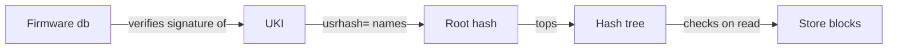

# The image

An image is the whole operating system of a node in one unsigned
raw disk image: systemd-boot, a UKI with the kernel and initrd, and
a read-only Nix store. `chalkos.lib.mkImages` builds one per
variant and platform, and
every node the [inventory](../../reference/kinds.md#inventory) runs on it boots the same bytes. One
signature on the UKI covers the whole store, so the firmware's signature check extends to every
block the node reads, and an upgrade replaces all of it at once.

## What does an image hold?

An image holds three partitions. The first boot adds the rest of the system region behind them.
The table names the x86-64 boot loader; an arm64 image has `BOOTAA64.EFI`.

| Partition | Size | Contents |
| --- | --- | --- |
| ESP | 1 GiB | systemd-boot as `/EFI/BOOT/BOOTX64.EFI` and the UKI as `/EFI/Linux/chalkos_1.efi` |
| Slot A, hash tree | 128 MiB | The store's dm-verity hash tree, labelled `store-verity_<hash16>` |
| Slot A, data | 3 GiB | The store as erofs, labelled `store_<hash16>` |

On its first boot, systemd-repart in the initrd adds slot B, two partitions of the same sizes
labelled `_empty`, and STATE, 128 MiB, encrypted and sealed to the
TPM. The installer lays out
the same partitions on its target disk in one run. VAR and further
volumes come from the node's [`SystemDisk`](../../reference/kinds.md#systemdisk) and
[`Volume`](../../reference/kinds.md#volume) documents at install. The sizes are the defaults of
[`chalkos.disk`](../../reference/options.md#chalkosdiskstoresize); a slot's size is fixed at install
and is the room every later upgrade has. [Image and partition layout](../../reference/image-layout.md)
lists every partition with its type and label.

## Why is the system read-only?

A node built from an image cannot drift from it. Images use NixOS's image-based appliance
profile:

- No Nix daemon and no `switch-to-configuration`: the system cannot be rebuilt on the node.
- The root file system is a tmpfs, so nothing written outside STATE and VAR survives a reboot.
- `/etc` is assembled from the image at boot and stays read-only.
- Users and groups are fixed at build time. Nodes have no interactive logins, so no account needs
  a password or an SSH key.
- The image avoids Perl and keeps interpreters out where it can.

What a node must keep goes to two partitions: STATE for its
config, certificates and Kubernetes secrets, and VAR at `/var`
for etcd, containerd, the kubelet and logs. [Storage and encryption](storage.md) describes both.

## How is the store built?

A slot's data partition holds the store as an erofs file system compressed with zstd at level 9
in 64 KiB clusters (`-zzstd,level=9 -C65536`), with 4 KiB blocks. These settings come within 3% of
zstd level 15's size at a sixth of its build time, and the kernel's erofs reads zstd. An upgrade
sends the compressed file system, so compression shrinks every transfer by the same factor.

The initrd mounts the store read-only at `/usr` and binds its `nix/store` to `/nix/store`. The
store holds no kernel or initrd: the UKI carries both, and the build fails if anything brings
them back into the system's closure.

## How does dm-verity protect the store?

dm-verity checks every block of the store against a hash tree when it is read, so a modified
block fails to read. The tree's top hash, the root hash, is
on the UKI's kernel command line as `usrhash=`. The UKI is signed, and
Secure Boot verifies the signature before the firmware
starts it, so the firmware's check covers the whole store.



Both the data and the hash tree use 4 KiB blocks. dm-verity refuses blocks smaller than a disk's
logical block size, so 512-byte blocks would not open on 4Kn disks; 4 KiB blocks also make the
tree an eighth of the size, about 2 MiB for an image with Kubernetes.

The initrd finds the store by its partition UUIDs, never by its labels. systemd derives both from
the root hash: the data partition's UUID is the hash's first 128 bits and the hash tree's its last
128 bits. A slot that holds another store, or a store written in part, has other UUIDs, so the
UKI cannot boot it. Kernel modules need no signatures of their own for the same reason: they live
in the store, which the root hash pins.

## What is in the UKI?

The UKI is one EFI binary with four parts that matter here:

- the kernel;
- the initrd, compressed with zstd at level 19, which makes it a tenth smaller than NixOS's
  default;
- the kernel command line, with `usrhash=` and the platform's console settings;
- os-release, which names the image.

Its os-release fields tell chalkd what an image is before it
installs it. chalkd reads them from the UKI, whose signature covers them, and refuses an image
whose ID or platform does not match the node:

| Field | Value |
| --- | --- |
| `IMAGE_ID` | `chalkos`, or `chalkos-installer` on the installer |
| `IMAGE_VERSION` | empty, so systemd-boot orders the image's entries by [generation](#how-does-systemd-boot-pick-the-uki) |
| `CHALKOS_VARIANT` | the name of the image's variant in mkImages; absent on the installer |
| `CHALKOS_PLATFORM` | the platform's name, absent on the installer |
| `CHALKOS_BOOT_TRIES` | [`chalkos.upgrade.bootTries`](../../reference/options.md#chalkosupgradeboottries) of the image |

[os-release fields](../../reference/os-release.md) lists them all.

The UKI is about 44 MiB for an image with Kubernetes, most of it the initrd, which carries the
file system tools that systemd-repart needs to create volumes and the libraries of systemd's TPM
and crypto support. The ESP holds a UKI per slot and, during an upgrade, a third, temporary copy.

## How does systemd-boot pick the UKI?

systemd-boot is the boot loader the firmware starts from the ESP's default path, so a disk boots
without a firmware boot entry. It lists the UKIs in `/EFI/Linux` and boots the first whose tries
are not used up, in its own order: entries with no tries left last, then by image ID, lowest
first, then by `IMAGE_VERSION` and by file name, highest first. A UKI of another image whose image
ID sorts before `chalkos` therefore boots first; chalkos never puts one on the ESP. Every chalkos
image sets `IMAGE_VERSION` empty, so among its UKIs the file name decides. A node names its UKIs
`chalkos_<generation>.efi`: the image and an install write generation 1, and each upgrade writes
the generation above the highest on the ESP. systemd-boot compares the numbers as numbers, so
`chalkos_10.efi` comes before `chalkos_9.efi`, and the entry an upgrade installed last boots
first, a downgrade's too.
[Boot, health and rollback](boot-and-rollback.md) follows the boot from there.

An upgrade replaces the UKI and the store, never systemd-boot: the boot loader a node was
installed with stays.

## What are slots A and B?

A slot is a pair of partitions that holds one image's store: its
hash tree and its data. A node has two, A and B, which is the A/B
scheme: the node boots one slot while an upgrade writes the other, so the image it ran before
stays on disk for a rollback.

Nothing records which slot is active. The partitions say it, here with the GPT types of an x86-64
image:

| Partition | GPT type | Label | Partition UUID |
| --- | --- | --- | --- |
| Hash tree of a slot in use | `usr-x86-64-verity` | `store-verity_<hash16>` | the root hash's last 128 bits |
| Data of a slot in use | `usr-x86-64` | `store_<hash16>` | the root hash's first 128 bits |
| Either partition of a slot not in use | as above | `_empty` | random |

`<hash16>` is the first 16 hex characters of the slot's root hash. The labels name the store for
people and tools; the boot never reads them. An upgrade first gives the inactive slot random UUIDs
and the label `_empty`, writes it, verifies it and only then gives it the UUIDs and labels of its
root hash. [Upgrades](upgrades.md) describes the steps.

## What identifies an image?

An image is its store's root hash. Two builds of the same
modules from the same inputs, the same chalkos, `flake.lock` and OS CA, have the same store and so
the same root hash, and an image that changes in any byte of its store has another. chalkd and
chalkctl compare images by it alone: an upgrade to the root
hash a node runs is installed already and changes nothing, and any other is a new image. No
version needs raising for a new build. The build refuses `system.image.version`, because
systemd-boot would order the entries by it before their generation.

chalkctl shows an image as the first 12 hex characters of its root hash, followed by the git tag
and revision it was built from when they are known, such as `3fa9c1e2b7d0 (v1.5.0, a1b2c3d4e5f6)`.
mkImages takes them as its `revision` and `tag` arguments and writes them into each image
directory's `metadata.json`; chalkctl sends them with the image, and a node keeps them in
`/state/chalkd/images.json` for status. They are provenance for display: they never reach the
store, and nothing orders or refuses an image by them.

## What does a platform add?

A platform's NixOS modules come before the variant's in each of its images. chalkos's `metal`
platform sets the console to the screen and the first serial port, where a BMC's serial-over-LAN
shows it. Its `kvm` platform sets the console to the first serial port and adds the QEMU guest
agent, about 6 MiB of store, limited to reporting on the node and shutting it down. A platform the
flake names in mkImages' [`platforms`](../../reference/options.md#platforms) adds firmware, kernel
module groups or agents to the images for that kind of machine alone.
[Variants and platforms](../../build/variants-and-platforms.md#a-platform-builds-an-image-per-kind-of-machine) explains platforms.

## Which kernel modules does an image carry?

An image carries a filtered copy of nixpkgs's prebuilt kernel module tree, so the kernel itself is
nixpkgs's and comes from its binary cache. Module groups,
listed in [`chalkos.kernel.moduleGroups`](../../reference/options.md#chalkoskernelmodulegroups), pick
what the tree keeps. Most groups name directories of the tree, so a kernel update brings a
subsystem's new drivers along.

| Groups | Included by default | What they cover |
| --- | --- | --- |
| `storage`, `network`, `virtualisation`, `filesystems`, `kubernetes`, `platform` | yes | Disk controllers, wired Ethernet, virtio and other hypervisors' drivers, the file systems nodes and CSI drivers mount, netfilter and traffic control, TPM, watchdogs, IPMI, sensors and the console's keyboard |
| `gpu`, `sound`, `media`, `wireless`, `infiniband`, `can`, `industrial` | no | Added per variant or platform, for example `chalkos.kernel.moduleGroups = [ "gpu" ];` |

A variant's or platform's modules add to the base groups, and `lib.mkForce` replaces them.
[`chalkos.kernel.extraModules`](../../reference/options.md#chalkoskernelextramodules) adds single
modules by name with their dependencies, and
[`chalkos.kernel.allModules`](../../reference/options.md#chalkoskernelallmodules) keeps the whole
tree. Out-of-tree modules from NixOS's `boot.extraModulePackages` are always included whole.

The base groups keep about a third of the kernel's 7,300 modules, about 45 MiB of the full
tree's 145 MiB. A missing module fails the build, not the boot: the build checks that every
module the image loads by name, and every dependency of a module in the tree, is in the tree.
[Add software, drivers and kernel modules](../../build/add-software.md) adds drivers and
firmware.

## What is on the system path?

Nodes have no logins, so the system path holds none of NixOS's default packages: only what the
image's own modules put there, such as systemd, bash, less, nftables, kmod and the mount helpers,
and what a variant adds. Each service names the tools it runs in its own path.

[`chalkos.debug.tools`](../../reference/options.md#chalkosdebugtools) adds coreutils, grep, sed,
findutils, procps, iproute2 and util-linux, and crictl on images with Kubernetes. They are used
from a privileged pod that enters the node's root:

```sh
kubectl debug node/<node> -it --profile=sysadmin --image=busybox -- \
  chroot /host /run/current-system/sw/bin/bash
```

`<node>` is the Kubernetes node's name. `--profile=sysadmin` makes the pod privileged, which
tools such as `nft` need; kubectl's default profile leaves it without their capabilities. A node
has no `/bin/bash`, so the command names the system path's.

## How large is an image?

An image with Kubernetes for `metal` measures about 246 MiB of store data, a 2 MiB hash tree and
a 44 MiB UKI; for `kvm`, 6 MiB more store. An upgrade sends those three parts, about 300 MiB per
node. The raw image is 4.2 GiB of apparent size, mostly the empty room of its slot, and sparse on
disk.

Every image build checks that the image leaves room for the next one. The build fails when:

- the store's data takes more than 80% of
  [`chalkos.disk.storeSize`](../../reference/options.md#chalkosdiskstoresize);
- the hash tree takes more than 80% of
  [`chalkos.disk.storeVeritySize`](../../reference/options.md#chalkosdiskstoreveritysize);
- three UKIs, both slots' and an upgrade's temporary copy, take more than 80% of
  [`chalkos.disk.espSize`](../../reference/options.md#chalkosdiskespsize).

The installer, which is never upgraded, has a store sized to its contents and is checked for one
UKI. The check runs against the sizes the image declares; a node checks an upgrade against the
slot sizes it was installed with, and refuses a store that does not fit them.

## How is an image built?

`nix build` builds one image directory: the image of one variant on one platform,
`images.<variant>-<platform>` of the flake's mkImages call. The directory holds the raw disk
image, systemd-repart's report of its partitions, the partition definitions the installer lays
out, and the files that say what the image is and which config it accepts. The inventory names the
directory, and chalkctl reads it when it validates, installs or upgrades a node.
[Your first image flake](../../build/first-image.md) builds one and lists its files.

The image is unsigned, and the signing key never enters `/nix/store`.
[`chalkbuild sign`](../../reference/cli/chalkbuild_sign.md) signs a copy of the image directory: the
boot loader and the UKIs on the raw image's ESP. chalkctl installs and upgrades nodes that enforce
Secure Boot with the signed copy.
[Sign images for Secure Boot](../../build/secure-boot-signing.md) covers the keys.

`mkImages` also builds each image as an OCI artifact, `oci.<variant>-<platform>`: an OCI image
layout that holds the store, the hash tree, the UKI, the boot loader and the contract as layers.
[`chalkbuild push`](../../reference/cli/chalkbuild_push.md) pushes it to a registry, and an inventory
names the pushed reference in place of a directory; `chalkctl install` and `chalkctl upgrade`
then have the node pull it.
[Publish images to a registry](../../build/publish-images.md) covers the steps.

## Limits

- An upgrade sends the whole compressed store, about 250 MiB for an image with Kubernetes, to
  every node; there are no delta updates.
- An upgrade never replaces systemd-boot. A node keeps the boot loader it was installed with.
- Slot sizes are fixed at install. A store that outgrows the slots of installed nodes cannot be
  installed on them.
- The image carries no firmware unless a variant or platform adds it with NixOS's
  `hardware.firmware`.

## Related pages

- [Your first image flake](../../build/first-image.md) for how mkImages builds the images.
- [Boot, health and rollback](boot-and-rollback.md) for how a node boots the image.
- [Upgrades](upgrades.md) for how a new image reaches a node.
- [Security model](security.md) for what Secure Boot and dm-verity protect against.
- [Image and partition layout](../../reference/image-layout.md) and
  [os-release fields](../../reference/os-release.md) for the details.
- [Customise an image](../../build/customise-image.md),
  [Add software, drivers and kernel modules](../../build/add-software.md) and
  [Sign images for Secure Boot](../../build/secure-boot-signing.md) for the tasks.
